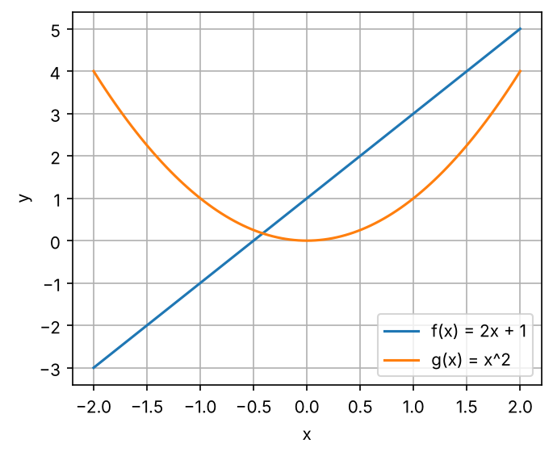

import { Aside, LinkButton } from '@astrojs/starlight/components';
import CompoundDemo from '../../../components/CompoundDemo.tsx';
import ExpLogMirror from '../../../components/ExpLogMirror.tsx';
import SigmaLoopDemo from '../../../components/SigmaLoopDemo.tsx';
import SequenceProbDemo from '../../../components/SequenceProbDemo.tsx';

<Aside type="note" title="影片">
本集影片製作中，完成後會放在這裡。
</Aside>

## 這集要解決什麼問題

EP01 從零寫出了 Softmax，也就是 EP00 地圖上第 ⑥ 站「分數 → 機率」的那一步：

$$
p_i = \frac{e^{z_i}}{\sum_j e^{z_j}}
$$

白話：第 $i$ 個候選 token 的分數 $z_i$ 先變成 $e^{z_i}$，再除以所有候選的 $e^{z_j}$ 加起來的總和，就是它的機率 $p_i$。

<Aside type="tip" title="小提醒">

沒看過前兩集也沒關係，這集只需要兩個前提。EP00：LLM 每一步會替詞彙表裡的每個 token 打一個分數（logits），再用 Softmax 換成機率。EP01：我們在自己的電腦建了一個叫 `llm-labs` 的 Python 專案，用 NumPy 從零寫出 `ep01/softmax.py` 裡的 `softmax`，並用 `uv run pytest` 跑測試。這集的程式接著寫在 `llm-labs` 裡；還沒有這個專案的話，先照 EP01 第一部分建好（步驟 7 的 PyTorch 可以先跳過），再把 EP01 動手做的參考解答存成 `ep01/softmax.py`，這集的測試會匯入它。

</Aside>

寫 Softmax 的時候，有幾個地方我們只是「先照做」：

| 符號 | 目前知道的 | 還沒回答的 | 在哪裡回答 |
|---|---|---|---|
| 整條式子 | 一組分數進去，一組機率出來 | 這是哪一種「函數」？ | 工具一 |
| $e$、$e^{z_i}$ | $e$ 約是 2.718；$e^{z_i}$ 永遠是正數，$z_i$ 越大它越大 | $e$ 從哪裡來？為什麼偏偏用它？ | 工具二、三 |
| $\sum_j$ | 全部加起來 | 上下標怎麼念？為什麼分母用 $j$、不用 $i$？ | 工具四 |
| EP01 第 4 個測試的 `np.log` | 叫「對數」 | 為什麼機率取 log 再做 Softmax，會剛好還原成原本的機率？ | 工具三 |

之後幾乎每條公式（損失函數、注意力、訓練）都是用這些符號寫的。所以這集先學讀公式的語言，一共四個工具：**函數、指數、對數、Σ 與 Π**。最後會看到這集最重要的一件事：**對數把乘法變成加法**，這就是訓練模型時到處都是 $\log$ 的原因。

學完這集，你應該能：

- 把 Softmax 公式的每個符號念出來，說出它在做什麼。
- 用 $f(x)$ 描述函數，說明合成函數與反函數，並用 matplotlib 畫出函數圖。
- 用指數律化簡次方，說出 $e$ 從哪裡來、Softmax 為什麼用 $e^{z}$。
- 說出 $\log_b y$ 的意思、用對數律化簡，知道 `np.log` 是以 $e$ 為底的對數。
- 把 $\sum$、$\prod$ 翻成 for 迴圈和一行 NumPy，不犯「差一個」的錯。
- 解釋為什麼一句話的機率要用 log 機率的加總來算，並從零寫出數值穩定的 `logsumexp` 和 `log_softmax`，通過測試。

## 準備：開一個邊讀邊跑的 notebook

在 Ubuntu 終端機進到 EP01 建好的專案，建立這集的資料夾（`ep02/__init__.py` 是空檔案，和 EP01 的 `ep01/__init__.py` 一樣，讓 Python 把 `ep02` 當成可以匯入的套件）：

```bash
cd ~/code/llm-labs
mkdir -p ep02 && touch ep02/__init__.py
```

接著在 VS Code 新增 `ep02/playground.ipynb`，kernel 選 `.venv`，第一個 cell 寫：

```python
import sys
sys.path.append("..")    # 讓 Python 也到上一層（llm-labs）找程式

import math
import numpy as np
from ep01.softmax import softmax
```

VS Code 會在 notebook 所在的 `ep02/` 執行程式；`sys.path` 是 Python 找模組的資料夾清單，加入上一層 `..`（`llm-labs`），才匯入得到 EP01 的 `softmax` 和等一下要寫的 `ep02/mathlang.py`。`math` 是 Python 內建的數學模組。也可以直接打開這集的 notebook 邊讀邊跑，裡面已經定義好 `softmax`，不用匯入。

<LinkButton href="https://colab.research.google.com/github/chainchen1103/llm-from-scratch/blob/main/notebooks/ep02/ep02_math_language.ipynb" icon="external" target="_blank" rel="noopener noreferrer">在 Colab 開啟 notebook</LinkButton>
<LinkButton href="https://github.com/chainchen1103/llm-from-scratch/blob/main/notebooks/ep02/ep02_math_language.ipynb" variant="secondary" target="_blank" rel="noopener noreferrer">在 GitHub 查看</LinkButton>

<Aside type="tip" title="小提醒">

接下來的程式區塊裡，`print()` 那一行後面的註解（迴圈則寫在迴圈下方）就是印出來的結果，其他註解是說明。有些運算還會跳出 `RuntimeWarning` 警告（例如溢位），註解會在括號裡註明；警告不是錯誤，程式會照常往下跑。

</Aside>

## 工具一：函數

### 輸入 → 輸出的機器

**函數 function** 像一台機器：放一個東西進去，照固定的規則，出來一個東西。數學寫成 $f(x)$：$f$ 是函數的名字，$x$ 是輸入，$f(x)$（念「f of x」）是輸出。例如 $f(x) = 2x + 1$ 的意思是「輸入乘 2 再加 1」，所以 $f(3) = 7$。

同一個函數有三種寫法：**公式**（$2x + 1$）、**表格**（$x = -2, -1, 0, 1, 2$ 分別對到 $-3, -1, 1, 3, 5$）、**圖**（把每一組 $(x, f(x))$ 當成點連起來）。Python 的 `def` 就是函數（程式裡習慣叫「函式」），還能一次把整個 NumPy 陣列丟進去，每個元素各算一次（EP01 的向量化）：

```python
def f(x):
    return 2 * x + 1

print(f(3))                              # 7
print(f(np.array([-2, -1, 0, 1, 2])))    # [-3 -1  1  3  5]
```

### 畫函數圖

`matplotlib` 是 EP01 步驟 6 裝進專案的畫圖套件，`plt` 是大家習慣的簡稱：

```python
import matplotlib.pyplot as plt

x = np.linspace(-2, 2, 101)              # -2 到 2 平均切 101 個點
fig, ax = plt.subplots(figsize=(5, 4))   # 一張圖、一組座標軸
ax.plot(x, f(x), label="f(x) = 2x + 1")  # 101 個點連成線
ax.plot(x, x**2, label="g(x) = x^2")
ax.set(xlabel="x", ylabel="y")
ax.legend()                              # 顯示每條線的名字
ax.grid(True)                            # 加上格線
fig.savefig("first_plot.png", dpi=150, bbox_inches="tight")
```



圖會直接顯示在 cell 下方；最後一行另外存成 `ep02/first_plot.png`（`dpi` 是解析度，`bbox_inches="tight"` 讓存檔時不切到座標軸的文字）。圖上的文字先用英文，因為 matplotlib 預設的字型沒有中文，會變成方框。之後畫損失曲線，就是把 $x$ 換成訓練步數、$y$ 換成損失。

### 輸入、輸出不一定是一個數

$f(x) = 2x + 1$ 是「一個數進、一個數出」。函數的輸入和輸出也可以是一整排數字，或有好幾個輸入（例如 $f(x, y) = xy$）：

```python
z = np.array([1.0, 2.0, 3.0])
print(np.sum(z))                            # 6.0
print(softmax(z))                           # [0.09003057 0.24472847 0.66524096]
print(softmax(np.array([1.0, 2.0, 5.0])))   # [0.01714783 0.04661262 0.93623955]
```

- 加總是「一排數字進、一個數出」：形狀 `(3,)` 進去，一個數出來。
- **Softmax 是「一排數字進、一排數字出」**：形狀 `(3,)` 進去，形狀 `(3,)` 出來。這種「一排數字」叫向量，現在先把它想成一維陣列，EP03 會正式介紹。
- 第三行只把第 3 個分數從 3 改成 5，前兩個機率也跟著變了（0.090 → 0.017、0.245 → 0.047）。因為分母 $\sum_j e^{z_j}$ 用到了**所有**分數，Softmax 的每個輸出都由整個輸入向量決定。

### 合成函數與反函數

把一個函數的輸出，直接當成另一個函數的輸入，叫**合成函數 composite function**，寫成 $f(g(x))$：先把 $x$ 丟進 $g$，再把結果丟進 $f$。反過來，把結果復原成原本輸入的函數，叫**反函數 inverse function**，寫成 $f^{-1}$。$f(x) = 2x + 1$ 是「乘 2 再加 1」，倒過來「減 1 再除以 2」就是它的反函數 $f^{-1}(y) = (y - 1)/2$：拿到輸出 $y$，就能算回原本的輸入。

```python
def g(x):
    return x ** 2

def f_inv(y):
    return (y - 1) / 2

print(f(g(3)), g(f(3)))           # 19 49
print(f_inv(f(3)), f(f_inv(7)))   # 3.0 7.0
```

- **順序很重要**：$f(g(3)) = f(9) = 19$，$g(f(3)) = g(7) = 49$。
- **LLM 就是一個很長的合成函數**。以 EP00 的 Qwen2.5-0.5B 為例，大致是「嵌入 → 第 1 層 → 第 2 層 → ⋯ → 第 24 層 → 反嵌入 → Softmax」，每一步的輸出都是下一步的輸入。EP05 的鏈鎖律 chain rule，算的就是「最裡面的輸入動一點，最外面的輸出會動多少」。
- $f^{-1}$ 念「f 的反函數」。這裡的 $-1$ **不是**次方，$f^{-1}(x)$ 不是 $1/f(x)$。
- 不是每個函數都能復原：$g(x) = x^2$ 把 $2$ 和 $-2$ 都變成 $4$，看到 $4$ 不知道原本是哪一個。不同的輸入一定給出不同的輸出，才有反函數；一路往上爬的函數（**遞增 increasing**：輸入越大、輸出越大）一定符合。下一個工具的 $e^x$ 就是遞增的，它的反函數就是工具三的對數。

## 工具二：指數與 e

### 次方與指數律

$a^n$ 念「a 的 n 次方」，意思是 $n$ 個 $a$ 相乘，例如 $2^3 = 2 \times 2 \times 2 = 8$。$a$ 叫**底數 base**，$n$ 叫**指數 exponent**。次方的計算規則合稱**指數律 laws of exponents**（這裡的底數 $a$ 都是正數，$\cdot$ 和 $\times$ 一樣是乘號）：

| 規則 | 例子 | 為什麼 |
|---|---|---|
| $a^m \cdot a^n = a^{m+n}$ | $2^3 \cdot 2^2 = 2^5 = 32$ | 3 個 2 和 2 個 2 排在一起，是 5 個 2 |
| $a^m / a^n = a^{m-n}$ | $2^5 / 2^2 = 2^3$ | 上下約掉 2 個 2 |
| $(a^m)^n = a^{mn}$ | $(2^3)^2 = 2^6$ | 3 個 2 一組，共 2 組 |
| $a^0 = 1$ | $2^3 / 2^3 = 2^0 = 1$ | 套第二條 |
| $a^{-n} = 1/a^n$ | $2^{-3} = 1/8$ | $2^{-3} = 2^{0-3} = 2^0 / 2^3$ |
| $a^{1/2} = \sqrt{a}$ | $9^{1/2} = 3$ | $a^{1/2} \cdot a^{1/2} = a^{1/2 + 1/2} = a^1$，平方是 $a$ 的正數就是 $\sqrt{a}$ |

前三條可以直接數出來。後三條沒辦法用「幾個 $a$ 相乘」來數（「負 3 個 2 相乘」是什麼？），它們是延伸出來的定義：這樣定義，前兩條規則才能繼續成立（看「為什麼」那一欄）。**最重要的是第一條：相乘＝指數相加**，後面的對數和本集重點都靠它。

```python
print(2**3, 2**3 * 2**2, 2**5)      # 8 32 32
print(2**0, 2**-3, 9**0.5)          # 1 0.125 3.0
print(2**10, 2**20, 2**30)          # 1024 1048576 1073741824
print(np.finfo(np.float64).max)     # 1.7976931348623157e+308
print(np.float64(2.0) ** 1024)      # inf（附 RuntimeWarning: overflow encountered in scalar power）
```

第三行是**指數成長 exponential growth**：以 2 為底，指數每加 10，結果就約乘上 1000 倍（$2^{10} = 1024$）。第四行的 `np.finfo(np.float64).max` 是 `float64` 能存的最大數，約 $1.8 \times 10^{308}$（`e+308` 是科學記號，代表乘上 $10^{308}$；這個 `e` 和下一節的自然常數 $e$ 無關）。它略小於 $2^{1024}$，所以最後一行的 $2^{1024}$ 溢位成 `inf`。這裡特地用 NumPy 的 `float64`：Python 的整數沒有大小上限（`2**1024` 會印出一個 309 位數），Python 的小數 `2.0 ** 1024` 則會直接報錯 `OverflowError`。

### e 從哪裡來

**用複利找到它。** 存 1 元、年利率 100%：一年結算一次，年底拿到 2 元。改成半年結算一次、每次給 50% 的利息，前半年的利息在後半年也會生利息，年底是 $(1 + \frac{1}{2})^2 = 2.25$ 元。一年結算 $n$ 次、每次給 $\frac{1}{n}$ 的利息，錢每次都變成 $1 + \frac{1}{n}$ 倍，年底就有 $(1 + \frac{1}{n})^n$ 元。結算得越頻繁，錢會無限變多嗎？

```python
for n in [1, 2, 12, 365, 1_000_000]:     # 每年、每半年、每月、每天、每百萬分之一年
    print(n, (1 + 1 / n) ** n)
# 1 2.0
# 2 2.25
# 12 2.613035290224676
# 365 2.7145674820219727
# 1000000 2.7182804690957534
```

不會。它越來越靠近 2.71828⋯ 這個數。這個數叫**自然常數 e**，以數學家 Euler 的名字命名（$e = 2.718281828459045\ldots$），和 $\pi$ 一樣是無限不循環小數。（`1_000_000` 就是 1000000，底線只是方便閱讀。）

<CompoundDemo client:visible />

**另一種算出 $e$ 的方法：一直加下去。** 先認識一個符號：$k!$ 念「k 的**階乘 factorial**」，是 $1 \times 2 \times \cdots \times k$，例如 $4! = 24$；另外規定 $0! = 1$。

$$
e = \frac{1}{0!} + \frac{1}{1!} + \frac{1}{2!} + \frac{1}{3!} + \cdots = \sum_{k=0}^{\infty} \frac{1}{k!}
$$

白話：$1 + 1 + \frac{1}{2} + \frac{1}{6} + \frac{1}{24} + \cdots$ 一直加下去，後面的項越來越小，總和就是 $e$。$\sum$ 先看成「把後面那一串全部加起來」（工具四會細講），$\infty$ 念「無限大」，意思是一直加下去。像這樣無限多項加起來的式子，叫**級數 series**。

```python
print(sum(1 / math.factorial(k) for k in range(10)))   # 2.7182815255731922
print(math.e)                                          # 2.718281828459045
```

`math.factorial(k)` 算 $k!$。第一行讓 `k` 依序是 0、1、⋯、9，把每個 `1 / math.factorial(k)` 加起來，也就是 $k = 0$ 到 $9$ 這 10 項。只加 10 項，小數點後 6 位就和 `math.e` 一樣了，比複利結算一百萬次還準。同樣的級數也能算 $e$ 的任何次方：

$$
e^x = \sum_{k=0}^{\infty} \frac{x^k}{k!} = 1 + x + \frac{x^2}{2!} + \frac{x^3}{3!} + \cdots
$$

白話：$x = 1$ 時就是上面那條 $e$ 的級數；換成別的 $x$，就得到 $e^x$。動手做會用它從零寫出 `exp_series`，並和 `math.exp` 比對。為什麼這條級數剛好等於 $e^x$，要等 EP04 學了導數 derivative 才能說明。

### 指數函數 eˣ

以 $e$ 為底數、$x$ 當輸入，就是**指數函數 exponential function** $e^x$，也寫成 $\exp(x)$。NumPy 是 `np.exp`：

```python
x = np.array([-2.0, -1.0, 0.0, 1.0, 2.0])
print(np.exp(x))                              # [0.13533528 0.36787944 1.         2.71828183 7.3890561 ]
print(np.exp(2 + 3), np.exp(2) * np.exp(3))   # 148.4131591025766 148.4131591025766
print(np.exp(-1000.0), np.exp(1000.0))        # 0.0 inf（附 RuntimeWarning: overflow encountered in exp）
```

它有四個性質：**永遠是正數**（$e^{-2} \approx 0.135$，$\approx$ 念「約等於」；再負也只是越來越靠近 0）、**遞增**、$e^0 = 1$、$e^{a+b} = e^a \cdot e^b$（指數律第一條，第二行驗證了它）。最後一行提醒我們電腦的限制：數學上 $e^{-1000}$ 是一個正數，只是太小，電腦存成 `0.0`；$e^{1000}$ 太大，存成 `inf`。本集重點會處理這兩件事。另外，$e^x$ 的曲線在每一點的斜率 slope（有多陡）剛好等於它自己的值，EP04 會看到這有多方便。

### 為什麼 Softmax 用指數函數

分數 logits 可以是任何數，包括負數。要把它變成機率，這個函數需要做到三件事：

1. **輸出一定是正的**。直接拿分數除以總和就不行：`z = np.array([-1.0, 2.0])` 的 `z / z.sum()` 是 `[-1.  2.]`，「機率」變成 −1 和 2。$e^{z}$ 永遠是正數，除以總和之後每一項都在 0 和 1 之間。
2. **保持大小順序**：分數越高，機率越高。$e^x$ 是遞增的；換成 $x^2$ 就不行，$-3$ 和 $3$ 會變得一樣大。
3. **只看差距**。用指數律，兩個機率的比值是 $\dfrac{p_i}{p_j} = \dfrac{e^{z_i}}{e^{z_j}} = e^{z_i - z_j}$：$p_i$ 和 $p_j$ 的分母是同一個總和，相除時約掉了，只剩兩個分子相除，也就是指數相減。所以**分數差 1，機率就差 $e \approx 2.718$ 倍**，跟分數本身是多少無關。

```python
z = np.array([1.0, 2.0, 3.0])
p = softmax(z)
print(p[1] / p[0], p[2] / p[1], np.e)   # 2.718281828459045 2.718281828459045 2.718281828459045
q = softmax(z / 2)                      # 溫度 T = 2
print(q)                                # [0.18632372 0.30719589 0.50648039]
print(q[1] / q[0], np.exp(0.5))         # 1.648721270700128 1.6487212707001282
```

這也從另一個角度解釋了 EP01 的「每個分數都減掉同一個數，Softmax 的結果不變」：差距沒變，比值就沒變。**溫度**也是同一件事：EP00 的溫度是把分數除以 $T$ 再做 Softmax，分數的差距就變成原本的 $1/T$ 倍。$T = 2$ 時，分數差 1 只讓機率差 $e^{0.5} \approx 1.65$ 倍，機率變得比較平均。（最後一行兩個數的最後一位不同，是 EP01 弄壞它 3 看過的小數誤差。）那 $2^z$、$10^z$ 呢？它們其實也符合這三點；為什麼偏偏用 $e$，學完對數再回答。

## 工具三：對數

### 對數：指數的反函數

$b^x$ 是「給次方，求結果」。反過來「給結果，求次方」，就是**對數 logarithm**：$\log_b y$ 念「以 $b$ 為底，$y$ 的對數」，意思是「$b$ 的幾次方等於 $y$」。也就是說，$b^x = y$ 和 $x = \log_b y$ 是同一件事。這裡的底數 $b$ 是不等於 1 的正數（1 的任何次方都是 1），$y$ 要是正數（下一節說明為什麼）。例如 $\log_{10} 1000 = 3$（因為 $10^3 = 1000$）、$\log_2 8 = 3$、$\log_{10} 1 = 0$（$10^0 = 1$）、$\log_2 0.5 = -1$（$2^{-1} = 0.5$）、$\log_{10} 2 \approx 0.301$（$10^{0.301} \approx 2$）。

以 $e$ 為底的對數叫**自然對數 natural logarithm**，寫成 $\ln$。**機器學習的論文裡，沒寫底數的 $\log$ 幾乎都是 $\ln$**，NumPy 也一樣：`np.log` 就是 $\ln$，以 2 和 10 為底的另外叫 `np.log2`、`np.log10`。

```python
print(np.log10(1000), np.log2(8), np.log10(2))   # 3.0 3.0 0.3010299956639812
print(np.log(np.e), np.log(1), np.log(np.e**2))  # 1.0 0.0 2.0
```

### 對數律：每一條都來自指數律

先用 10 為底心算：$100 \times 1000 = 10^2 \times 10^3 = 10^{2+3} = 10^5$，取 $\log_{10}$ 就是 $2 + 3 = 5$。**兩個數相乘，對數相加。** 換成 $e$ 也一樣：令 $a = e^m$、$b = e^n$，也就是 $m = \ln a$、$n = \ln b$，那麼 $ab = e^m \cdot e^n = e^{m+n}$，所以：

$$
\ln(ab) = m + n = \ln a + \ln b
$$

白話：相乘之後取對數，等於各自取對數再相加。

對數的規則合稱**對數律 laws of logarithms**，每一條都是用同一招，把一條指數律翻過來（$a$、$b$ 都要是正數；照論文的習慣，沒寫底數的 $\log$ 就是 $\ln$，換成其他底數也一樣成立）：

| 對數律 | 來自哪一條指數律 |
|---|---|
| $\log(ab) = \log a + \log b$ | $e^m \cdot e^n = e^{m+n}$ |
| $\log(a/b) = \log a - \log b$ | $e^m / e^n = e^{m-n}$ |
| $\log(a^k) = k \log a$ | $(e^m)^k = e^{km}$ |
| $\log 1 = 0$ | $e^0 = 1$ |

```python
a, b = 2.0, 3.0
print(np.log(a * b), np.log(a) + np.log(b))   # 1.791759469228055 1.791759469228055
print(np.log(a / b), np.log(a) - np.log(b))   # -0.40546510810816444 -0.4054651081081645
print(np.log(a ** 5), 5 * np.log(a))          # 3.4657359027997265 3.4657359027997265
print(np.log(np.array([1.0, 0.5, 0.293, 0.01])))   # [ 0.         -0.69314718 -1.22758267 -4.60517019]
print(np.log(0.0))    # -inf（附 RuntimeWarning: divide by zero encountered in log）
print(np.log(-1.0))   # nan（附 RuntimeWarning: invalid value encountered in log）
```

- **第一條就是這集的主角：對數把乘法變成加法。**（第二行最後幾位不同，又是小數誤差。）
- 機率在 0 到 1 之間，所以**機率的對數都 ≤ 0**，機率越小越負。第四行的 0.293 是 EP00 裡「今天天氣很」後面接「冷」的機率 29.3%，它的對數是 $-1.228$。
- $\ln 0$：沒有任何次方能讓 $e^x$ 剛好等於 0，所以 0 沒有對數；只是 $x$ 越接近 0，$\ln x$ 就越往負的方向掉、沒有底，NumPy 用 `-inf`（負無限大）表示。$\ln(-1)$：$e^x$ 永遠是正數，不可能等於 $-1$，也沒有答案，NumPy 給 `nan`（not a number）。

### ln x 是 eˣ 的鏡像，而且會把大數「壓扁」

反函數把輸入和輸出對調：$e^0 = 1$，所以 $\ln 1 = 0$；$e^1 = e$，所以 $\ln e = 1$。一般來說，點 $(a, b)$ 在 $y = e^x$ 的曲線上，點 $(b, a)$ 就在 $y = \ln x$ 上。把兩條曲線畫在一起，它們以斜線 $y = x$ 為鏡子，互相對稱。鏡像也說明了 $\ln x$ 為什麼爬得非常慢：$e^x$ 往上衝得多快，$\ln x$ 就往右爬得多慢。

<ExpLogMirror client:visible />

```python
V = 151936                                # Qwen2.5-0.5B 的詞彙表大小
print(np.log(1_000_000))                  # 13.815510557964274
print(np.log10(V), np.log2(V))            # 5.181660688602459 17.213104219641906
print(np.log(np.finfo(np.float64).max))   # 709.782712893384
print(np.exp(709.0), np.exp(710.0))       # 8.218407461554972e+307 inf（附 RuntimeWarning: overflow encountered in exp）
```

- $\ln 1{,}000{,}000$ 只有約 13.8：對數會把很大的數「壓扁」成好處理的大小。
- $V$ 是 EP00 的 Qwen2.5-0.5B 詞彙表裡的 token 數，也就是模型每一步要打的分數個數。$\log_{10} V \approx 5.18$，介於 5 和 6 之間，所以 $V$ 是 6 位數。$\log_2 V \approx 17.2$，所以 $2^{17} < V < 2^{18}$。17 個二進位數字（每個是 0 或 1）只能排出 $2^{17} = 131{,}072$ 種編號，不夠；要 18 個（262,144 種）才夠替每個 token 編號。EP07 會用 $\log_2$ 來量「資訊有多少」，單位就是**位元 bit**。
- `float64` 最大值的 $\ln$ 約是 709.78：這就是 EP01 說「$e^{710}$ 會溢位」的原因。最後一行驗證：$e^{709}$ 還存得下，$e^{710}$ 就變成 `inf`。

### 回到 EP01 的測試 4

EP01 的第 4 個測試用 `np.log` 從 EP00 溫度元件的 5 個機率反推出分數；EP01 說過，這組分數直接做 Softmax，會剛好還原成原本的機率。為什麼？令分數 $z_j = \ln p_j$，而所有 $p_j$ 加起來是 1：

$$
\text{softmax}(\ln p)_i = \frac{e^{\ln p_i}}{\sum_j e^{\ln p_j}} = \frac{p_i}{\sum_j p_j} = p_i
$$

白話：關鍵是 $e^{\ln p} = p$。$e^x$ 和 $\ln x$ 互為反函數，一個做、一個復原；分母又剛好是全部機率的總和 1。

加上溫度 $T$ 呢？用對數律第三條 $\log(a^k) = k \log a$（這裡 $k = 1/T$），$(\ln p_i)/T = \ln(p_i^{1/T})$，所以 $e^{(\ln p_i)/T} = p_i^{1/T}$。也就是說，溫度 $T$ 的 Softmax 是「每個機率取 $1/T$ 次方，再除以總和，讓它們加起來是 1」；$T = 2$ 就是每個機率開根號。EP00 網站的溫度元件背後就是這一行數學，下面第二個 `print` 就是 EP01 測試 4 檢查的那組數字（約 0.405、0.236、0.154、0.103、0.103）：

```python
p = np.array([0.62, 0.21, 0.09, 0.04, 0.04])
print(softmax(np.log(p)))                  # [0.62 0.21 0.09 0.04 0.04]
T = 2.0
print(softmax(np.log(p) / T))              # [0.40469633 0.23552828 0.15418945 0.10279297 0.10279297]
print(p ** (1 / T) / np.sum(p ** (1 / T))) # [0.40469633 0.23552828 0.15418945 0.10279297 0.10279297]
```

**為什麼偏偏是 $e$？** 換成 2 當底數也可以。因為 $2 = e^{\ln 2}$，用指數律第三條，$2^{z} = (e^{\ln 2})^{z} = e^{z \ln 2}$：用 2 當底數的 Softmax，等於先把分數乘上 $\ln 2 \approx 0.693$ 再做一般的 Softmax，也就是溫度 $T = 1/\ln 2 \approx 1.44$。`z = np.array([1.0, 2.0, 3.0])` 時，`2.0**z / np.sum(2.0**z)` 和 `softmax(z * np.log(2))` 都是 `[0.14285714 0.28571429 0.57142857]`。換底數只是換溫度，而分數是模型自己學出來的，會自己配合底數。大家都用 $e$，是因為 $e^x$ 的斜率最乾淨（EP04），而且它剛好和 `np.log`（$\ln$）配成一對。

## 工具四：Σ 與 Π

### 怎麼念 Σ

$$
\sum_{i=1}^{n} x_i = x_1 + x_2 + \cdots + x_n
$$

白話：讓 $i$ 從 1 跑到 $n$，把每個 $x_i$ 加起來。

$\sum$ 是希臘字母 sigma 的大寫，叫**加總符號 summation notation**。上面這條念成「$x_i$，$i$ 從 1 加到 $n$」：下面的 $i = 1$ 是從哪裡開始（$i$ 叫索引，是「第幾個」的代號）；上面的 $n$ 是到哪裡結束，**包含** $n$；右邊的 $x_i$ 是每一項長什麼樣子（$x_i$ 念「x i」，是第 $i$ 個 $x$）。例如 $x = (3, 1, 4, 1, 5)$：$\sum_{i=1}^{5} x_i = 3 + 1 + 4 + 1 + 5 = 14$，$\sum_{i=2}^{4} x_i = 1 + 4 + 1 = 6$。

- **索引只是代號**：$\sum_{i=1}^{n} x_i$ 和 $\sum_{k=1}^{n} x_k$ 完全一樣，就像 for 迴圈的變數換個名字。
- **省略上下標**：$\sum_j$ 的意思是「所有的 $j$ 都加」。Softmax 的 $\sum_j$，對 Qwen2.5-0.5B 來說就是全部 151,936 個 token。
- **平均**：$\bar{x} = \frac{1}{n}\sum_{i=1}^{n} x_i$（$\bar{x}$ 念「x bar」），全部加起來再除以個數，上面的例子是 $14 / 5 = 2.8$。
- **Softmax 的分母為什麼用 $j$**：分子的 $i$ 是「正在算的那一個」候選，分母要把**每一個**候選都加起來。分母也寫 $i$ 的話，同一個字母同時代表「固定的那一個」和「跑過全部的那一個」，就像兩層 for 迴圈用了同一個變數名稱。也因為分母跑過了全部，它對每個 $i$ 都一樣。

### Σ ＝ for 迴圈 ＝ `np.sum`

看到 $\sum$，先把它想成一個 for 迴圈：

```python
x = np.array([3.0, 1.0, 4.0, 1.0, 5.0])   # 數學寫成 x_1, x_2, …, x_5
total = 0.0
for i in range(len(x)):                   # Python 的 i 是 0, 1, …, 4
    total = total + x[i]
print(total, np.sum(x), x.sum())          # 14.0 14.0 14.0
print(np.sum(x[1:4]))                     # 6.0
print(np.mean(x), np.sum(x) / len(x))     # 2.8 2.8
```

for 迴圈逐項累加；`np.sum`（或 `x.sum()`）用 EP01 的向量化一行做完，結果一樣。**數學的索引常從 1 開始，Python 從 0 開始**，翻譯時要小心：

| 數學 | Python |
|---|---|
| $x_1$ | `x[0]` |
| 第 $i$ 個 $x_i$ | `x[i - 1]` |
| 最後一個 $x_n$ | `x[n - 1]`，也就是 `x[-1]` |
| $\sum_{i=2}^{4} x_i$ | `np.sum(x[1:4])`（切片含頭不含尾） |

這裡最容易多算或少算一個，弄壞它 4 會看到。

<SigmaLoopDemo client:visible />

EP03 的內積 dot product 寫成 $\sum_i a_i b_i$，意思是「對應位置相乘，再全部加起來」，到時候也是先想成 for 迴圈，再換成一行 NumPy。

### Π：連乘，以及一句話的機率

$\prod$ 是希臘字母 pi 的大寫，叫**連乘符號 product notation**：$\prod_{i=1}^{n} x_i = x_1 \times x_2 \times \cdots \times x_n$，和 $\sum$ 一樣讓 $i$ 跑過每一項，只是改成「全部乘起來」。NumPy 是 `np.prod`。例如階乘就是連乘，$n! = \prod_{k=1}^{n} k$：`np.prod([1, 2, 3, 4])` 是 `24`，和 `math.factorial(4)` 一樣。

連乘在語言模型裡很重要。模型一次只預測下一個 token。讓它從頭一個一個念出「今天／天／氣／很／冷」這 5 個 token，每一步都會給正確的下一個 token 一個機率，記成 $p_1, p_2, \ldots, p_5$。例如最後一步的 $p_5$，就是 EP00 看到的「今天天氣很」後面接「冷」的 29.3%。整句話的機率，是這 5 個數連乘：

$$
P(\text{今天天氣很冷}) = p_1 \times p_2 \times p_3 \times p_4 \times p_5 = \prod_{t=1}^{5} p_t
$$

白話：$P(\ldots)$ 念「⋯⋯的機率」。一句話的機率，等於每一步「猜中下一個 token」的機率全部乘起來（這裡用 $t$ 當索引，代表第幾步）。

為什麼可以這樣相乘，EP06 會用條件機率 conditional probability 正式說明。這集只要記得：**一句話的機率＝很多個小於 1 的數連乘**。把對數律第一條推廣到很多項，就得到：

$$
\log \prod_{i=1}^{n} x_i = \sum_{i=1}^{n} \log x_i
$$

白話：連乘之後取 log，等於各自取 log 再加總。例如 `np.log(np.prod([0.5, 0.2]))` 和 `np.sum(np.log([0.5, 0.2]))` 都是 `-2.3025850929940455`，也就是 $\ln 0.1$。下一節就會看到這條式子有多重要。

## 本集重點：對數把乘法變成加法

### 連乘會小到存不下

一個 400 個 token 的回答，機率是 400 個小於 1 的數連乘。假設每一步的機率都是 0.1：

```python
for n in [10, 100, 300, 400]:
    probs = np.full(n, 0.1)              # n 個 0.1
    print(n, np.prod(probs), np.sum(np.log(probs)))
# 10 1.0000000000000006e-10 -23.025850929940457
# 100 1.000000000000006e-100 -230.25850929940455
# 300 1.0000000000000168e-300 -690.7755278982137
# 400 0.0 -921.0340371976183
```

- **直接連乘**：$0.1^{400} = 10^{-400}$，但 `float64` 能存的最小正數約 $5 \times 10^{-324}$，再小就變成 `0.0`。這叫**下溢 underflow**：溢位是太大存不下，下溢是太接近 0 存不下。變成 0 之後，所有夠長的句子機率都是 0，沒辦法比較哪一句比較可能。
- **取 log 再加總**：400 個 $\ln 0.1 \approx -2.30$ 加起來是 $-921.03$，很普通的一個數字，完全存得下。
- 而且 $\ln$ 是遞增函數，機率越大，**log 機率 log probability** 也越大。所以比 log 機率的大小，就等於比機率的大小，什麼都沒損失。

這就是為什麼訓練時到處都是 $\log$：**模型計算、比較的幾乎都是 log 機率，而不是機率本身。**

<SequenceProbDemo client:visible />

### logsumexp：Softmax 分母的 log 版

既然要算 log 機率，Softmax 取 log 之後，分母會變成 $\log \sum_j e^{z_j}$。分數超過約 709.78 時（工具三算出的那個數），單一個 $e^{z_j}$ 就會溢位；全部加起來的總和還會更早超過上限。解法和 EP01 一樣：先把最大的分數 $m = \max_j z_j$（所有 $z_j$ 裡最大的那個）提出來。用指數律，$e^{z_j} = e^{m} \cdot e^{z_j - m}$；再用對數律 $\log(ab) = \log a + \log b$ 和 $\log e^{m} = m$：

$$
\log \sum_j e^{z_j} = \log\Big(e^{m} \sum_j e^{z_j - m}\Big) = m + \log \sum_j e^{z_j - m}
$$

白話：每個分數先減掉最大值，再做 exp、加總、取 log，最後把最大值加回來。減完之後最大的一項是 $e^0 = 1$，不會溢位。這個 log、sum、exp 的組合太常用了，有自己的名字：**logsumexp**。

```python
z = np.array([1000.0, 1001.0, 1002.0])
print(np.log(np.sum(np.exp(z))))           # inf（附 RuntimeWarning: overflow encountered in exp）
m = np.max(z)
print(m + np.log(np.sum(np.exp(z - m))))   # 1002.4076059644444
```

結果是 $1002 + \ln(1 + e^{-1} + e^{-2})$，只比最大值 1002 大一點點。所以 logsumexp 可以想成「平滑版的最大值」：最大的那一項說了算。減完最大值後每一項都不超過 1、總和最多是項數 $n$，所以結果最多比最大值大 $\ln n$。

### log-softmax：直接算 log 機率

把 Softmax 整條取 log，用對數律 $\log(a/b) = \log a - \log b$ 和 $\log e^{z_i} = z_i$：

$$
\log p_i = \log \frac{e^{z_i}}{\sum_j e^{z_j}} = z_i - \log \sum_j e^{z_j} = z_i - \text{logsumexp}(z)
$$

白話：第 $i$ 個 log 機率，就是「自己的分數，減掉全部分數的 logsumexp」。這叫 **log-softmax**：

```python
z = np.array([1.0, 2.0, 3.0])
m = np.max(z)
lse = m + np.log(np.sum(np.exp(z - m)))
print(z - lse)              # [-2.40760596 -1.40760596 -0.40760596]
print(np.log(softmax(z)))   # [-2.40760596 -1.40760596 -0.40760596]
```

這個例子兩種寫法一樣。那為什麼不直接寫 `np.log(softmax(z))` 就好？分數本身多大其實沒關係（`[1000, 1001, 1002]` 也沒問題），因為 EP01 的 Softmax 已經先減掉最大值。問題出在**差距**：只要某個分數比最大值小超過約 745，它的 $e^{z_j - m}$ 就會下溢成 0（`np.exp(-746.0)` 是 `0.0`），Softmax 給它剛好 0 的機率，取 log 就得到 `-inf`。745 和 709.78 是同一個道理：`float64` 能存的最小正數約 $5 \times 10^{-324}$，它的 $\ln$ 約是 $-744.4$，再小一點就存不下。PyTorch 預設的 `float32` 範圍小得多，差距超過約 104 就會這樣。弄壞它 2 會親眼看到。

log-softmax 不會：它只對 $\sum_j e^{z_j - m}$ 取 log，這個總和裡最大值那一項是 $e^0 = 1$，所以總和至少是 1；很小的項就算下溢成 0，也只是被加進總和，不會單獨拿去取 log。**訓練時要用 log-softmax，不要先做 Softmax 再取 log。** PyTorch 有現成的 `torch.log_softmax`，動手做會拿它來對照。EP07 會看到，LLM 的損失就是 $-\log p$（$p$ 是正確的那個 token 的機率），也就是正確答案的 log 機率加一個負號。

## 動手做：從零寫出 `mathlang.py`

在 `llm-labs/ep02/mathlang.py` 寫下面 5 個函式：

```python
import numpy as np

def exp_series(x, n_terms=20):
    """用 e^x = Σ_{k=0}^{∞} x^k / k! 的前 n_terms 項（k = 0 … n_terms-1）近似 e^x。
    x 是一個數。只用純 Python，不能用 np.exp 或 math.exp。"""

def e_by_compound(n):
    """回傳 (1 + 1/n)^n。n 越大，越接近 e。"""

def logsumexp(z, axis=-1, keepdims=False):
    """數值穩定地算 log(Σ exp(z))，沿著 axis 做。z 可以是任意形狀。
    回傳形狀和 z.sum(axis=axis, keepdims=keepdims) 一樣：
    z 形狀 (4, 7)、axis=-1 → (4,)；keepdims=True → (4, 1)。"""

def log_softmax(z, axis=-1):
    """回傳 log(softmax(z))，但不能先算 softmax 再取 log。輸出形狀和 z 一樣。"""

def sequence_logprob(probs):
    """一串機率 p_1 … p_n，回傳 log(p_1 × … × p_n)，但不能先連乘。
    probs 形狀 (..., n)，回傳形狀 (...)：一維輸入就回傳一個數。"""
```

要求與提示：

1. **`exp_series`**：不用每次都算階乘。第 $k$ 項 $\frac{x^k}{k!}$ 等於第 $k-1$ 項乘上 $\frac{x}{k}$，所以從第 0 項的 $1$ 開始，每一圈乘上一個數就得到下一項。`e_by_compound` 一行就夠。
2. **`logsumexp`**：只用 NumPy，不寫 Python 迴圈。先用 `keepdims=True` 算出每一列自己的最大值（EP01 Softmax 的同一招），照上面的公式算完，最後依 `keepdims` 決定要不要用 `np.squeeze(out, axis=axis)` 拿掉那個長度 1 的維度。預設拿掉，和 `np.sum`、`torch.logsumexp` 一樣。
3. **`log_softmax`**：用你的 `logsumexp`。想清楚這裡的 `keepdims` 要設成什麼，廣播才會對（EP01 的「每一列減掉自己的最大值」）。
4. **`sequence_logprob`**：用 $\log \prod = \sum \log$，一行就夠。沿著最後一個維度加總：形狀 `(2, 400)` 代表 2 句話、每句 400 個 token，要回傳 2 個數。

把下面的測試存成 `llm-labs/tests/test_ep02_mathlang.py`：

```python
import math

import numpy as np
import pytest

from ep01.softmax import softmax
from ep02.mathlang import e_by_compound, exp_series, logsumexp
from ep02.mathlang import log_softmax, sequence_logprob

def test_two_ways_to_get_e():
    assert math.isclose(exp_series(1.0, 3), 2.5)      # 剛好 3 項：1 + 1 + 1/2
    assert math.isclose(exp_series(1.0, 20), math.e)
    assert math.isclose(exp_series(2.0, 30), math.exp(2.0))
    assert math.isclose(exp_series(-1.0, 30), math.exp(-1.0))
    assert e_by_compound(1) == 2.0
    assert math.isclose(e_by_compound(1_000_000), math.e, rel_tol=1e-6)

def test_logsumexp_matches_naive_formula_on_small_inputs():
    rng = np.random.default_rng(0)
    z = rng.normal(size=(4, 7))
    naive = np.log(np.sum(np.exp(z), axis=-1))
    assert logsumexp(z).shape == (4,)
    assert np.allclose(logsumexp(z), naive)
    assert logsumexp(z, axis=0).shape == (7,)
    assert logsumexp(z, keepdims=True).shape == (4, 1)
    assert logsumexp(z[:1]).shape == (1,)

def test_logsumexp_large_inputs():
    z = np.array([1000.0, 1001.0, 1002.0])
    expected = 1002.0 + math.log(1 + math.exp(-1) + math.exp(-2))
    assert np.isfinite(logsumexp(z))
    assert np.isclose(logsumexp(z), expected)
    rows = np.array([[0.0, 1.0, 2.0], [1000.0, 1001.0, 1002.0]])   # 每一列要減自己的最大值
    assert np.allclose(logsumexp(rows), [expected - 1000.0, expected])
    assert np.allclose(log_softmax(rows)[0], log_softmax(rows)[1])

def test_exp_of_log_softmax_is_softmax():
    rng = np.random.default_rng(1)
    z = rng.normal(size=(3, 5)) * 10
    assert log_softmax(z).shape == z.shape
    assert np.allclose(np.exp(log_softmax(z)), softmax(z))
    assert np.allclose(np.exp(log_softmax(z, axis=0)), softmax(z, axis=0))

def test_log_softmax_has_no_minus_inf():
    assert np.allclose(log_softmax(np.array([0.0, 1000.0])), [-1000.0, 0.0])

def test_sequence_logprob_does_not_underflow():
    probs = np.full(400, 0.1)
    assert np.prod(probs) == 0.0          # 直接連乘：下溢成 0
    lp = sequence_logprob(probs)
    assert np.isfinite(lp)
    assert np.isclose(lp, 400 * math.log(0.1))
    assert sequence_logprob(np.full((2, 400), 0.1)).shape == (2,)   # 每一列是一句話

def test_matches_pytorch():
    torch = pytest.importorskip("torch")
    rng = np.random.default_rng(2)
    z = rng.normal(size=(3, 5)) * 10
    t = torch.from_numpy(z)
    assert np.allclose(logsumexp(z), torch.logsumexp(t, dim=-1).numpy())
    assert np.allclose(log_softmax(z), torch.log_softmax(t, dim=-1).numpy())
```

這 7 個測試依序檢查：兩種算 $e$ 的方法；分數小、直接照公式算也不會溢位時，`logsumexp` 和直接算的結果一樣，各種 `axis`、`keepdims` 的形狀也對（`z[:1]` 那一行專抓 `np.squeeze` 忘了指定 `axis`：形狀 `(1, 1)` 會被壓成一個數，而不是 `(1,)`）；分數很大時不溢位，而且每一列減的是**自己的**最大值；`np.exp(log_softmax(z))` 會還原成 EP01 的 `softmax(z)`；弄壞它 2 的情況不能出現 `-inf`；400 個 0.1 不會下溢；最後和 PyTorch 官方的 `torch.logsumexp`、`torch.log_softmax` 比對數值。亂數都固定了 seed，每次跑都是同一組數字。幾個新寫法：

- `math.isclose(a, b)` 是 Python 內建、只比兩個數的版本，但預設比 `np.isclose` 嚴格得多：只允許十億分之一的**相對誤差 relative error**（誤差除以正確答案）。複利收斂得很慢，$n = 1{,}000{,}000$ 時還差約 $5 \times 10^{-7}$ 倍，所以用 `rel_tol=1e-6` 放寬到百萬分之一。`e_by_compound(1) == 2.0` 和 `np.prod(probs) == 0.0` 可以用 `==`，是因為答案剛好能被電腦精確存下；一般的小數還是照 EP01 用 `isclose`。
- `pytest.importorskip("torch")` 的意思是「匯入 torch，匯入不了就跳過這個測試」：沒裝 PyTorch（EP01 步驟 7）的話，最後一個測試會被跳過，而不是失敗。
- `rng.normal(size=(4, 7))` 產生形狀 `(4, 7)`、有正有負的亂數（大多在 −2 到 2 之間），`* 10` 把分數的差距拉大。`torch.from_numpy(z)` 把 NumPy 陣列轉成 PyTorch 的張量，算完用 `.numpy()` 轉回來，才能用 `np.allclose` 比較。

然後在 `~/code/llm-labs` 執行：

```bash
uv run pytest
```

EP01 的 7 個測試加上這集的 7 個：裝了 PyTorch 會看到 `14 passed`；沒裝的話是 `13 passed, 1 skipped`。想看被跳過的是哪一個、為什麼，可以執行 `uv run pytest -rs`。參考解答在這集 notebook 的最後，先自己寫寫看。

**加碼：畫出鏡像圖。** 寫一個腳本 `ep02/plot_functions.py`，執行 `uv run python ep02/plot_functions.py` 會把 $y = e^x$（$x$ 從 $-3$ 到 $2$）、$y = \ln x$（$x$ 從 $e^{-3}$ 到 $e^{2}$）、虛線 $y = x$ 畫在同一張圖，標出 $(0, 1)$、$(1, e)$ 和它們的鏡像 $(1, 0)$、$(e, 1)$，存成 `ep02/functions.png`。加上 `ax.set_aspect("equal")` 讓兩軸同比例，鏡像才看得出來。練習**固定設定、可以重現**：寫死 `figsize` 和 `dpi`；開頭先 `import matplotlib`、`matplotlib.use("Agg")`（只存檔、不開視窗），再 `import matplotlib.pyplot as plt`；存檔路徑用 `Path(__file__).parent / "functions.png"`（`Path` 要先 `from pathlib import Path`，`__file__` 是腳本自己的路徑），從哪裡執行都存到同一處。執行兩次，`md5sum ep02/functions.png` 印出的「指紋」應該一樣：檔案內容完全相同，指紋才會相同。

## 弄壞它

每一個都先**猜**結果，再執行，最後用自己的話解釋。弄壞它 2 和 5 會在 notebook 匯入你寫的 `mathlang.py`。改過 `mathlang.py` 之後，要重新啟動 kernel（notebook 上方的「Restart」）才會讀到新版，重新啟動後記得再執行一次第一個 cell。用這集的 notebook 的話，需要的函式裡面都準備好了。

### 弄壞它 1：連乘下溢

```python
probs = np.full(400, 0.1)
print(np.prod(probs))
print(np.sum(np.log(probs)))
print(400 * np.log(0.1))

for dtype in [np.float64, np.float32]:     # 延伸：從第幾個 0.1 開始，連乘會變成 0？
    n = 1
    while np.prod(np.full(n, 0.1, dtype=dtype)) > 0:
        n += 1
    print(dtype.__name__, n)
```

前兩個在本集重點看過了。第三個數學上和第二個完全相等，印出來也會一模一樣嗎？延伸的迴圈找出連乘變成 `0.0` 的臨界點（`dtype.__name__` 是型別的名字，例如 `float64`），`float32` 是 PyTorch 預設的小數型別。

<details>
<summary>實際結果與解釋</summary>

```
0.0
-921.0340371976183
-921.0340371976182
float64 324
float32 46
```

- 第一個是本集重點的下溢：$10^{-400}$ 比 `float64` 能存的最小正數（約 $5 \times 10^{-324}$）還小，變成 `0.0`。
- 後兩個差在最後一位。小數只能存有限的位數，每算一次都要四捨五入，留下一點點**捨入誤差 rounding error**，也就是前面說的「小數誤差」。`np.sum` 要做 399 次加法，誤差累積起來；`400 * np.log(0.1)` 只做一次乘法。這也是測試裡用 `np.isclose`、不用 `==` 的原因。
- 臨界點：`float64` 是第 324 個，`float32` 只要第 46 個（`float32` 能存的最小正數約 $1.4 \times 10^{-45}$）。也就是說，如果用 `float32` 直接連乘，每步 0.1 的句子到第 46 個 token，機率就存不下了。log 機率的加總完全沒有這個問題。

</details>

### 弄壞它 2：先 Softmax 再取 log

```python
from ep02.mathlang import log_softmax

z = np.array([0.0, 1000.0])
print(softmax(z))
print(np.log(softmax(z)))
print(log_softmax(z))
```

<details>
<summary>實際結果與解釋</summary>

```
[0. 1.]
[-inf   0.]
[-1000.     0.]
```

第二個 `print` 還會跳出 `RuntimeWarning: divide by zero encountered in log`。分數 0 比最大值 1000 小了 1000，$e^{-1000}$ 下溢成 0，Softmax 給了它剛好 0 的機率；`np.log(0.0)` 就是 `-inf`。真正的 log 機率是 $0 - \text{logsumexp}(z) \approx -1000$：很小，但是有限的數字，你的 `log_softmax` 算對了。

這在訓練時會出大事：損失是 $-\log p$（$p$ 是正確答案的機率）。如果正確答案剛好是這個 token，損失就是 `inf`，接下來整個訓練都會壞掉。

</details>

### 弄壞它 3：`np.log(100)` 是 2 嗎？

```python
print(np.log(100))
```

$10^2 = 100$，所以答案是 2？

<details>
<summary>實際結果與解釋</summary>

```
4.605170185988092
```

`np.log` 是以 $e$ 為底的 $\ln$，$e^{4.605} \approx 100$。要以 10 為底，`np.log10(100)`、`math.log10(100)`、`np.log(100) / np.log(10)` 三種寫法都印出 `2.0`。第三種叫**換底 change of base**：$\log_{10} x = \ln x / \ln 10$（因為 $x = 10^{\log_{10} x}$，兩邊取 $\ln$，用對數律第三條就得到 $\ln x = \log_{10} x \cdot \ln 10$）。讀論文或寫程式時看到 $\log$，先確認底數；機器學習裡幾乎都是 $\ln$。

</details>

### 弄壞它 4：Σ 差一個

想算 $\sum_{i=1}^{10} i = 1 + 2 + \cdots + 10$，和 $e$ 的前 10 項 $\sum_{k=0}^{9} \frac{1}{k!}$，寫成：

```python
print(sum(i for i in range(1, 10)))
print(sum(1 / math.factorial(k) for k in range(1, 10)))
```

<details>
<summary>實際結果與解釋</summary>

```
45
1.7182815255731922
```

正確答案應該是 55 和 2.718⋯，兩個都差了一項。第一個少了最後一項 10：`range` 含頭不含尾，`range(1, 10)` 只到 9，$\sum_{i=1}^{n}$ 要寫成 `range(1, n + 1)`。第二個少了第一項，也就是 $k = 0$ 的 $\frac{1}{0!} = 1$：下標從 0 開始，`range` 也要從 0 開始，寫成 `range(10)`。

這種錯叫**差一錯誤 off-by-one error**：程式不會報錯，只是答案差一點，很難發現。翻譯 $\sum$ 的時候，先確認「從哪裡開始、到哪裡結束、包不包含結尾」。

</details>

### 弄壞它 5：用級數算 e⁻³⁰

用你寫的 `exp_series` 加 150 項（數學上已經非常準），和 `math.exp` 比：

```python
from ep02.mathlang import exp_series

print(exp_series(-30.0, 150))
print(math.exp(-30))
```

<details>
<summary>實際結果與解釋</summary>

參考解答（每一圈 `term *= x / k`：先算 `x / k`，再乘進 `term`）印出：

```
6.1030424788918156e-06
9.357622968840175e-14
```

正確答案是 $e^{-30} \approx 9.36 \times 10^{-14}$，級數算出來卻是 $6.1 \times 10^{-6}$，大了約 6500 萬倍。你的數字可能和這裡不一樣，甚至是負的，因為結果和運算順序有關：只把那一行改成 `term = term * x / k`（先乘 `x`，再除以 `k`），結果就變成 `-3.06681235635622e-05`；直接照公式寫成 `sum((-30.0)**k / math.factorial(k) for k in range(150))`，是 `-6.592959478139358e-05`。

三種寫法數學上完全一樣，算出來卻差很多，連正負號都不一定對。原因是 $x = -30$ 時各項正負交錯（$k$ 是奇數時 $x^k$ 是負的），而且中間的項非常大：最大的一項是 $\frac{30^{30}}{30!} \approx 7.76 \times 10^{11}$（`30.0**30 / math.factorial(30)` 是 `776207020879.7281`）。`float64` 大約只有 16 位**有效數字 significant digits**（從第一個不是 0 的數字算起，大約只有 16 位是準的），這麼大的數本身就帶著約 $10^{-4}$ 的捨入誤差。這些大項正負互相抵消，最後要剩下 $10^{-13}$ 這麼小的答案，可是誤差比答案大得多，留下來的幾乎全是誤差：兩個很接近的大數相減，有效數字幾乎全部消失。

修法：$e^{-30} = 1 / e^{30}$。$x = 30$ 時每一項都是正的，沒有抵消：`1 / exp_series(30.0, 150)` 是 `9.357622968840172e-14`，和正確答案 `9.357622968840175e-14` 只差在最後一位。

這和 logsumexp、log-softmax 是同一個教訓：**數學上相等的寫法，在電腦上不一定一樣準。**

</details>

## 小結

- **函數**是輸入 → 輸出的機器。Softmax 是「向量 → 向量」的函數，LLM 是很多層函數的合成。反函數把結果復原，$f^{-1}$ 不是 $1/f$。
- **指數**：$a^m \cdot a^n = a^{m+n}$，相乘＝指數相加。$e \approx 2.718$ 可以用複利或級數 $\sum 1/k!$ 算出來。Softmax 用 $e^{z}$，因為它永遠是正數、保持順序，而且分數差 1、機率就差 $e$ 倍；溫度只是改變分數之間的差距。
- **對數**是指數的反函數：$\log_b y$ 是「$b$ 的幾次方等於 $y$」。`np.log` 是 $\ln$，所以 `softmax(np.log(p))` 會還原成 `p`；0 和負數沒有對數。$\log(ab) = \log a + \log b$：對數把乘法變成加法。
- **$\sum$ 與 $\prod$** 是加總和連乘，翻成 for 迴圈、`np.sum`、`np.prod`。數學的 $x_1$ 是 Python 的 `x[0]`，小心差一錯誤。
- **本集重點**：一句話的機率是很多個小於 1 的數連乘，很快就下溢成 0；改算 log 機率的加總就沒問題。logsumexp 先減最大值才不會溢位；log 機率要用 log-softmax $\log p_i = z_i - \text{logsumexp}(z)$ 直接算，不要先 Softmax 再取 log。

## 自我檢測

1. 不用計算機：$2^{10}$ 大約是多少？$\log_2 1024$、$\log_{10} 0.001$、$\ln 1$ 各是多少？
2. 為什麼 `np.log(0.5)` 是負的？哪些數沒有對數？為什麼？
3. 兩個候選的分數是 2 和 3，Softmax 之後機率差幾倍？溫度 $T = 0.5$ 呢？
4. 把 $\sum_{i=1}^{n} x_i^2$ 寫成 for 迴圈和一行 NumPy。數學的 $x_1$ 在 Python 是哪一個？
5. 一句話的機率是每個 token 機率的連乘。為什麼程式裡要算 log 機率的加總，而不是直接連乘？
6. logsumexp 為什麼要先減最大值？它和 EP01 Softmax 減最大值的技巧有什麼關係？為什麼 log 機率不要寫成 `np.log(softmax(z))`？

<details>
<summary>參考答案</summary>

1. $2^{10} = 1024$，大約 1000。$\log_2 1024 = 10$；$\log_{10} 0.001 = -3$（$10^{-3} = 0.001$）；$\ln 1 = 0$（$e^0 = 1$）。
2. $e$ 要取負的次方才會小於 1（$e^{-0.693} \approx 0.5$），所以 $\ln 0.5 \approx -0.693$。0 和負數沒有對數：$e^x$ 永遠是正數，不可能等於 0 或負數。
3. 差 $e^{3-2} = e \approx 2.72$ 倍。$T = 0.5$ 時分數除以 0.5 變成 4 和 6，差距是 2，機率差 $e^2 \approx 7.39$ 倍：溫度小於 1 會拉大差距。
4. for 迴圈：先 `total = 0.0`，再 `for i in range(len(x)):`，每一圈做 `total = total + x[i] ** 2`。一行 NumPy：`np.sum(x ** 2)`。數學的 $x_1$ 是 `x[0]`。
5. 很多個小於 1 的數相乘，很快就小到 `float64` 存不下（每步 0.1 的話，第 324 個就變成 `0.0`），所有長句子的機率都變成 0，沒辦法比較。用 $\log \prod = \sum \log$ 改算加總，結果是普通大小的數（400 個 0.1 約是 $-921$）；而且 $\ln$ 是遞增的，比 log 機率就等於比機率。
6. 為了不溢位：分數超過約 709.78，$e^{z}$ 就變成 `inf`。先把 $e^{m}$ 提出來（$e^{z_j} = e^m \cdot e^{z_j - m}$），取 log 之後變成把 $m$ 加回來，數學上結果不變。和 EP01 是同一招：EP01 的 Softmax 提出 $e^{-c}$ 之後分子分母約掉，這裡提出 $e^{m}$ 之後，取 log 變成加法。`np.log(softmax(z))` 在某個分數比最大值小超過約 745 時（`float32` 只要約 104），那個機率會下溢成 0，取 log 得到 `-inf`；log-softmax 用 $z_i - \text{logsumexp}(z)$ 直接算，不會出現 `-inf`。

</details>

## 下一集

這集看到 $\sum_i a_i b_i$ 這種「對應位置相乘、再全部加起來」的寫法，它有自己的名字：內積。下一集 **EP03 向量與矩陣：內積、矩陣乘法、線性變換**，會正式介紹向量和矩陣：內積為什麼能衡量兩個向量有多「像」、EP01 看過的 `@` 矩陣乘法到底在算什麼，以及矩陣怎麼把一個向量變成另一個向量。內積＝相似度，這正是之後注意力的核心。
