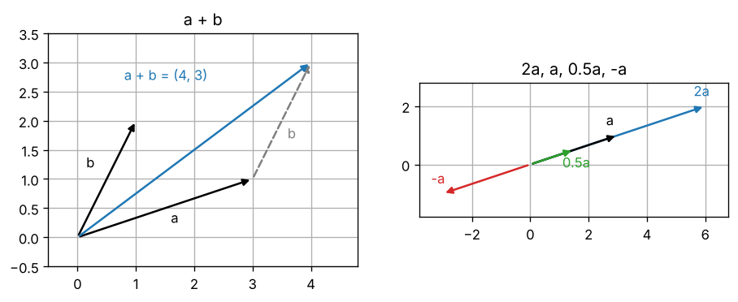
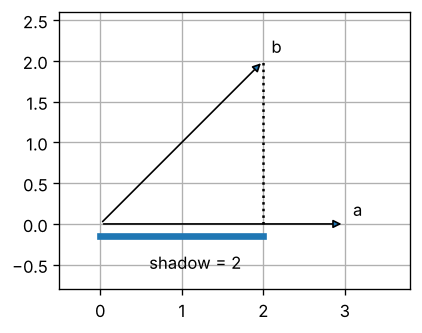
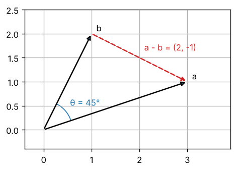
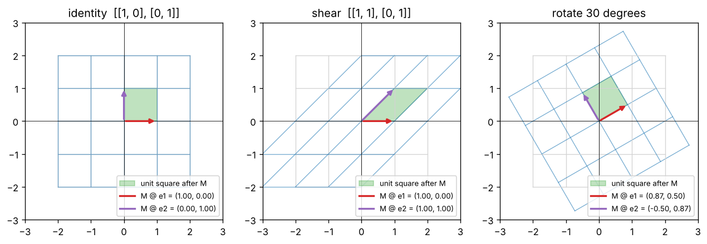
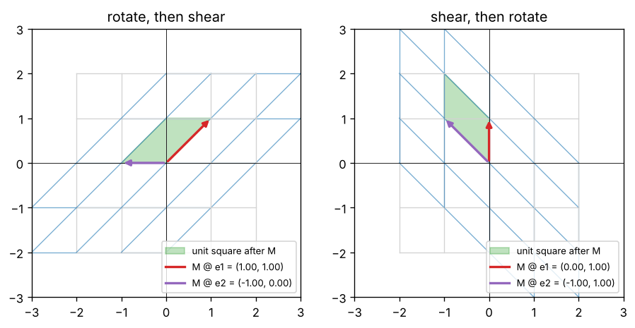

import { Aside, LinkButton } from '@astrojs/starlight/components';
import DotProductDemo from '../../../components/DotProductDemo.tsx';
import MatmulStepper from '../../../components/MatmulStepper.tsx';
import LinearMapDemo from '../../../components/LinearMapDemo.tsx';
import QueryScoreDemo from '../../../components/QueryScoreDemo.tsx';

<Aside type="note" title="影片">
本集影片製作中，完成後會放在這裡。
</Aside>

## 這集要解決什麼問題

EP00 把「今天天氣很」交給 Qwen2.5-0.5B，每一層之後的形狀都是 `(1, 4, 896)`：1 句話、4 個 token，每個 token 是一排 896 個數字。EP00 的地圖上，③ 嵌入把每個 token 換成這樣一排數字；⑤ 把最後一個位置的那排數字乘上反嵌入矩陣，替詞彙表裡 151,936 個 token 各打一個分數。

<Aside type="tip" title="小提醒">

沒看過前幾集也沒關係，這集只需要幾個前提。EP00：LLM 每一步會替詞彙表裡的每個 token 打一個分數（logits），再用 Softmax 換成機率。EP01：我們在自己的電腦建了一個叫 `llm-labs` 的 Python 專案，寫出 `ep01/softmax.py` 裡的 `softmax`，用 `uv run pytest` 跑測試；也看過 `@` 的形狀規則 `(a, b) @ (b, c)` 得到 `(a, c)`。EP02：$\sum$ 是「全部加起來」，可以翻成 for 迴圈。還沒有 `llm-labs` 的話，先照 EP01 第一部分建好（步驟 7 的 PyTorch 可以先跳過），再把 EP01 動手做的參考解答存成 `ep01/softmax.py`。

</Aside>

EP02 最後留下一個式子 $\sum_i a_i b_i$：「對應位置相乘，再全部加起來」，它叫**內積**。這集要回答：內積為什麼能衡量兩排數字有多「像」？EP01 的 `@` 到底在算什麼？矩陣又怎麼把一排數字變成另一排？

| 看過的東西 | 出處 | 還沒回答的 | 在哪裡回答 |
|---|---|---|---|
| `(1, 4, 896)`：每個 token 是一排 896 個數字 | EP00 | 這排數字該怎麼看？ | 工具一 |
| $\sum_i a_i b_i$：對應位置相乘，再全部加起來 | EP02 | 它代表什麼？ | 工具二 |
| 意思相近的 token，向量也相近 | EP00 ③ | 「相近」怎麼量？ | 工具二 |
| `A @ B`：`(a, b) @ (b, c)` 得到 `(a, c)` | EP01 | 每一格在算什麼？ | 工具三 |
| 乘上反嵌入矩陣 → 每個 token 一個分數 | EP00 ⑤ | 怎麼一次變出 15 萬個分數？ | 工具三、本集重點 |
| 函數 $f(x)$：輸入 → 輸出的機器 | EP02 | 矩陣也是函數嗎？ | 工具四 |

這集一共四個工具：**向量、內積與餘弦相似度、矩陣與矩陣乘法、線性變換**。最後會看到這集最重要的一件事：**內積＝相似度，矩陣乘法＝一次算很多個內積**。這正是 LLM 打分數和注意力的骨架。

學完這集，你應該能：

- 把向量看成「一排數字＝箭頭＝點」，算長度和單位向量。
- 用 $\sum_i a_i b_i$ 算內積，說出 $a \cdot b = \lVert a \rVert \lVert b \rVert \cos\theta$ 從哪裡來，說明餘弦相似度為什麼要除以長度。
- 用列觀點、欄觀點解釋矩陣乘法，預測 `@` 的結果形狀，分清 `@` 和 `*`。
- 從 $(1, 0)$、$(0, 1)$ 的落點讀出矩陣，看懂 PyTorch 的 `nn.Linear`。
- 解釋 LLM 怎麼替 151,936 個 token 打分數，並用純 Python 從零寫出內積和矩陣乘法，通過測試。

## 準備：開一個邊讀邊跑的 notebook

在 Ubuntu 終端機進到 `llm-labs`，建立這集的資料夾：

```bash
cd ~/code/llm-labs
mkdir -p ep03 && touch ep03/__init__.py
```

接著在 VS Code 新增 `ep03/playground.ipynb`，kernel 選 `.venv`，第一個 cell 和 EP02 一樣：

```python
import sys
sys.path.append("..")    # 讓 Python 也到上一層（llm-labs）找程式

import math
import numpy as np
from ep01.softmax import softmax
```

也可以直接打開這集的 notebook 邊讀邊跑，裡面已經定義好 `softmax`，不用匯入。

<LinkButton href="https://colab.research.google.com/github/chainchen1103/llm-from-scratch/blob/main/notebooks/ep03/ep03_vectors_matrices.ipynb" icon="external" target="_blank" rel="noopener noreferrer">在 Colab 開啟 notebook</LinkButton>
<LinkButton href="https://github.com/chainchen1103/llm-from-scratch/blob/main/notebooks/ep03/ep03_vectors_matrices.ipynb" variant="secondary" target="_blank" rel="noopener noreferrer">在 GitHub 查看</LinkButton>

<Aside type="tip" title="小提醒">

接下來的程式區塊裡，`print()` 那一行後面的註解就是印出來的結果，其他註解是說明。區塊裡有印出好幾行的（例如矩陣），整個區塊的結果會依序寫在區塊最後的註解裡。

</Aside>

**寫法約定**：向量寫成 $(3, 1)$，形狀寫成 `(2,)`。向量用小寫（$a$、$x$），矩陣用大寫（$A$、$W$）。$a_i$ 是 $a$ 的第 $i$ 個數字；數學從 1 開始數，Python 從 0 開始數。

## 工具一：向量

### 一排數字＝箭頭＝點

**向量 vector** 就是一排數字，例如 $a = (3, 1)$。同一個向量有三種看法：**一排數字**（程式裡的一維陣列，形狀 `(2,)`）、**箭頭**（從原點 $(0, 0)$ 指到 $(3, 1)$，有方向也有長度）、**點**（箭頭的尖端）。2 個數字畫在平面上（2D），3 個數字畫在空間裡（3D）。

<Aside type="caution" title="注意">

「維」有兩種意思。EP01 說的陣列維度 dimension 是有幾個軸（`ndim`）；向量的維度是有幾個數字。所以 `(896,)` 是一維陣列，也是 896 維向量。

</Aside>

### 加法與純量乘法

- **加法**：對應位置相加，$(3, 1) + (1, 2) = (4, 3)$。畫成箭頭是「頭尾相接」：把 $b$ 的尾巴接到 $a$ 的頭，從原點到 $b$ 的新尖端就是 $a + b$。
- **純量乘法 scalar multiplication**：**純量 scalar** 是單獨一個數。純量乘向量，就是每個數字都乘上它：$2a$ 方向不變、長度變 2 倍；$-a$ 指向反方向；$0.5a$ 縮短一半。



```python
a = np.array([3.0, 1.0])
b = np.array([1.0, 2.0])
print(a + b)                    # [4. 3.]
print(a - b)                    # [ 2. -1.]
print(2 * a, -1 * a, 0.5 * a)   # [6. 2.] [-3. -1.] [1.5 0.5]
```

NumPy 的 `+`、`*` 本來就是逐元素運算（EP01），直接寫就好。

### 長度與單位向量

$$
\lVert a \rVert = \sqrt{\sum_{i=1}^{n} a_i^2} = \sqrt{a_1^2 + a_2^2 + \cdots + a_n^2}
$$

白話：每個數字先平方，全部加起來（EP02 的 $\sum$），再開根號。

這是向量的**長度**，也就是箭頭有多長。$\lVert a \rVert$ 念「a 的長度」（高中課本寫成 $|a|$），正式名稱是**範數 norm**。2D 就是畢氏定理：$(3, 4)$ 的長度是兩股 3、4 的直角三角形的斜邊 $\sqrt{9 + 16} = 5$。3D 也一樣：$(1, 2, 2)$ 的長度是 $\sqrt{1 + 4 + 4} = 3$。

長度是 1 的向量叫**單位向量 unit vector**。向量除以自己的長度 $a / \lVert a \rVert$，方向不變、長度變成 1，只留下「方向」。每個數字都是 0 的**零向量 zero vector** 例外：長度是 0，不能除，也沒有方向。

```python
a = np.array([3.0, 4.0])
print(np.sqrt(np.sum(a ** 2)), np.linalg.norm(a))   # 5.0 5.0
u = a / np.linalg.norm(a)                           # 單位向量
print(u, np.linalg.norm(u))                         # [0.6 0.8] 1.0
print(len(a))                                       # 2
```

第一個 `print` 先照公式算，再用 NumPy 現成的 `np.linalg.norm`（`linalg` 是**線性代數 linear algebra**，研究向量與矩陣的數學）。

<Aside type="caution" title="注意">

這個系列說向量的「長度」只指 $\lVert a \rVert$；有幾個數字，說「維度」。EP00、EP01 說的「長度 896 的向量」是指有 896 個數字，從這集起改說「896 維向量」。最後一行的 `len(a)` 是數字個數 2，不是長度 5。

</Aside>

896 維畫不出來，但公式一模一樣：

```python
rng = np.random.default_rng(0)
h = rng.normal(size=896)            # 896 個亂數，假裝是一個 token 的向量
print(h.shape, np.linalg.norm(h))   # (896,) 29.179717348312174
```

這就是這集的策略：**在 2D 畫圖建立直覺，公式直接搬到 896 維。** EP00 ③ 的嵌入，就是把每個 token 換成這樣一個 896 維向量，只是數字是訓練學出來的，不是亂數。

## 工具二：內積與餘弦相似度

### 對應位置相乘，再全部加起來

$$
a \cdot b = \sum_{i=1}^{n} a_i b_i = a_1 b_1 + a_2 b_2 + \cdots + a_n b_n
$$

白話：兩個向量對應位置的數字相乘，再全部加起來。

這叫**內積 dot product**，$a \cdot b$ 念「a dot b」。EP02 的指數律裡，$\cdot$ 放在兩個數中間是乘號；放在兩個向量中間，就是內積。兩個維度相同的向量進去，**一個數**出來，例如 $(1, 2, 3) \cdot (4, 5, 6) = 4 + 10 + 18 = 32$。照 EP02 的習慣，先把 $\sum$ 寫成 for 迴圈，再換成 NumPy：

```python
a = np.array([1.0, 2.0, 3.0])
b = np.array([4.0, 5.0, 6.0])
total = 0.0
for i in range(len(a)):
    total = total + a[i] * b[i]
print(total, np.sum(a * b), np.dot(a, b), a @ b)   # 32.0 32.0 32.0 32.0
```

`np.sum(a * b)` 是公式的字面翻譯，`np.dot(a, b)` 和 `a @ b` 是 NumPy 現成的內積。向量和自己的內積，就是長度的平方：$a \cdot a = \sum_i a_i^2 = \lVert a \rVert^2$。

### 幾何意義：長度 × 影子

內積還有另一個公式：

$$
a \cdot b = \lVert a \rVert \lVert b \rVert \cos\theta
$$

白話：兩個長度相乘，再乘上兩支箭頭夾角的 $\cos$。

$\theta$（念「theta」）是兩支箭頭的夾角。$\cos\theta$（念「cos theta」）叫**餘弦 cosine**，只跟角度有關：長度 1 的箭頭從 x 軸的正方向逆時針轉 $\theta$ 時，它的 x 座標就是 $\cos\theta$，y 座標叫 $\sin\theta$（**正弦 sine**）。x 座標可以想成箭頭落在 x 軸上的「影子」：$\cos 0° = 1$（躺平，影子最長）、$\cos 60° = 0.5$、$\cos 90° = 0$（直立，沒有影子）、$\cos 180° = -1$（指向反方向，影子在背後）。

把 $a$ 的方向當成 x 軸來看：箭頭 $b$ 的長度是 $\lVert b \rVert$，影子也跟著放大 $\lVert b \rVert$ 倍，所以 $\lVert b \rVert \cos\theta$ 就是 $b$ 落在 $a$ 的方向上的影子長（這個影子，高中課本叫 $b$ 在 $a$ 上的正射影）。內積就是「**$a$ 的長度 × $b$ 在 $a$ 方向上的影子**」。夾角超過 90° 時，影子落在反方向，算成負的。

**為什麼 $\sum$ 會等於「長度 × 影子」？** 先看最簡單的情況：$a = (3, 0)$ 躺在 x 軸上，$b = (2, 2)$。$a \cdot b = 3 \times 2 + 0 \times 2 = 6$。$a$ 的第二個數字是 0，第二項消失了；剩下的 2 是 $b$ 的 x 座標，也就是從 $b$ 的尖端垂直畫到 x 軸、落在 $(2, 0)$ 的影子長。所以 6 ＝ 長度 3 × 影子 2。



$b$ 在斜線 $y = x$ 上，和 $a$ 夾 45°，用兩個公式算算看：

```python
a = np.array([3.0, 0.0])
b = np.array([2.0, 2.0])
print(a @ b, np.linalg.norm(a) * np.linalg.norm(b) * np.cos(np.radians(45)))   # 6.0 6.000000000000001
```

`np.cos` 吃的角度單位是**弧度 radian**（180° 等於 $\pi$ 弧度），`np.radians(45)` 把 45° 換成弧度。兩個公式都得到 6，最後一位的 `1` 是 EP02 看過的捨入誤差。

$a$ 不躺在 x 軸上也成立，證明要用高中的**餘弦定理 law of cosines**。$a$、$b$ 和連接兩個尖端的 $a - b$ 圍成一個三角形：從 $b$ 的尖端走 $a - b$ 就到 $a$ 的尖端（因為 $b + (a - b) = a$），所以第三邊長 $\lVert a - b \rVert$。



$$
\lVert a - b \rVert^2 = \lVert a \rVert^2 + \lVert b \rVert^2 - 2 \lVert a \rVert \lVert b \rVert \cos\theta
$$

白話：知道三角形的兩邊和夾角，就能算出第三邊。

左邊換成 $\sum$ 展開，每一項用乘法公式 $(x - y)^2 = x^2 + y^2 - 2xy$：

$$
\lVert a - b \rVert^2 = \sum_i (a_i - b_i)^2 = \sum_i a_i^2 + \sum_i b_i^2 - 2 \sum_i a_i b_i
$$

白話：差的平方的加總，拆成三個加總；前兩個就是 $\lVert a \rVert^2$ 和 $\lVert b \rVert^2$。

兩條式子算的是同一個 $\lVert a - b \rVert^2$，扣掉共同的 $\lVert a \rVert^2 + \lVert b \rVert^2$、再除以 $-2$，就得到 $\sum_i a_i b_i = \lVert a \rVert \lVert b \rVert \cos\theta$。用圖上的 $a = (3, 1)$、$b = (1, 2)$ 檢查第二條：左邊 $\lVert (2, -1) \rVert^2 = 4 + 1 = 5$，右邊 $10 + 5 - 2 \times 5 = 5$（$a \cdot b = 3 + 2 = 5$），兩邊一樣。

反過來，有了內積，就能算出夾角：

```python
a = np.array([3.0, 1.0])
b = np.array([1.0, 2.0])
cos_theta = (a @ b) / (np.linalg.norm(a) * np.linalg.norm(b))
print(cos_theta, np.degrees(np.arccos(cos_theta)))   # 0.7071067811865475 45.00000000000001
```

`np.arccos` 是 cos 的反函數（EP02）。cos 本身不能整個反推（$\cos 300° = \cos 60°$，就像 $x^2$），但在 0° 到 180° 之間一路往下，不同的角度給出不同的值，所以給一個 −1 到 1 之間的數，就能算回 0° 到 180° 之間唯一的角度（單位是弧度，`np.degrees` 換成度）。所以 $(3, 1)$ 和 $(1, 2)$ 夾 45°。

### 正、零、負：正負號就是方向

長度都是正的（零向量除外），所以內積的正負號由 $\cos\theta$ 決定：

| 夾角 | 內積 | 意思 |
|---|---|---|
| 小於 90° | 正 | 方向接近 |
| 剛好 90° | 0 | **垂直**，線性代數的正式說法是**正交 orthogonal** |
| 大於 90° | 負 | 方向偏向相反（180° 時完全相反） |

```python
a = np.array([2.0, 1.0])
print(a @ np.array([1.0, 1.0]), a @ np.array([-1.0, 2.0]), a @ np.array([-2.0, -0.5]))   # 3.0 0.0 -4.5
```

三個向量和 $a = (2, 1)$ 的夾角，分別小於、剛好、大於 90°。

### 餘弦相似度：只看方向

$$
\text{cos\_sim}(a, b) = \frac{a \cdot b}{\lVert a \rVert \lVert b \rVert} = \cos\theta
$$

白話：內積除以兩個長度，剩下的就是夾角的 $\cos$。

這叫**餘弦相似度 cosine similarity**。它的範圍是 $-1$ 到 $1$：同方向是 1、垂直是 0、反方向是 $-1$，和長度無關。零向量沒有方向，分母是 0，不能算（NumPy 會得到 `nan`）。

**為什麼要除以長度？** 把一個向量放大 100 倍，內積也跟著變 100 倍，但方向根本沒變。比較兩個東西「像不像」，應該只看方向。

<DotProductDemo client:visible />

下面用**手作的示範向量**算一張相似度表。4 個數字代表「動物、毛茸茸、甜、黃色」的程度，是我們自己定的，不是模型學出來的。`E` 是把 5 個向量一列一列疊起來的表格（矩陣，工具三介紹），`E[0]` 是貓那一列。`np.round(sim, 2)` 四捨五入到小數點後 2 位：

```python
def cos_sim(a, b):
    return (a @ b) / (np.linalg.norm(a) * np.linalg.norm(b))

#              動物 毛茸茸  甜  黃色
E = np.array([[1.0, 0.9, 0.0, 0.1],    # 貓
              [1.0, 0.6, 0.0, 0.3],    # 狗
              [1.0, 0.7, 0.0, 0.9],    # 小雞
              [0.0, 0.0, 0.8, 0.3],    # 蘋果
              [0.0, 0.0, 0.9, 1.0]])   # 香蕉
sim = np.zeros((5, 5))
for i in range(5):
    for j in range(5):
        sim[i, j] = cos_sim(E[i], E[j])
print(np.round(sim, 2))
# 貓和狗的內積，以及貓和「放大 100 倍的狗」的內積
print(E[0] @ E[1], E[0] @ (100 * E[1]))
print(cos_sim(E[0], E[1]), cos_sim(E[0], 100 * E[1]))
# [[1.   0.97 0.84 0.03 0.06]
#  [0.97 1.   0.93 0.09 0.19]
#  [0.84 0.93 1.   0.21 0.44]
#  [0.03 0.09 0.21 1.   0.89]
#  [0.06 0.19 0.44 0.89 1.  ]]
# 1.57 157.0
# 0.9664512615360344 0.9664512615360344
```

第 $i$ 列第 $j$ 欄是「第 $i$ 個詞和第 $j$ 個詞有多像」：對角線都是 1（自己和自己同方向），而且沿著對角線對稱。貓和狗最像（0.97）；小雞因為「黃色」，和香蕉也有一點像（0.44）；動物和水果幾乎不像。狗放大 100 倍，內積從 1.57 變成 157.0，相似度完全不變。這裡的數字都不是負的，所以沒有負的相似度；真實的嵌入有正有負，相似度也可以是負的。

**真實的嵌入**：那 896 個數字不是人標的「動物、甜」，而是訓練學出來的（EP18），單獨看一個數字通常說不出它代表什麼。EP00 說「意思相近的 token，向量也相近」，「相近」最常用的量法就是餘弦相似度。

**和 LLM 的連結**：EP00 ⑤ 的分數也是內積。每個候選 token 有一個 896 維向量，最後一個位置的向量 $h$ 和它做內積，就是這個 token 的分數。（打分數直接用內積、不除以長度，原因在本集重點。）

## 工具三：矩陣與矩陣乘法

### 形狀 (m, n)：m 列 n 欄

**矩陣 matrix** 是排成長方形的數字表格。形狀 `(m, n)` 代表 m **列 row**（橫的一排）、n **欄 column**（直的一排）。

<Aside type="caution" title="注意">

這個系列 row 一律叫「列」、column 一律叫「欄」，不用「行」（中國大陸的「行」「列」用法和台灣剛好相反）。

</Aside>

$A_{ij}$ 是第 $i$ 列第 $j$ 欄的數字，在 Python 是 `A[i - 1, j - 1]`。向量一列一列疊起來就是矩陣：「今天天氣很」4 個 token 的向量疊起來，就是形狀 `(4, 896)` 的矩陣，每一列是一個 token，也就是 EP00 說的 $[n \times d]$。

### 矩陣乘向量：列觀點和欄觀點

形狀 `(m, n)` 的矩陣乘上 `(n,)` 的向量 $x$，得到 `(m,)` 的向量。數學上矩陣乘法不寫符號，直接並排：$A$ 乘 $x$ 寫成 $Ax$，$A$ 乘 $B$ 寫成 $AB$，程式裡就是 `A @ x`、`A @ B`。有兩種看法：

- **列觀點 row view**：輸出的第 $i$ 個數字＝第 $i$ 列和 $x$ 的內積。m 列，就是 m 個內積。
- **欄觀點 column view**：輸出＝$x_1 \times$ 第 1 欄 $+ \cdots + x_n \times$ 第 n 欄，也就是各欄的**加權和 weighted sum**：每一欄先乘上自己的權重（$x$ 的數字），再加起來。

$$
\begin{pmatrix} 1 & 2 & 3 \\ 4 & 5 & 6 \end{pmatrix}
\begin{pmatrix} 2 \\ 1 \\ -1 \end{pmatrix}
= \begin{pmatrix} 2 + 2 - 3 \\ 8 + 5 - 6 \end{pmatrix}
= 2 \begin{pmatrix} 1 \\ 4 \end{pmatrix} + 1 \begin{pmatrix} 2 \\ 5 \end{pmatrix} - 1 \begin{pmatrix} 3 \\ 6 \end{pmatrix}
= \begin{pmatrix} 1 \\ 7 \end{pmatrix}
$$

白話：第一個等號後面是列觀點，每一列和 $(2, 1, -1)$ 做內積；第二個等號後面是欄觀點，三欄分別乘上 2、1、−1 再加起來。

數學習慣把 $x$ 寫成直的一欄。NumPy 的一維陣列 `(3,)` 沒有直、橫之分，`A @ x` 會把它當成直的來算，結果也是一維的 `(2,)`；真的用 `reshape` 變成直的 `(3, 1)`，結果就變成 `(2, 1)`。

```python
A = np.array([[1.0, 2.0, 3.0],
              [4.0, 5.0, 6.0]])
print(A.shape, A[1, 2], A[1], A[:, 2])                   # (2, 3) 6.0 [4. 5. 6.] [3. 6.]
x = np.array([2.0, 1.0, -1.0])
print(A @ x)                                             # [1. 7.]
# 列觀點：每一列和 x 做內積
print(np.array([A[0] @ x, A[1] @ x]))                    # [1. 7.]
# 欄觀點：各欄的加權和
print(x[0] * A[:, 0] + x[1] * A[:, 1] + x[2] * A[:, 2])  # [1. 7.]
```

`A[1]` 是第 2 列、`A[:, 2]` 是第 3 欄（Python 從 0 數，EP01 的切片）。**列觀點用來看「打分數」，欄觀點用來看「變換」**，等一下都會用到。

### 矩陣乘矩陣：每一格都是一個內積

形狀 `(m, n)` 的 $A$ 乘上 `(n, p)` 的 $B$，得到 `(m, p)` 的 $C$：

$$
C_{ij} = \sum_{k=1}^{n} A_{ik} B_{kj}
$$

白話：$C$ 的第 $i$ 列第 $j$ 欄，是 $A$ 的第 $i$ 列和 $B$ 的第 $j$ 欄的內積（$k$ 跑過這兩排數字的每個位置）。

所以輸出的 m × p 格，**每一格都是一個內積**。這就是 EP01 形狀規則的由來：$A$ 的一列和 $B$ 的一欄都要有 n 個數字，內積才算得了。每一格要做 n 次乘法，總共是 **m × n × p 次乘法**。EP01 的 `[[1, 2], [3, 4]] @ [[10, 20], [30, 40]]` 得到 `[[70, 100], [150, 220]]`，左上角的 70 就是第 1 列 $(1, 2)$ 和第 1 欄 $(10, 30)$ 的內積：$10 + 60 = 70$。

```python
B = np.array([[1.0, 0.0],
              [0.0, 1.0],
              [1.0, -1.0]])
C = A @ B                           # (2, 3) @ (3, 2) → (2, 2)
print(C)
# C[1, 0]＝A 的第 2 列和 B 的第 1 欄的內積（Python 從 0 數）
print(A[1] @ B[:, 0])
# 轉置：列和欄互換，(2, 3) 變 (3, 2)
print(A.T)
# [[ 4. -1.]
#  [10. -1.]]
# 10.0
# [[1. 4.]
#  [2. 5.]
#  [3. 6.]]
```

這裡一共 2 × 3 × 2 = 12 次乘法。`A.T` 是 EP01 看過的轉置。

<MatmulStepper client:visible />

前面那張 5 × 5 的相似度表，也可以一次用矩陣乘法算完：每一列先變成單位向量，再乘上自己的轉置，25 個內積一起算：

```python
U = E / np.linalg.norm(E, axis=1, keepdims=True)              # 每一列除以自己的長度
print(U.shape, (U @ U.T).shape, np.allclose(U @ U.T, sim))   # (5, 4) (5, 5) True
```

`keepdims=True` 讓每一列的長度排成 `(5, 1)`，靠廣播讓每一列除以**自己的**長度（EP01 Softmax 的老招）。`U @ U.T` 的第 $i$ 列第 $j$ 欄是 `U[i]` 和 `U[j]` 的內積，而兩個單位向量的內積，就是餘弦相似度。

### `@` 和 `*`、轉置、順序

- **`*` 是逐元素相乘**，兩邊形狀要一樣或能廣播（EP01）；**`@` 是矩陣乘法**，左邊的欄數要等於右邊的列數。兩者完全不同（弄壞它 1、2）。
- **轉置** `.T` 寫成數學是 $A^\top$，念「A 的轉置」。一維陣列沒有列和欄可以交換，`.T` 什麼都不做（弄壞它 3）。
- **$AB$ 通常不等於 $BA$**：數字相乘可以交換順序（$2 \times 3 = 3 \times 2$），矩陣一般不行。

```python
M = np.array([[1, 2], [3, 4]])
P = np.array([[0, 1], [1, 0]])
print(M @ P)
print(P @ M)
# [[2 1]
#  [4 3]]
# [[3 4]
#  [1 2]]
```

`M @ P` 把 `M` 的兩欄對調，`P @ M` 把兩列對調，結果不一樣。形狀不同時更明顯：`(2, 3) @ (3, 4)` 能算，倒過來根本不能算。

### LLM 怎麼替 151,936 個 token 打分數

現在可以回答 EP00 ⑤ 的問題了。詞彙表裡每個 token 都有一個用來打分數的 896 維向量，151,936 個疊起來，就是 EP00 說的反嵌入矩陣 $W$，形狀 `(151936, 896)`。最後一個位置的向量 $h$ 形狀是 `(896,)`。用列觀點看 `W @ h`：$W$ 的每一列和 $h$ 各做一次內積，**一次得到 151,936 個分數**，再交給 Softmax 換成機率。寫成 `h @ W.T`，也就是 `(896,) @ (896, 151936)`，是同一個計算。

```python
print(896 * 151_936, 896 * 151_936 / 5e8)   # 136134656 0.272269312
```

一次打分數要 **136,134,656 次乘法，約 1.36 億次**，而且每產生一個 token 就要做一次。這種計算量怎麼估算，留給 EP33。

第二個數字和 ③ 有關：嵌入表也是一張 `(151936, 896)` 的表，裡面有 896 × 151,936 個數字（剛好和上面的乘法次數一樣多），每一個都是參數。`5e8` 是 $5 \times 10^8$，也就是 Qwen2.5-0.5B 約 5 億個參數；所以嵌入表就占了約 27%，這就是 EP00 說「其餘幾乎都是嵌入表」的原因。

**有興趣的話**：這集 notebook 的最後有一格選做程式，在 Google Colab 載入 Qwen2.5-0.5B，用上面 `U @ U.T` 的方法算幾個詞（例如 cat、dog、貓、狗）的真實嵌入相似度表，也印出打分數的表是不是直接共用嵌入表的設定。結果請自己執行看看。

## 工具四：線性變換

### 矩陣是一台函數機器

$f(x) = Ax$：向量進去、向量出來，就是 EP02 的函數機器，`(m, n)` 的矩陣吃 n 維、吐 m 維。用矩陣這樣變換向量，叫**線性變換 linear transformation**。2 × 2 的矩陣把平面上的每個點送到另一個點，所以可以畫出整個平面怎麼變形。

### 看 (1, 0) 和 (0, 1) 被送到哪裡

記 $e_1 = (1, 0)$、$e_2 = (0, 1)$（念「e 一」「e 二」；這個 e 只是名字，和 EP02 的自然常數 $e$ 無關）。用欄觀點，$A e_1$ 是 1 × 第 1 欄 + 0 × 第 2 欄，也就是第 1 欄；$A e_2$ 就是第 2 欄。換句話說：

**矩陣的兩欄，就是 $(1, 0)$ 和 $(0, 1)$ 被送到的落點。**

任何向量都能拆成 $x = x_1 e_1 + x_2 e_2$，例如 $(3, 2) = 3(1, 0) + 2(0, 1)$。再用一次欄觀點：$Ax$ 是 $x_1 \times$ 第 1 欄 $+ x_2 \times$ 第 2 欄，而這兩欄就是 $Ae_1$、$Ae_2$，所以：

$$
A x = x_1 (A e_1) + x_2 (A e_2)
$$

白話：$x$ 被送到的位置，是兩個落點的加權和，權重就是 $x$ 自己的兩個數字。

知道兩個落點，就知道每個點去哪裡。例如下面的剪切把 $e_1$ 留在原地、把 $e_2$ 送到 $(1, 1)$，那 $(3, 2)$ 就被送到 $3(1, 0) + 2(1, 1) = (5, 2)$。

### 四個 2D 例子

| 變換 | 矩陣 | 白話 |
|---|---|---|
| 縮放 scaling | $\begin{pmatrix} 2 & 0 \\ 0 & 0.5 \end{pmatrix}$ | 橫向拉長 2 倍、縱向壓成一半 |
| 旋轉 rotation | $\begin{pmatrix} 0 & -1 \\ 1 & 0 \end{pmatrix}$ | 繞原點逆時針轉 90° |
| 剪切 shear（高中課本叫推移） | $\begin{pmatrix} 1 & 1 \\ 0 & 1 \end{pmatrix}$ | 越高的點往右推得越多 |
| 投影 projection | $\begin{pmatrix} 1 & 0 \\ 0 & 0 \end{pmatrix}$ | 壓扁到 x 軸上，只留下影子 |

```python
e1, e2 = np.array([1.0, 0.0]), np.array([0.0, 1.0])
scale = np.array([[2.0, 0.0], [0.0, 0.5]])
rot = np.array([[0.0, -1.0], [1.0, 0.0]])     # 逆時針轉 90°
shear = np.array([[1.0, 1.0], [0.0, 1.0]])
proj = np.array([[1.0, 0.0], [0.0, 0.0]])     # 投影到 x 軸
for M in [scale, rot, shear, proj]:
    print(M @ e1, M @ e2, M @ np.array([3.0, 2.0]))
# [2. 0.] [0.  0.5] [6. 1.]
# [0. 1.] [-1.  0.] [-2.  3.]
# [1. 0.] [1. 1.] [5. 2.]
# [1. 0.] [0. 0.] [3. 0.]
```

- 每次印出的前兩個向量，剛好是矩陣的兩欄；第三個是 $(3, 2)$ 的落點，剪切的 $(5, 2)$ 和手算的一樣。
- 轉任意角度 $\theta$ 的矩陣是 $\begin{pmatrix} \cos\theta & -\sin\theta \\ \sin\theta & \cos\theta \end{pmatrix}$：它把 $e_1$ 送到**單位圓 unit circle**（圓心在原點、半徑 1 的圓）上角度 $\theta$ 的點 $(\cos\theta, \sin\theta)$；代入 $\theta = 90°$ 就是 `rot`。EP24 的旋轉位置編碼 RoPE 會用旋轉矩陣讓模型知道 token 的位置。
- 什麼都不做的矩陣叫**恆等矩陣 identity matrix** $I$（高中課本叫單位方陣）：對角線是 1、其他是 0，NumPy 是 `np.eye(2)`。$Ix = x$、$IA = AI = A$，就像乘以 1。

下面的元件畫出格線和**單位正方形 unit square**（四個角是 $(0, 0)$、$(1, 0)$、$(1, 1)$、$(0, 1)$）。拖動兩支箭頭，就是在改矩陣的兩欄：

<LinearMapDemo client:visible />

### 「線性」是什麼意思

$$
f(a + b) = f(a) + f(b), \qquad f(c\,a) = c\,f(a)
$$

白話：先相加再變換＝先變換再相加；先伸縮再變換＝先變換再伸縮（$c$ 是任何一個純量）。

所有矩陣都符合這兩條。畫成圖，就是三件事：**直線還是直線、原點不動、格線保持平行而且等距**。投影比較特別：直線可能被壓成一個點、格線疊在一起，但它仍然符合這兩條規則。

```python
rng = np.random.default_rng(0)
a, b = rng.normal(size=2), rng.normal(size=2)
print(np.allclose(shear @ (a + b), shear @ a + shear @ b))   # True
print(np.allclose(shear @ (3 * a), 3 * (shear @ a)))         # True

def shift(v):                       # 平移：每個點往右移 1
    return v + np.array([1.0, 0.0])

print(shift(np.zeros(2)), np.allclose(shift(a + b), shift(a) + shift(b)))   # [1. 0.] False
```

隨便挑兩個向量，剪切都符合。**平移**就不是線性的：它把原點移走了，也不符合第一條。逐元素平方也不是：它會把直線彎成曲線。

### 合成＝矩陣相乘，順序很重要

像 EP02 的合成函數 $f(g(x))$，「先旋轉 $R$、再剪切 $S$」寫成 $S(Rx)$。而 $S(Rx) = (SR)x$：兩步可以先合成一個矩陣 $SR$。**最靠近 $x$ 的矩陣先作用，所以要從右往左讀。**

```python
x = np.array([1.0, 2.0])
# 一步一步來：先旋轉，再剪切
print(rot @ x, shear @ (rot @ x))
# 先合成一個矩陣，再乘一次
SR = shear @ rot
print(SR)
print(SR @ x)
# [-2.  1.] [-1.  1.]
# [[ 1. -1.]
#  [ 1.  0.]]
# [-1.  1.]
```

兩種做法都把 $(1, 2)$ 送到 $(-1, 1)$。順序一般不能交換：「先旋轉再剪切」和「先剪切再旋轉」是兩回事（弄壞它 4）。另外，只有線性變換的話，疊再多層都能先合成一個矩陣，等於只有一層；所以神經網路的層和層之間要夾著非線性的**激活函數 activation function**，EP10 會看到。

**能不能復原？** 投影把 $(3, 2)$ 和 $(3, -5)$ 都壓成 $(3, 0)$，無法知道原本是哪一個，就像 EP02 的 $x^2$ 沒有反函數；旋轉則可以轉回來。能復原的矩陣有**反矩陣 inverse matrix** $A^{-1}$（高中課本叫反方陣），暫時用不到。

### 神經網路的一層：`nn.Linear`

PyTorch 的 `nn.Linear(in, out)` 是神經網路最常見的一層，它算的是 `y = x @ W.T + b`：

- `W` 的形狀是 `(out, in)`，每一列負責一個輸出。只有一個向量時，`x @ W.T` 就是 $Wx$。`x` 也可以一次放很多個 token（每列一個），全部被同一個 `W` 變換。
- `b` 叫**偏差 bias**，靠廣播加到每一列。輸入 0 會得到 $b$，也就是原點被送到 $b$（$b$ 不是全 0 時就不在原地了），嚴格說是**仿射變換 affine transformation**（線性變換再平移），但大家仍然叫它**線性層 linear layer**。

```python
rng = np.random.default_rng(0)
X = rng.normal(size=(4, 3))         # 4 個 token，每個 3 維
W = rng.normal(size=(2, 3))         # PyTorch 的存法：(輸出, 輸入)
bias = np.array([0.5, -0.5])
Y = X @ W.T + bias                  # (4, 3) @ (3, 2) → (4, 2)，再廣播加上 (2,)
print(Y.shape, np.allclose(Y[0], W @ X[0] + bias))   # (4, 2) True
```

第二個檢查：第一個 token 的輸出 `Y[0]`，就是 $W$ 乘上它的向量再加 $b$。Qwen2.5-0.5B 每一層的注意力和前饋網路，都由好幾個這樣的線性層組成，**每一層最主要的計算就是矩陣乘法**。`W` 裡的數字怎麼訓練出來，要等 EP04 的梯度和 EP05 的鏈鎖律。

## 本集重點：內積＝相似度，矩陣乘法＝一次算很多個內積

### 一個查詢，對一排向量打分數

把 4 個 3 維向量疊成矩陣 `K`（形狀 `(4, 3)`），再拿一個**查詢 query** 向量 `q` 去問：「你們誰和我最像？」（「查詢」這個名字先借用，EP22 會正式介紹。）

```python
K = np.array([[2.0, 0.0, 1.0],      # 和 q 方向接近
              [0.0, 1.0, 0.0],      # 和 q 垂直
              [1.0, 1.0, 1.0],      # 有點像
              [-1.0, 0.0, -1.0]])   # 方向相反
q = np.array([1.0, 0.0, 1.0])
scores = K @ q                      # (4, 3) @ (3,) → (4,)：一次 4 個內積
weights = softmax(scores)
print(scores)                       # [ 3.  0.  2. -2.]
print(weights, weights.sum())       # [0.70204779 0.0349529  0.25826895 0.00473036] 1.0
```

**內積 → 分數 → Softmax → 權重**：最像的 `K[0]` 拿到約 70% 的權重，垂直的 `K[1]` 只有 3.5%，方向相反的 `K[3]` 只剩 0.5%。這和 LLM 打分數是同一個骨架，只是 4 列變成 151,936 列、3 維變成 896 維。

<Aside type="caution" title="注意">

這裡的「權重」是當場算出來、加起來是 1 的比例，不是 EP00 說的「權重＝模型的參數」（像 `nn.Linear` 的 `W`）。

</Aside>

### 長向量占便宜

這裡的「像」是**內積**，不是餘弦相似度：方向越接近，分數越高；但向量越長，分數也越大。把 `K[2]` 拉長 3 倍，方向不變：

```python
K_long = K.copy()
K_long[2] = [3.0, 3.0, 3.0]         # 和 K[2] 同方向、長 3 倍
print(K_long @ q, cos_sim(K_long[2], q), cos_sim(K[0], q))
# q 變 2 倍
print(np.round(softmax(K @ (2 * q)), 3))
# [ 3.  0.  6. -2.] 0.8164965809277259 0.9486832980505138
# [0.879 0.002 0.119 0.   ]
```

`K_long[2]` 的方向沒變，和 `q` 的餘弦相似度是 0.82，輸給 `K[0]` 的 0.95；可是它的分數變成 6，跑到第一名。

那為什麼打分數不除以長度？比較兩個詞像不像時要除；但 LLM 打分數、注意力都直接用內積，因為**長度也是模型學出來、有用的資訊**。看第二行：`q` 變 2 倍，所有分數一起變 2 倍，Softmax 就更集中（最像的從 70% 變成 88%），等於把溫度從 1 調成 0.5（EP00、EP02：溫度是把分數除以 $T$）。所以「內積＝相似度」要記成：**長度一樣時，方向越接近，分數越高；長度會把分數放大。**

下面的元件把同一個例子畫成 2D：紫色的 $k_1$～$k_4$ 對應 `K` 的 4 列（改用 2 維的數字；元件裡叫它們 key，這個名字也是先借用），$q$ 一開始是 $(1, 1)$。4 個分數一樣是 3、0、2、−2，權重也一樣；只有 $k_3$ 的餘弦相似度不同：2D 的 $k_3$ 和 $q$ 夾 45°，是 0.707，不是上面的 0.82。

<QueryScoreDemo client:visible />

### 很多個查詢：一次矩陣乘法

查詢不只一個時，把它們也疊成矩陣：

```python
queries = np.array([[1.0, 0.0, 1.0],
                    [0.0, 2.0, -1.0]])   # 2 個查詢，形狀 (2, 3)
scores = queries @ K.T                  # (2, 3) @ (3, 4) → (2, 4)：8 個內積
print(scores)
print(np.round(softmax(scores, axis=-1), 3))
# [[ 3.  0.  2. -2.]
#  [-1.  2.  1.  1.]]
# [[0.702 0.035 0.258 0.005]
#  [0.028 0.56  0.206 0.206]]
```

`(2, 4)` 的第 $i$ 列第 $j$ 欄，就是「第 $i$ 個查詢和 `K` 的第 $j$ 列的內積」。Softmax 沿著 `axis=-1` 做，每個查詢各自分到一組加起來是 1 的權重（EP01）。第二個查詢 $(0, 2, -1)$ 和 `K[1]` 最像，拿到 56%。

**這就是注意力的骨架。** 每個 token 拿自己的查詢向量，和每個 token（包括自己）的向量做內積；4 個 token 一次算完，就是 `(4, d) @ (d, 4)` → `(4, 4)` 的分數表（$d$ 是向量的維度）。Softmax 之後得到權重，再用權重把那些 token 的資訊**加權平均 weighted average**（權重加起來是 1 的加權和）。實際的 LLM 還會讓每個 token 只看自己和前面的 token，也會把向量切成好幾份分開算，這些是 EP23 的事；查詢和被比較的向量從哪裡來、為什麼還要除以 $\sqrt{d}$，是 EP22 的事。

## 動手做：從零寫出 `linalg.py`

在 `llm-labs/ep03/linalg.py` 寫下面 5 個函式：

```python
import math

def dot(a, b):
    """a、b 是元素個數相同的 list，回傳 Σ a_i b_i（一個數）。個數不同要 raise ValueError。"""

def norm(a):
    """回傳向量 a 的長度 ‖a‖ = √(Σ a_i²)。"""

def cosine_similarity(a, b):
    """回傳 a·b / (‖a‖‖b‖)。維度不同（list 元素個數不同）、或其中一個是零向量（沒有方向），raise ValueError。"""

def matvec(A, x):
    """A 是 m 列 n 欄的巢狀 list，x 是 n 個數字的 list，回傳 m 個數字的 list。
    形狀不合要 raise ValueError。"""

def matmul(A, B):
    """A 的形狀 (m, n)、B 的形狀 (n, p)，回傳 (m, p) 的巢狀 list。用三層迴圈。
    形狀不合要 raise ValueError。"""
```

要求與提示：

1. **只用純 Python**（list、for、`math.sqrt`），不能用 NumPy。**巢狀 list nested list** 是「list 裡面放 list」，例如 `[[1, 2, 3], [4, 5, 6]]`，每個內層的 list 是一列，形狀是 `(len(A), len(A[0]))`。
2. **`norm`** 用你的 `dot(a, a)`，因為 $a \cdot a = \lVert a \rVert^2$。
3. **錯誤訊息要說出兩個形狀**。`raise ValueError("訊息")` 會讓程式停下來並顯示訊息。把 tuple 放進 f-string：`f"{(m, n)}"` 會印成 `(2, 3)`，`f"{(len(a),)}"` 會印成 `(3,)`。
4. **`matvec`** 用列觀點，呼叫 `dot`。**`matmul`** 用三層迴圈：`i` 跑 $A$ 的列、`j` 跑 $B$ 的欄、`k` 跑內積的每一項，就是上面 $C_{ij}$ 的公式。

把下面的測試存成 `llm-labs/tests/test_ep03_linalg.py`：

```python
import math

import numpy as np
import pytest

from ep03.linalg import cosine_similarity, dot, matmul, matvec, norm

def test_dot_matches_numpy():
    assert dot([1, 2, 3], [4, 5, 6]) == 32            # 4 + 10 + 18
    rng = np.random.default_rng(0)
    a, b = rng.normal(size=50), rng.normal(size=50)
    assert math.isclose(dot(a.tolist(), b.tolist()), np.dot(a, b))

def test_norm_3_4_5():
    assert norm([3, 4]) == 5.0                        # 畢氏定理
    assert norm([1, 2, 2]) == 3.0
    a = np.random.default_rng(1).normal(size=896)
    assert math.isclose(norm(a.tolist()), np.linalg.norm(a))

def test_cosine_parallel_orthogonal_opposite():
    assert math.isclose(cosine_similarity([1, 2], [3, 6]), 1.0)       # 同方向，長度不同
    assert math.isclose(cosine_similarity([1, 2], [-2, 1]), 0.0, abs_tol=1e-12)   # 垂直
    assert math.isclose(cosine_similarity([1, 2], [-1, -2]), -1.0)    # 反方向
    with pytest.raises(ValueError):
        cosine_similarity([0, 0], [1, 2])                             # 零向量沒有方向
    with pytest.raises(ValueError):
        cosine_similarity([1, 2], [0, 0])                             # 兩邊都要檢查

def test_matvec_matmul_match_numpy():
    assert matvec([[1, 2, 3], [4, 5, 6]], [2, 1, -1]) == [1, 7]
    rng = np.random.default_rng(2)
    A, x, B = rng.normal(size=(3, 4)), rng.normal(size=4), rng.normal(size=(4, 5))
    assert np.allclose(matvec(A.tolist(), x.tolist()), A @ x)
    C = matmul(A.tolist(), B.tolist())
    assert np.array(C).shape == (3, 5) and np.allclose(C, A @ B)
    assert np.allclose(matmul(A.tolist(), np.eye(4).tolist()), A)    # 乘恆等矩陣不變

def test_shape_mismatch_raises():
    with pytest.raises(ValueError) as e:
        dot([1, 2, 3], [1, 2])
    assert "(3,)" in str(e.value) and "(2,)" in str(e.value)
    with pytest.raises(ValueError) as e:
        matvec([[1, 2, 3], [4, 5, 6]], [1, 2])
    assert "(2, 3)" in str(e.value) and "(2,)" in str(e.value)
    with pytest.raises(ValueError) as e:
        matmul([[1, 2, 3], [4, 5, 6]], [[1, 2, 3], [4, 5, 6]])     # (2, 3) @ (2, 3)
    assert str(e.value).count("(2, 3)") == 2

def test_matmul_is_not_commutative():
    A = [[1, 2], [3, 4]]
    P = [[0, 1], [1, 0]]
    assert matmul(A, P) == [[2, 1], [4, 3]]           # A 的兩欄對調
    assert matmul(P, A) == [[3, 4], [1, 2]]           # A 的兩列對調

def test_matches_pytorch():
    torch = pytest.importorskip("torch")
    rng = np.random.default_rng(4)
    A, B = rng.normal(size=(3, 4)), rng.normal(size=(4, 5))
    ours = matmul(A.tolist(), B.tolist())
    assert np.allclose(ours, torch.matmul(torch.from_numpy(A), torch.from_numpy(B)).numpy())
    a, b = rng.normal(size=8), rng.normal(size=8)
    theirs = torch.nn.functional.cosine_similarity(torch.from_numpy(a), torch.from_numpy(b), dim=0)
    assert math.isclose(cosine_similarity(a.tolist(), b.tolist()), theirs.item(), rel_tol=1e-6)
    torch.manual_seed(0)
    layer, x = torch.nn.Linear(3, 2), torch.randn(4, 3)        # 3 進 2 出；4 個 token
    W, bias = layer.weight.detach().numpy(), layer.bias.detach().numpy()
    assert W.shape == (2, 3)                                    # (輸出, 輸入)
    assert np.allclose(layer(x).detach().numpy(), x.numpy() @ W.T + bias, atol=1e-6)
```

最後一個測試和 PyTorch 官方的實作比對，順便驗證 `nn.Linear` 算的就是 `x @ W.T + b`。幾個新寫法：

- `.tolist()` 把 NumPy 陣列換成（巢狀）list，因為你的函式只吃 list。
- `with pytest.raises(ValueError) as e:` 是「底下這段程式應該要報 `ValueError`」，沒報錯，測試就失敗；`str(e.value)` 是錯誤訊息。
- `math.isclose`（EP02）預設比相對誤差，和 0 比的時候，只要結果帶一點點捨入誤差（例如 `1e-17`）就不算相等，所以垂直那一行加上 `abs_tol=1e-12`：差距在 $10^{-12}$ 以內就算相等。
- `layer.weight`、`layer.bias` 就是這一層的 `W` 和 `b`。`.detach()` 拿掉 PyTorch 為了訓練記下的計算紀錄（EP09），才能用 `.numpy()` 轉成 NumPy 陣列；`.item()` 把只有一個數的張量取出成 Python 的數。

然後在 `~/code/llm-labs` 執行：

```bash
uv run pytest
```

EP01、EP02 各 7 個測試，加上這集的 7 個：裝了 PyTorch 會看到 `21 passed`；沒裝的話是 `19 passed, 2 skipped`，跳過的是 EP02 和這集的 `test_matches_pytorch`（`uv run pytest -rs` 會列出原因）。沒做 EP02 的話少了它的 7 個，是 `14 passed`（沒裝 PyTorch 是 `13 passed, 1 skipped`）。參考解答在這集 notebook 的最後，先自己寫寫看。

### 畫出變形圖：`plot_transform.py`

在 `llm-labs/ep03/plot_transform.py` 寫一個畫圖腳本，執行 `uv run python ep03/plot_transform.py` 會產生 `ep03/transform.png`：

```python
from pathlib import Path

import numpy as np

OUT = Path(__file__).parent / "transform.png"

def draw(ax, M, title):
    """在 ax 上畫出 2 × 2 矩陣 M 把格線、單位正方形、e1 和 e2 送到哪裡。"""

if __name__ == "__main__":
    import matplotlib

    matplotlib.use("Agg")    # 只存檔、不開視窗
    import matplotlib.pyplot as plt

    # 一列三張圖：恆等、剪切、逆時針旋轉 30°，存成 OUT
```

要求與提示：

1. **`draw` 畫三樣東西**，再用 `ax.set(xlim=(-3, 3), ylim=(-3, 3), aspect="equal", title=title)` 把兩軸都設成 $-3$ 到 $3$、比例一樣，加上標題（EP02 用過的 `ax.set`）：
   - **格線**：$x = -2, \ldots, 2$ 和 $y = -2, \ldots, 2$ 共 10 條線。每條取 101 個點排成 `(2, 101)`（`line[0]` 是 x 座標、`line[1]` 是 y 座標），一欄是一個點。`M @ line` 的第 $j$ 欄只用到 `line` 的第 $j$ 欄（$C_{ij}$ 的公式），就是 `M` 乘上第 $j$ 個點，一次變換整條線。原本的畫淡灰色，變換後的畫彩色。（`nn.Linear` 是一列一個 token，所以寫成 `X @ W.T`。）
   - **單位正方形**：4 個角排成 `(2, 4)`，變換後用 `ax.fill(xs, ys, alpha=0.3)` 塗色。
   - **`M @ e1` 和 `M @ e2` 兩支箭頭**：`ax.annotate("", xy=(x, y), xytext=(0, 0), arrowprops=dict(arrowstyle="-|>", color=c))`。箭頭進不了圖例，另外畫一條「空線」把落點寫進圖例：`ax.plot([], [], color=c, label=f"M @ e1 = ({x:.2f}, {y:.2f})")`，最後 `ax.legend()`。
2. **主程式放在 `if __name__ == "__main__":` 底下**：只有直接執行這個檔案時才會跑，被別的程式 `import` 時不會跑。`matplotlib.use("Agg")` 也放在裡面，弄壞它 4 在 notebook 匯入 `draw` 時，才不會把 notebook 的圖片顯示關掉。
3. **固定設定、可以重現**（同 EP02 的加碼）：寫死 `figsize` 和 `dpi`，存到 `OUT`。執行兩次，`md5sum ep03/transform.png` 的指紋應該一樣。

畫對的話，剪切的 $e_2$ 落在 $(1.00, 1.00)$；旋轉 30° 的 $e_1$ 落在 $(0.87, 0.50)$、$e_2$ 落在 $(-0.50, 0.87)$。



### 和 NumPy 比速度

在 `playground.ipynb` 執行（改過 `linalg.py` 之後，要重新啟動 kernel 才會讀到新版，和 EP02 一樣）：

```python
import time
from ep03.linalg import matmul

rng = np.random.default_rng(0)
A, B = rng.normal(size=(200, 200)), rng.normal(size=(200, 200))
t0 = time.perf_counter()
C = matmul(A.tolist(), B.tolist())
t1 = time.perf_counter()
for _ in range(100):                # A @ B 太快，跑 100 次取平均
    D = A @ B
t2 = time.perf_counter()
py, nps = t1 - t0, (t2 - t1) / 100
print(np.allclose(C, D), f"{py:.3f} 秒", f"{nps * 1000:.3f} 毫秒", f"{py / nps:.0f} 倍")   # True 0.553 秒 0.154 毫秒 3597 倍（某一次的結果，依電腦而定）
```

800 萬次乘法，結果一樣，速度差了幾千倍。倍數每次都不一樣：同一台電腦多半落在約 2,000 到 5,000 倍，電腦在忙別的事時也跑出過幾百倍（NumPy 只要約 0.1 到 0.3 毫秒，一點干擾倍數就跳很多，可以多跑幾次）；換一台電腦也會不一樣。這就是 EP01 的向量化：Python 迴圈一步一步算，NumPy 的 `@` 交給最佳化過的程式整批算，通常還會用上好幾個 CPU 核心。

## 弄壞它

每一個都先**猜**結果，再執行，最後用自己的話解釋。弄壞它 4 用到工具四的 `shear`、`rot` 和你寫的 `draw`，弄壞它 5 用到工具二的 `cos_sim`。改過 `plot_transform.py` 要重新啟動 kernel，再執行第一個 cell 和定義這些變數的 cell。用這集的 notebook 的話，需要的東西都準備好了。

### 弄壞它 1：用 `*` 代替 `@`

```python
a = np.array([1.0, 2.0, 3.0])
b = np.array([4.0, 5.0, 6.0])
# 想算內積，卻寫成 *
print(a * b)
# 換成直的 (3, 1) 和橫的 (1, 3)，還是用 *
col, row = a.reshape(3, 1), b.reshape(1, 3)
print((col * row).shape)
```

<details>
<summary>實際結果與解釋</summary>

```
[ 4. 10. 18.]
(3, 3)
```

`*` 只做了內積的前半：對應位置相乘，卻沒有加起來。換成直的和橫的更糟：廣播把它延伸成「每個乘每個」的 3 × 3 表格，而且完全不報錯（EP01 弄壞它 1 的陷阱）。內積要用 `a @ b`；手上是橫的和直的，就用 `row @ col`，`(1, 3) @ (3, 1)` 得到 `(1, 1)`：

```python
print(col * row)
print(a @ b, row @ col)
# [[ 4.  5.  6.]
#  [ 8. 10. 12.]
#  [12. 15. 18.]]
# 32.0 [[32.]]
```

</details>

### 弄壞它 2：形狀不合

讀懂錯誤訊息，想想要怎麼改：

```python
A = np.ones((2, 3))
B = np.ones((2, 3))
A @ B
```

<details>
<summary>實際結果與解釋</summary>

```
ValueError: matmul: Input operand 1 has a mismatch in its core dimension 0, with gufunc signature (n?,k),(k,m?)->(n?,m?) (size 2 is different from 3)
```

翻譯一下：operand 1 是第二個**運算元 operand**，也就是 `B`（從 0 數）。`(n?,k),(k,m?)->(n?,m?)` 是 `@` 的形狀規則：左邊 `(n, k)`、右邊 `(k, m)`、結果 `(n, m)`，兩個 `k` 必須一樣（問號代表那一維可以沒有，例如一維陣列）。`B` 的第 0 維（2 列）和 `A` 的最後一維（3 欄）對不上。

轉置其中一個就能算，但意思不同：

```python
print((A @ B.T).shape, (A.T @ B).shape)   # (2, 2) (3, 3)
```

`A @ B.T` 是兩邊的**列**兩兩做內積，`A.T @ B` 是兩邊的**欄**兩兩做內積。怎麼改要看你想讓「誰和誰」做內積，不是看哪個不報錯。

</details>

### 弄壞它 3：一維陣列轉置

```python
v = np.array([1.0, 2.0, 3.0])
print(v.shape, v.T.shape)
print(v @ v.T)
```

`v.T` 會把 `v` 變成直的嗎？`v @ v.T` 是一個數，還是 3 × 3 的矩陣？

<details>
<summary>實際結果與解釋</summary>

```
(3,) (3,)
14.0
```

一維陣列沒有列和欄可以交換，`.T` 什麼都不做，`v @ v.T` 就是內積 $1 + 4 + 9 = 14$。課本裡的 $v$ 常是直的一欄，$v v^\top$ 是 3 × 3 矩陣；在 NumPy 要先把 `v` 變成直的 `(3, 1)`，`.T` 才有作用：

```python
col = v.reshape(3, 1)
print(col.shape, col.T.shape, (col @ col.T).shape)   # (3, 1) (1, 3) (3, 3)
```

</details>

### 弄壞它 4：先旋轉再剪切 vs 先剪切再旋轉

先猜：兩種順序各把 $e_1$ 送到哪裡？再印出來、畫出來：

```python
import matplotlib.pyplot as plt
from ep03.plot_transform import draw

# 先旋轉、再剪切
print(shear @ rot)
# 先剪切、再旋轉
print(rot @ shear)

fig, axes = plt.subplots(1, 2, figsize=(9, 4.6))
draw(axes[0], shear @ rot, "rotate, then shear")
draw(axes[1], rot @ shear, "shear, then rotate")
```

<details>
<summary>實際結果與解釋</summary>

```
[[ 1. -1.]
 [ 1.  0.]]
[[ 0. -1.]
 [ 1.  1.]]
```



看第一欄（$e_1$ 的落點）：先旋轉再剪切，$e_1$ 先轉到 $(0, 1)$，再被推到 $(1, 1)$；先剪切再旋轉，$e_1$ 剪切時不動，再轉到 $(0, 1)$。兩張圖的平行四邊形往相反方向傾斜：乘法的順序就是做事的順序，從右往左讀。

</details>

### 弄壞它 5：只看內積、不看長度

```python
q = np.array([1.0, 1.0])
same = np.array([1.0, 1.0])         # 方向和 q 完全一樣
big = np.array([10.0, 0.0])         # 長很多，但偏了 45°
print(q @ same, q @ big)
print(cos_sim(q, same), cos_sim(q, big))
```

哪一個和 `q` 的內積比較大？餘弦相似度呢？

<details>
<summary>實際結果與解釋</summary>

```
2.0 10.0
0.9999999999999998 0.7071067811865475
```

內積說 `big` 比較像，只因為它長；餘弦相似度說 `same` 完全同方向（`...98` 是捨入誤差），`big` 偏了 45°（$\cos 45° \approx 0.707$）。所以比較兩個詞像不像要除以長度；打分數卻直接用內積，原因在本集重點。

EP22 會看到注意力把內積除以 $\sqrt{d}$（$d$ 是維度）：維度越高，加起來的項越多，內積的絕對值通常越大（各項有正有負會互相抵消，所以大約跟著 $\sqrt{d}$ 變大）。但 $\sqrt{d}$ 是固定的數，不像餘弦相似度那樣除掉每個向量自己的長度。

</details>

## 小結

- **向量**是一排數字，也是箭頭和點。長度 $\lVert a \rVert = \sqrt{\sum_i a_i^2}$，除以長度得到單位向量。2D 的直覺，公式直接搬到 896 維。
- **內積** $a \cdot b = \sum_i a_i b_i = \lVert a \rVert \lVert b \rVert \cos\theta$，是「$a$ 的長度 × $b$ 在 $a$ 方向上的影子」：正＝方向接近、0＝垂直、負＝方向偏向相反。**餘弦相似度**再除掉兩個長度，只看方向。
- **矩陣乘法** `(m, n) @ (n, p)` 得到 `(m, p)`，每一格是一列和一欄的內積，共 m × n × p 次乘法。`@` 不是 `*`，$AB$ 通常不等於 $BA$。
- **線性變換**：矩陣是「向量 → 向量」的函數，兩欄就是 $(1, 0)$、$(0, 1)$ 的落點。合成就是矩陣相乘，從右往左讀。`nn.Linear` 算的是 `x @ W.T + b`。
- **本集重點**：內積＝相似度，矩陣乘法＝一次算很多個內積。LLM 用 `W @ h` 一次替 151,936 個 token 打分數；內積 → Softmax → 權重，就是注意力的骨架。長度一樣時，方向越接近，分數越高；長度會把分數放大。

## 自我檢測

1. 不用計算機：$(6, 8)$ 的長度和單位向量是什麼？$(1, 2, 3) \cdot (1, 0, -1)$ 是多少？
2. 兩個向量的內積是 0，代表什麼？是負的呢？各舉一個 2D 的例子。
3. 比較兩個詞的向量像不像，為什麼要用餘弦相似度，而不直接用內積？那 LLM 打分數、注意力為什麼又直接用內積？
4. `(32, 896) @ (896, 151936)` 的結果是什麼形狀？要做幾次乘法？把 `@` 換成 `*` 呢？
5. 一個矩陣把 $(1, 0)$ 送到 $(2, 1)$、把 $(0, 1)$ 送到 $(-1, 3)$。寫出這個矩陣，並算出 $(1, 1)$ 被送到哪裡。
6. 用「內積＝相似度，矩陣乘法＝一次算很多個內積」解釋 LLM 怎麼替 151,936 個 token 打分數。

<details>
<summary>參考答案</summary>

1. 長度 $\sqrt{36 + 64} = 10$，單位向量 $(0.6, 0.8)$。內積 $1 + 0 - 3 = -2$。
2. 兩個都不是零向量時，內積是 0 代表兩個向量垂直（正交），例如 $(1, 0) \cdot (0, 1) = 0$。是負的代表夾角大於 90°、方向偏向相反，例如 $(1, 0) \cdot (-1, 1) = -1$（夾角 135°）。
3. 內積會被長度放大：向量放大 100 倍，內積也變 100 倍，方向卻沒變；比較像不像只該看方向，所以用餘弦相似度。打分數、注意力直接用內積，因為長度也是模型學出來、有用的資訊：長度變大，分數一起放大，Softmax 更集中，像是把溫度調低。
4. 結果是 `(32, 151936)`：32 個位置，各對 151,936 個 token 打分數。乘法次數是 $32 \times 896 \times 151{,}936 = 4{,}356{,}308{,}992$，約 43.6 億次。換成 `*` 會報錯：廣播要靠右對齊、每一維一樣或其中一個是 1，最後一維 896 和 151,936 對不上。
5. 兩個落點就是兩欄：$\begin{pmatrix} 2 & -1 \\ 1 & 3 \end{pmatrix}$。$(1, 1) = e_1 + e_2$，所以被送到 $(2, 1) + (-1, 3) = (1, 4)$。
6. 151,936 個 token 的向量疊成 `(151936, 896)` 的矩陣 $W$。最後一個位置的向量 $h$ 和每個 token 的向量做內積，得到它的分數（長度一樣時，方向越接近、分數越高）；`W @ h` 用列觀點看，就是一次做完 151,936 個內積（約 1.36 億次乘法），再用 Softmax 換成機率。

</details>

## 下一集

這集的矩陣都是固定的數字，可是模型的權重要靠訓練一點一點調整：每個權重該往哪個方向調、調多少？下一集 **EP04 導數與梯度：從斜率到梯度**，從 EP02 提過的斜率出發，學會導數、偏導數，以及指向「上升最快」方向的梯度，這是訓練模型的第一步。
