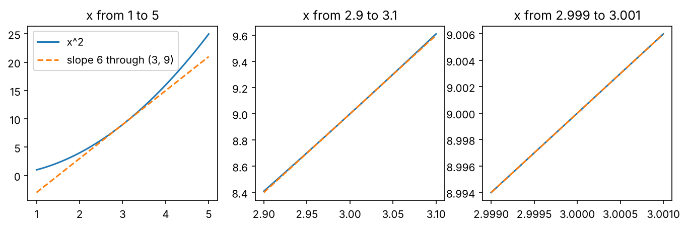
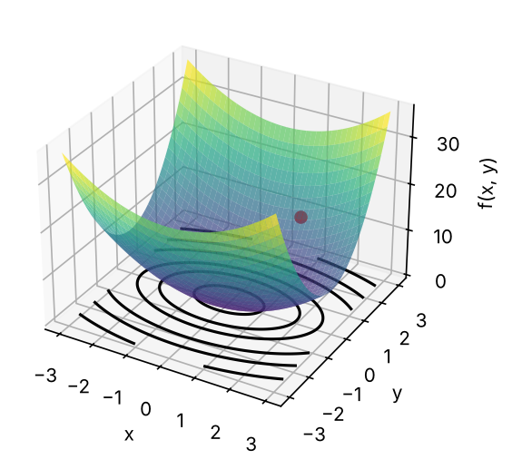
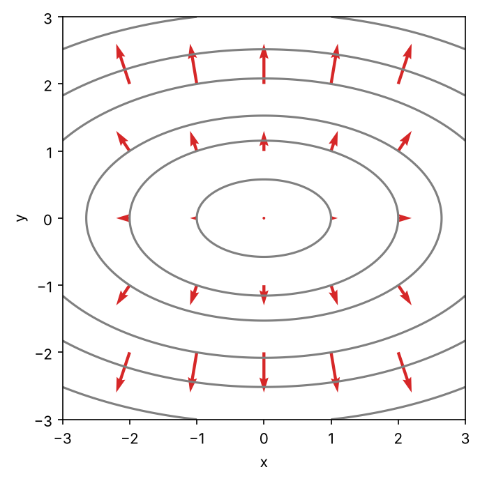
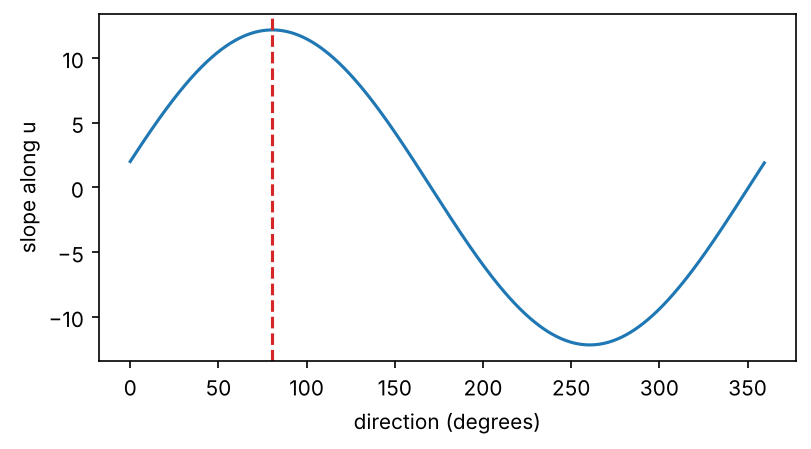
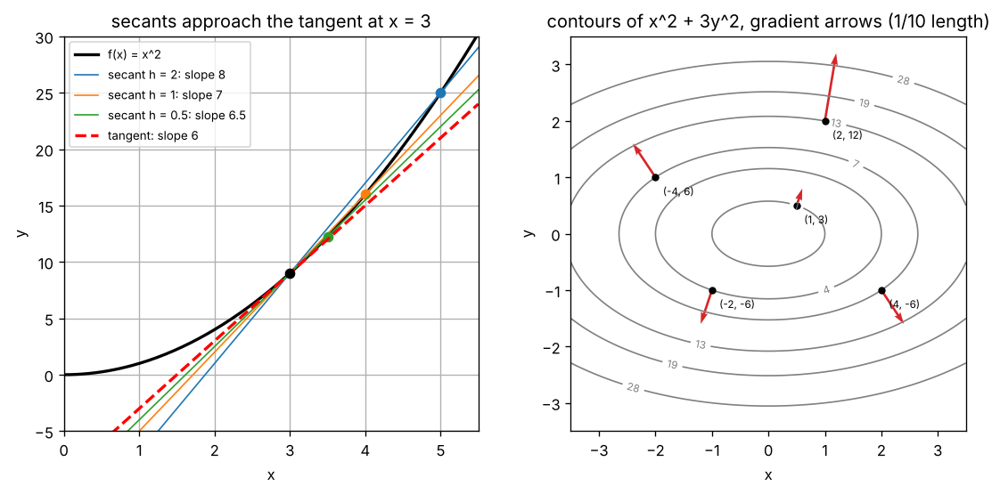
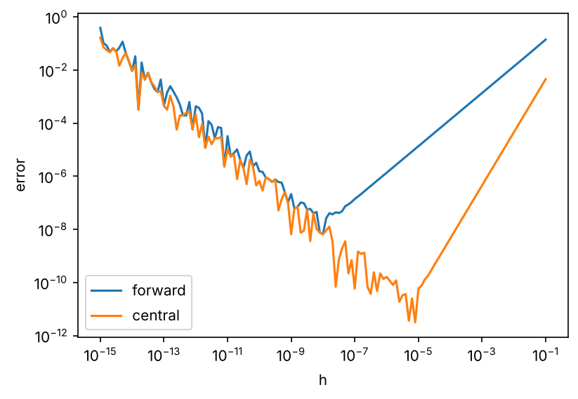

import { Aside, LinkButton } from '@astrojs/starlight/components';
import SecantTangentDemo from '../../../components/SecantTangentDemo.tsx';
import GradientFieldDemo from '../../../components/GradientFieldDemo.tsx';
import DirectionalDerivativeDemo from '../../../components/DirectionalDerivativeDemo.tsx';
import FiniteDiffErrorDemo from '../../../components/FiniteDiffErrorDemo.tsx';

<Aside type="note" title="影片">
本集影片製作中，完成後會放在這裡。
</Aside>

## 這集要解決什麼問題

EP03 最後留下一個問題：矩陣裡的數字，例如 `nn.Linear` 的權重 $W$，要靠訓練一點一點調整。**每個參數該往哪個方向改、改多少？** EP00 說過，告訴每個參數「該往哪個方向調、調多少」的訊號叫梯度 gradient；EP01 說過，訓練時用損失 loss 衡量模型錯多少，越小越好。這集要把「梯度」從一個名字，變成算得出來、畫得出來的東西。出發點是 EP02 提過的斜率 slope：$e^x$ 在每一點的斜率剛好等於它自己的值。可是曲線的「多陡」要怎麼量？

<Aside type="tip" title="小提醒">

沒看過前幾集也沒關係，這集只需要幾個前提。EP01：我們在自己的電腦建了一個叫 `llm-labs` 的 Python 專案，用 `uv run pytest` 跑測試。EP02：函數 $f(x)$ 是「輸入 → 輸出」的機器，也可以有好幾個輸入；$e^x$（`np.exp`）的反函數是 $\ln x$（`np.log`），而且 $e^{a+b} = e^a \cdot e^b$。EP03：向量是一排數字，也是箭頭；$\lVert a \rVert$ 是長度，長度 1 的單位向量只代表方向；內積 $a \cdot b = \sum_i a_i b_i = \lVert a \rVert \lVert b \rVert \cos\theta$（$\theta$ 是兩支箭頭的夾角）；`nn.Linear` 的 $W$ 形狀是 `(輸出, 輸入)`。還沒有 `llm-labs` 的話，先照 EP01 第一部分建好（步驟 7 的 PyTorch 可以先跳過）。

</Aside>

| 看過的東西 | 出處 | 還沒回答的 | 在哪裡回答 |
|---|---|---|---|
| 斜率：曲線在某一點有多陡 | EP02 | 曲線的「多陡」怎麼量？ | 工具一、工具二 |
| $e^x$ 每一點的斜率等於自己的值 | EP02 | 為什麼？ | 工具二 |
| 一排數字進、一個數出的函數 | EP02 | 每個輸入各有多大影響？ | 工具三 |
| 梯度：告訴每個參數該怎麼調的訊號 | EP00 | 它到底是什麼？ | 工具四 |
| $a \cdot b = \lVert a \rVert \lVert b \rVert \cos\theta$ | EP03 | 和「最陡的方向」有什麼關係？ | 本集重點 |
| 每個參數該往哪個方向改、改多少？ | EP03 | 全部 | 本集重點（方向）；改多少是 EP08 |

這集一共四個工具：**斜率與平均變化率、導數、偏導數與等高線、梯度**。最後會看到這集最重要的一件事：**梯度指向上升最快的方向，負梯度指向下降最快的方向**。這就是「每個參數該往哪個方向改」的答案。

學完這集，你應該能：

- 算直線的斜率和曲線上兩點之間的平均變化率，用「$h$ 越來越小」說明導數和切線，看懂 $f'(x)$、$\frac{df}{dx}$。
- 用中央差分算數值導數，說出它為什麼比前向差分準、$h$ 為什麼不能太小；會用 $x^n$、$e^x$、$\ln x$ 的導數。
- 從導數的正負號判斷上坡、下坡，用 $f(x + h) \approx f(x) + f'(x)\,h$ 預測輸出的變化。
- 對多個輸入的函數算偏導數、排成梯度，在等高線圖上畫出梯度箭頭。
- 用 $\nabla f \cdot u = \lVert \nabla f \rVert \cos\theta$ 解釋梯度為什麼指向上升最快的方向，並從零寫出數值梯度，和 PyTorch 比對。

## 準備：開一個邊讀邊跑的 notebook

在 Ubuntu 終端機進到 `llm-labs`，建立這集的資料夾：

```bash
cd ~/code/llm-labs
mkdir -p ep04 && touch ep04/__init__.py
```

接著在 VS Code 新增 `ep04/playground.ipynb`，kernel 選 `.venv`，第一個 cell 寫：

```python
import sys
sys.path.append("..")    # 讓 Python 也到上一層（llm-labs）找程式

import math
import numpy as np
import matplotlib.pyplot as plt
```

`matplotlib` 是 EP02 畫函數圖用過的套件。也可以直接打開這集的 notebook 邊讀邊跑。

<LinkButton href="https://colab.research.google.com/github/chainchen1103/llm-from-scratch/blob/main/notebooks/ep04/ep04_derivatives_gradients.ipynb" icon="external" target="_blank" rel="noopener noreferrer">在 Colab 開啟 notebook</LinkButton>
<LinkButton href="https://github.com/chainchen1103/llm-from-scratch/blob/main/notebooks/ep04/ep04_derivatives_gradients.ipynb" variant="secondary" target="_blank" rel="noopener noreferrer">在 GitHub 查看</LinkButton>

<Aside type="tip" title="小提醒">

接下來的程式區塊裡，`print()` 那一行後面的註解就是印出來的結果，其他註解是說明。迴圈或印出好幾行的區塊，結果會依序寫在區塊最後的註解裡。

</Aside>

**寫法約定**：$h$ 一律代表「很小的一步」，可以是負的（往左走）。$\Delta$ 是希臘字母，念「delta」，表示**變化量 change**：$\Delta x$ 是 $x$ 變了多少。

## 工具一：斜率與平均變化率

### 直線的斜率：上升 ÷ 前進

EP02 的 $f(x) = 2x + 1$ 畫出來是一條直線。在直線上從一點走到另一點，往右走（前進）$\Delta x$、往上走（上升）$\Delta y$，斜率就是：

$$
\frac{\Delta y}{\Delta x} = \frac{f(x_2) - f(x_1)}{x_2 - x_1}
$$

白話：往右走 1 步，往上爬幾步。正的是上坡、負的是下坡、0 是平的。

```python
def f(x):
    return 2 * x + 1

print((f(1) - f(0)) / (1 - 0), (f(5) - f(2)) / (5 - 2), (f(10) - f(-3)) / (10 - (-3)))   # 2.0 2.0 2.0
```

直線的斜率在哪裡量都一樣，就是 $x$ 前面的 2（直線 $y = mx + b$ 的 $m$）：$x$ 每多 1，輸出多 2。

### 曲線上的割線：平均變化率

$g(x) = x^2$ 是曲線。從 $x = 3$ 出發、走到不同的終點，算出來的斜率都不一樣：

```python
def g(x):
    return x ** 2

for b in [5, 4, 3.5]:
    print(b, (g(b) - g(3)) / (b - 3))
# 5 8.0
# 4 7.0
# 3.5 6.5
```

穿過曲線上兩點的直線叫**割線 secant line**，它的斜率叫**平均變化率 average rate of change**：

$$
\frac{g(b) - g(a)}{b - a}
$$

白話：從 $a$ 走到 $b$，平均每走 1 步，輸出變多少。

就像開車 2 小時走了 120 公里，平均時速 60；但儀表板上顯示的，是「這一瞬間」的時速。EP02 說的「某一點有多陡」是儀表板那一種。怎麼量？讓終點越來越靠近起點：8 → 7 → 6.5，好像在靠近某個數。

## 工具二：導數

### 讓 h 越來越小

把終點寫成 $3 + h$，讓 $h$ 越來越小：

```python
for h in [1, 0.1, 0.01, 0.001, 0.0001]:
    print(h, (g(3 + h) - g(3)) / h)
# 1 7.0
# 0.1 6.100000000000012
# 0.01 6.009999999999849
# 0.001 6.000999999999479
# 0.0001 6.000100000012054
```

越來越靠近 6。用代數也看得出來（$h$ 不是 0，才能約分）：

$$
\frac{(3 + h)^2 - 3^2}{h} = \frac{9 + 6h + h^2 - 9}{h} = 6 + h
$$

白話：割線的斜率剛好是 $6 + h$，$h$ 越小，就越靠近 6。

最後幾位的 `...012`、`...849` 是 EP02 看過的捨入誤差，弄壞它 2 會再遇到它。$h$ 是負的（終點在左邊）也一樣，$h = -0.1$ 得到約 5.9。

「$h$ 越來越靠近 0（但不等於 0）時，式子越來越靠近的那個數」叫**極限 limit**，寫成 $\lim_{h \to 0}$，念「h 趨近於 0 的極限」：

$$
\lim_{h \to 0} \frac{(3 + h)^2 - 3^2}{h} = 6
$$

白話：$h$ 越來越小，割線的斜率越來越靠近 6。

這個 6 就是 $x^2$ 在 $x = 3$ 的**導數 derivative**：曲線在這一點的斜率。$h$ 不能等於 0（分母會是 0），所以只能說「靠近」。

### 放大看，曲線就像直線

把 $x = 3$ 附近放大三次，同時畫一條通過 $(3, 9)$、斜率 6 的虛線：

```python
fig, axes = plt.subplots(1, 3, figsize=(11, 3))
for ax, w in zip(axes, [2, 0.1, 0.001]):
    xs = np.linspace(3 - w, 3 + w, 101)
    ax.plot(xs, g(xs), label="x^2")
    ax.plot(xs, 9 + 6 * (xs - 3), "--", label="slope 6 through (3, 9)")
    ax.set_title(f"x from {3 - w:g} to {3 + w:g}")
axes[0].legend()
plt.show()
```



1 到 5 看得出是彎的，2.9 到 3.1 幾乎是直的，2.999 到 3.001 已經和虛線分不開。這條通過 $(3, 9)$、斜率等於導數的直線叫**切線 tangent line**：$y = 9 + 6(x - 3)$。割線的兩個點越靠越近，割線就轉成切線。

### 記號：f′(x) 和 df/dx

任何一點 $x$ 都能這樣算：

$$
f'(x) = \lim_{h \to 0} \frac{f(x + h) - f(x)}{h}
$$

白話：輸入動一點點 $h$，看輸出變了多少，再除以 $h$。

$f'(x)$ 念「f prime x」，也可以說「f 的導數」。把剛才的 3 換成一般的 $x$：$\frac{(x + h)^2 - x^2}{h} = 2x + h$，$h \to 0$ 時是 $2x$，所以 $(x^2)' = 2x$：$x = 3$ 是 6，$x = 0$ 是 0（谷底是平的），$x = -1$ 是 $-2$（下坡）。

**導數本身也是一個函數**：輸入 $x$，輸出那一點的斜率。求導數這件事叫**微分 differentiation**，例如「對 $x$ 微分」。（整個函數 $f'(x)$ 也常叫導函數，這個系列都叫導數。）

另一種寫法是 $\frac{df}{dx}$，念「d f d x」，來自 $\frac{\Delta f}{\Delta x}$，$d$ 代表「小到趨近於 0 的變化」。它不是普通的分數，$d$ 不能約掉；好處是寫得出「對誰微分」，工具三有好幾個輸入時就用得到。

下面的元件可以選 $h$，或沿著曲線拖動 Q（割線的另一個點）：$h$ 越小，割線越貼近切線，割線斜率越接近導數。也可以切換成 $x^3$、$e^x$（它們的導數在下面的「常用導數」）。

<SecantTangentDemo client:visible />

### 數值導數：前向差分與中央差分

電腦沒辦法讓 $h$ 真的趨近 0，只能挑一個很小的 $h$ 直接算，這叫**數值微分 numerical differentiation**，算出來的數叫數值導數。常見的做法有兩種：

- **前向差分 forward difference**：$\frac{f(x + h) - f(x)}{h}$，就是定義裡的式子，只往右看。
- **中央差分 central difference**：$\frac{f(x + h) - f(x - h)}{2h}$，左右各走 $h$，割線的兩個點對稱地夾住 $x$。

```python
def cube(x):
    return x ** 3

h = 0.001
print((cube(2 + h) - cube(2)) / h)              # 前向：12.006000999997823
print((cube(2 + h) - cube(2 - h)) / (2 * h))    # 中央：12.000000999998317
```

$x^3$ 的導數是 $3x^2$（下一節的冪次法則），在 2 是 12。前向差了約 0.006，中央只差 0.000001。前向的割線只往右看，曲線彎多少它就偏多少；中央是往右、往左兩條割線斜率的平均，彎曲造成的偏差大致抵消。用 $x^2$ 看最清楚：在 3 往右的割線斜率是 $6 + h$，往左是 $6 - h$，平均剛好是 6。

之後都用中央差分，$h$ 預設 `1e-5`（$10^{-5}$；為什麼是這個數，見弄壞它 2）：

```python
def nd(f, x, h=1e-5):
    return (f(x + h) - f(x - h)) / (2 * h)

print(nd(g, 3.0), nd(cube, 2.0))    # 6.000000000039306 12.00000000021184
```

`nd` 是動手做 `numerical_derivative` 的簡短版。數值導數不用推公式，只要那一點有導數（見弄壞它 4）就能算，代價是一點誤差，以及每次要算兩次 $f$。

### 常用導數

常數、$x^2$、$x^3$ 都能照上面的定義推出來（展開、約分、讓 $h \to 0$），下表的三、四列也是（把 $c$ 提到前面、把分子拆成兩個函數各自的變化）；一般的 $x^n$ 先接受結果，$e^x$、$\ln x$ 等一下說明。全部都可以用 `nd` 驗證：

| 函數 | 導數 | 說明 |
|---|---|---|
| 常數 $c$ | $0$ | 平的，斜率處處是 0 |
| $x^n$ | $n x^{n-1}$ | $(x^2)' = 2x$、$(x)' = 1$；$n$ 是負數也成立（$x \ne 0$）：$(1/x)' = -x^{-2}$ |
| $c \cdot f(x)$ | $c \cdot f'(x)$ | 函數放大 $c$ 倍，斜率也放大 $c$ 倍 |
| $f(x) + g(x)$ | $f'(x) + g'(x)$ | 分開微分再加起來 |
| $e^x$ | $e^x$ | 斜率等於自己的值 |
| $\ln x$ | $1/x$ | 只在 $x > 0$ 有定義；越往右爬得越慢 |

第二列叫**冪次法則 power rule**。三、四列一起用：$(3x^2 + 2x + 1)' = 6x + 2$，在 $x = 2$ 是 14。

```python
print(nd(lambda x: 3 * x ** 2 + 2 * x + 1, 2.0))          # 14.000000000002897
print(nd(lambda x: 1 / x, 2.0), nd(lambda x: 7.0, 2.0))   # -0.2500000000099645 0.0
```

`lambda x: ...` 是不取名字的小函式，等於只有一行 `return` 的 `def`。接著看 **$e^x$**：EP02 說 $e^x$ 每一點的斜率都等於自己的值，現在可以驗證了：

```python
for x in [-1.0, 0.0, 1.0, 2.0]:
    print(x, nd(np.exp, x), np.exp(x))
# -1.0 0.3678794411765551 0.36787944117144233
# 0.0 1.0000000000121023 1.0
# 1.0 2.718281828517632 2.718281828459045
# 2.0 7.38905609911633 7.38905609893065
```

斜率和高度的前 9 位都一樣，$(1, e)$ 那一點的斜率就是 $e \approx 2.718$。為什麼？用指數律 $e^{x+h} = e^x \cdot e^h$：

$$
\frac{e^{x+h} - e^x}{h} = e^x \cdot \frac{e^h - 1}{h}
$$

白話：$e^x$ 可以整個提出來，剩下的 $\frac{e^h - 1}{h}$ 和 $x$ 無關。

$h$ 越小，$\frac{e^h - 1}{h}$ 越靠近 1（下面的最右欄）；底數換成 2，則靠近 0.693，正好是 $\ln 2$（中間那欄）：

```python
for h in [0.1, 0.001, 0.00001]:
    print(h, (2 ** h - 1) / h, (math.e ** h - 1) / h)
print(np.log(2))
# 0.1 0.7177346253629313 1.0517091807564771
# 0.001 0.6933874625807412 1.0005001667083846
# 1e-05 0.6931495828199629 1.000005000006965
# 0.6931471805599453
```

同一招用在 $2^x$：$(2^x)' = \ln 2 \cdot 2^x \approx 0.693 \cdot 2^x$。只有底數是 $e$ 時，這個倍數剛好是 1，這就是 EP02 說的「$e^x$ 的斜率最乾淨」。為什麼偏偏是 $e$？回到 EP02 的複利：$(1 + \frac{1}{n})^n \approx e$。令 $h = \frac{1}{n}$，就是 $(1 + h)^{1/h} \approx e$；兩邊取 $h$ 次方，得到 $1 + h \approx e^h$，所以 $\frac{e^h - 1}{h} \approx 1$，$h$ 越小越準。

EP02 的級數 $e^x = 1 + x + \frac{x^2}{2!} + \frac{x^3}{3!} + \cdots$ 也說得通了：每一項用冪次法則微分，$\left(\frac{x^k}{k!}\right)' = \frac{k x^{k-1}}{k!} = \frac{x^{k-1}}{(k-1)!}$（$k! = k \times (k-1)!$，分子分母的 $k$ 約掉），剛好變成前一項（第一項 1 是常數，微分是 0），所以整串微分完還是自己；$x = 0$ 時它又是 1，和 $e^x$ 一樣。（同時符合這兩件事的函數只有一個，證明不在這裡做。）用 EP02 寫的 `exp_series` 驗證：

```python
from ep02.mathlang import exp_series
print(nd(exp_series, 1.0), exp_series(1.0))   # 2.718281828473223 2.7182818284590455
```

最後幾位會隨你 `exp_series` 的寫法不同；沒做 EP02 的話，跳過這個 cell。再看 **$\ln x$**：

```python
for x in [0.5, 1.0, 2.0, 10.0]:
    print(x, nd(np.log, x), 1 / x)
# 0.5 2.0000000002629026 2.0
# 1.0 1.0000000000343332 1.0
# 2.0 0.5000000000088267 0.5
# 10.0 0.09999999999177332 0.1
```

EP02 說 $\ln x$ 是 $e^x$ 對 $y = x$ 的鏡像：$(a, e^a)$ 在 $e^x$ 上，$(e^a, a)$ 就在 $\ln x$ 上。鏡像把「上升」和「前進」對調，斜率變成倒數：$e^x$ 在 $(a, e^a)$ 的斜率是 $e^a$，所以 $\ln x$ 在 $(e^a, a)$ 的斜率是 $1/e^a$；而那一點的 $x$ 就是 $e^a$，所以 $(\ln x)' = 1/x$。例如 $e^x$ 在 $(1, e)$ 的斜率是 $e$，$\ln x$ 在鏡像點 $(e, 1)$ 的斜率就是 $1/e$。

**這集不教的**：乘法、除法的微分規則，以及函數套著函數（EP02 的合成函數，例如 $e^{2x}$、$\ln(1 + x^2)$）怎麼微分。最後這個要用**鏈鎖律 chain rule**，是 EP05 的主角；在那之前，不確定的導數就用數值導數算。

### 正負號與 0：上坡、下坡、山頂、谷底

- $f'(x) > 0$：上坡，函數在這裡**遞增**（EP02）。
- $f'(x) < 0$：下坡，**遞減 decreasing**：輸入越大、輸出越小。
- $f'(x) = 0$：這一點是平的，可能是（附近的）山頂、谷底，也可能都不是。

```python
def wave(x):
    return x ** 3 - 3 * x                 # 導數是 3x² - 3

for x in [-2.0, -1.0, 0.0, 1.0, 2.0]:
    print(x, wave(x), round(nd(wave, x), 6))
# -2.0 -2.0 9.0
# -1.0 2.0 0.0
# 0.0 0.0 -3.0
# 1.0 -2.0 0.0
# 2.0 2.0 9.0
```

$x = -1$ 的導數是 0，左邊上坡、右邊下坡：它是附近的山頂（高度 2；不是整條曲線最高的地方，$x = 3$ 時是 18）。$x = 1$ 是附近的谷底（$-2$）。導數是 0 卻都不是的例子：$x^3$ 在 0，兩邊都是上坡，只在這一點平了一下。

不加 `round` 的話，$x = \pm 1$ 會印出 `9.992007221626408e-11`：中央差分算 $x^3$ 會多出 $h^2 = 10^{-10}$（$\frac{(x + h)^3 - (x - h)^3}{2h} = \frac{6x^2 h + 2h^3}{2h} = 3x^2 + h^2$），這是 $h$ 不等於 0 造成的誤差（弄壞它 2）。**訓練模型就是在找損失的谷底**，平滑的谷底導數是 0（尖底沒有導數，見弄壞它 4）。

### 導數＝輸出變化的倍數

切線貼著曲線，所以在 $x$ 附近：

$$
f(x + h) \approx f(x) + f'(x)\,h
$$

白話：輸入動 $h$，輸出大約動 $f'(x) \times h$。

用切線代替曲線，叫**線性近似 linear approximation**：

```python
for h in [0.1, 0.01]:
    print(h, g(3 + h), g(3) + 6 * h)
# 0.1 9.610000000000001 9.6
# 0.01 9.060099999999998 9.06
```

差距正好是 $h^2$（0.01、0.0001），$h$ 越小越準。**這條式子就是「往哪個方向改」的答案**：想讓 $f$ 變小，$f'(x) > 0$ 就讓 $x$ 減一點，$f'(x) < 0$ 就加一點，也就是往導數的**反方向**走。$x^2$ 在 3 的導數是 6，$x$ 減 0.01，$f$ 大約減 0.06。

## 工具三：偏導數與等高線

### 很多個輸入：碗與等高線

模型的損失不只一個輸入，而是所有的參數，Qwen2.5-0.5B 就有約 5 億個（EP00）。先看兩個輸入：

$$
f(x, y) = x^2 + 3y^2
$$

白話：$x$ 的平方，加上 3 倍的 $y$ 的平方。

每個點 $(x, y)$ 都有一個高度，畫成立體像一個碗：$(0, 0)$ 是碗底（高度 0），往外越來越高，$y$ 方向比 $x$ 方向陡（係數 3）。地板上同時畫出**等高線 contour line**：高度一樣的點連成的線，就像地圖上的等高線。

```python
def bowl(x, y):
    return x ** 2 + 3 * y ** 2

t = np.linspace(-3, 3, 201)
GX, GY = np.meshgrid(t, t)                # 201 × 201 的棋盤格：每一格的 x、y
fig = plt.figure(figsize=(5, 4))
ax = fig.add_subplot(projection="3d")     # 立體的座標軸
ax.plot_surface(GX, GY, bowl(GX, GY), cmap="viridis", alpha=0.7)
ax.contour(GX, GY, bowl(GX, GY), levels=[1, 4, 7, 13, 19, 28], offset=0, colors="k")   # 等高線畫在地板上
ax.plot([1], [2], [13], "ro")             # (1, 2) 在碗面上，高度 13
ax.set(xlabel="x", ylabel="y", zlabel="f(x, y)")
plt.show()
```



`np.meshgrid` 把兩排座標配成棋盤格，`bowl(GX, GY)` 一次算出整片棋盤格的高度（EP01 的向量化）。立體圖只能從一個角度看，之後都只畫地板上的等高線，也就是從正上方往下看。$x^2 + 3y^2 = 13$ 是一圈橢圓，$(1, 2)$ 就在上面（$1 + 12 = 13$）。相鄰兩條等高線的高度差一樣時，等高線越密，坡越陡（這裡 `levels` 的間隔不一樣，不能這樣比）。

### 固定其他、只動一個

其他輸入固定、只動一個，得到的導數叫**偏導數 partial derivative**，寫成 $\frac{\partial f}{\partial x}$。$\partial$ 是圓圓的 d，念「partial」；整個念「partial f partial x」，或「f 對 x 的偏導數」。怎麼算：把其他輸入當成常數，照上面的表微分。

$$
\frac{\partial f}{\partial x} = 2x, \qquad \frac{\partial f}{\partial y} = 6y
$$

白話：對 $x$ 來說，$3y^2$ 是常數，導數 0；對 $y$ 來說，它是 3 倍的 $y^2$，導數是 $3 \cdot 2y$。

在 $(1, 2)$ 是 2 和 12。數值驗證，一次只讓一個輸入動：

```python
h = 1e-5
print(bowl(1.0, 2.0))                                     # 13.0
print((bowl(1 + h, 2.0) - bowl(1 - h, 2.0)) / (2 * h))    # 只動 x：2.0000000000131024
print((bowl(1.0, 2 + h) - bowl(1.0, 2 - h)) / (2 * h))    # 只動 y：12.000000000078613
```

意思是：在 $(1, 2)$，$y$ 動一點點造成的變化，是 $x$ 動一樣多的 6 倍。

偏導數也可以想成**切一刀**：固定 $y = 2$，就是沿著水平線 $y = 2$ 把碗切開，切面是一條只有一個輸入的曲線 $f(x, 2) = x^2 + 12$，它在 $x = 1$ 的斜率就是 $\frac{\partial f}{\partial x} = 2$。

## 工具四：梯度

### 把偏導數排成向量

所有偏導數排成一個向量，叫**梯度 gradient**：

$$
\nabla f = \left(\frac{\partial f}{\partial x}, \frac{\partial f}{\partial y}\right) = (2x,\ 6y)
$$

白話：每個輸入一格，那一格放「只動這個輸入時的斜率」。

$\nabla$ 是倒過來的三角形，$\nabla f$ 念「f 的梯度」或「nabla f」。在 $(1, 2)$，$\nabla f = (2, 12)$。$n$ 個輸入就有 $n$ 個偏導數，所以梯度是和輸入一樣多個數字的向量，可以算長度、畫成箭頭（EP03）：

```python
grad = np.array([2 * 1.0, 6 * 2.0])
print(grad, np.linalg.norm(grad))     # [ 2. 12.] 12.165525060596439
```

### 畫成箭頭：垂直於等高線、指向上坡

```python
fig, ax = plt.subplots(figsize=(5, 5))
ax.contour(GX, GY, bowl(GX, GY), levels=[1, 4, 7, 13, 19, 28], colors="gray")
PX, PY = np.meshgrid(np.arange(-2.0, 2.5, 1.0), np.arange(-2.0, 2.5, 1.0))   # 5 × 5 個點
ax.quiver(PX, PY, 2 * PX, 6 * PY, color="C3", angles="xy", scale_units="xy", scale=20)
ax.set(aspect="equal", xlabel="x", ylabel="y")
plt.show()
```

`ax.quiver(位置 x, 位置 y, 箭頭 x, 箭頭 y)` 一次畫一群箭頭；`angles="xy", scale_units="xy", scale=20` 讓箭頭照座標的方向畫、長度縮成 1/20。`aspect="equal"` 讓兩軸同比例，橢圓才不會變形，「垂直」才看得出來。



看三件事：

1. 每支箭頭都**垂直於**經過它的等高線（$(0, 1)$ 這類點在沒畫出來的圈上，看兩側的圈）。
2. 都指向外，也就是**上坡**。
3. 沿著同一個方向越往外，箭頭越長；離碗底一樣遠時，$y$ 方向的箭頭比 $x$ 方向長（$y$ 方向比較陡）。碗底 $(0, 0)$ 的梯度是 $(0, 0)$，沒有箭頭（平的）。

<Aside type="caution" title="注意">

梯度箭頭畫在 $x$-$y$ 平面上，也就是立體圖的地板。它說的是**輸入**往哪個方向移動，高度上升最快（想下坡就往反方向），不是貼在碗面上往上指的箭頭；它的長度（例如 $(1, 2)$ 的 12.17）也不是高度，而是往箭頭方向的斜率：走一小步 $h$，高度大約增加 $12.17 \times h$。

</Aside>

下面的元件可以在等高線圖上拖一個點，看梯度箭頭和兩個偏導數怎麼跟著變：

<GradientFieldDemo client:visible />

為什麼梯度剛好垂直於等高線、指向上坡？這就是本集重點。

## 本集重點：梯度指向上升最快的方向

### 往任一方向走一小步：方向導數

站在 $p = (1, 2)$，方向用 EP03 的單位向量 $u = (u_1, u_2)$ 表示（長度 1，只代表方向）。走一小步 $h$ 就到 $p + h\,u$：$x$ 動了 $h u_1$，$y$ 動了 $h u_2$。用線性近似，把兩個輸入各自造成的變化加起來：

$$
f(p + h\,u) - f(p) \approx \frac{\partial f}{\partial x}\,h u_1 + \frac{\partial f}{\partial y}\,h u_2 = h\,(\nabla f \cdot u)
$$

白話：往 $u$ 走 $h$，高度的變化約等於 $h$ 乘上梯度和 $u$ 的內積。

所以沿著 $u$ 的斜率是 $\nabla f \cdot u$，叫**方向導數 directional derivative**。對這個碗，也可以像 $6 + h$ 那樣直接展開：

$$
\begin{aligned}
f(1 + h u_1,\ 2 + h u_2) &= (1 + h u_1)^2 + 3(2 + h u_2)^2 \\
&= 13 + h\,(2u_1 + 12u_2) + h^2\,(u_1^2 + 3u_2^2)
\end{aligned}
$$

白話：減掉 13、除以 $h$，$h \to 0$ 時只剩 $2u_1 + 12u_2$，正好是 $\nabla f \cdot u$。

一般的函數，「各自的變化可以直接相加」要求函數在 $p$ 附近夠平滑：放大看像一片斜斜的平面，沒有尖角或摺痕（弄壞它 4 的 $|x|$ 在 0 就不是）。證明要等 EP05 的鏈鎖律，這裡先用數字驗證。$u = (1, 0)$ 就是 $\frac{\partial f}{\partial x}$，$u = (0, 1)$ 就是 $\frac{\partial f}{\partial y}$：

```python
p = np.array([1.0, 2.0])

def bowl_v(v):                            # 同一個碗，改成吃一個向量
    return v[0] ** 2 + 3 * v[1] ** 2

h = 1e-5
for u in [np.array([1.0, 0.0]), np.array([0.0, 1.0]), np.array([0.6, 0.8])]:
    print(u, (bowl_v(p + h * u) - bowl_v(p - h * u)) / (2 * h), grad @ u)
# [1. 0.] 2.0000000000131024 2.0
# [0. 1.] 12.000000000078613 12.0
# [0.6 0.8] 10.79999999991088 10.8
```

第三個方向是 EP03 的 $(3, 4)$ 變成的單位向量：$0.6 \times 2 + 0.8 \times 12 = 10.8$，和數值一致。

### 用內積找最陡的方向

EP03 說 $a \cdot b = \lVert a \rVert \lVert b \rVert \cos\theta$，而 $u$ 的長度是 1：

$$
\nabla f \cdot u = \lVert \nabla f \rVert \cos\theta
$$

白話：往 $u$ 方向的斜率，等於梯度的長度乘上 $u$ 和梯度夾角的 $\cos$。

站的位置固定，$\lVert \nabla f \rVert$ 就固定，只有 $\cos\theta$ 隨方向變：

| 夾角 $\theta$ | $\cos\theta$ | 方向導數 | 意思 |
|---|---|---|---|
| 0°（和梯度同方向） | 1 | $\lVert \nabla f \rVert$（最大） | 上升最快 |
| 90°（和梯度垂直） | 0 | 0 | 高度暫時不變：這個方向貼著等高線 |
| 180°（和梯度反方向） | −1 | $-\lVert \nabla f \rVert$（最小） | 下降最快 |

**梯度指向上升最快的方向，長度就是那個方向的斜率；負梯度 $-\nabla f$ 指向下降最快的方向。**（前提是梯度不是零向量：碗底的梯度是 $(0, 0)$，零向量沒有方向，往每個方向的斜率都是 0。）第二列也解釋了為什麼梯度垂直於等高線：順著等高線走，高度不變，方向導數是 0，那個方向一定和梯度垂直。

### 把 u 轉一圈

每 15° 取一個方向（EP03 單位圓上的點 $(\cos t, \sin t)$），不用任何公式，直接用數值算出 24 個方向導數：

```python
def slope_along(deg):
    t = np.radians(deg)
    u = np.array([np.cos(t), np.sin(t)])    # 和 x 軸夾 deg 度的單位向量
    return (bowl_v(p + h * u) - bowl_v(p - h * u)) / (2 * h)

coarse = np.arange(0, 360, 15)              # 24 個方向
D = np.array([slope_along(d) for d in coarse])
fine = np.arange(0, 360, 0.5)               # 720 個方向
D2 = np.array([slope_along(d) for d in fine])
angle = np.degrees(np.arctan2(grad[1], grad[0]))      # 梯度和 x 軸的夾角
fig, ax = plt.subplots(figsize=(6, 3))
ax.plot(fine, D2)
ax.axvline(angle, color="C3", linestyle="--")
ax.set(xlabel="direction (degrees)", ylabel="slope along u")
print(np.round(D, 1))
print(coarse[D.argmax()], D.max(), coarse[D.argmin()], D.min())
print(fine[D2.argmax()], D2.max())
print(angle, np.linalg.norm(grad))
print(np.allclose(D, np.linalg.norm(grad) * np.cos(np.radians(coarse - angle))))
# [  2.    5.    7.7   9.9  11.4  12.1  12.   11.1   9.4   7.1   4.3   1.2
#   -2.   -5.   -7.7  -9.9 -11.4 -12.1 -12.  -11.1  -9.4  -7.1  -4.3  -1.2]
# 75 12.108748005790202 255 -12.108748005790202
# 80.5 12.165522430240825
# 80.53767779197439 12.165525060596439
# True
```



- 24 個方向裡，最陡的上坡在 75°（12.1），最陡的下坡在 255°，剛好反方向；改成每 0.5° 一個，最陡的上坡移到 80.5°，斜率 12.16552。
- `np.arctan2(y, x)` 從箭頭的 $(x, y)$ 算出它和 x 軸的夾角（單位是弧度，`np.degrees` 換成度）。梯度 $(2, 12)$ 的方向是 80.54°，長度 $\sqrt{148} \approx 12.1655$：**最陡的方向就是梯度的方向，最陡的斜率就是梯度的長度。**
- 最後一行：24 個數值都等於 $\lVert \nabla f \rVert \cos\theta$。圖是一條 cos 波浪，最高點在紅色虛線（梯度方向），離它 90° 的地方是 0（順著等高線的方向）。

下面的元件可以自己轉動 $u$，看方向導數跟著 $\cos\theta$ 變：

<DirectionalDerivativeDemo client:visible />

### 往負梯度走一小步

往 $-\nabla f$ 走一小步，到 $p - 0.01\,\nabla f$；再和「同樣走這麼遠、換別的方向」比：

```python
step = 0.01
dist = step * np.linalg.norm(grad)          # 走的距離：約 0.1217
print(bowl_v(p), bowl_v(p - step * grad))
for name, d in [("-x", np.array([-1.0, 0.0])), ("-y", np.array([0.0, -1.0]))]:
    print(name, bowl_v(p + dist * d))
# 13.0 11.5636
# -x 12.771489498788071
# -y 11.584536992728427
```

高度從 13 降到 11.5636。線性近似預測會少 $0.01 \times \lVert \nabla f \rVert^2 = 1.48$（走的距離 $0.01 \lVert \nabla f \rVert$ 乘上斜率 $\lVert \nabla f \rVert$），也就是 11.52，差的一點來自碗的彎曲。同樣走 0.1217，往 $-x$ 只降到 12.77，往 $-y$ 降到 11.58（梯度幾乎朝著 $y$），三個方向裡負梯度降最多。一步走多遠（0.01 怎麼選）、走幾步、什麼時候停，是 EP08 梯度下降 gradient descent 和學習率 learning rate 的事。

### 和 LLM 的連結

- **損失**是衡量模型錯多少的一個數，越小越好（怎麼算是 EP07 的交叉熵 cross-entropy）。訓練資料固定時，它是**所有參數的函數**：Qwen2.5-0.5B 的損失，是約 5 億個輸入的函數。
- 損失對參數的梯度有 5 億個數字，每個參數一格。正負號說「往哪邊改，損失會變大」，反過來改就是下坡；大小說「損失對這個參數有多敏感」。
- **梯度和參數的形狀一樣**：EP03 `nn.Linear` 的權重 $W$ 形狀是 `(2, 3)`，損失 $L$ 對 $W$ 的梯度 $\frac{\partial L}{\partial W}$ 也是 `(2, 3)`，第 $(i, j)$ 格是 $\frac{\partial L}{\partial W_{ij}}$。動手做的最後會實際算一次。
- 回答 EP03 的問題：**每個參數都往自己那一格梯度的反方向改，改的量和那一格成正比**（不管正負，離 0 越遠改得越多），就是上面的 `p - step * grad`：每一格乘同一個 `step`，合起來才剛好是負梯度，也就是損失下降最快的方向。

## 動手做：從零寫出 `calculus.py`

在 `llm-labs/ep04/calculus.py` 寫下面 3 個函式：

```python
import numpy as np

def numerical_derivative(f, x, h=1e-5):
    """用中央差分 (f(x + h) - f(x - h)) / (2h) 近似 f 在 x 的導數 f'(x)。
    f 吃一個數、吐一個數；x 是一個數。回傳一個數。"""

def numerical_gradient(f, x, h=1e-5):
    """f 吃一個 NumPy 陣列、吐一個數。對 x 的每一格各做一次中央差分，
    回傳和 x 形狀一樣的陣列（每一格是 f 對那一格的偏導數）。不能改到呼叫端的 x。"""

def directional_derivative(f, x, u, h=1e-5):
    """f 在 x 沿著方向 u 的方向導數，用中央差分 (f(x + h u) - f(x - h u)) / (2h)。
    u 不是單位向量時先除以自己的長度；u 是零向量（沒有方向）要 raise ValueError。"""
```

要求與提示：

1. **只用 NumPy 和基本的 Python**。`numerical_derivative` 一行就夠，就是前面的 `nd`。
2. **`numerical_gradient`** 先寫 `x = np.array(x, dtype=float)`：複製一份、轉成小數（弄壞它 5 會看到兩件事都要做）。`np.ndindex(x.shape)` 會依序產生每一格的索引（一維是 `(0,)`、`(1,)`⋯，二維是 `(0, 0)`、`(0, 1)`⋯），`x[idx]` 就能讀寫那一格，同一段程式能處理任何形狀。每一格先存原值 `old`，改成 `old + h` 算一次 `f`、改成 `old - h` 再算一次，最後 `x[idx] = old` 放回去。
3. **`directional_derivative`** 用 `np.linalg.norm(u)` 算長度；長度是 0 就 raise `ValueError`，訊息說 u 是零向量。

把下面的測試存成 `llm-labs/tests/test_ep04_calculus.py`：

```python
import math

import numpy as np
import pytest

from ep04.calculus import directional_derivative, numerical_derivative, numerical_gradient

def bowl(v):
    """f(x, y) = x² + 3y²：∂f/∂x = 2x、∂f/∂y = 6y。"""
    return v[0] ** 2 + 3 * v[1] ** 2

def xy(v):
    """f(x, y) = xy：∂f/∂x = y、∂f/∂y = x。兩個輸入互相影響，沒放回原值就會算錯。"""
    return v[0] * v[1]

def test_derivative_of_x_squared():
    assert math.isclose(numerical_derivative(lambda x: x ** 2, 3.0), 6.0, abs_tol=1e-6)   # 2x
    assert math.isclose(numerical_derivative(lambda x: x ** 3, 2.0), 12.0, rel_tol=1e-8)  # 3x²
    assert math.isclose(numerical_derivative(lambda x: 7.0, 1.5), 0.0, abs_tol=1e-9)      # 常數

def test_exp_is_its_own_derivative():
    for x in [-2.0, 0.0, 1.0, 3.0]:
        assert math.isclose(numerical_derivative(np.exp, x), np.exp(x), rel_tol=1e-6)

def test_log_derivative_is_one_over_x():
    for x in [0.5, 1.0, 2.0, 10.0]:
        assert math.isclose(numerical_derivative(np.log, x), 1 / x, rel_tol=1e-6)

def test_gradient_of_bowl_and_xy():
    assert np.allclose(numerical_gradient(bowl, np.array([1.0, 2.0])), [2.0, 12.0])
    assert np.allclose(numerical_gradient(bowl, np.array([1, 2])), [2.0, 12.0])    # 整數輸入也要對
    assert numerical_gradient(bowl, np.array([1, 2])).dtype == np.float64          # 回傳小數，不是整數
    assert np.allclose(numerical_gradient(bowl, np.zeros(2)), [0.0, 0.0], atol=1e-9)  # 碗底
    assert np.allclose(numerical_gradient(xy, np.array([1.0, 2.0])), [2.0, 1.0], rtol=0, atol=1e-8)  # 每一格都要放回原值

def test_gradient_shape_and_input_untouched():
    W = np.random.default_rng(0).normal(size=(2, 3))
    W_before = W.copy()
    grad = numerical_gradient(lambda M: np.sum(M ** 2), W)      # ∂/∂W_ij (Σ_kl W_kl²) = 2 W_ij
    assert grad.shape == (2, 3)
    assert np.allclose(grad, 2 * W)
    assert np.array_equal(W, W_before)                          # 一個位元都不能變

def test_directional_derivative_is_largest_along_gradient():
    p = np.array([1.0, 2.0])
    g = numerical_gradient(bowl, p)
    best = directional_derivative(bowl, p, g)                   # 沒有先變成單位向量也要對
    assert math.isclose(best, np.linalg.norm(g), rel_tol=1e-6)  # 最大值 = ‖∇f‖ = √148
    for deg in range(0, 360, 15):
        t = np.radians(deg)
        assert directional_derivative(bowl, p, [np.cos(t), np.sin(t)]) <= best + 1e-9
    assert math.isclose(directional_derivative(bowl, p, -g), -best, rel_tol=1e-6)   # 負梯度：下降最快
    assert math.isclose(directional_derivative(bowl, p, [0, 5]), 12.0, rel_tol=1e-6)  # (0, 5) → (0, 1)
    assert abs(directional_derivative(bowl, p, [-12, 2])) < 1e-6   # 和梯度垂直：順著等高線的方向，斜率 0
    with pytest.raises(ValueError):
        directional_derivative(bowl, p, [0, 0])                 # 零向量沒有方向

def test_matches_pytorch_autograd():
    torch = pytest.importorskip("torch")
    p = torch.tensor([1.0, 2.0], dtype=torch.float64, requires_grad=True)
    bowl(p).backward()                                          # PyTorch 自動算梯度（EP09 會從零做一個）
    assert np.allclose(p.grad.numpy(), numerical_gradient(bowl, np.array([1.0, 2.0])))

    rng = np.random.default_rng(1)
    X, Y = rng.normal(size=(4, 3)), rng.normal(size=(4, 2))
    W0 = rng.normal(size=(2, 3))

    def loss(W):                                                # 示範用的損失：均方誤差
        return ((X @ W.T - Y) ** 2).mean()

    W = torch.tensor(W0, requires_grad=True)
    ((torch.from_numpy(X) @ W.T - torch.from_numpy(Y)) ** 2).mean().backward()
    assert W.grad.shape == (2, 3)                               # 梯度和參數形狀一樣
    assert np.allclose(W.grad.numpy(), numerical_gradient(loss, W0), rtol=0, atol=1e-8)
```

最後一個測試和 PyTorch 官方的自動微分比對。幾個新寫法：

- `requires_grad=True` 告訴 PyTorch「要對這個張量算梯度」；`.backward()` 算完之後，梯度放在 `.grad`。`dtype=torch.float64` 讓 PyTorch 和 NumPy 一樣用 `float64`。
- 第二段的損失是**均方誤差 mean squared error**：每個輸出和「正確答案」`Y` 的差距平方後取平均，這裡只是示範用。
- `rtol=0`：`np.allclose` 預設除了 `atol`，還允許 0.001% 的相對誤差，數字大時會蓋過 `atol`；設成 0 才只比絕對誤差。

然後在 `~/code/llm-labs` 執行：

```bash
uv run pytest
```

EP01–EP03 各 7 個測試，加上這集的 7 個：裝了 PyTorch 會看到 `28 passed`；沒裝的話是 `25 passed, 3 skipped`，跳過的是 EP02、EP03、EP04 各一個和 PyTorch 比對的測試（`uv run pytest -rs` 會列出原因）。少做了哪一集，就少那一集的 7 個。參考解答在這集 notebook 的最後，先自己寫寫看。

### 畫出割線與梯度：`plot_gradient.py`

在 `llm-labs/ep04/plot_gradient.py` 寫一個畫圖腳本，執行 `uv run python ep04/plot_gradient.py` 會產生 `ep04/gradient.png`：

```python
from pathlib import Path

import numpy as np

OUT = Path(__file__).parent / "gradient.png"

def draw_secants(ax):
    """在 ax 上畫 f(x) = x²、從 x = 3 到 3 + h 的割線（h = 2、1、0.5），以及 x = 3 的切線。"""

def draw_gradients(ax):
    """在 ax 上畫 x² + 3y² 的等高線，以及 5 個點的梯度箭頭（長度縮成 1/10）。"""

if __name__ == "__main__":
    import matplotlib

    matplotlib.use("Agg")    # 只存檔、不開視窗
    import matplotlib.pyplot as plt

    # 一列兩張圖：左邊 draw_secants、右邊 draw_gradients，存成 OUT
```

要求與提示：

1. **`draw_secants`**：畫 $x^2$、三條割線（每條的終點畫一個點）、$x = 3$ 的切線（虛線）。圖例寫出每條線的斜率（`f"{slope:g}"` 會把 `8.0` 印成 `8`）；範圍寫死：$x$ 從 0 到 5.5，$y$ 從 −5 到 30。
2. **`draw_gradients`**：畫 $x^2 + 3y^2$ 在 $-3.5$ 到 $3.5$ 的等高線（`levels=[1, 4, 7, 13, 19, 28]`，再用 `ax.clabel(cs)` 在線上標高度，`cs` 是 `ax.contour` 的回傳值）；畫 $(1, 2)$、$(-2, 1)$、$(2, -1)$、$(-1, -1)$、$(0.5, 0.5)$ 的梯度箭頭（`quiver`，和上面一樣加 `angles="xy", scale_units="xy"`，但 `scale=10`：長度縮成 1/10，在標題註明）；每個點旁邊用 `ax.annotate(f"({gx:g}, {gy:g})", (x, y), textcoords="offset points", xytext=(5, -12))` 寫出梯度的值；`aspect="equal"`。
3. **固定設定、可以重現**（同 EP03）：寫死 `figsize` 和 `dpi`，存到 `OUT`。執行兩次，`md5sum ep04/gradient.png` 的指紋應該一樣。

畫對的話，左圖的圖例是斜率 8、7、6.5 和切線的 6；右圖 $(1, 2)$ 旁邊是 `(2, 12)`、$(-2, 1)$ 旁邊是 `(-4, 6)`。五個點都在畫出來的等高線上（例如 $(-1, -1)$ 在 4 那一圈），箭頭都垂直於那一圈、指向外。



### 損失對 W 的梯度，和 PyTorch 對照

在 `playground.ipynb` 執行（改過 `calculus.py` 之後，要重新啟動 kernel 才會讀到新版；重新啟動後先執行第一個 cell）。$X$、$W$ 和 EP03 `nn.Linear` 那一段是同一組亂數（先不管偏差），$Y$ 是示範用的「正確答案」，損失用均方誤差：

```python
from ep04.calculus import numerical_gradient

rng = np.random.default_rng(0)
X = rng.normal(size=(4, 3))          # 4 個 token，每個 3 維
W = rng.normal(size=(2, 3))          # 參數：(輸出, 輸入)
Y = rng.normal(size=(4, 2))          # 示範用的正確答案

def loss(W):
    return np.mean((X @ W.T - Y) ** 2)

G = numerical_gradient(loss, W)
print(loss(W), G.shape)
print(np.round(G, 3))
# 每個參數都往反方向改，改的量和那一格成正比
print(loss(W - 0.1 * G))
# 2.1080842504151196 (2, 3)
# [[-1.283 -0.624  0.044]
#  [-0.961 -0.348 -0.024]]
# 1.817189510791545
```

`G` 和 `W` 一樣是 `(2, 3)`。`G[0, 0]` 是 −1.283：`W[0, 0]` 調大一點，損失會變小；`G[0, 2]` 只有 0.044，損失對它不敏感。6 個參數一起往負梯度改一點，損失從 2.108 降到 1.817。裝了 PyTorch 的話，和它的自動微分對照：

```python
import torch

Wt = torch.tensor(W, requires_grad=True)
((torch.from_numpy(X) @ Wt.T - torch.from_numpy(Y)) ** 2).mean().backward()
print(Wt.grad.shape, np.allclose(Wt.grad.numpy(), G))   # torch.Size([2, 3]) True
```

**數值梯度的代價**：6 個參數要呼叫 `loss` 12 次（每格 2 次）；Qwen2.5-0.5B 約 5 億個參數，算一次梯度就要跑模型 10 億次，根本不可能。PyTorch 跑一次模型、再倒著算回來，就拿到全部的梯度，這是 EP09–EP11 的**自動微分 automatic differentiation** 和**反向傳播 backpropagation**。數值梯度之後拿來檢查別的方法算得對不對，叫**梯度檢查 gradient checking**（EP11）。

## 弄壞它

每一個都先**猜**結果，再執行，最後用自己的話解釋。弄壞它 3 用到工具四的 `grad` 和本集重點的 `bowl_v`、`p`、`step`；重新啟動過 kernel 的話，先執行第一個 cell 和定義這些變數的 cell。用這集的 notebook 的話，需要的東西都準備好了。

### 弄壞它 1：前向差分 vs 中央差分

$e^x$ 在 1 的導數是 $e$。$h$ 每小 10 倍，兩種差分的誤差各小幾倍？

```python
for h in [0.1, 0.01, 0.001]:
    fw = (np.exp(1 + h) - np.exp(1)) / h
    ce = (np.exp(1 + h) - np.exp(1 - h)) / (2 * h)
    print(f"{h:g} {abs(fw - np.e):.1e} {abs(ce - np.e):.1e}")
```

<details>
<summary>實際結果與解釋</summary>

```
0.1 1.4e-01 4.5e-03
0.01 1.4e-02 4.5e-05
0.001 1.4e-03 4.5e-07
```

`.1e` 是科學記號、小數點後 1 位：`1.4e-01` 是 $1.4 \times 10^{-1}$。$h$ 小 10 倍，前向的誤差小 10 倍（和 $h$ 成正比），中央小 100 倍（和 $h^2$ 成正比）：中央差分左右對稱，把和 $h$ 成正比的那部分偏差抵消掉了。

</details>

### 弄壞它 2：h 太小

把 $h$ 從 0.1 一路縮小到 $10^{-15}$，誤差會一直變小嗎？$h = 10^{-15}$ 時，數值導數是多少？

```python
hs = np.logspace(-15, -1, 141)          # 10 的 -15 次方到 -1 次方，次方平均取 141 個
fw = np.abs((np.exp(1 + hs) - np.exp(1)) / hs - np.e)
ce = np.abs((np.exp(1 + hs) - np.exp(1 - hs)) / (2 * hs) - np.e)
fig, ax = plt.subplots(figsize=(6, 4))
ax.loglog(hs, fw, label="forward")      # 兩軸都用對數刻度 log scale：每一大格乘 10
ax.loglog(hs, ce, label="central")
ax.set(xlabel="h", ylabel="error")
ax.legend()
print(f"{hs[fw.argmin()]:.0e} {fw.min():.1e} {hs[ce.argmin()]:.0e} {ce.min():.1e}")
print((np.exp(1 + 1e-15) - np.exp(1)) / 1e-15)
```

<details>
<summary>實際結果與解釋</summary>

```
1e-08 6.6e-09 8e-06 3.2e-12
3.108624468950438
```

第一行的後兩個數落在捨入誤差的雜訊裡，隨 CPU 不同，也可能是 `5e-06 3.6e-12`。



不會。前向差分在 $h \approx 10^{-8}$ 最準（誤差 $6.6 \times 10^{-9}$），中央差分在 $h \approx 10^{-5}$ 附近最準（誤差只有幾個 $10^{-12}$）；$h = 10^{-15}$ 算出 3.11，差了 14%。log–log 圖是 V 字：

- **右半邊**是**截斷誤差 truncation error**：$h$ 不是 0 造成的公式誤差，$h$ 越小越小。兩條都是斜直線：前向的斜率約 1（$h$ 小 10 倍、誤差小 10 倍），中央約 2（小 100 倍），就是弄壞它 1 的結果。
- **左半邊**是捨入誤差，$h$ 越小越大：$h$ 越小，$e^{1+h}$ 和 $e$ 前面相同的位數越多（$h = 10^{-15}$ 時有 15 位），相減全部抵消，剩下的有效位數越少，捨入誤差（EP01 的 `0.1 + 0.2`；`float64` 約 16 位有效數字）佔的比例越大，再除以很小的 $h$ 就被放大。

經驗法則：前向差分的 $h$ 取 $10^{-8}$ 左右（16 位的一半），中央差分取 $10^{-5}$ 到 $10^{-6}$（約三分之一），所以預設 `h=1e-5`。PyTorch 預設的 `float32` 只有約 7 位有效數字，數值梯度更不準，所以梯度檢查要用 `float64`（EP11）。

</details>

下面的元件把弄壞它 2 的 log–log 圖做成互動版：移動 $h$，看前向和中央差分的誤差各是多少、V 字的谷底在哪裡。元件的數字是瀏覽器用 JavaScript 實際算的：V 字的形狀、前向差分的谷底（$h = 10^{-8}$，誤差 $6.6 \times 10^{-9}$）都和上面一樣；中央差分就不同了：$h = 10^{-5}$ 的誤差是 $5.9 \times 10^{-11}$，谷底（圖上的圈）約在 $h = 7.9 \times 10^{-6}$、誤差約 $2.5 \times 10^{-11}$，都比 NumPy 谷底的 $3.2 \times 10^{-12}$ 大。這就是「落在捨入誤差的雜訊裡」：換一種實作、換一台電腦，這幾個數就可能不一樣。

<FiniteDiffErrorDemo client:visible />

### 弄壞它 3：正負號弄反

把本集重點的 `p - step * grad` 寫成 `p + step * grad`：

```python
print(bowl_v(p + step * grad))
```

<details>
<summary>實際結果與解釋</summary>

```
14.523600000000002
```

高度從 13 **升**到 14.52。梯度指向上坡，加上去就是往山上走。之後訓練時如果損失不降反升，第一個要檢查的就是這個正負號。

</details>

### 弄壞它 4：不能微分的點

$|x|$ 在 0 是一個尖角。**後向差分 backward difference** $\frac{f(x) - f(x - h)}{h}$ 只往左看。在 0，前向、後向、中央差分各是多少？第二個 `print` 離尖角只有 $10^{-6}$，真正的斜率是 1，中央差分呢？

```python
h = 1e-5
x0 = 1e-6                                     # 離尖角比 h 還近的一點
print((abs(0 + h) - abs(0)) / h, (abs(0) - abs(0 - h)) / h, (abs(0 + h) - abs(0 - h)) / (2 * h))
print((abs(x0 + h) - abs(x0 - h)) / (2 * h))
```

<details>
<summary>實際結果與解釋</summary>

```
1.0 -1.0 0.0
0.10000000000000005
```

右邊的斜率是 1、左邊是 −1，沒有一條切線貼得住，所以 $|x|$ 在 0 **不可微分 not differentiable**。中央差分把左右平均成 0，看起來像導數是 0 的平底，其實是尖底，這一點根本沒有導數。離尖角比 $h$ 還近時（$x = 10^{-6}$），兩個點跨過尖角，算出 0.1，真正的斜率卻是 1。EP10 的 ReLU rectified linear unit（$\max(0, x)$）在 0 也有尖角，PyTorch 在尖角直接規定一個值（ReLU 和 `abs` 在 0 都用 0）。

</details>

### 弄壞它 5：`numerical_gradient` 的兩個 bug

這個版本沒有複製 `x`，也忘了把改過的那一格復原。$f(x, y) = xy$ 的梯度是 $(y, x)$，在 $(1, 2)$ 是 $(2, 1)$：

```python
def grad_buggy(f, x, h=1e-5):
    grad = np.zeros_like(x)                        # 形狀和 dtype 都照抄 x
    for i in range(x.size):
        x[i] += h
        f_plus = f(x)
        x[i] -= 2 * h
        f_minus = f(x)
        grad[i] = (f_plus - f_minus) / (2 * h)     # 忘了把 x[i] 加回來
    return grad

def xy(v):
    return v[0] * v[1]

p = np.array([1.0, 2.0])
print(grad_buggy(xy, p), p)
q = np.array([1, 2])                               # 整數陣列
print(grad_buggy(xy, q), q)
```

<details>
<summary>實際結果與解釋</summary>

```
[2.      0.99999] [0.99999 1.99999]
[99999     0] [0 1]
```

- **忘了復原**：算完第 0 格，`x[0]` 停在 $1 - h$，第 1 格就在錯的位置 $(0.99999, 2)$ 算，得到 0.99999 而不是 1。錯得很少，很難發現。沒有複製，呼叫端的 `p` 也被改掉了：每算一次梯度，參數就默默飄一點。
- **整數陣列**：`q[0] += 1e-5` 把 1.00001 截成整數 1 存回去，不報錯；`-= 2e-5` 得到 0.99998，截成 0。於是 $(2 - 0) / 0.00002$ 在電腦裡算出 `99999.99999999999`（0.00002 存不準，又是捨入誤差），存進整數的 `grad`（`np.zeros_like` 連 dtype 也照抄 `x`）直接砍掉小數，變成 99999。
- 正確做法就是動手做提示 2 的兩件事：`np.array(x, dtype=float)` 複製並轉成小數；先存 `old`，最後 `x[idx] = old`。就算記得加回來，`0.5 + 1e-5 - 2e-5 + 1e-5` 也是 `0.49999999999999994`（捨入誤差），所以直接放回原值最保險。你的 `numerical_gradient(xy, np.array([1, 2]))` 應該是 `[2. 1.]`。

</details>

## 小結

- **斜率與平均變化率**：直線的斜率是上升 ÷ 前進；曲線上兩點的割線斜率是平均變化率。
- **導數** $f'(x) = \lim_{h \to 0} \frac{f(x + h) - f(x)}{h}$：割線的兩點越靠越近，就轉成切線，導數是切線的斜率，也是「輸出變化的倍數」：$f(x + h) \approx f(x) + f'(x)\,h$。正＝上坡、負＝下坡、0＝平的。常用的：$(x^n)' = n x^{n-1}$、$(e^x)' = e^x$、$(\ln x)' = 1/x$。
- **數值導數**：中央差分 $\frac{f(x + h) - f(x - h)}{2h}$ 的誤差和 $h^2$ 成正比，比前向差分準；$h$ 太小會被捨入誤差放大，預設 `1e-5`。
- **偏導數與梯度**：固定其他輸入、只動一個，得到偏導數；全部排成向量就是梯度 $\nabla f$，形狀和輸入一樣，在等高線圖上垂直於等高線、指向上坡。
- **本集重點**：方向導數 $\nabla f \cdot u = \lVert \nabla f \rVert \cos\theta$，所以梯度指向上升最快的方向，長度就是那個方向的斜率；負梯度指向下降最快的方向。訓練時，每個參數往自己那一格梯度的反方向改，改的量和那一格成正比，損失就往下降最快的方向走一小步。

## 自我檢測

1. 不用計算機：$x^2$ 從 $x = 1$ 到 $x = 3$ 的平均變化率是多少？在 $x = 1$ 的導數呢？$5x^3 - 2x + 7$ 在 $x = 1$ 的導數是多少？那裡是上坡還是下坡？$x$ 從 1 變成 1.01，輸出大約變多少？
2. 用「割線」「切線」「$h$ 越來越小」說明導數是什麼。中央差分為什麼比前向差分準？$h$ 為什麼不是越小越好？
3. $f(x, y) = x^2 y$：寫出 $\frac{\partial f}{\partial x}$、$\frac{\partial f}{\partial y}$ 和 $(3, 1)$ 的梯度。在 $(3, 1)$ 往哪個方向走上升最快？那個方向的斜率是多少？
4. 用 $\nabla f \cdot u = \lVert \nabla f \rVert \cos\theta$ 解釋：為什麼梯度和等高線垂直？為什麼負梯度是下降最快的方向？
5. 損失對形狀 `(2, 3)` 的 $W$ 的梯度是什麼形狀？某一格是 −1.283，那個參數該調大還是調小？為什麼不能用數值梯度訓練 5 億個參數的模型？
6. 用「梯度指向上升最快的方向」回答 EP03 結尾的問題：每個參數該往哪個方向改？一步要走多遠，為什麼這集還沒有答案？

<details>
<summary>參考答案</summary>

1. 平均變化率 $(9 - 1)/(3 - 1) = 4$；導數 $2x$ 在 1 是 2。$(5x^3 - 2x + 7)' = 15x^2 - 2$，在 1 是 13，正的，所以是上坡。輸出大約變 $13 \times 0.01 = 0.13$（實際是 0.131505）。
2. 割線穿過曲線上 $x$ 和 $x + h$ 兩點，斜率是平均變化率；$h$ 越來越小，割線轉成切線，割線斜率靠近的那個數就是導數（切線的斜率）。中央差分平均了往右、往左兩條割線，彎曲造成的偏差大致抵消，誤差和 $h^2$ 成正比；前向差分只往右看，誤差和 $h$ 成正比。$h$ 太小時，$f(x + h)$ 和 $f(x)$ 相減會抵消掉大部分位數，捨入誤差再除以很小的 $h$ 就被放大。
3. $\frac{\partial f}{\partial x} = 2xy$（$y$ 當常數），$\frac{\partial f}{\partial y} = x^2$（$x^2$ 是 $y$ 前面的常數倍）。$(3, 1)$ 的梯度是 $(6, 9)$。上升最快的方向就是梯度的方向，變成單位向量是 $(6, 9)/\sqrt{117} \approx (0.555, 0.832)$；那個方向的斜率是梯度的長度 $\sqrt{36 + 81} = \sqrt{117} \approx 10.82$。
4. 順著等高線走，高度暫時不變，方向導數是 0。梯度不是零向量時，$\lVert \nabla f \rVert \cos\theta = 0$ 只能是 $\cos\theta = 0$，也就是 $\theta = 90°$：順著等高線的方向和梯度垂直。站的位置固定時，方向導數只隨 $\cos\theta$ 變，最小是 $\theta = 180°$（$\cos\theta = -1$），也就是負梯度的方向，斜率 $-\lVert \nabla f \rVert$。
5. 也是 `(2, 3)`：梯度和參數形狀一樣，每個參數一格。−1.283 是負的，代表這個參數調大一點損失會變小，所以該調大（往梯度的反方向改）。數值梯度每個參數要算兩次損失，5 億個參數就要跑模型 10 億次才拿到一次梯度；自動微分跑一次模型、再倒著算回來就拿到全部（EP09–EP11）。
6. 每個參數都往自己那一格梯度的反方向改，改的量和那一格成正比（離 0 越遠，改得越多）；全部一起改，就是往損失下降最快的方向走一小步。可是梯度只描述「站的這一點附近」：走太遠，線性近似就不準了（往負梯度走 0.01 倍，碗的高度就已經和預測差了一點）。一步走多遠、要走幾步，是 EP08 梯度下降和學習率的事。

</details>

## 下一集

這集刻意避開了 $e^{2x}$、$\ln(1 + x^2)$ 這種函數套著函數的導數，而模型正是很多層函數的合成（EP02）。下一集 **EP05 鏈鎖律：反向傳播的數學核心**，學會把一層一層的導數串起來，這正是之後反向傳播一次算出全部梯度的原理。
