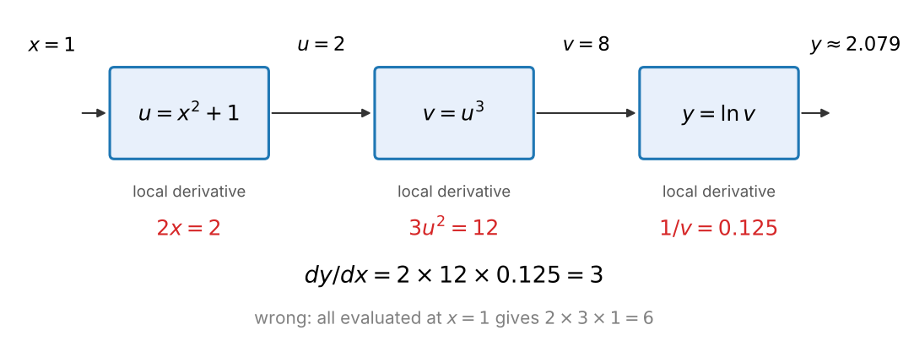
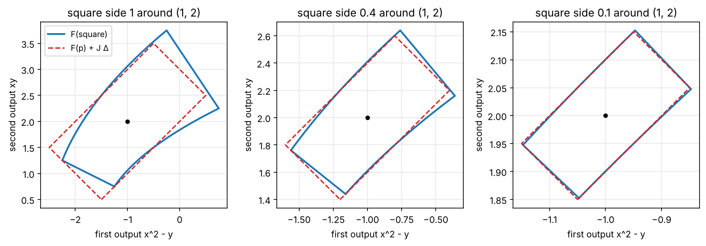
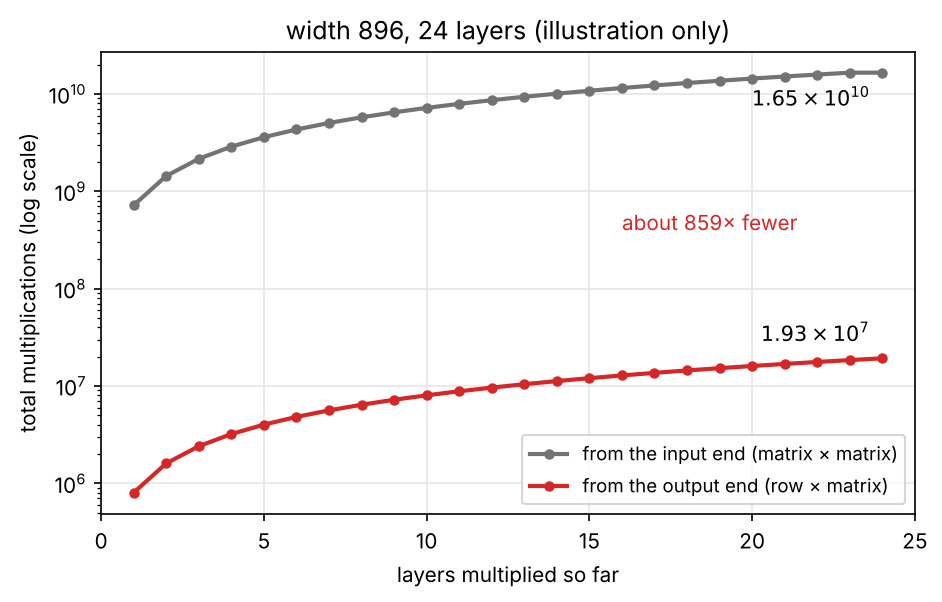
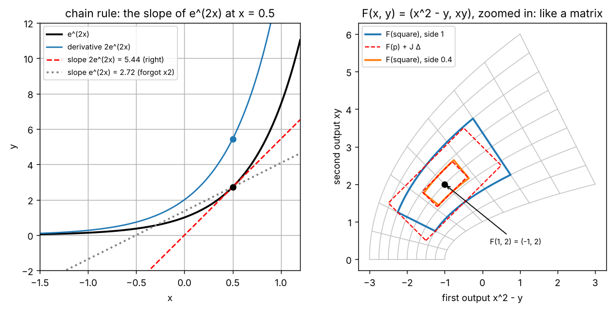
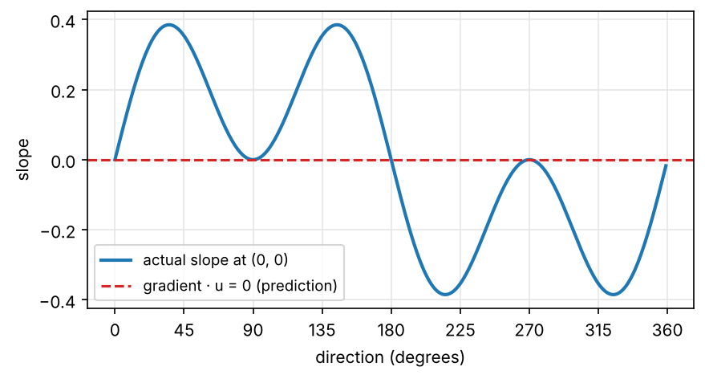
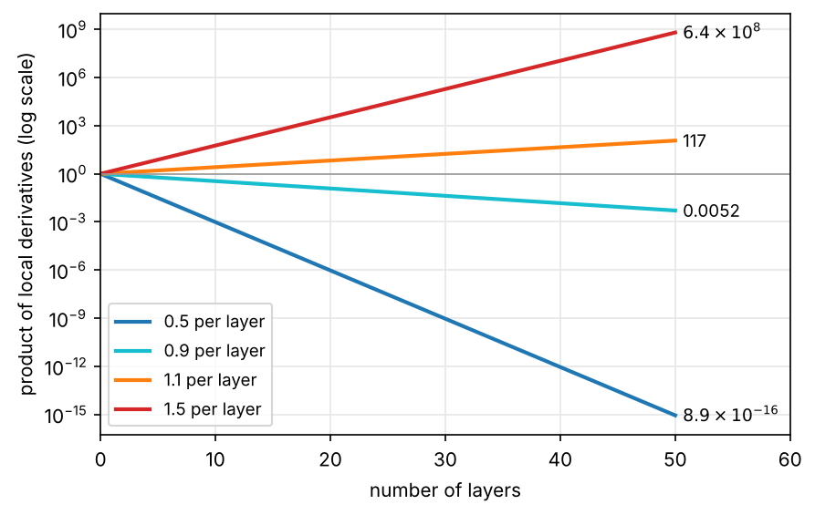

import { Aside, LinkButton } from '@astrojs/starlight/components';
import ChainMachinesDemo from '../../../components/ChainMachinesDemo.tsx';
import JacobianWarpDemo from '../../../components/JacobianWarpDemo.tsx';
import MultiplyOrderCostDemo from '../../../components/MultiplyOrderCostDemo.tsx';
import VanishingGradientDemo from '../../../components/VanishingGradientDemo.tsx';

<Aside type="note" title="影片">
本集影片製作中，完成後會放在這裡。
</Aside>

## 這集要解決什麼問題

EP04 學會了梯度：每個參數往自己那一格梯度的反方向改，損失下降得最快。它留下三個問題：

1. **函數套著函數怎麼微分？** EP04 刻意避開了 $e^{2x}$、$\ln(1 + x^2)$ 這種合成函數。
2. **方向導數為什麼能把「各自的變化直接相加」？** EP04 說這要求函數夠平滑，證明要等這集。
3. **5 億個參數的梯度怎麼算？** 數值梯度要跑模型 10 億次；PyTorch「跑一次模型，再倒著算回來」就拿到全部，怎麼做到的？

模型是很多層函數的合成（EP02），所以三個問題其實是同一個：**合成函數的導數怎麼算、怎麼算最省**。答案是**鏈鎖律 chain rule**。

<Aside type="tip" title="小提醒">

沒看過前幾集也沒關係，這集只需要幾個前提。EP01：`llm-labs` 是我們的 Python 專案（還沒有的話先照 EP01 建好），用 `uv run pytest` 跑測試。EP02：函數是「輸入 → 輸出」的機器，合成函數 $f(g(x))$ 是先做 $g$、再做 $f$，像兩台機器串起來。EP03：`(m, n) @ (n, p)` 得到 `(m, p)`，共 m × n × p 次乘法；矩陣是把向量變成向量的函數（線性變換），合成就是矩陣相乘，從右往左讀；`nn.Linear` 的 $W$ 形狀是 `(輸出, 輸入)`。EP04：線性近似 $f(x + h) \approx f(x) + f'(x)\,h$；偏導數排成梯度 $\nabla f$，碗 $x^2 + 3y^2$ 在 $(1, 2)$ 的梯度是 $(2, 12)$；$(x^n)' = n x^{n-1}$、$(e^x)' = e^x$、$(\ln x)' = 1/x$。這集會用到 EP04 的 `ep04/calculus.py`，還沒寫的話，先把 EP04 notebook 最後的參考解答存成這個檔案。

</Aside>

| 看過的東西 | 出處 | 還沒回答的 | 在哪裡回答 |
|---|---|---|---|
| 合成函數 $f(g(x))$；LLM 是很長的合成函數 | EP02 | 導數怎麼算？ | 工具一 |
| $e^{2x}$、$\ln(1 + x^2)$ | EP04 | 只能用數值導數算 | 工具一 |
| 方向導數：各自的變化直接相加 | EP04 | 為什麼可以？ | 工具二 |
| 一排數字進、一排數字出 | EP02、EP03 | 「導數」是什麼？ | 工具三 |
| 合成＝矩陣相乘；m × n × p 次乘法 | EP03 | 和導數有什麼關係？ | 工具四、本集重點 |
| 數值梯度要跑模型 10 億次 | EP04 | 怎麼一次拿到全部？ | 本集重點 |

這集一共四個工具：**一個輸入的鏈鎖律、多變數鏈鎖律與可微分、Jacobian 矩陣、Jacobian 相乘**。最後會看到這集最重要的一件事：**從輸出端倒著乘最省，一次就拿到所有輸入的梯度**。這就是反向傳播的數學核心（實作是 EP09–EP11 的事）。

學完這集，你應該能：

- 用「速率相乘」說明鏈鎖律 $(f \circ g)'(x) = f'(g(x)) \cdot g'(x)$，算出 $e^{2x}$、$\ln(1 + x^2)$ 和三層合成函數的導數，說出外層的導數在哪一點算。
- 用多變數鏈鎖律推出方向導數，說明「直接相加」需要可微分，以及同一個輸入走兩條路時貢獻相加。
- 寫出 Jacobian 矩陣，認得三種常見的 Jacobian，並用 Jacobian 相乘算合成函數的導數。
- 用乘法次數說明為什麼倒著乘最省，並從零寫出 `chain_gradient`，和 PyTorch 比對。

## 準備：開一個邊讀邊跑的 notebook

在 Ubuntu 終端機進到 `llm-labs`，建立這集的資料夾：

```bash
cd ~/code/llm-labs
mkdir -p ep05 && touch ep05/__init__.py
```

接著在 VS Code 新增 `ep05/playground.ipynb`，kernel 選 `.venv`，第一個 cell 寫：

```python
import sys
sys.path.append("..")    # 讓 Python 也到上一層（llm-labs）找程式

import numpy as np
import matplotlib.pyplot as plt
from ep04.calculus import numerical_derivative as nd, numerical_gradient
```

`as nd` 把 EP04 寫的 `numerical_derivative` 改叫短名字 `nd`（中央差分，$h$ 預設 `1e-5`）。也可以直接打開這集的 notebook 邊讀邊跑。

<LinkButton href="https://colab.research.google.com/github/chainchen1103/llm-from-scratch/blob/main/notebooks/ep05/ep05_chain_rule.ipynb" icon="external" target="_blank" rel="noopener noreferrer">在 Colab 開啟 notebook</LinkButton>
<LinkButton href="https://github.com/chainchen1103/llm-from-scratch/blob/main/notebooks/ep05/ep05_chain_rule.ipynb" variant="secondary" target="_blank" rel="noopener noreferrer">在 GitHub 查看</LinkButton>

<Aside type="tip" title="小提醒">

接下來的程式區塊裡，`print()` 那一行後面的註解就是印出來的結果，其他註解是說明。迴圈或印出好幾行的區塊，結果會依序寫在區塊最後的註解裡。

</Aside>

**寫法約定**：$f \circ g$（念「f 合成 g」；$\circ$ 是小圓圈，不是乘號）是「先做 $g$、再做 $f$」的合成函數：$(f \circ g)(x) = f(g(x))$。$g$ 叫內層，$f$ 叫外層。

## 工具一：一個輸入的鏈鎖律

### 速率相乘

最簡單的合成：$u = 2x$、$y = 3u$。$x$ 動 0.01，$u$ 動 0.02，$y$ 動 0.06：$u$ 的變化是 $x$ 的 2 倍，$y$ 又是 $u$ 的 3 倍，所以 $y$ 是 $x$ 的 $2 \times 3 = 6$ 倍。就像齒輪：A 轉 1 圈 B 轉 2 圈、B 轉 1 圈 C 轉 3 圈，A 轉 1 圈 C 就轉 6 圈。

曲線也一樣：放大看曲線就像直線（EP04），所以在一點附近，每台機器都把**輸入的變化量**乘上自己在那一點的斜率。看 $y = e^{2x}$：內層 $u = 2x$、外層 $y = e^u$。在 $x = 0.5$ 讓 $x$ 往右動 $h$：

```python
x = 0.5
for h in [0.1, 0.001, 0.00001]:
    du = 2 * (x + h) - 2 * x                    # 內層 u = 2x 變了多少
    dy = np.exp(2 * (x + h)) - np.exp(2 * x)    # 外層 y = eᵘ 變了多少
    print(f"{h:g} {du / h:.4f} {dy / du:.4f} {dy / h:.4f}")
# 0.1 2.0000 3.0092 6.0184
# 0.001 2.0000 2.7210 5.4420
# 1e-05 2.0000 2.7183 5.4366
```

`:.4f` 印到小數點後 4 位。三欄是 $\frac{\Delta u}{\Delta x}$、$\frac{\Delta y}{\Delta u}$、$\frac{\Delta y}{\Delta x}$（$\Delta$ 是變化量），第三欄就是前兩欄相乘（$\Delta u$ 是真的數字，可以約掉）。$h$ 越小：第一欄一直是 2，內層的斜率；第二欄靠近 $e \approx 2.7183$，是 $e^u$ 在 $u = 1$ 的斜率，而 1 正是內層的輸出 $2 \times 0.5$；第三欄靠近 $2e \approx 5.4366$。

### 用線性近似推一次

一般的情形：內層 $u = g(x)$、外層 $y = f(u)$。$x$ 動 $h$，$u$ 大約動 $\Delta u \approx g'(x)\,h$；外層站在 $u = g(x)$，輸入動了 $\Delta u$，所以 $f(u + \Delta u) \approx f(u) + f'(u)\,\Delta u$。兩行接起來：

$$
f(g(x + h)) \approx f(g(x)) + f'(g(x)) \cdot g'(x)\,h
$$

白話：$x$ 動 $h$，最後的輸出大約動 $f'(g(x)) \cdot g'(x)$ 乘上 $h$。

和 EP04 的 $f(x + h) \approx f(x) + f'(x)\,h$ 對照，$h$ 前面的倍數就是 $f \circ g$ 的導數：

$$
(f \circ g)'(x) = f'(g(x)) \cdot g'(x)
$$

白話：**合成函數的導數＝外層的導數（在內層的輸出那一點算）× 內層的導數。**

這就是**鏈鎖律**。每台機器自己的導數只看自己的輸入和輸出，叫**局部導數 local derivative**：一路上的局部導數乘起來就好（前提是每一層在用到的那一點都有導數，$|x|$ 在 0 就沒有）。

### 兩種寫法：f′(g(x)) 和 dy/dx

$f'(g(x)) \cdot g'(x)$ 念「f 的導數在 g(x) 那一點的值，乘上 g 的導數」，**看得到在哪一點算**。另一種寫法用 $u$、$y$：

$$
\frac{dy}{dx} = \frac{dy}{du} \cdot \frac{du}{dx}
$$

白話：$y$ 對 $x$ 的倍數＝$y$ 對 $u$ 的倍數 × $u$ 對 $x$ 的倍數。

像分數約掉 $du$，所以好記；但 $\frac{dy}{du}$ 不是普通的分數（EP04），它成立靠的是上面的推導。這種寫法也藏起了「$\frac{dy}{du}$ 要在 $u = g(x)$ 算」（弄壞它 2）。

### 兌現 EP04 的兩個導數

- $e^{2x}$：內層 $2x$ 的導數是 2；外層 $e^u$ 的導數是 $e^u$，在 $u = 2x$ 算是 $e^{2x}$。所以 $(e^{2x})' = 2e^{2x}$。
- $\ln(1 + x^2)$：內層 $1 + x^2$ 的導數是 $2x$；外層 $\ln u$ 的導數是 $\frac{1}{u}$，在 $u = 1 + x^2$ 算。所以導數是 $\frac{2x}{1 + x^2}$。

$e^{2x}$ 的導數在 0.5 是 $2e \approx 5.4366$，和上面表格的第三欄一致。$\ln(1 + x^2)$ 用 EP04 的中央差分驗算：

```python
for x in [-1.0, 0.0, 0.5, 1.0, 2.0]:
    print(x, nd(lambda t: np.log(1 + t ** 2), x), 2 * x / (1 + x ** 2))
# -1.0 -0.9999999999843466 -1.0
# 0.0 0.0 0.0
# 0.5 0.7999999999591666 0.8
# 1.0 0.9999999999843466 1.0
# 2.0 0.8000000000008 0.8
```

兩欄只差不到 $10^{-9}$。$\ln(1 + x^2)$ 在 0 是谷底（左右對稱，數值導數剛好 `0.0`），$x = \pm 1$ 最陡，再往外又變平。

### 三層以上：一路相乘

$y = \ln\big((x^2 + 1)^3\big)$ 拆成三台機器，局部導數一路相乘：

$$
\begin{gathered}
x \xrightarrow{\ u = x^2 + 1\ } u \xrightarrow{\ v = u^3\ } v \xrightarrow{\ y = \ln v\ } y \\
\frac{dy}{dx} = \frac{dy}{dv} \cdot \frac{dv}{du} \cdot \frac{du}{dx} = \frac{1}{v} \cdot 3u^2 \cdot 2x
\end{gathered}
$$

白話：三台機器的局部導數乘起來。

```python
x = 1.0
u = x ** 2 + 1                       # 第 1 台：局部導數 2x
v = u ** 3                           # 第 2 台：局部導數 3u²
y = np.log(v)                        # 第 3 台：局部導數 1/v
local = [2 * x, 3 * u ** 2, 1 / v]   # 每一台都在「自己的輸入」那一點算
print(u, v, y)
print(local, np.prod(local))
print(nd(lambda t: np.log((t ** 2 + 1) ** 3), 1.0))
# 2.0 8.0 2.0794415416798357
# [2.0, 12.0, 0.125] 3.0
# 2.99999999995304
```

`np.prod` 把一排數字全部乘起來（EP02 的 $\prod$）：$2 \times 12 \times 0.125 = 3$，和數值導數一致。



**外層的導數要在內層的輸出那一點算**：$3u^2$ 代 $u = 2$（不是 $x = 1$），$\frac{1}{v}$ 代 $v = 8$；三個都在 $x = 1$ 算會得到 $2 \times 3 \times 1 = 6$，錯一倍。所以要先**往前算一遍、記下每一台的輸入**。這裡的局部導數都是數字，乘的順序無所謂；工具四換成矩陣就不行了。

下面的元件可以拖動滑桿改變 $x$，看每台機器的輸入、局部導數和乘積，也可以切換成「外層導數都在 $x$ 算」的錯誤版本：

<ChainMachinesDemo client:visible />

## 工具二：多變數鏈鎖律與可微分

### 兩條路，各自的變化相加

一個點沿著路徑走：時間 $t$ 決定位置 $(x(t), y(t))$，再算高度 $f(x, y)$。$t$ 動 $h$，$x$ 動 $\Delta x \approx \frac{dx}{dt}\,h$、$y$ 動 $\Delta y \approx \frac{dy}{dt}\,h$。先借用 EP04 的「各自的變化可以直接相加」（為什麼可以，等一下說明），$f$ 大約變了 $\frac{\partial f}{\partial x}\Delta x + \frac{\partial f}{\partial y}\Delta y$。除以 $h$：

$$
\frac{df}{dt} = \frac{\partial f}{\partial x}\frac{dx}{dt} + \frac{\partial f}{\partial y}\frac{dy}{dt} = \nabla f \cdot \left(\frac{dx}{dt}, \frac{dy}{dt}\right)
$$

白話：$t$ 經過 $x$、$y$ 兩條路影響 $f$；每條路上的局部導數相乘，兩條路再**相加**。

這叫**多變數鏈鎖律 multivariable chain rule**（$f$ 有兩個輸入，對其中一個微分寫 $\partial$；$x$、$y$ 和沿路的高度只有 $t$ 一個輸入，寫 $d$），$\left(\frac{dx}{dt}, \frac{dy}{dt}\right)$ 是點移動的速度。例子：EP04 的碗 $f = x^2 + 3y^2$，路徑 $(t^2, 2t)$，$t = 1$ 時走到 $(1, 2)$，速度 $(2t, 2) = (2, 2)$，梯度 $(2, 12)$：$2 \times 2 + 12 \times 2 = 28$（直接代 $f = t^4 + 12t^2$ 再微分也是 28）。

```python
def bowl(x, y):
    return x ** 2 + 3 * y ** 2

def path(t):
    return t ** 2, 2 * t                   # t = 1 時走到 (1, 2)

grad = np.array([2.0, 12.0])               # EP04：碗在 (1, 2) 的梯度 (2x, 6y)
velocity = np.array([2.0, 2.0])            # (dx/dt, dy/dt) = (2t, 2) 在 t = 1
print(nd(lambda t: bowl(*path(t)), 1.0), grad @ velocity)   # 28.000000000361066 28.0
```

`*` 把 `path` 回傳的 `(x, y)` 拆開，當成 `bowl` 的兩個參數。

### 兌現 EP04：方向導數是特例

EP04 的「往 $u$ 走一小步」就是一條直線路徑：時間 $t$ 走到 $p + t\,u$，速度永遠是 $u$。代進多變數鏈鎖律，在 $t = 0$（$\frac{d}{dt}$ 寫在式子前面，是把整個式子對 $t$ 微分）：

$$
\frac{d}{dt} f(p + t\,u) = \nabla f(p) \cdot u
$$

白話：沿著 $u$ 走的斜率，就是梯度和 $u$ 的內積，也就是 EP04 的方向導數。不過它靠的還是借來的加號。

### 為什麼可以相加：可微分

加號假設了 $f$ 在 $p$ 附近像一片斜斜的平面。正式的說法：$f$ 在 $p$ **可微分 differentiable**，是指

$$
f(p + \Delta) = f(p) + \nabla f(p) \cdot \Delta + \text{誤差}
$$

而且 $\Delta$ 越短，「誤差 ÷ 走的距離 $\lVert \Delta \rVert$」越靠近 0。

白話：走一小步 $\Delta$，高度的變化就是平面的預測 $\nabla f(p) \cdot \Delta$，誤差比走的距離小得多。

關鍵是**所有方向一起**：離 $p$ 夠近時，不管 $\Delta$ 指向哪裡（沿彎路靠近也一樣），比值都很小。加號就在定義裡：$\nabla f \cdot \Delta = \frac{\partial f}{\partial x}\Delta x + \frac{\partial f}{\partial y}\Delta y$。「曲線放大像直線」升級成「曲面放大像平面」（只有一個輸入時，可微分就是 EP04 的「有導數」）。碗在 $(1, 2)$ 往 $u = (0.6, 0.8)$ 走 $s$：

```python
p, u = np.array([1.0, 2.0]), np.array([0.6, 0.8])

def bowl_v(v):                                      # 同一個碗，改成吃一個向量
    return v[0] ** 2 + 3 * v[1] ** 2

for s in [0.1, 0.01, 0.001]:
    d = s * u                                       # 往 u 的方向走 s
    err = bowl_v(p + d) - (bowl_v(p) + grad @ d)    # 實際的高度 − 平面的預測
    print(f"{s:g} {err:.3g} {err / s:.3g}")
# 0.1 0.0228 0.228
# 0.01 0.000228 0.0228
# 0.001 2.28e-06 0.00228
```

`:.3g` 印 3 位有效數字。距離小 10 倍，誤差小 100 倍，誤差 ÷ 距離越來越靠近 0。但只走一個方向還不夠：碗的誤差其實是 $\Delta x^2 + 3\Delta y^2$（EP04 展開碗時的 $h^2$ 項，沿 $u$ 是 $2.28\,s^2$），不超過 $3\lVert \Delta \rVert^2$，往哪裡走都一樣小，所以碗可微分。

什麼樣的函數可微分？**一次只動一個輸入**：從 $(x, y)$ 走到 $(x + \Delta x, y + \Delta y)$ 拆成兩段（中間那一項加一次、減一次，所以是等號）：

$$
\begin{aligned}
&f(x + \Delta x, y + \Delta y) - f(x, y) \\
={}& \underbrace{f(x + \Delta x, y + \Delta y) - f(x, y + \Delta y)}_{\text{只動 } x} \\
+{}& \underbrace{f(x, y + \Delta y) - f(x, y)}_{\text{只動 } y}
\end{aligned}
$$

白話：先只動 $y$，再只動 $x$，總變化是兩段變化的和。

每一段只有一個輸入在動，可以用線性近似：第二段 $\approx \frac{\partial f}{\partial y}\,\Delta y$；第一段 $\approx \frac{\partial f}{\partial x}\,\Delta x$，但這個偏導數是在**已經移了 $\Delta y$ 的** $(x, y + \Delta y)$ 附近算的。只要偏導數不會因為位置動一點點就突然跳掉（這叫**連續 continuous**），它就差不多等於在 $(x, y)$ 的值，兩段加起來就是 $\nabla f \cdot \Delta$。例如碗沿 $u$ 走 0.01（$\Delta = (0.006, 0.008)$）：只動 $x$ 那段實際是 0.012036，預測 $2 \times 0.006 = 0.012$（碗的 $\frac{\partial f}{\partial x} = 2x$ 和 $y$ 無關，差的 $0.006^2$ 只是曲線彎曲）。

所以**偏導數都連續，函數就可微分，加號就成立**：這就是 EP04 留下的條件。**偏導數都存在還不夠**：只沿 $x$ 軸、$y$ 軸各切一刀，其他方向可能根本不是平面（弄壞它 3）。

### 同一個輸入走兩條路：貢獻相加

$f(x) = x \cdot e^x$：$x$ 進了乘法兩次，一次直接當 $a = x$，一次先變成 $b = e^x$。看成 $g(a, b) = a \cdot b$，套多變數鏈鎖律（$t$ 換成 $x$）：

$$
\frac{df}{dx} = \underbrace{\frac{\partial g}{\partial a} \cdot \frac{da}{dx}}_{b \cdot 1} + \underbrace{\frac{\partial g}{\partial b} \cdot \frac{db}{dx}}_{a \cdot e^x} = e^x + x\,e^x
$$

白話：$x$ 走 $a$、$b$ 兩條路影響結果，兩條路的貢獻加起來。

```python
x = 2.0
road_a = np.exp(x) * 1            # 第一條路：∂g/∂a · da/dx ＝ b · 1
road_b = x * np.exp(x)            # 第二條路：∂g/∂b · db/dx ＝ a · eˣ
print(road_a, road_b, road_a + road_b)
print(nd(lambda t: t * np.exp(t), x))
# 7.38905609893065 14.7781121978613 22.16716829679195
# 22.167168297571035
```

只算一條路會少一大塊，兩條加起來才是 $3e^2 \approx 22.17$（順便推出了 EP04 沒教的**乘法法則 product rule** $(pq)' = p'q + pq'$）。模型裡同一個參數會用很多次，例如每個 token 都被同一個 $W$ 變換（EP03）：每用一次就是一條路，梯度要把每條路的貢獻**加起來**，實作時怎麼加是 EP09 的事。

## 工具三：Jacobian 矩陣

### 每個輸出對每個輸入

EP02 的 Softmax、EP03 的線性變換都是一排數字進、一排數字出。$n$ 個輸入、$m$ 個輸出時，每個輸出 $y_i$ 都有自己的梯度（$n$ 個偏導數），一列一列疊起來：

$$
J = \begin{pmatrix} \frac{\partial y_1}{\partial x_1} & \cdots & \frac{\partial y_1}{\partial x_n} \\ \vdots & & \vdots \\ \frac{\partial y_m}{\partial x_1} & \cdots & \frac{\partial y_m}{\partial x_n} \end{pmatrix}, \qquad J_{ij} = \frac{\partial y_i}{\partial x_j}
$$

白話：第 $i$ 列第 $j$ 欄放「第 $j$ 個輸入動一點點，第 $i$ 個輸出跟著動的倍數」。

它叫 **Jacobian 矩陣 Jacobian matrix**，常簡稱 Jacobian（以數學家 Jacobi 命名，中文也有人寫成雅可比矩陣）。第 $i$ 列是第 $i$ 個輸出的梯度；形狀 `(輸出, 輸入)`，和 `nn.Linear` 的 $W$ 一樣，等一下會看到這不是巧合。每一列用上一節的平面近似，疊起來：

$$
F(x + \Delta x) \approx F(x) + J\,\Delta x
$$

白話：輸入動 $\Delta x$，輸出大約動 $J\,\Delta x$。**放大看，可微分的向量函數就像一個線性變換**（EP03），只是中心從原點搬到了 $F(x)$。

例子 $F(x, y) = (x^2 - y,\ xy)$（這裡的 $x$、$y$ 是兩個輸入）：$x^2 - y$ 對 $x$、$y$ 的偏導數是 $2x$、$-1$；$xy$ 的是 $y$、$x$。所以

$$
J = \begin{pmatrix} 2x & -1 \\ y & x \end{pmatrix}, \quad \text{在 } (1, 2) \text{ 是 } \begin{pmatrix} 2 & -1 \\ 2 & 1 \end{pmatrix}
$$

白話：每一列是一個輸出的梯度。

### 數值 Jacobian：一欄一欄算

只讓第 $j$ 個輸入動 $\pm h$，整排輸出一起做中央差分，就得到第 $j$ 欄。$n$ 個輸入呼叫 $F$ 共 $2n$ 次，和輸出有幾個無關：

```python
def nj(f, x, h=1e-5):                       # 數值 Jacobian 的簡短版：一欄一欄算
    cols = []
    for j in range(len(x)):
        e = np.zeros(len(x))
        e[j] = h                            # 只動第 j 個輸入
        cols.append((f(x + e) - f(x - e)) / (2 * h))
    return np.array(cols).T                 # 一欄一欄排好：(輸出, 輸入)

def F(v):
    x, y = v
    return np.array([x ** 2 - y, x * y])

p = np.array([1.0, 2.0])
J_F = np.array([[2.0, -1.0],
                [2.0, 1.0]])                # 手算的 [[2x, −1], [y, x]] 在 (1, 2)
print(nj(F, p))
print(np.allclose(nj(F, p), J_F))
d = np.array([0.01, -0.02])
print(F(p + d) - F(p), J_F @ d)
# [[ 2. -1.]
#  [ 2.  1.]]
# True
# [ 0.0401 -0.0002] [0.04 0.  ]
```

`np.array(cols)` 是 `(輸入, 輸出)`，轉置成 `(輸出, 輸入)`。最後一行：輸入動 $(0.01, -0.02)$，輸出實際動 $(0.0401, -0.0002)$，$J\,\Delta x$ 預測 $(0.04, 0)$，差距比 $\Delta x$ 本身小得多。把 $(1, 2)$ 附近的小正方形丟進 $F$：



正方形越小，變彎的形狀越像 $J$ 的平行四邊形：放大看就像矩陣。下面的元件可以拖動點 $p$、選正方形的邊長：

<JacobianWarpDemo client:visible />

### 三個一定要認得的 Jacobian

**(a) 線性變換 $y = Wx$：Jacobian 就是 $W$。** $y_i = \sum_j W_{ij} x_j$（EP03 的列觀點），對 $x_j$ 偏微分只剩 $W_{ij}$，在哪一點都一樣，近似也沒有誤差。`nn.Linear` 的偏差 $b$ 是常數，不影響 Jacobian。

```python
A = np.array([[1.0, 2.0, 3.0],
              [4.0, 5.0, 6.0]])             # EP03 的 A：3 個輸入、2 個輸出
J = nj(lambda v: A @ v, np.array([2.0, 1.0, -1.0]))
print(J.shape, np.allclose(J, A))           # (2, 3) True
```

**(b) 逐元素的函數：Jacobian 是對角矩陣。** $y_i = e^{x_i}$ 只和 $x_i$ 有關，所以 $j \ne i$ 的偏導數都是 0，只剩對角線上的 $e^{x_i}$。列數和欄數一樣的矩陣叫方陣 square matrix；對角線（左上到右下）以外都是 0 的方陣叫**對角矩陣 diagonal matrix**（EP03 的恆等矩陣是一種）。`np.diag` 把一排數字放上對角線：

```python
z = np.array([-1.0, 0.0, 0.5, 2.0])
J = nj(np.exp, z)
print(np.round(J, 4))
print(np.allclose(J, np.diag(np.exp(z))))
r = np.array([1.0, 2.0, 3.0, 4.0])
print(r @ np.diag(np.exp(z)), r * np.exp(z))
# [[0.3679 0.     0.     0.    ]
#  [0.     1.     0.     0.    ]
#  [0.     0.     1.6487 0.    ]
#  [0.     0.     0.     7.3891]]
# True
# [ 0.36787944  2.          4.94616381 29.5562244 ] [ 0.36787944  2.          4.94616381 29.5562244 ]
```

最後一行：一排數字乘上對角矩陣＝逐元素相乘 `*`（EP03），所以不必真的建出這個方陣。896 維的逐元素函數，Jacobian 有 $896^2 = 802{,}816$ 格，最多只有對角線上的 896 格不是 0。

**(c) 輸出一個數的函數：Jacobian 只有一列，就是梯度。** $n$ 個輸入、1 個輸出，Jacobian 是 `(1, n)`：梯度一般寫成和輸入同形狀的 `(n,)`，Jacobian 是同樣的數字排成一列。損失就是這種函數。（Softmax 的每個輸出都和所有輸入有關，它的 Jacobian 留到 EP07。）

## 工具四：Jacobian 相乘

### 合成的 Jacobian＝Jacobian 相乘

$g$ 吃 $n$ 個數、吐 $k$ 個，$f$ 吃 $k$ 個、吐 $m$ 個。它們的 Jacobian 寫成 $J_g$、$J_f$（下標寫是誰的 Jacobian），形狀是 `(k, n)` 和 `(m, k)`。做法和工具一相同，用兩次線性近似：$g(x + \Delta x) \approx g(x) + J_g\,\Delta x$；$f$ 站在 $g(x)$，輸入動了 $J_g\,\Delta x$，輸出就大約動 $J_f\,(J_g\,\Delta x)$。所以

$$
J_{f \circ g}(x) = J_f(g(x)) \; J_g(x)
$$

白話：合成函數的 Jacobian＝外層的 Jacobian（在內層的輸出那一點算）× 內層的 Jacobian。

多了一件工具一沒有的事：**順序**。最靠近 $x$ 的 $J_g$ 在最右邊，從右往左讀（EP03）；形狀 `(m, k) @ (k, n)` 得到 `(m, n)`，函數接得起來，$k$ 就對得上。工具一是 `(1, 1)` 的特例。工具二的碗沿路徑走也一樣：路徑 $t \to (x, y)$ 吃 1 個數、吐 2 個，Jacobian 是速度排成的一欄 `(2, 1)`；碗吃 2 個、吐 1 個，Jacobian 是梯度排成的一列 `(1, 2)`（工具三 (c)）：

```python
print(grad.reshape(1, 2) @ velocity.reshape(2, 1))     # [[28.]]
```

得到 `(1, 1)` 的 28：前面的工具其實是同一條規則。

### 一個四層的小模型

線性變換、逐元素 $e^x$、線性變換、均方誤差（EP04 示範用的損失），吃 3 個數、吐一個數。層和層之間夾一個逐元素的非線性函數，是 EP03 說的做法（EP10 的激活函數）。

```python
rng = np.random.default_rng(0)
W1 = rng.normal(size=(4, 3))          # 第 1 層：3 個輸入 → 4 個輸出
W2 = rng.normal(size=(2, 4))          # 第 3 層：4 → 2
y = np.array([1.0, -1.0])             # 示範用的正確答案
x = np.array([0.5, -0.3, 0.2])

z = W1 @ x                            # 第 1 層：線性變換
a = np.exp(z)                         # 第 2 層：逐元素 eˣ
out = W2 @ a                          # 第 3 層：線性變換
L = np.mean((out - y) ** 2)           # 第 4 層：均方誤差，一個數

J1, J2, J3 = W1, np.diag(np.exp(z)), W2
J4 = (out - y).reshape(1, 2)          # ∂L/∂outᵢ = 2(outᵢ − yᵢ) / 2
print(J4.shape, J3.shape, J2.shape, J1.shape)
G = J4 @ J3 @ J2 @ J1
print(L, G.shape, G)

def model_loss(x):
    return np.mean((W2 @ np.exp(W1 @ x) - y) ** 2)

print(numerical_gradient(model_loss, x))
# (1, 2) (2, 4) (4, 4) (4, 3)
# 20.152478275228532 (1, 3) [[11.17157777  4.44298483  4.62302374]]
# [11.17157777  4.44298483  4.62302374]
```

- 每個 Jacobian 都在**那一層的輸入**算（$J_2$ 用 `z`、$J_4$ 用 `out`），所以要先往前算一遍。
- $J_4$：$L = \frac{1}{2}\big((o_1 - y_1)^2 + (o_2 - y_2)^2\big)$（$o_i$ 是 `out` 的兩個數，$y_i$ 是正確答案 `y` 的兩個數，不是工具三的輸出），對 $o_i$ 偏微分是 $2(o_i - y_i) / 2$（冪次法則加一次鏈鎖律）。
- `(1, 2) @ (2, 4) @ (4, 4) @ (4, 3)` 得到 `(1, 3)`，和數值梯度印出來的位數全都一樣。

## 本集重點：從輸出端倒著乘最省

### 同一串乘法，兩種順序

想像一個 24 層的模型：每一層都是 $d$ 個數字進、$d$ 個數字出（$d$ 叫模型的**寬度 width**；EP00 的 Qwen2.5-0.5B 每個 token 是 896 維向量，$d = 896$），最後算出損失（一個數）。照工具四，損失對輸入的梯度（排成一列）是一長串 Jacobian 相乘：

$$
J_{\text{loss}} \cdot J_{24} \cdots J_2 \cdot J_1
$$

白話：從右往左依序是第 1 層到第 24 層、再到損失的 Jacobian；$J_{\text{loss}}$ 是 `(1, d)`，其他是 `(d, d)`。

矩陣相乘**不能交換位置**（EP03），**但可以決定先算哪兩個相鄰的**：$(AB)C = A(BC)$，叫**結合律 associative law**，就像 $(2 \times 3) \times 4 = 2 \times (3 \times 4)$。所以有兩種做法：

- **從輸入端開始**：先算 $J_2 J_1$，再算 $J_3 (J_2 J_1)$⋯⋯每一步都是**矩陣 × 矩陣**，手上是「這一層的每個數字對每個輸入的影響」，一整個 $d \times d$ 矩陣。
- **從輸出端開始**：先算 $J_{\text{loss}} J_{24}$ 得到一列，再乘 $J_{23}$⋯⋯每一步都是**一列 × 矩陣**，手上只是「損失對這一層每個數字的影響」，一列 $d$ 個數。

照 EP03 的 m × n × p，`(d, d) @ (d, d)` 是 $d^3$ 次乘法，`(1, d) @ (d, d)` 只有 $d^2$ 次。代入 $d = 896$、24 層：

```python
width, depth = 896, 24
print(depth * width ** 3, depth * width ** 2, width ** 3 // width ** 2)
start_in = (depth - 1) * width ** 3 + width ** 2    # 從輸入端：23 次矩陣 × 矩陣，最後一次一列 × 矩陣
start_out = depth * width ** 2                      # 從輸出端：24 次一列 × 矩陣
print(start_in, start_out, start_in / start_out)
# 17263755264 19267584 896
# 16545234944 19267584 858.7083333333334
```

粗估每層各乘一次：從輸入端 $24 \times 896^3 = 17{,}263{,}755{,}264$（約 173 億）次，從輸出端 $24 \times 896^2 = 19{,}267{,}584$（約 1,927 萬）次，差 896 倍，剛好是寬度。精確一點（從輸入端時 $J_1$ 不用乘，最後多一次一列 × 矩陣）是約 165 億次，差約 859 倍。



為什麼差這麼多？損失只有一個數，從它開始每一步只追蹤「一列」；從輸入端開始，要同時追蹤 896 個輸入各自的影響。（輸入很少、輸出很多時就反過來，EP09 再提。）

<Aside type="caution" title="注意">

這只是示意。真實模型的一層不只一個方陣（注意力、前饋網路裡都有好幾個線性層），實作上也不把 Jacobian 建出來（工具三 (b) 的 `*` 就是例子）。但「倒著乘，每一步只拿著一列」不變。

</Aside>

下面的元件可以調整寬度和層數，比較兩種順序：

<MultiplyOrderCostDemo client:visible />

### NumPy 實測

```python
import time

rng = np.random.default_rng(0)
Js = [rng.normal(size=(width, width)) / np.sqrt(width) for _ in range(depth)]   # 示意用的 24 個 Jacobian
row = rng.normal(size=(1, width))                                              # 損失那一層：一列

t0 = time.perf_counter()
M = Js[0]
for J in Js[1:]:
    M = J @ M                       # 從輸入端：矩陣 × 矩陣
g_in = row @ M
t1 = time.perf_counter()
r = row
for J in reversed(Js):
    r = r @ J                       # 從輸出端：一列 × 矩陣
t2 = time.perf_counter()
print(g_in.shape, r.shape, np.allclose(g_in, r))   # (1, 896) (1, 896) True
print(f"{t1 - t0:.3f} 秒 {(t2 - t1) * 1000:.3f} 毫秒 {(t1 - t0) / (t2 - t1):.0f} 倍")   # 0.152 秒 4.097 毫秒 37 倍（某一次的結果，依電腦而定）
```

`time.perf_counter()` 是計時器，前後相減就是經過的秒數；`reversed(Js)` 從 list 的最後一個往前走。除以 $\sqrt{896}$ 是讓亂數矩陣連乘時不會一路變大或變小（道理見弄壞它 5；為什麼是 $\sqrt{896}$，EP13 再說明）。

結果一樣，時間差幾十倍。倍數每次都不一樣，換電腦也會變（同一台電腦連跑 100 次，15 到 62 倍都有，大多在 30 到 50 倍）。沒有 859 倍，是因為矩陣 × 矩陣讀進來的每個數字都能重複用很多次；一列 × 矩陣每個數字只用一次，時間主要花在從記憶體讀矩陣。

### 和 LLM 的連結：反向傳播

- **參數也是函數的輸入**：資料固定時，損失是所有參數的函數（EP04）；第 $k$ 層的輸出由它的輸入和參數 $W_k$ 決定。
- **倒著乘回來的那一列**：走到第 $k$ 層時，手上那一列是「損失對第 $k$ 層輸出的梯度」。第 $k$ 層拿它算出損失對 $W_k$ 的梯度（公式 EP11 推），再乘上自己對輸入的 Jacobian，把新的一列交給第 $k - 1$ 層。
- 所以**跑一次模型（記下每一層的輸入），再倒著乘回來一次**，所有參數的梯度就全部拿到。照上面的示意，倒著乘共 $24 \times 896^2$ 次乘法，和往前跑一次（每層一個矩陣乘一個向量）一樣多；參數的梯度和參數一樣多格，在這個示意裡每格只要一次乘法（公式 EP11 推），又是 $24 \times 896^2$ 次。倒著這一趟和往前跑一次是同一個等級：幾倍，不是幾億倍。
- 反過來從輸入端乘、把 5 億個參數都當成輸入，就要同時追蹤 5 億個影響，大約等於跑模型 5 億次。

這就是 EP04 說的「跑一次模型，再倒著算回來」：**反向傳播 backpropagation**。EP09 從零做自動微分引擎（計算圖 computational graph），EP10 用它訓練第一個神經網路，EP11 推出對 $W$ 的梯度並做梯度檢查。

## 動手做：從零寫出 `chain.py`

在 `llm-labs/ep05/chain.py` 寫下面 3 個函式：

```python
import numpy as np

def chain_derivative(fs, dfs, x):
    """fs、dfs：一個輸入的函數和它們的導數，由內到外排好（fs[0] 最先作用）。回傳 (值, 導數)。
    每一台的導數都在它自己的輸入那一點算；fs 和 dfs 長度不同要 raise ValueError。"""

def numerical_jacobian(f, x, h=1e-5):
    """f 吃一維陣列、吐一維陣列。回傳形狀 (len(f(x)), len(x)) 的 Jacobian（中央差分，一欄一欄算）。
    不能改到呼叫端的 x。"""

def chain_gradient(layers, x):
    """layers：[(f, jacobian_f), ...]，由內到外；jacobian_f(v) 回傳 f 在 v 的 Jacobian，最後一層的是 (1, k)。
    先往前記下每一層的輸入，再從輸出端倒著做「一列 × Jacobian」，回傳對 x 的梯度（形狀和 x 一樣）。"""
```

要求與提示：

1. **只用 NumPy 和基本的 Python**。
2. **`chain_derivative`**：從 `value, deriv = x, 1.0` 開始，每一層**先**把 `df(value)` 乘進 `deriv`，**再** `value = f(value)`；順序反了就是代錯點。`zip(fs, dfs, strict=True)` 長度不同時會 raise `ValueError`。數字乘數字可以邊算邊乘；`chain_gradient` 是矩陣，才要倒著乘。
3. **`numerical_jacobian`**：先 `x = np.array(x, dtype=float)`（複製、轉成小數），再照工具三的 `nj` 寫最簡單。如果照 EP04 的做法一格一格改 `x`（存 `old`、最後放回），`f` 的輸出也要用 `np.array(..., dtype=float)` 複製：`f` 可能直接回傳 `x` 本身（例如 `lambda v: v`），之後再改 `x`，存起來的輸出也會跟著變。
4. **`chain_gradient`**：往前時用 list 記下每一層的輸入；倒著走從 `row = np.ones((1, 1))`（損失對自己的導數是 1）開始，用 `zip(reversed(layers), reversed(inputs))` 配對，每步 `row = row @ jac(v_in)`，最後 `reshape(x.shape)`。

把下面的測試存成 `llm-labs/tests/test_ep05_chain.py`：

```python
import math

import numpy as np
import pytest

from ep04.calculus import numerical_derivative, numerical_gradient
from ep05.chain import chain_derivative, chain_gradient, numerical_jacobian

def make_layers():
    """工具四的小模型，每一層是 (函數, 它的 Jacobian)。"""
    rng = np.random.default_rng(0)
    W1, W2 = rng.normal(size=(4, 3)), rng.normal(size=(2, 4))
    y = np.array([1.0, -1.0])
    layers = [
        (lambda v: W1 @ v, lambda v: W1),
        (np.exp, lambda v: np.diag(np.exp(v))),
        (lambda v: W2 @ v, lambda v: W2),
        (lambda v: np.mean((v - y) ** 2), lambda v: (2 * (v - y) / v.size).reshape(1, -1)),
    ]
    return layers, W1, W2, y

def test_chain_rule_exp_2x_and_log():
    for x in [-1.0, 0.0, 0.5, 2.0]:
        assert math.isclose(numerical_derivative(lambda t: np.exp(2 * t), x), 2 * np.exp(2 * x), rel_tol=1e-6)
        assert math.isclose(numerical_derivative(lambda t: np.log(1 + t ** 2), x), 2 * x / (1 + x ** 2), abs_tol=1e-8)
    value, deriv = chain_derivative([lambda x: 2 * x, np.exp], [lambda x: 2.0, np.exp], 0.5)   # 由內到外
    assert math.isclose(value, np.e)
    assert math.isclose(deriv, 2 * np.e)

def test_chain_derivative_evaluates_outer_at_inner_output():
    fs = [lambda x: x ** 2 + 1, lambda u: u ** 3, np.log]          # ln((x² + 1)³)
    dfs = [lambda x: 2 * x, lambda u: 3 * u ** 2, lambda v: 1 / v]
    value, deriv = chain_derivative(fs, dfs, 1.0)
    assert math.isclose(value, np.log(8.0))
    assert math.isclose(deriv, 3.0)        # 都在 x = 1 算會得到 6
    for x in [-2.0, 0.5, 3.0]:
        assert math.isclose(chain_derivative(fs, dfs, x)[1], 6 * x / (1 + x ** 2))
    with pytest.raises(ValueError):
        chain_derivative(fs, dfs[:2], 1.0)                         # 不能默默少算一層

def test_jacobian_of_linear_is_W():
    W = np.random.default_rng(1).normal(size=(2, 3))
    for x in [np.zeros(3), np.array([1.0, -2.0, 0.5])]:
        J = numerical_jacobian(lambda v: W @ v, x)
        assert J.shape == (2, 3)                                   # (輸出, 輸入)，和 W 一樣
        assert np.allclose(J, W, rtol=0, atol=1e-8)                # 線性：在哪一點都是 W

def test_jacobian_of_elementwise_exp_is_diagonal():
    z = np.array([-1.0, 0.0, 0.5, 2.0])
    J = numerical_jacobian(np.exp, z)
    assert np.allclose(J, np.diag(np.exp(z)), rtol=1e-6, atol=0)
    assert np.all(J[~np.eye(4, dtype=bool)] == 0)                  # 對角線以外剛好是 0

def test_jacobian_shape_and_input_untouched():
    def F(v):                                                      # 3 個輸入、2 個輸出
        return np.array([v[0] * v[1], v[1] + v[2] ** 2])

    x = np.array([0.5, 2.0, 3.0])
    x_before = x.copy()
    J = numerical_jacobian(F, x)
    assert J.shape == (2, 3)
    assert np.allclose(J, [[2.0, 0.5, 0.0], [0.0, 1.0, 6.0]], rtol=0, atol=1e-8)   # 要放回原值
    assert np.array_equal(x, x_before)                             # 一個位元都不能變（0.5 + h − 2h + h 不等於 0.5）
    assert np.allclose(numerical_jacobian(F, np.array([1, 2, 3])), [[2.0, 1.0, 0.0], [0.0, 1.0, 6.0]])   # 整數輸入也要對
    assert np.allclose(numerical_jacobian(lambda v: v, x), np.eye(3))       # f 直接回傳 x 本身也要對

def test_chain_gradient_matches_numerical_gradient():
    layers, *_ = make_layers()

    def full(x):
        for f, _ in layers:
            x = f(x)
        return x

    for x in [np.array([0.5, -0.3, 0.2]), np.zeros(3)]:
        x_before = x.copy()
        g = chain_gradient(layers, x)
        assert g.shape == x.shape
        assert np.allclose(g, numerical_gradient(full, x), rtol=1e-6, atol=1e-8)
        assert np.array_equal(x, x_before)

    order = []
    def tracked(k, jac):                                           # 包一層：被叫到時記下是第幾層
        def wrapped(v):
            order.append(k)
            return jac(v)
        return wrapped
    chain_gradient([(f, tracked(k, jac)) for k, (f, jac) in enumerate(layers)], np.array([0.5, -0.3, 0.2]))
    assert order == [3, 2, 1, 0]                                   # 從輸出端（損失）倒著乘回來

def test_matches_pytorch_autograd():
    torch = pytest.importorskip("torch")
    layers, W1, W2, y = make_layers()
    x0 = np.array([0.5, -0.3, 0.2])
    x = torch.tensor(x0, requires_grad=True)                       # float64
    out = torch.from_numpy(W2) @ torch.exp(torch.from_numpy(W1) @ x)
    ((out - torch.from_numpy(y)) ** 2).mean().backward()           # PyTorch：跑一次，再倒著算回來
    assert np.allclose(chain_gradient(layers, x0), x.grad.numpy(), rtol=1e-12, atol=0)
```

幾個新寫法：`*_` 收起用不到的回傳值；`~np.eye(4, dtype=bool)` 標出對角線以外的 12 格（`~` 把 `True`、`False` 對調）；`tracked` 記下每一層的 Jacobian 被呼叫的順序，檢查是不是從損失那一層倒著取（它只看順序，乘的方向要照提示 4）。最後一個測試兩邊都照公式算，只差捨入誤差，所以用很嚴的 `rtol=1e-12`。

然後在 `~/code/llm-labs` 執行：

```bash
uv run pytest
```

EP01–EP04 各 7 個測試，加上這集的 7 個：裝了 PyTorch 會看到 `35 passed`；沒裝的話是 `31 passed, 4 skipped`，跳過的是 EP02–EP05 各一個和 PyTorch 比對的測試（`uv run pytest -rs` 會列出原因）。少做了哪一集，就少那一集的 7 個。參考解答在這集 notebook 的最後，先自己寫寫看。

### 畫出鏈鎖律與 Jacobian：`plot_chain.py`

在 `llm-labs/ep05/plot_chain.py` 寫一個畫圖腳本，執行 `uv run python ep05/plot_chain.py` 會產生 `ep05/chain.png`：

```python
from pathlib import Path

import numpy as np

OUT = Path(__file__).parent / "chain.png"

def F(v):                                   # 工具三的 F；v 也可以是形狀 (2, N) 的一批點
    x, y = v
    return np.array([x ** 2 - y, x * y])

def draw_exp2x(ax, x0=0.5):
    """在 ax 上畫 e^(2x)、導數 2e^(2x)，以及通過 (x0, e^(2x0))、斜率 2e^(2x0) 和 e^(2x0) 的兩條直線。"""

def square_outline(center, side, n=50):
    """正方形的邊界，每邊 n 個點、最後接回起點；回傳形狀 (2, 4n + 1)：第一列 x、第二列 y。"""

def draw_warp(ax, p=(1.0, 2.0), sides=(1.0, 0.4)):
    """在 ax 上畫 F 變彎的格線、以 p 為中心的正方形被 F 變成的形狀，和平行四邊形 F(p) + J Δ。"""

if __name__ == "__main__":
    import matplotlib

    matplotlib.use("Agg")    # 只存檔、不開視窗
    import matplotlib.pyplot as plt

    # 一列兩張圖：左邊 draw_exp2x、右邊 draw_warp，存成 OUT
```

要求與提示：

1. **`draw_exp2x`**：$e^{2x}$ 畫黑色、導數畫藍色，$x$ 從 −1.5 到 1.2，$y$ 從 −2 到 12。斜率 $2e^{2x_0}$ 的直線畫紅色虛線，斜率 $e^{2x_0}$（漏乘內層的 2）畫灰色點線，圖例寫出斜率（`f"{slope:.2f}"`）；導數曲線在 $x_0$ 畫一個點，它的高度就是紅線的斜率。
2. **`square_outline`**：四個角是 `center` 加上 $(\pm s, \pm s)$（$s$ 是邊長的一半，逆時針排），每條邊用 `np.linspace(0, 1, n, endpoint=False)` 取 $n$ 個點（`endpoint=False`：不含終點，免得和下一條邊的起點重複）。回傳 `(2, 201)`，`F` 不用改就能整批算。
3. **`draw_warp`**：在 $x$ 從 0 到 2、$y$ 從 1 到 3 的範圍畫格線，每個方向 9 條、每條取 101 個點，排成 `(2, 101)` 丟進 `F`，畫灰色；邊長 1 和 0.4 的正方形變成的形狀畫實線，平行四邊形 $F(p) + J\,\Delta$（$J$ 用工具三手算的公式，$\Delta$ 是正方形上的點減 $p$）畫紅色虛線；`aspect="equal"`，用 `ax.annotate` 標出 $F(1, 2)$。
4. **可以重現**（同 EP04）：寫死 `figsize` 和 `dpi`，執行兩次，`md5sum ep05/chain.png` 應該一樣。

畫對的話：左圖的圖例是 5.44 和 2.72，紅線貼著曲線，灰線從曲線中間穿過；右圖的格線變成一把扇子，$F(1, 2) = (-1, 2)$，邊長 0.4 的形狀幾乎和平行四邊形重疊。



### 用 `chain_gradient` 算四層小模型，和 PyTorch 對照

在 `playground.ipynb` 執行（改過 `chain.py` 要重新啟動 kernel 才會讀到新版；重新啟動後先執行第一個 cell 和「一個四層的小模型」那一個 cell）：

```python
from ep05.chain import chain_gradient

layers = [                           # 每一層：(函數, 它的 Jacobian)
    (lambda v: W1 @ v, lambda v: W1),
    (np.exp, lambda v: np.diag(np.exp(v))),
    (lambda v: W2 @ v, lambda v: W2),
    (lambda v: np.mean((v - y) ** 2), lambda v: (v - y).reshape(1, 2)),
]
print(chain_gradient(layers, x))     # [11.17157777  4.44298483  4.62302374]
```

和工具四乘出來的 `G` 一樣。裝了 PyTorch 的話，和它的自動微分對照：

```python
import torch

xt = torch.tensor(x, requires_grad=True)
out_t = torch.from_numpy(W2) @ torch.exp(torch.from_numpy(W1) @ xt)
((out_t - torch.from_numpy(y)) ** 2).mean().backward()
print(xt.grad, np.allclose(xt.grad.numpy(), chain_gradient(layers, x)))
# tensor([11.1716,  4.4430,  4.6230], dtype=torch.float64) True
```

PyTorch 只印 4 位小數。`.backward()` 做的就是這集的事：往前算時記下倒著算要用到的值，再從損失倒著乘回來。

## 弄壞它

每一個都先**猜**結果，再執行，最後用自己的話解釋。弄壞它 4 用到工具三的 `nj`、`F`、`J_F`、`p`、`A`；重新啟動過 kernel 的話，先執行第一個 cell 和定義這些變數的 cell（用這集的 notebook 就都準備好了）。

### 弄壞它 1：漏乘內層的導數

把 $e^{2x}$ 的導數寫成 $e^{2x}$，只微分外層、忘了乘內層 $2x$ 的導數：

```python
for x in [0.0, 0.5, 1.0]:
    wrong = np.exp(2 * x)                       # 忘了乘內層的導數 2
    print(x, nd(lambda t: np.exp(2 * t), x), wrong)
```

<details>
<summary>實際結果與解釋</summary>

```
0.0 2.000000000129676 1.0
0.5 5.436563657279513 2.718281828459045
1.0 14.778112198854386 7.38905609893065
```

每一點都剛好差 2 倍，就是內層 $2x$ 的導數。`chain.png` 左圖的灰線就是這個錯誤版本：斜率只有一半，從曲線中間穿過去。

</details>

### 弄壞它 2：外層的導數代錯點

$\ln(1 + x^2)$ 的外層導數 $\frac{1}{u}$，代成 $x$，而不是 $u = 1 + x^2$：

```python
for x in [0.5, 1.0, 3.0]:
    wrong = (1 / x) * (2 * x)                   # 外層的 1/u 代了 x
    right = (1 / (1 + x ** 2)) * (2 * x)        # 外層的 1/u 代 u = 1 + x²
    print(x, nd(lambda t: np.log(1 + t ** 2), x), wrong, right)
```

<details>
<summary>實際結果與解釋</summary>

```
0.5 0.7999999999591666 2.0 0.8
1.0 0.9999999999843466 2.0 1.0
3.0 0.5999999999950489 2.0 0.6000000000000001
```

錯的版本永遠是 2（$\frac{1}{x} \cdot 2x$），真正的斜率卻會變：0.8、1.0、0.6，過了 $x = 1$ 就越往右越平。在 $x = 0$ 更糟：$\frac{1}{0}$ 算不出來，而那裡其實是谷底，導數是 0。$\frac{dy}{du}$ 看不出「在哪一點算」，最容易犯這個錯；寫成 $f'(g(x))$ 就清楚了。

</details>

### 弄壞它 3：偏導數都存在，卻不能直接相加

$f(x, y) = \frac{x^2 y}{x^2 + y^2}$（原點另外規定是 0）。在原點，$\nabla f \cdot u$ 和實際的斜率一樣嗎？

```python
def bad(v):
    x, y = v
    if x == 0 and y == 0:
        return 0.0                              # 原點另外規定是 0
    return x ** 2 * y / (x ** 2 + y ** 2)

h, o = 1e-5, np.zeros(2)

def slope_at(q, deg):                           # 在 q 沿著和 x 軸夾 deg 度的方向的斜率
    u = np.array([np.cos(np.radians(deg)), np.sin(np.radians(deg))])
    return (bad(q + h * u) - bad(q - h * u)) / (2 * h)

plt.plot(range(360), [slope_at(o, k) for k in range(360)])   # 原點沿每個方向的實際斜率
plt.axhline(0, color="C3", linestyle="--")                   # ∇f · u 的預測：每個方向都是 0
print(numerical_gradient(bad, o), slope_at(o, 45))
print(np.round([slope_at(o, k) for k in range(0, 360, 45)], 4))
q = np.array([1.0, 2.0])                        # 離開原點
print(numerical_gradient(bad, q) @ [np.cos(np.radians(30)), np.sin(np.radians(30))], slope_at(q, 30))
```

<details>
<summary>實際結果與解釋</summary>

```
[0. 0.] 0.3535533905932738
[ 0.      0.3536  0.      0.3536  0.     -0.3536 -0.     -0.3536]
0.4942562584063931 0.4942562584264731
```

`-0.` 是極小的負數，四捨五入成 0。



- 在原點，$f(x, 0) = 0$、$f(0, y) = 0$，兩個偏導數都是 0，$\nabla f \cdot u$ 永遠是 0；沿 45° 實際的斜率卻是 $\frac{1}{2\sqrt{2}} \approx 0.354$。圖是 $\cos^2\theta \sin\theta$（$\theta$ 是方向和 $x$ 軸的夾角，最高約 0.385），不是 EP04 的 cos 波浪：平面沿 $\theta$ 的斜率是 $a\cos\theta + b\sin\theta$（$(a, b)$ 是梯度），0° 和 90° 都是 0 就表示 $a = b = 0$，每個方向都該是 0。
- 放大也沒用：沿著穿過原點的直線，$f$ 都是直線（往 $\theta$ 方向走 $r$，$f = r\cos^2\theta \sin\theta$，和 $r$ 成正比），像一把各方向斜度不同的傘，放大幾倍都不是平面。所以 $f$ 在原點**不可微分**，加號不成立，鏈鎖律不能用。
- 偏導數都存在，問題出在哪？用工具二的兩段拆法看：$\frac{\partial f}{\partial x}$ 在 $(0, s)$ 是 0、在 $(s, s)$ 卻是 0.5，$s$ 再小都一樣，偏導數在原點不連續。離開原點就沒事（第三行一致）。模型裡的函數幾乎處處可微分，少數尖角（$|x|$、EP10 的 ReLU）PyTorch 直接規定一個值。

</details>

### 弄壞它 4：Jacobian 乘錯順序

先做工具三的 $F$、再用 EP03 的 `rot` 逆時針轉 90°，合成的 Jacobian 是 `rot @ J_F` 還是 `J_F @ rot`？形狀不一樣時呢？

```python
rot = np.array([[0.0, -1.0],
                [1.0, 0.0]])                    # EP03：逆時針轉 90°
print(rot @ J_F)                                # 先 F、再轉：J_rot · J_F
print(J_F @ rot)                                # 乘反了
print(np.round(nj(lambda v: rot @ F(v), p), 6)) # 數值答案
J_g = A                                         # g(x) = A x：3 → 2
J_f = np.diag(np.exp(A @ np.array([0.1, 0.2, -0.3])))   # f：逐元素 eˣ，2 → 2
print((J_f @ J_g).shape)
J_g @ J_f
```

<details>
<summary>實際結果與解釋</summary>

```
[[-2. -1.]
 [ 2. -1.]]
[[-1. -2.]
 [ 1. -2.]]
[[-2. -1.]
 [ 2. -1.]]
(2, 3)
ValueError: matmul: Input operand 1 has a mismatch in its core dimension 0, with gufunc signature (n?,k),(k,m?)->(n?,m?) (size 2 is different from 3)
```

（錯誤訊息只列最後一行。）`rot` 是線性變換，Jacobian 就是它自己。數值答案和 `rot @ J_F` 一樣：後做的在左邊（EP03）。都是 2 × 2 時，乘反了照樣算得出數字，只是錯的，最危險。形狀不同時 NumPy 常會擋下來，但不是每次：$g$ 是 3 → 2、$f$ 是 2 → 3 時，乘反的 `(2, 3) @ (3, 2)` 照樣算出 `(2, 2)`，正確答案卻是 `(3, 3)`。檢查法：**最右邊的欄數＝輸入個數，最左邊的列數＝輸出個數**。

</details>

### 弄壞它 5：很多層一路相乘

50 層，每層的局部導數都是 0.5（或 1.5），乘起來是多少？0.9、1.1 呢？一半 0.5、一半 1.5（平均是 1）呢？

```python
print(0.5 ** 50, 1.5 ** 50)
print(0.9 ** 50, 1.1 ** 50)
print(np.prod([0.5, 1.5] * 25))                # list 重複 25 次，共 50 個數
```

<details>
<summary>實際結果與解釋</summary>

```
8.881784197001252e-16 637621500.2140496
0.00515377520732012 117.39085287969579
0.0007525434581650003
```



× 0.5 剩約 $8.9 \times 10^{-16}$，梯度小到等於沒有，前面的層幾乎學不到東西；× 1.5 變成約 $6.4 \times 10^8$，參數一步就飛走。差一點點也會累積：0.9 剩 0.5%，1.1 變成 117 倍。一半 0.5、一半 1.5，每一對是 0.75，還是縮成 $7.5 \times 10^{-4}$：要看乘積，不是平均。

這叫**梯度消失 vanishing gradient**、**梯度爆炸 exploding gradient**：鏈鎖律一路相乘，每層偏離 1 一點，就被層數放大成 EP02 的指數成長（或縮小）。EP00 說的「訓練時，梯度有一條直達的路徑往回傳」（殘差連接，EP25）是解法之一；EP13 從「訓練開始前參數怎麼設定」下手，EP20 處理文字序列時也會再遇到它。

</details>

下面的元件可以調整每層的局部導數和層數，在對數刻度上看連乘的結果消失或爆炸：

<VanishingGradientDemo client:visible />

## 小結

- **鏈鎖律** $(f \circ g)'(x) = f'(g(x)) \cdot g'(x)$：局部導數一路相乘，外層的導數在**內層的輸出**那一點算，所以要先往前算一遍。
- **多變數鏈鎖律**：每條路相乘、各條路相加，方向導數是它的特例。「直接相加」需要**可微分**：偏導數連續就夠，偏導數都存在還不夠。
- **Jacobian 矩陣**：形狀 `(輸出, 輸入)`，$F(x + \Delta x) \approx F(x) + J\,\Delta x$。線性變換的是 $W$，逐元素函數的是對角矩陣，輸出一個數的就是梯度。合成函數的 Jacobian 是 $J_f(g(x))\,J_g(x)$，從右往左。
- **本集重點**：損失只有一個數，所以從輸出端倒著乘，每一步只是一列 × 矩陣，比從輸入端乘省很多（寬度 896、24 層的示意差約 859 倍）。跑一次模型、記下每一層的輸入，再倒著乘回來一次，就拿到所有參數的梯度：這就是反向傳播。

## 自我檢測

1. 不用計算機：$e^{3x^2}$ 的導數是什麼？$\ln(2x + 1)$、$(x^2 + 1)^5$ 在 $x = 1$ 的導數是多少？外層的導數各在哪一點算？
2. 外層的導數為什麼要在內層的輸出那一點算？「偏導數都存在」為什麼不能保證「各自的變化可以直接相加」？
3. $f(x, y) = x^2 y$，路徑 $x = 2t$、$y = t + 1$：用多變數鏈鎖律算 $t = 1$ 的 $\frac{df}{dt}$，再直接代進去驗算。$x \cdot (x + 1)^2$ 裡 $x$ 走了哪兩條路？各自的貢獻在 $x = 1$ 是多少？
4. 吃 5 個數、吐 3 個數的函數，Jacobian 是什麼形狀？第 2 列第 4 欄是什麼意思？`nn.Linear(3, 2)` 的 Jacobian 是什麼？
5. $g$ 吃 3 個數吐 4 個、$f$ 吃 4 個數吐 1 個：$f \circ g$ 的 Jacobian 怎麼算？寫出每個形狀。$J_g$ 為什麼在右邊？
6. 寬度 1000、10 層的示意模型（最後是損失），從輸入端和從輸出端乘，各約幾次乘法？如果每層的局部導數都是 0.5，從損失倒著乘回輸入，會縮小成多少？

<details>
<summary>參考答案</summary>

1. $6x\,e^{3x^2}$（外層 $e^u$ 在 $u = 3x^2$ 算，乘內層的 $6x$）；$\frac{2}{3}$（外層 $\frac{1}{u}$ 在 $u = 3$ 算，乘內層的 2）；160（外層 $5u^4$ 在 $u = 2$ 算是 80，乘內層的 2）。
2. 外層「看到」的輸入是 $u = g(x)$，不是 $x$，它的斜率要在它自己的輸入那一點量（代錯點的後果見弄壞它 2）。偏導數只沿兩個軸各切一刀，其他方向可能根本不是平面（弄壞它 3 的傘）；要可微分才行，例如偏導數都連續。
3. 梯度 $(2xy, x^2)$ 在 $(2, 2)$ 是 $(8, 4)$，速度 $(2, 1)$，$\frac{df}{dt} = 16 + 4 = 20$；直接代是 $f = 4t^3 + 4t^2$，導數 $12t^2 + 8t$ 在 1 也是 20。$x \cdot (x + 1)^2$：一條路是 $a = x$，一條是 $b = (x + 1)^2$；貢獻 $b \cdot 1 = 4$ 加上 $a \cdot 2(x + 1) = 4$ 是 8，和展開成 $x^3 + 2x^2 + x$ 再微分一樣。
4. `(3, 5)`。第 2 列第 4 欄是 $\frac{\partial y_2}{\partial x_4}$：第 4 個輸入動一點點，第 2 個輸出跟著動的倍數。`nn.Linear(3, 2)` 的 Jacobian 就是權重 $W$，形狀 `(2, 3)`，在哪一點都一樣。
5. $J_f(g(x))\,J_g(x)$：`(1, 4) @ (4, 3)` 得到 `(1, 3)`，就是梯度排成一列。$g$ 先作用、最靠近 $x$，所以在最右邊（從右往左讀）。
6. 從輸入端約 $10 \times 1000^3 = 10^{10}$ 次，從輸出端約 $10 \times 1000^2 = 10^7$ 次，差約 1000 倍（精確算約 900 倍）。乘過 10 個 0.5 是 $0.5^{10} \approx 0.001$；50 層就是 $8.9 \times 10^{-16}$，前面的參數幾乎不動（梯度消失）。

</details>

## 下一集

這集把一層一層的導數串起來，知道了反向傳播為什麼能一次算出全部的梯度。下一集 **EP06 機率：分佈、條件機率、最大概似估計** 回到模型的輸出：模型每一步給出每個 token 的機率（EP00），一句話的機率是每個 token 條件機率的連乘；最大概似估計就是「讓訓練資料的機率越大越好」這個訓練目標。再之後的 EP07 把它變成損失（交叉熵），也會用到這集的鏈鎖律。
