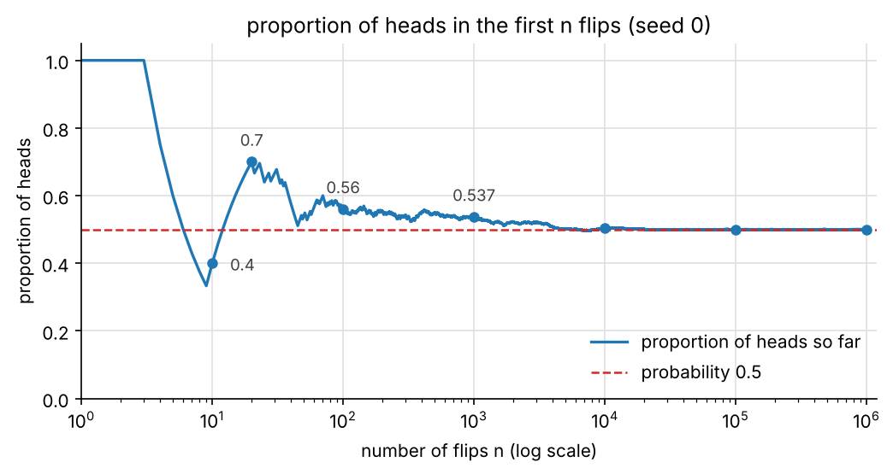
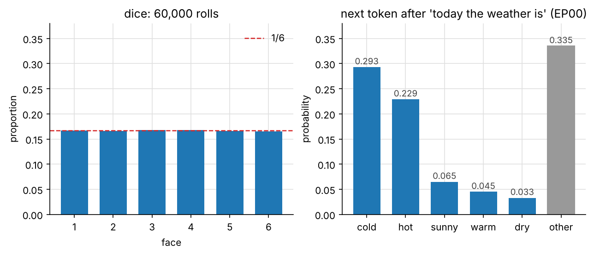
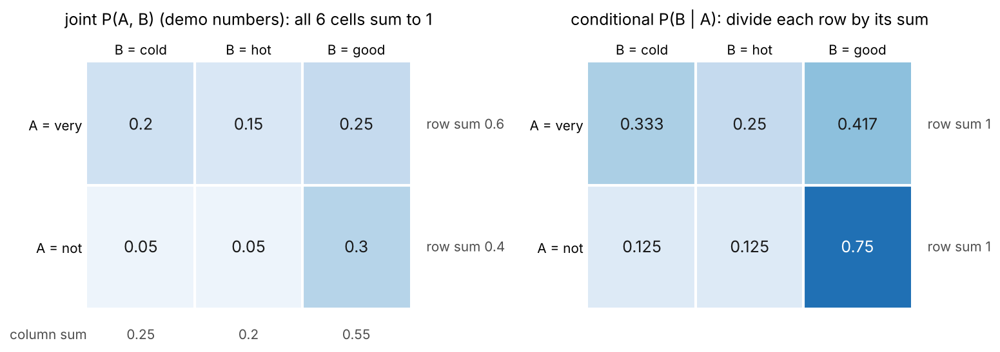
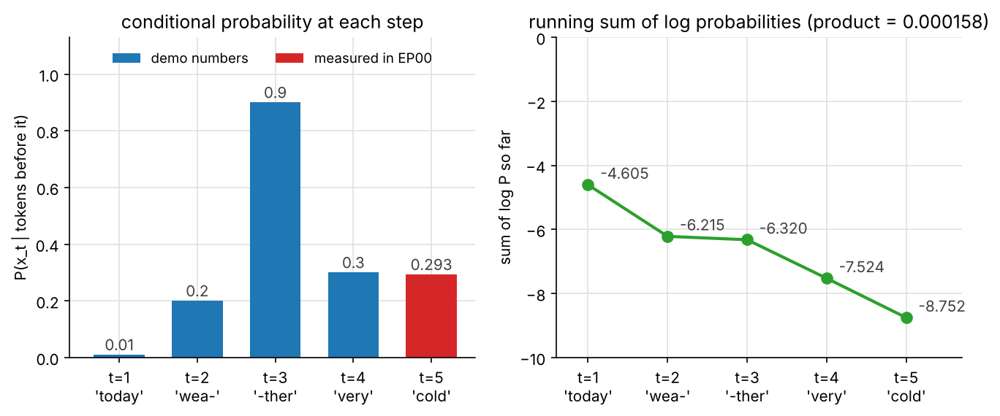
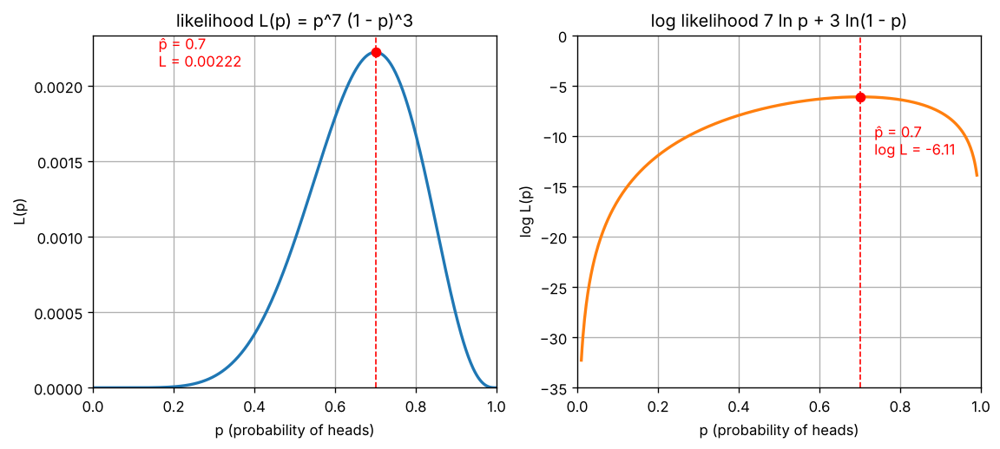
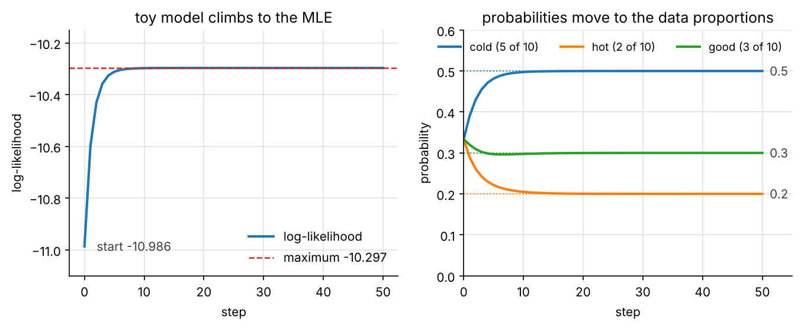

import { Aside, LinkButton } from '@astrojs/starlight/components';
import CoinFlipDemo from '../../../components/CoinFlipDemo.tsx';
import JointTableDemo from '../../../components/JointTableDemo.tsx';
import SentenceChainDemo from '../../../components/SentenceChainDemo.tsx';
import LikelihoodDemo from '../../../components/LikelihoodDemo.tsx';

<Aside type="note" title="影片">
本集影片製作中，完成後會放在這裡。
</Aside>

## 這集要解決什麼問題

EP00 看到，模型每一步替詞彙表裡的每個 token 給一個機率：「今天天氣很」後面，「冷」29.3%、「熱」22.9%⋯⋯全部加起來 100%，再依機率抽一個接上去。前面幾集留下三個和機率有關的問題：

1. **「機率分佈」正式是什麼？** EP00 一直在用這個詞。
2. **一句話的機率為什麼是連乘？** EP02 說「今天天氣很冷」的機率是每一步猜中下一個 token 的機率連乘，「為什麼可以這樣相乘，EP06 會用條件機率正式說明」。
3. **模型的參數怎樣才算好？** EP04、EP05 學會用梯度修改參數，EP05 結尾預告：讓訓練資料的機率越大越好。這句話寫成數學是什麼？

答案是**條件機率**、**機率的鏈鎖律**和**最大概似估計**：一句話的機率，是每個 token「給定前面全部」的條件機率連乘；訓練語言模型，就是找讓訓練資料的機率最大的參數。

<Aside type="tip" title="小提醒">

沒看過前幾集也沒關係，這集只需要幾個前提。EP00：模型每一步輸出詞彙表裡每個 token 的機率（Qwen2.5-0.5B 有 151,936 個 token），依機率抽一個接上去（自回歸）。EP01：`llm-labs` 是我們的 Python 專案（還沒有的話先照 EP01 建好），用 `uv run pytest` 跑測試；`np.random.default_rng(0)` 固定 seed；Softmax 的最後一步是「除以總和」。EP02：$\prod$ 是連乘；$\ln$ 是遞增函數；很多個小於 1 的數連乘會下溢成 0，取 log 變成加總就不會（log 機率）。EP03：`a @ b` 是內積。EP04：導數是 0 的點是平的，可能是山頂；$(\ln x)' = \frac{1}{x}$；梯度指向上升最快的方向。EP05：鏈鎖律 $(f \circ g)'(x) = f'(g(x)) \cdot g'(x)$；反向傳播一次拿到全部的梯度。這集會用到 `ep01/softmax.py`、`ep02/mathlang.py`、`ep04/calculus.py`，還沒寫的話，先把那幾集 notebook 最後的參考解答存成這些檔案。

</Aside>

| 看過的東西 | 出處 | 還沒回答的 | 在哪裡回答 |
|---|---|---|---|
| 每個 token 一個機率，加起來 100%；依機率抽一個 | EP00 | 「機率分佈」正式是什麼？ | 工具一 |
| 固定 seed，實驗才能重現 | EP01 | 不固定會怎樣？ | 工具一、弄壞它 5 |
| 一句話的機率 $p_1 \times \cdots \times p_5$ | EP02 | 為什麼可以這樣相乘？ | 工具二、工具三 |
| 連乘會下溢，取 log 變成加總 | EP02 | 訓練時也要取 log 嗎？ | 工具四、弄壞它 3 |
| 梯度指向上升最快的方向；反向傳播 | EP04、EP05 | 要讓什麼變大？ | 本集重點 |
| 「讓訓練資料的機率越大越好」 | EP05 | 寫成數學是什麼？ | 工具四、本集重點 |

這集一共四個工具：**機率與分佈、聯合機率與條件機率、機率的鏈鎖律、最大概似估計**。最後會看到這集最重要的一件事：**訓練語言模型＝最大概似估計**。

學完這集，你應該能：

- 說出機率的三個規則，認得白努利分佈和類別分佈，會依機率取樣、算期望值。
- 從聯合機率表算出邊際機率和條件機率，判斷兩件事是否獨立。
- 用乘法規則推出機率的鏈鎖律 $P(x_1, \ldots, x_n) = \prod_t P(x_t \mid x_{<t})$，說出語言模型是什麼。
- 分清楚「機率」和「概似」，求出最大概似估計，說明為什麼取 log 之後最大值的位置不變。
- 從零寫出 `prob.py`，和 PyTorch 對照。

## 準備：開一個邊讀邊跑的 notebook

在 Ubuntu 終端機進到 `llm-labs`，建立這集的資料夾：

```bash
cd ~/code/llm-labs
mkdir -p ep06 && touch ep06/__init__.py
```

接著在 VS Code 新增 `ep06/playground.ipynb`，kernel 選 `.venv`，第一個 cell 寫：

```python
import sys
sys.path.append("..")    # 讓 Python 也到上一層（llm-labs）找程式

import numpy as np
import matplotlib.pyplot as plt
from ep01.softmax import softmax
from ep02.mathlang import log_softmax
from ep04.calculus import numerical_derivative as nd, numerical_gradient
```

`as nd` 把 EP04 寫的 `numerical_derivative` 改叫短名字 `nd`（中央差分）。也可以直接打開這集的 notebook 邊讀邊跑。

<LinkButton href="https://colab.research.google.com/github/chainchen1103/llm-from-scratch/blob/main/notebooks/ep06/ep06_probability.ipynb" icon="external" target="_blank" rel="noopener noreferrer">在 Colab 開啟 notebook</LinkButton>
<LinkButton href="https://github.com/chainchen1103/llm-from-scratch/blob/main/notebooks/ep06/ep06_probability.ipynb" variant="secondary" target="_blank" rel="noopener noreferrer">在 GitHub 查看</LinkButton>

<Aside type="tip" title="小提醒">

接下來的程式區塊裡，`print()` 那一行後面的註解就是印出來的結果，其他註解是說明。迴圈或印出好幾行的區塊，結果會依序寫在區塊最後的註解裡。用到亂數的區塊都固定了 seed，結果會一模一樣（弄壞它 5 除外）。

</Aside>

**寫法約定**：$P(\ldots)$ 念「⋯⋯的機率」（EP02）；丟硬幣時，1 代表正面、0 代表反面。

## 工具一：機率與分佈

### 樣本空間、事件、機率

丟一顆骰子，所有可能的結果 $\{1, 2, 3, 4, 5, 6\}$ 叫**樣本空間 sample space**；我們關心的一組結果叫**事件 event**，例如「丟出偶數」是 $\{2, 4, 6\}$。**機率 probability** 替每個事件配一個數，遵守三個規則：

1. 每個事件的機率在 0 到 1 之間：0 是（照這個機率）不會發生，1 是一定發生。
2. 整個樣本空間的機率是 1：一定會丟出某一面。
3. 不會同時發生（**互斥 mutually exclusive**）的事件，機率可以相加：$P(\{2, 4, 6\}) = P(2) + P(4) + P(6)$。

公平的骰子每一面是 $\frac{1}{6}$，所以 $P(\text{偶數}) = \frac{3}{6} = 0.5$。EP00 的模型也一樣：樣本空間是詞彙表裡的 151,936 個 token，全部的機率加起來是 1（規則 2）；「下一個是『冷』或『熱』」是一個事件，機率是 29.3% + 22.9% = 52.2%（規則 3）。

### 丟硬幣：次數越多，比例越靠近機率

「正面的機率是 0.5」是什麼意思？丟很多次，正面的比例會靠近 0.5。用 EP01 的固定 seed 模擬，`rng.integers(0, 2)` 隨機給 0 或 1：

```python
rng = np.random.default_rng(0)
flips_sim = rng.integers(0, 2, size=1_000_000)    # 丟一百萬次：1 是正面、0 是反面
print(flips_sim[:10])
for n in [10, 20, 100, 1000, 10_000, 100_000, 1_000_000]:
    print(n, flips_sim[:n].mean())                # 前 n 次裡正面的比例
# [1 1 1 0 0 0 0 0 0 1]
# 10 0.4
# 20 0.7
# 100 0.56
# 1000 0.537
# 10000 0.503
# 100000 0.49958
# 1000000 0.500418
```

0/1 陣列的平均就是 1 的比例。10 次是 0.4，20 次反而跳到 0.7（第 11 到 20 次剛好全是正面）：不是每多丟一次就更近，但次數越多，越穩定地靠近 0.5。這叫**大數法則 law of large numbers**。反過來，**手上只有資料時，就用比例來猜機率**；工具四會看到，這正是最大概似估計的答案。



下面的元件可以拖動丟的次數、換 seed（元件的亂數和 NumPy 不同，數字不會和上面一樣）：

<CoinFlipDemo client:visible />

### 隨機變數與分佈

把結果寫成一個數，叫**隨機變數 random variable**，習慣用大寫字母，例如 $X$＝骰子的點數，$P(X = 3) = \frac{1}{6}$。把每個值的機率都列出來，就是**機率分佈 probability distribution**。這集只講**離散 discrete** 的分佈：值可以一個一個列出來。EP05 的 `rng.normal` 抽出的數可以是任何小數，是**連續 continuous** 的分佈（和函數「連續」不是同一件事），EP13 講初始化時再說明。

兩個最常用的離散分佈：

- **白努利分佈 Bernoulli distribution**（也有人寫「伯努利」）：只有 1 和 0 兩種結果，1 的機率是 $p$、0 的機率是 $1 - p$。丟硬幣、「下一個 token 是不是『冷』」都是。
- **類別分佈 categorical distribution**：$K$ 種結果，各有一個機率 $q_1, \ldots, q_K$，全部加起來是 1。骰子是 $K = 6$；**下一個 token 也是**：EP00 的 Softmax 吐出的 151,936 個機率，就是一個 $K = 151{,}936$ 的類別分佈。白努利是 $K = 2$ 的特例。

畫成長條圖，每一根的高度是一個值的機率或比例：

```python
rng = np.random.default_rng(0)
rolls = rng.integers(1, 7, size=60_000)            # 1 到 6（不含 7），丟六萬次
counts = np.bincount(rolls, minlength=7)[1:]       # bincount 數出 0 到 6 各出現幾次，去掉 0
print(rolls[:10], counts)
print(np.round(counts / rolls.size, 4))
tokens5 = ["冷", "熱", "晴", "暖", "乾", "其他"]
p_ep00 = np.array([0.293, 0.229, 0.065, 0.045, 0.033, 0.335])   # EP00 前 5 名，其他十幾萬個併成一格
print(p_ep00.sum())

fig, (ax1, ax2) = plt.subplots(1, 2, figsize=(9, 3))
ax1.bar(range(1, 7), counts / rolls.size)
ax1.set(title="dice: 60,000 rolls", xlabel="face")
ax2.bar(range(6), p_ep00)
ax2.set(title="next token after 'today the weather is'", xlabel="0 cold 1 hot 2 sunny 3 warm 4 dry 5 other")
plt.show()
# [6 4 4 2 2 1 1 1 2 5] [ 9991  9944 10089 10083  9976  9917]
# [0.1665 0.1657 0.1682 0.168  0.1663 0.1653]
# 1.0
```

matplotlib 預設字型沒有中文字，所以標題和橫軸用英文。下面的圖多畫了 1/6 的參考線和數值。



骰子六根幾乎一樣高（$\frac{1}{6} \approx 0.1667$）。token 那張最右邊的「其他」反而最高：十幾萬個 token 每個都很小，併在一起卻占了三分之一。

### 取樣：依機率抽一個

EP00 的「依機率抽一個」，就是從類別分佈**取樣 sampling**，抽出來的結果叫**樣本 sample**。`rng.choice` 可以用 `p=` 指定每個結果的機率：

```python
rng = np.random.default_rng(0)
print(rng.choice(tokens5, size=10, p=p_ep00))     # 從 EP00 的分佈抽 10 次
idx = rng.choice(6, size=10_000, p=p_ep00)        # 再抽一萬次，結果用編號 0–5
print(np.bincount(idx, minlength=6) / idx.size)
# ['乾' '冷' '冷' '冷' '其他' '其他' '暖' '其他' '晴' '其他']
# [0.292  0.2269 0.0689 0.0415 0.0343 0.3364]
```

機率最高的「冷」不一定被抽到，3.3% 的「乾」也可能第一個出現；抽一萬次，比例就很靠近分佈本身（「冷」0.292 對 0.293）。EP00 的溫度改的是抽之前的機率本身；其他挑 token 的方法 EP28 再講。

### 期望值：用機率加權的平均

骰子平均丟出幾點？每個值乘上自己的機率，再加起來：

$$
\begin{aligned}
E[X] &= \sum_x x \, P(X = x) \\
&= 1 \cdot \tfrac{1}{6} + 2 \cdot \tfrac{1}{6} + \cdots + 6 \cdot \tfrac{1}{6} = 3.5
\end{aligned}
$$

白話：每個可能的值，用它的機率當權重，算加權平均。

這叫**期望值 expected value**，$E[X]$ 念「X 的期望值」。期望值不一定丟得出來（沒有 3.5 點）；丟很多次，平均會靠近它：

```python
faces = np.arange(1, 7)
print(faces @ np.full(6, 1 / 6), rolls.mean())     # 3.5 3.4976666666666665
```

`faces @ np.full(6, 1 / 6)` 是 EP03 的內積：每一面乘上 $\frac{1}{6}$ 再加起來。本集重點的「模型預期的次數」也是期望值，EP07 的熵也是。

## 工具二：聯合機率與條件機率

### 聯合機率表

一個小世界（**數字是示範用的，自己編的**）：一份文字裡，「很」「不」後面只會接「冷」「熱」「好」。從「很」或「不」出現的位置裡隨便挑一個，把它當成前一個字，記成 $A$；它後面的下一個字記成 $B$（隨機變數，只是值是字），6 種組合的機率排成一張表：

| | 冷 | 熱 | 好 | 一列加起來 $P(A)$ |
|---|---|---|---|---|
| **很** | 0.20 | 0.15 | 0.25 | 0.60 |
| **不** | 0.05 | 0.05 | 0.30 | 0.40 |
| **一欄加起來 $P(B)$** | 0.25 | 0.20 | 0.55 | 1 |

每一格是「前一個字是這一列、**而且**下一個字是這一欄」的機率，叫**聯合機率 joint probability**，寫成 $P(A, B)$，例如 $P(\text{很}, \text{冷}) = 0.20$（$P(A = \text{很}, B = \text{冷})$ 的簡寫）。高中數學用事件的寫法 $P(\text{很} \cap \text{冷})$，$\cap$ 念「交集」。6 格就是整個樣本空間，加起來是 1。

```python
joint = np.array([[0.20, 0.15, 0.25],     # 前一個字「很」：很冷、很熱、很好
                  [0.05, 0.05, 0.30]])    # 前一個字「不」：不冷、不熱、不好
print(joint.shape, joint.sum())           # (2, 3) 1.0
```

### 邊際機率：把一列加起來

「前一個字是『很』」的機率，不管下一個字是什麼：「很冷」「很熱」「很好」互斥，用規則 3 加起來，$P(\text{很}) = 0.20 + 0.15 + 0.25 = 0.60$。它寫在表的邊上，所以叫**邊際機率 marginal probability**。用 EP01 的 `axis`：

```python
p_prev = joint.sum(axis=1)                # 每一列加起來：P(前一個字)
p_next = joint.sum(axis=0)                # 每一欄加起來：P(下一個字)
print(p_prev, p_next)                     # [0.6 0.4] [0.25 0.2  0.55]
```

### 條件機率：只看一列，再讓它加起來是 1

已經知道前一個字是「很」，下一個字是「冷」的機率是多少？世界縮小成「很」那一列：0.20、0.15、0.25。可是這三個加起來只有 0.60，不是 1；全部除以 0.60，就是**條件機率 conditional probability**：

$$
\begin{gathered}
P(B \mid A) = \frac{P(A, B)}{P(A)} \\
P(\text{冷} \mid \text{很}) = \frac{0.20}{0.60} \approx 0.333
\end{gathered}
$$

白話：**只看 $A$ 那一列，再除以那一列的總和**，讓它加起來是 1。

$P(B \mid A)$ 念「給定 $A$，$B$ 的機率」，高中數學念「在 $A$ 發生的條件下，$B$ 的機率」。直線 $\mid$ 右邊是已經知道的事，$P(A) > 0$ 才有定義。「除以總和」和 EP01 Softmax 的最後一步一樣。

```python
cond = joint / joint.sum(axis=1, keepdims=True)    # (2, 3) / (2, 1)：每一列除以自己的總和
print(np.round(cond, 3))
print(cond.sum(axis=1))
# [[0.333 0.25  0.417]
#  [0.125 0.125 0.75 ]]
# [1. 1.]
```

`keepdims=True` 留下 `(2, 1)`，每一列才會除以**自己的**總和（EP01 的廣播；忘了會怎樣，見弄壞它 1）。每一列都是一個分佈，叫**條件分佈 conditional distribution**。同樣是「好」，前一個字是「很」時 0.417，是「不」時 0.75。



### 獨立：知道了也沒用

如果知道 $A$ 不會改變 $B$ 的機率，$P(B \mid A) = P(B)$，就說 $A$、$B$ **獨立 independent**。代進條件機率的定義（$P(A) > 0$ 時），等價的寫法是

$$
P(A, B) = P(A)\,P(B)
$$

白話：聯合機率＝邊際機率相乘，表裡**每一格**都要成立。

這個寫法 $P(A) = 0$ 時也能用，所以正式的定義用它。丟兩次硬幣是獨立的：第一次是正面，不會改變第二次。

<Aside type="caution" title="注意">

獨立不是互斥。「前一個字是『很』」和「前一個字是『不』」互斥，同時發生的機率是 0，不是 $0.6 \times 0.4$：知道一個發生，另一個就不會發生，反而不獨立。

</Aside>

這張表獨立嗎？

```python
print(np.outer(p_prev, p_next))           # 第 i 列第 j 欄是 p_prev[i] × p_next[j]：如果獨立，表應該長這樣
print(np.allclose(np.outer(p_prev, p_next), joint))
# [[0.15 0.12 0.33]
#  [0.1  0.08 0.22]]
# False
```

不獨立：$P(\text{很}, \text{冷})$ 是 0.20，不是 0.15；$P(\text{好} \mid \text{不}) = 0.75$，比 $P(\text{好}) = 0.55$ 大很多。**語言幾乎從來不是獨立的**：「今天天氣很」後面是「冷」的機率（29.3%），和隨便一個位置剛好是「冷」的機率差得很遠。所以語言模型要算的是條件機率（見弄壞它 2）。

下面的元件可以點一列看條件分佈，點一欄看反過來的 $P(A \mid B)$（已知下一個字，除以那一欄的總和），也可以切換成「如果獨立」的表：

<JointTableDemo client:visible />

## 工具三：機率的鏈鎖律

### 乘法規則

把條件機率的定義兩邊乘上 $P(A)$：

$$
P(A, B) = P(A)\,P(B \mid A)
$$

白話：「$A$ 而且 $B$」的機率＝先發生 $A$ 的機率 × 在 $A$ 發生的條件下、再發生 $B$ 的機率。

這叫**乘法規則 multiplication rule**（和 EP05 的乘法法則只差一個字：那是導數，這是機率；不少英文書也把這條叫 product rule，和下面的鏈鎖律一樣撞名）。用表驗算，$P(\text{很}, \text{冷}) = 0.6 \times \frac{0.20}{0.60} = 0.2$：

```python
print(p_prev[:, None] * cond)                      # P(A) 乘上 P(B | A)：(2, 1) * (2, 3)
print(np.allclose(p_prev[:, None] * cond, joint))
# [[0.2  0.15 0.25]
#  [0.05 0.05 0.3 ]]
# True
```

`p_prev[:, None]` 就是 `reshape(2, 1)`。順序也可以反過來拆，$P(A, B) = P(B)\,P(A \mid B)$；兩種拆法放在一起就是貝氏定理 Bayes theorem，這個系列暫時用不到。

### 推廣到 n 個

三件事 $x_1, x_2, x_3$（例如一句話的前三個 token）：把「$x_1$ 而且 $x_2$」整個當成 $A$、$x_3$ 當成 $B$，用一次乘法規則；再把 $P(x_1, x_2)$ 拆一次：

$$
\begin{aligned}
&P(x_1, x_2, x_3) \\
={}& P(x_1, x_2)\,P(x_3 \mid x_1, x_2) \\
={}& P(x_1)\,P(x_2 \mid x_1)\,P(x_3 \mid x_1, x_2)
\end{aligned}
$$

白話：第一件的機率，乘上後面每一件「給定前面幾件」的條件機率。

$n$ 件事一路拆下去：

$$
\begin{aligned}
&P(x_1, \ldots, x_n) \\
={}& P(x_1)\,P(x_2 \mid x_1) \cdots P(x_n \mid x_1, \ldots, x_{n-1}) \\
={}& \prod_{t=1}^{n} P(x_t \mid x_{<t})
\end{aligned}
$$

白話：每一項都是「給定前面全部，下一個的條件機率」，全部乘起來。

$x_{<t}$（念「x 下標小於 t」：編號在 $t$ 之前，不是值小於 $t$）是 $x_1, \ldots, x_{t-1}$；$t = 1$ 時前面什麼都沒有，那一項就是 $P(x_1)$。這叫**機率的鏈鎖律 chain rule of probability**。它**不需要獨立之類的假設**，只用了條件機率的定義（前面的機率大於 0，每一項才有定義），任何 $n$ 件事都成立。

<Aside type="caution" title="注意">

英文也叫 chain rule，但和 EP05 的鏈鎖律是兩件事，只是名字一樣：EP05 是導數一路相乘，這裡是機率一路相乘。

</Aside>

### 兌現 EP02：一句話的機率

EP02 的「今天／天／氣／很／冷」，$p_1, \ldots, p_5$ 其實是這 5 個條件機率（前 4 個是示範數字）：

| $t$ | token $x_t$ | $p_t$ | 數字 |
|---|---|---|---|
| 1 | 今天 | $P(\text{今天})$：一句話用「今天」開頭 | 0.01（示範） |
| 2 | 天 | $P(\text{天} \mid \text{今天})$ | 0.2（示範） |
| 3 | 氣 | $P(\text{氣} \mid \text{今天天})$ | 0.9（示範） |
| 4 | 很 | $P(\text{很} \mid \text{今天天氣})$ | 0.3（示範） |
| 5 | 冷 | $P(\text{冷} \mid \text{今天天氣很})$ | 0.293（EP00 實測） |

$$
\begin{aligned}
&P(\text{今天天氣很冷}) \\
={}& P(\text{今天})\,P(\text{天} \mid \text{今天}) \cdots P(\text{冷} \mid \text{今天天氣很}) \\
={}& \prod_{t=1}^{5} P(x_t \mid x_{<t})
\end{aligned}
$$

白話：一句話的機率＝每一步「給定前面所有 token，下一個是正確 token」的條件機率連乘。

所以 EP02「每一步猜中下一個 token 的機率」連乘，**就是機率的鏈鎖律**；模型每一步看的，正好就是前面所有的 token（EP00 的自回歸）。第一個 token 沒有前文，實作上常在最前面放一個代表「開頭」的特殊 token special token（詞彙表裡專門留的記號）當條件。嚴格說，這 5 項連乘是「開頭 5 個 token 剛好是這 5 個」的機率，後面還能接別的字；要算「整句話到這裡結束」，還要再乘上下一個是「結束」特殊 token 的條件機率。

```python
p_cond = np.array([0.01, 0.2, 0.9, 0.3, 0.293])    # 只有最後一個是 EP00 的實測，其他是示範
print(np.prod(p_cond), np.sum(np.log(p_cond)))
print(np.round(np.cumsum(np.log(p_cond)), 3))      # log 機率一步一步加起來
# 0.00015821999999999999 -8.751524088371022
# [-4.605 -6.215 -6.32  -7.524 -8.752]
```

`np.cumsum` 是「加到目前為止」。實際計算時都用 EP02 的 **log 機率**：連乘變加總，再長的句子也不會下溢。最後一步的 $\ln 0.293 = -1.228$，正是 EP02 算過的那個數。



下面的元件可以把句子加長，看連乘下溢成 0；也可以切換成「當成獨立」，把詞序對調看看（先猜猜會怎樣，弄壞它 2 會解釋）：

<SentenceChainDemo client:visible />

### 語言模型

**語言模型 language model**：給前面的 token $x_{<t}$，輸出下一個 token 的條件分佈 $P(\cdot \mid x_{<t})$（$\cdot$ 代表「詞彙表裡的每一個 token」）。EP00 的模型每跑一次，Softmax 吐出的 151,936 個機率就是這個條件分佈。有了它可以：

- **算一句話的機率**：每一步取出正確 token 的條件機率，用鏈鎖律連乘（實際上是 log 加總）。
- **生成**：從條件分佈取樣一個 token，接到後面，再算下一步⋯⋯就是 EP00 的自回歸。

模型的參數（約 5 億個數字）決定每一步的條件分佈：參數換一組，同一句話的機率就變了。哪一組參數比較「好」？

## 工具四：最大概似估計

### 同一份資料，不同參數

一枚硬幣不知道公不公平，丟 10 次：正正反正正正反正正反，7 次正面。假設它正面的機率是 $p$，$p$ 就是這枚硬幣的**參數**。每次丟都是獨立的，所以這份資料的機率是 10 個數連乘：

$$
\begin{aligned}
P(\text{資料}; p) &= p \cdot p \cdot (1 - p) \cdot p \cdot p \\
&\quad \cdot p \cdot (1 - p) \cdot p \cdot p \cdot (1 - p) \\
&= p^7 (1 - p)^3
\end{aligned}
$$

白話：正面乘 $p$、反面乘 $1 - p$，10 次全部乘起來。

分號後面寫參數：「參數是 $p$ 時」。這也是鏈鎖律：因為獨立，每一項 $P(x_t \mid x_{<t})$ 都變成 $P(x_t)$，不用看前面（語言就不行）。$p$ 換不同的值：

```python
flips = np.array([1, 1, 0, 1, 1, 1, 0, 1, 1, 0])   # 正正反正正正反正正反：7 次正面

def likelihood(p):
    return np.prod(np.where(flips == 1, p, 1 - p))  # 正面乘 p、反面乘 1 − p

for p in [0.3, 0.5, 0.7, 0.9]:
    print(p, likelihood(p))
# 0.3 7.501409999999998e-05
# 0.5 0.0009765625
# 0.7 0.0022235660999999998
# 0.9 0.0004782968999999999
```

`np.where(條件, a, b)`：條件成立取 `a`、否則取 `b`。$p = 0.7$ 時，這份資料的機率最大，是 $p = 0.5$ 的 2.3 倍。

### 概似函數

同一條式子 $p^7 (1 - p)^3$，有兩種看法：

- **參數固定、看資料**：$p = 0.5$ 時，丟出「正正反正正正反正正反」這一串的機率是多少？這是**機率**。
- **資料固定、看參數**：資料已經是這一串，$p$ 換成多少，這份資料的機率最大？這時把它看成 $p$ 的函數，叫**概似函數 likelihood function**：

$$
L(p) = p^7 (1 - p)^3
$$

白話：資料固定，參數是 $p$ 時，這份資料的機率。

這是「這一串、照這個順序」的機率；不管順序的話要再乘上 7 正 3 反的排法數 120（高中的二項分佈 binomial distribution）；120 和 $p$ 無關，整條曲線只是放大 120 倍，最大值還在同一個 $p$。「概似」是「看起來有多像」：$L(0.7) > L(0.5)$，$p = 0.7$ 比較能解釋這份資料。

<Aside type="caution" title="注意">

$L(0.7)$ **不是**「$p$ 是 0.7 的機率」，而是 $p = 0.7$ 時這份資料的機率。$p$ 固定時，丟 10 次全部 1024 種結果的機率加起來是 1；資料固定、$p$ 換來換去，$L(p)$ 沒有「加起來是 1」這回事。

</Aside>

**最大概似估計 MLE maximum likelihood estimation**：選讓概似最大的參數，

$$
\hat{p} = \operatorname*{argmax}_{p} L(p)
$$

白話：$\hat{p}$ 是讓 $L(p)$ 最大的那個 $p$。

$\hat{p}$ 念「p hat」，戴帽子代表「從資料估計出來的」；argmax 回傳的是位置，不是最大值本身（和 EP01 的 `argmax` 一樣）。先用**格點 grid** 找：0 到 1 每隔 0.01 取一個點，每一點都算 $L(p)$，挑最大的：

```python
ps = np.arange(0, 101) / 100                      # 0、0.01、⋯、1
L = np.array([likelihood(p) for p in ps])
print(ps[np.argmax(L)], L.max())                  # 0.7 0.0022235660999999998
```

### 取 log：山頂的位置不變

$L(p)$ 是連乘，取 log 變加總（EP02 的對數律；沒寫底數的 $\log$ 就是 $\ln$），叫 **log 概似 log-likelihood**：

$$
\log L(p) = 7 \ln p + 3 \ln(1 - p)
$$

白話：7 個 $\ln p$ 加上 3 個 $\ln(1 - p)$。

$\ln$ 是遞增函數（EP02）：$L$ 越大，$\log L$ 越大，所以**山頂在同一個 $p$**。而且資料一多，$L$ 會下溢成 0，$\log L$ 不會（弄壞它 3）。

山頂是平的（EP04：導數是 0）。$(\ln p)' = \frac{1}{p}$；$\ln(1 - p)$ 用 EP05 的鏈鎖律，內層 $1 - p$ 的導數是 $-1$，所以是 $-\frac{1}{1 - p}$：

$$
\begin{gathered}
\frac{d}{dp}\log L = \frac{7}{p} - \frac{3}{1 - p} = 0 \\
\Rightarrow\; 7(1 - p) = 3p \;\Rightarrow\; \hat{p} = \frac{7}{10} = 0.7
\end{gathered}
$$

白話：令導數為 0，解出 $\hat{p} = 0.7$（$\Rightarrow$ 念「所以」）。

用中央差分驗算：

```python
def log_lik(p):
    return 7 * np.log(p) + 3 * np.log(1 - p)

for p in [0.5, 0.6, 0.7, 0.8]:
    print(p, nd(log_lik, p), 7 / p - 3 / (1 - p))
print(log_lik(0.7), np.log(likelihood(0.7)))
# 0.5 8.000000001029406 8.0
# 0.6 4.166666666138852 4.166666666666668
# 0.7 -2.975397705995419e-09 1.7763568394002505e-15
# 0.8 -6.250000011975842 -6.2500000000000036
# -6.108643020548935 -6.108643020548935
```

左邊導數正（上坡）、右邊負（下坡），0.7 兩欄都幾乎是 0（$10^{-9}$ 是中央差分的誤差，$10^{-15}$ 是捨入誤差）。$p$ 變大時，$\frac{7}{p}$ 一路變小、$\frac{3}{1 - p}$ 一路變大，導數只在 0.7 穿過 0，所以 0.7 是整條曲線的山頂（EP04：導數是 0 只是「可能」）。

一般來說，丟 $n$ 次、$k$ 次正面，$0 < k < n$ 時同樣解出 $\hat{p} = \frac{k}{n}$；全部正面時，導數 $\frac{n}{p}$ 永遠是正的，一路上坡到端點 $p = 1$，答案還是 $\frac{k}{n}$（全部反面對稱，$\hat{p} = 0$；弄壞它 4）。**白努利分佈的最大概似估計，就是正面的比例**：工具一的「用比例猜機率」，原來就是「讓資料的機率最大」的答案。



這張圖是動手做的 `plot_likelihood.py` 畫的。下面的元件可以拖動 $p$，也可以調丟的次數和正面的次數：

<LikelihoodDemo client:visible />

### 類別分佈：也是比例

$K$ 種結果時，參數是 $K$ 個機率 $q_1, \ldots, q_K$（加起來是 1）。第 $j$ 種在資料裡出現 $c_j$ 次（和硬幣一樣，每個位置當成獨立、不看前文），每出現一次就乘一個 $q_j$，所以

$$
\log L = \sum_{j=1}^{K} c_j \ln q_j
$$

白話：每種結果的次數乘上它的 log 機率，全部加起來。

答案也是比例 $\hat{q}_j = \frac{c_j}{n}$，$n = c_1 + \cdots + c_K$ 是資料的總數（證明要處理「加起來是 1」的限制，本集重點會用數值驗證）。例子：詞彙表只有「冷」「熱」「好」3 個 token，資料是一小串 token（示範）：

```python
data = np.array([0, 1, 0, 2, 0, 2, 2, 0, 1, 0])  # 冷 熱 冷 好 冷 好 好 冷 熱 冷（0 冷、1 熱、2 好）
c = np.bincount(data, minlength=3)               # 每個 token 出現幾次
q_hat = c / c.sum()
print(c, q_hat, c @ np.log(q_hat))
# [5 2 3] [0.5 0.2 0.3] -10.296530140645736
```

`c @ np.log(q_hat)` 就是上面的 $\sum_j c_j \ln q_j$（內積）。換成條件分佈也一樣：「前一個字是『很』時，下一個字的分佈」的最大概似估計，就是「很」後面接每個字的比例。**EP17 的第一個語言模型就是這樣做的**：拿真的文字，算出每個字後面接每個字的次數，再換成比例。

## 本集重點：訓練語言模型＝最大概似估計

### 四個工具接起來

- 模型的參數記成 $\theta$（希臘字母，念 theta，代表全部約 5 億個數字；EP03 用它代表角度，這裡是另一個意思），它決定每一步的條件分佈 $P_\theta(\cdot \mid x_{<t})$：右下角的 $\theta$ 和工具四的分號一樣，是「參數是 $\theta$ 時」。
- 一句話的機率是條件機率的連乘（工具三），取 log 變加總。句子和句子之間，訓練時當成彼此獨立（一種簡化），log 再加總。
- 最大概似估計：選讓全部訓練資料的 log 機率總和最大的參數（工具四）：

$$
\hat{\theta} = \operatorname*{argmax}_{\theta} \sum_{\text{每一句}} \sum_{t} \log P_\theta(x_t \mid x_{<t})
$$

白話：**修改參數，讓模型給訓練資料裡「真正的下一個 token」的 log 機率，全部位置加起來越大越好。**$\hat{\theta}$ 和工具四的 $\hat{p}$ 一樣戴帽子：從資料估計出來的參數。

這就是 EP05 預告的訓練目標。把這個總和取負號、再除以 token 數，就是 LLM 訓練時看到的損失，EP07 會說明它為什麼叫交叉熵。

硬幣可以令導數為 0 直接解；5 億個參數沒辦法。做法是 EP04、EP05 的：用反向傳播算出 log 概似對每個參數的梯度，往梯度的方向把參數改一點點，重複很多次。一步走多遠、走幾步，是 EP08 梯度下降的事。

### 玩具模型：3 個分數、一個 Softmax

最小的「語言模型」：詞彙表是上面的 3 個 token，**不看前文**，參數是 3 個分數 $z$，機率是 Softmax($z$)，資料是上面那 10 個 token。log 概似用 EP02 的 log-softmax 算，梯度用 EP04 的數值梯度，每一步往梯度的方向走 0.1 倍、走 50 步。這裡只示範一次；0.1 怎麼選、什麼時候停，是 EP08 學習率的事。

```python
def log_lik_z(z):
    return np.sum(log_softmax(z)[data])            # data 是整數陣列：一次取出 10 個位置的 log 機率

print(numerical_gradient(log_lik_z, np.zeros(3)))  # [ 1.66666667 -1.33333333 -0.33333333]
z, history = np.zeros(3), []                       # 一開始三個分數一樣：機率各 1/3
for step in range(51):
    history.append(log_lik_z(z))                   # 實驗紀錄：每一步的 log 概似
    if step in [0, 1, 2, 5, 10, 20, 50]:
        print(step, np.round(softmax(z), 3), round(log_lik_z(z), 4))
    z = z + 0.1 * numerical_gradient(log_lik_z, z)  # 往 log 概似上升最快的方向走一小步
print(numerical_gradient(log_lik_z, np.log(q_hat)))  # 分數取 log(比例)，Softmax 剛好是比例
fig, ax = plt.subplots(figsize=(5, 3))
ax.plot(history)
ax.axhline(c @ np.log(q_hat), color="red", ls="--")  # 工具四的最大值
ax.set(xlabel="step", ylabel="log-likelihood", title="toy model climbs to the MLE")
plt.show()
# 0 [0.333 0.333 0.333] -10.9861
# 1 [0.391 0.289 0.32 ] -10.5983
# 2 [0.43  0.261 0.309] -10.43
# 5 [0.481 0.222 0.297] -10.3111
# 10 [0.498 0.205 0.298] -10.2973
# 20 [0.5 0.2 0.3] -10.2965
# 50 [0.5 0.2 0.3] -10.2965
# [0.0000000e+00 0.0000000e+00 8.8817842e-11]
```



- 第一行：一開始的梯度 $(1.67, -1.33, -0.33)$ 剛好是「實際出現次數 − 模型預期的次數」：$5 - \frac{10}{3}$、$2 - \frac{10}{3}$、$3 - \frac{10}{3}$（每個位置是「冷」的機率都是 $\frac{1}{3}$，10 個位置預期 $\frac{10}{3}$ 次，就是期望值）。猜得太少的，分數就調高；為什麼剛好是這樣，EP07 推 Softmax 的導數時會看到。
- log 概似從 $10 \ln \frac{1}{3} = -10.9861$ 一路變大，停在工具四的最大值 $-10.2965$，機率停在資料的比例。最後一行驗證山頂：在「比例」那一點梯度是 0（$10^{-11}$ 是中央差分的誤差）。**用梯度一步一步爬，爬到的就是最大概似估計**（這個玩具的 log 概似只有一座山）。
- 「冷」為什麼沒被推到 1？5 個位置要「冷」、2 個要「熱」、3 個要「好」，三個機率加起來只能是 1，最好的妥協就是比例。真正的語言模型也一樣：同一段前文在訓練資料裡接過很多種字，最大概似要的是照比例分（EP00 的模型給「今天天氣很」後面的「冷」也只有 29.3%；實際的模型只會大致接近比例，見下面）。
- 左圖就是程式畫的實驗紀錄：每一步的 log 概似。右圖另外畫了每一步的 `softmax(z)`。

### 和 LLM 的連結

- 真正的語言模型一樣，只是分數是模型看了前文算出來的（EP00 的 logits），參數有 5 億個，梯度用反向傳播算（EP05）。
- 真正的地形複雜得多，訓練只爬到夠高就停，也不會去追訓練資料上的最高點（太貼合訓練資料反而不好，是 EP16 的過擬合）。所以精確的說法是：**訓練的目標**是最大概似。
- **預訓練的目標就是最大概似**（EP38 的監督式微調也是；EP41 起的偏好最佳化換了目標）。EP00 說預訓練模型學的是「網路上的文字接下來通常怎麼寫」，就是這個意思：它的前 10 名裡出現簡體的「干燥」，因為訓練資料裡就有人這樣寫。

## 動手做：從零寫出 `prob.py`

在 `llm-labs/ep06/prob.py` 寫下面 5 個函式：

```python
import numpy as np

def empirical_distribution(samples, k):
    """samples：一串整數，每個都在 0 到 k − 1（k 是類別數，工具四的 K）。回傳長度 k 的陣列，第 i 格是 i 出現的比例
    （沒出現就是 0），加起來是 1。samples 是空的、有值不在 0 到 k − 1、或不是整數，要 raise ValueError。"""

def conditional(joint):
    """joint：二維聯合機率表，第 i 列第 j 欄是 P(A = i, B = j)。回傳同形狀的條件機率表，
    第 i 列是 P(B | A = i)：每一列除以那一列的加總 P(A = i)，所以每一列加起來是 1。
    某一列加總是 0（P(A = i) = 0，條件機率沒有定義）要 raise ValueError。不能改到呼叫端的 joint。"""

def chain_log_prob(cond_probs):
    """一串條件機率 P(x₁)、P(x₂ | x₁)、⋯、P(xₙ | x₁, ⋯, xₙ₋₁) → log P(x₁, ⋯, xₙ) = Σ log。
    不先連乘（長序列不能下溢）。每個機率都要在 0 到 1 之間，否則 raise ValueError；
    有 0 時回傳 -inf，而且不能跳出 RuntimeWarning。"""

def bernoulli_mle(flips):
    """flips：0/1 陣列（1 = 正面）。回傳正面的比例，也就是白努利分佈的最大概似估計 p̂。
    空的、或有 0 和 1 以外的值，要 raise ValueError。"""

def log_likelihood(p, flips):
    """白努利分佈的 log 概似：(正面數) ln p + (反面數) ln(1 − p)。
    p 可以是 0 或 1，0 × log 0 當成 0：p = 1 而且全部正面是 0.0、p = 1 卻有反面是 -inf（p = 0 對稱）；
    不能跳出 RuntimeWarning。p 不在 [0, 1] 要 raise ValueError。"""
```

要求與提示：

1. **只用 NumPy 和基本的 Python**。
2. **`empirical_distribution`**：樣本裡每個值出現的比例排成的分佈，叫**經驗分佈 empirical distribution**。`np.bincount(samples, minlength=k)` 算出每個值出現幾次，再除以樣本數（不是除以 `k`）。整數檢查用 `np.issubdtype(samples.dtype, np.integer)`。
3. **`conditional`**：工具二的一行，`keepdims=True` 不能少。先用 `np.asarray(joint, dtype=float)` 轉成小數，次數表（整數）也能用；它遇到小數陣列不會複製，所以不要用 `/=`（會改到呼叫端的表）。加總是 0 的列直接除，會得到 `nan` 和 `RuntimeWarning`，要先檢查。
4. **`chain_log_prob`**：可以 `from ep02.mathlang import sequence_logprob`（EP02 的 Σ log），再加上範圍檢查和「有 0 就回傳 `-np.inf`」（先檢查，就不會呼叫到 `np.log(0)` 而跳出警告）。測試會傳 Python list，先 `np.asarray(cond_probs, dtype=float)`。
5. **`log_likelihood`**：直接照公式寫，`p = 1` 時 `np.log(1 - p)` 是 `-inf`（還會跳出警告），再乘上反面數 0 得到 `nan`，不是 0（`p = 0` 同理）。寫一個小函式 `term(count, prob)`：`count` 是 0 就回傳 `0.0`、`prob` 是 0 就回傳 `-np.inf`，其他照公式。`flips` 可能是 list，先 `np.asarray(flips)`。

把下面的測試存成 `llm-labs/tests/test_ep06_prob.py`：

```python
import math
import warnings

import numpy as np
import pytest

from ep01.softmax import softmax
from ep06.prob import bernoulli_mle, chain_log_prob, conditional, empirical_distribution, log_likelihood

JOINT = np.array([[0.20, 0.15, 0.25],      # 工具二的示範表：前一個字「很」「不」× 下一個字「冷」「熱」「好」
                  [0.05, 0.05, 0.30]])
FLIPS = np.array([1, 1, 0, 1, 1, 1, 0, 1, 1, 0])   # 工具四的 10 次：7 次正面

def test_empirical_distribution_counts_and_sums_to_one():
    p = empirical_distribution(np.array([0, 2, 2, 1, 2]), k=4)
    assert p.shape == (4,)
    assert np.allclose(p, [0.2, 0.2, 0.6, 0.0])               # 沒出現的 3 也要有一格
    assert math.isclose(p.sum(), 1.0)
    for bad in [np.array([0, 1, 4]), np.array([], dtype=int), np.array([0.0, 1.0])]:
        with pytest.raises(ValueError):                       # 4 不在 0 到 3、空的、不是整數
            empirical_distribution(bad, k=4)

def test_empirical_distribution_approaches_true_distribution():
    true_p = np.array([0.5, 0.2, 0.3])
    rng = np.random.default_rng(0)                            # 固定 seed：每次跑都一樣
    samples = rng.choice(3, size=100_000, p=true_p)
    assert np.allclose(empirical_distribution(samples, k=3), true_p, rtol=0, atol=0.01)

def test_conditional_rows_sum_to_one_and_rebuild_joint():
    rng = np.random.default_rng(1)
    square = rng.random((3, 3))
    square = square / square.sum()                            # 3 × 3：忘了 keepdims 也不會報錯，只會算錯
    for joint in [JOINT, square]:
        before = joint.copy()
        cond = conditional(joint)
        assert np.array_equal(joint, before)                  # 不能改到呼叫端的表
        assert cond.shape == joint.shape
        assert np.allclose(cond.sum(axis=1), 1.0)             # 每一列是一個分佈
        p_a = joint.sum(axis=1, keepdims=True)                # 邊際機率 P(A)
        assert np.allclose(p_a * cond, joint)                 # 乘法規則：P(A, B) = P(A) P(B | A)
    assert np.allclose(conditional(JOINT)[1], [0.125, 0.125, 0.75])    # P(下一個字 | 不)
    assert np.allclose(conditional(np.array([[4, 3, 5], [1, 1, 6]])), conditional(JOINT))   # 整數的次數表（JOINT × 20）也行

def test_conditional_zero_row_raises():
    with pytest.raises(ValueError):
        conditional(np.array([[0.5, 0.5], [0.0, 0.0]]))       # P(A = 1) = 0：沒有定義

def test_chain_log_prob_no_underflow():
    assert math.isclose(chain_log_prob([0.5, 0.2]), math.log(0.1))
    lp = chain_log_prob(np.full(1000, 0.1))
    assert np.prod(np.full(1000, 0.1)) == 0.0                 # 直接連乘：下溢成 0
    assert math.isclose(lp, 1000 * math.log(0.1))             # log 加總：−2302.58⋯
    with warnings.catch_warnings():
        warnings.simplefilter("error")                        # 有 warning 就算失敗
        assert chain_log_prob([0.5, 0.0, 0.3]) == -np.inf     # 有一步不可能 → 整句不可能
    for bad in [[0.5, 1.2], [0.5, -0.1]]:                     # 機率不能超過 1，也不能是負的
        with pytest.raises(ValueError):
            chain_log_prob(bad)

def test_bernoulli_mle_maximizes_log_likelihood():
    p_hat = bernoulli_mle(FLIPS)
    assert math.isclose(p_hat, 0.7)
    for bad in [np.array([]), np.array([1, 0, 2])]:           # 空的、有 0 和 1 以外的值
        with pytest.raises(ValueError):
            bernoulli_mle(bad)
    assert math.isclose(log_likelihood(0.7, FLIPS), 7 * math.log(0.7) + 3 * math.log(0.3))
    grid = np.arange(1, 100) / 100                            # 0.01、0.02、⋯、0.99
    lls = [log_likelihood(p, FLIPS) for p in grid]
    assert math.isclose(grid[np.argmax(lls)], p_hat)          # 格點裡最大的就在 p̂
    assert all(log_likelihood(p_hat, FLIPS) >= ll for ll in lls)

def test_log_likelihood_edge_cases():
    with warnings.catch_warnings():
        warnings.simplefilter("error")
        assert log_likelihood(1.0, [1, 1, 1]) == 0.0          # 0 × log 0 當成 0：機率 1，log 是 0
        assert log_likelihood(1.0, [1, 1, 1, 0]) == -np.inf   # p = 1 卻出現反面：不可能
        assert log_likelihood(0.0, [0, 0]) == 0.0
    for bad_p in [1.5, -0.1]:
        with pytest.raises(ValueError):
            log_likelihood(bad_p, FLIPS)

def test_matches_pytorch():
    torch = pytest.importorskip("torch")
    flips = torch.tensor(FLIPS, dtype=torch.float64)
    bern = torch.distributions.Bernoulli(probs=torch.tensor(0.7, dtype=torch.float64))
    assert math.isclose(bern.log_prob(flips).sum().item(), log_likelihood(0.7, FLIPS), rel_tol=1e-12)

    z = np.array([2.0, -1.0, 0.5, 0.0])                      # 4 個 token 的分數
    tokens = np.array([0, 2, 2, 3, 1, 0])                    # 一串 token 的 ID
    p = softmax(z)                                           # EP01
    torch_lp = torch.log_softmax(torch.tensor(z), dim=-1)[torch.tensor(tokens)].sum().item()
    assert math.isclose(chain_log_prob(p[tokens]), torch_lp, rel_tol=1e-12)
```

`warnings.simplefilter("error")` 把警告變成錯誤，所以「不能跳出 `RuntimeWarning`」也測得到。

然後在 `~/code/llm-labs` 執行：

```bash
uv run pytest
```

EP01–EP05 共 35 個測試，加上這集的 8 個：裝了 PyTorch 會看到 `43 passed`；沒裝的話是 `38 passed, 5 skipped`，跳過的是 EP02–EP06 各一個和 PyTorch 比對的測試（`uv run pytest -rs` 會列出原因）。少做了哪一集，就少那一集的 7 個（只有這集的測試是 `8 passed`，沒裝 PyTorch 是 `7 passed, 1 skipped`）。參考解答在這集 notebook 的最後，先自己寫寫看。

### 畫出概似函數：`plot_likelihood.py`

在 `llm-labs/ep06/plot_likelihood.py` 寫一個畫圖腳本，執行 `uv run python ep06/plot_likelihood.py` 會產生 `ep06/likelihood.png`：

```python
from pathlib import Path

import numpy as np

OUT = Path(__file__).parent / "likelihood.png"
FLIPS = np.array([1, 1, 0, 1, 1, 1, 0, 1, 1, 0])     # 工具四的 10 次：7 次正面

def draw_likelihood(ax, flips):
    """在 ax 上畫 L(p) = p^正面數 (1 − p)^反面數，p 從 0 到 1（501 個點）；
    在 p̂ 畫紅點和紅色垂直虛線，標出 p̂ 和 L(p̂)，標題寫出式子。"""

def draw_log_likelihood(ax, flips):
    """在 ax 上畫 log L(p) = 正面數 · ln p + 反面數 · ln(1 − p)，p 從 0.01 到 0.99；
    同樣標出 p̂ 和 log L(p̂)。"""

if __name__ == "__main__":
    import matplotlib

    matplotlib.use("Agg")    # 只存檔、不開視窗
    import matplotlib.pyplot as plt

    # 一列兩張圖：左邊 draw_likelihood、右邊 draw_log_likelihood，存成 OUT
```

要求與提示：

1. **兩張圖**：左圖的標題寫出式子，例如 `p^7 (1 - p)^3`（用正面數、反面數組出來）。右圖的兩端是 $\log 0$，所以只畫 0.01 到 0.99，`ylim=(-35, 0)`。
2. **標出最大值**：寫一個兩張圖共用的小函式 `mark_max(ax, x, y, text)`，用 `ax.plot([x], [y], "o", color="red")`、`ax.axvline(x, color="red", linestyle="--")`、`ax.annotate(text, (x, y))`。
3. 這個檔案自己算 $L$ 和 $\log L$，不 import `prob.py`：直接執行腳本時，Python 只在 `ep06/` 裡找模組，找不到 `ep06.prob`。
4. **可以重現**（同 EP04、EP05）：寫死 `figsize` 和 `dpi`，執行兩次，`md5sum ep06/likelihood.png` 應該一樣。

畫對的話就是工具四那張圖：左圖的山頂在 0.7、高約 0.00222；右圖在 0.7 最高（約 −6.11），$p = 0.01$ 約 −32、$p = 0.99$ 約 −14。

### 和 PyTorch 對照

裝了 PyTorch 的話，在 `playground.ipynb` 執行（改過 `prob.py` 要重新啟動 kernel 才會讀到新版，再從第一個 cell 依序執行到這裡：會用到前面的 `flips`、`data`、`z`、`log_lik_z`）：

```python
import torch
from ep06.prob import chain_log_prob, log_likelihood

bern = torch.distributions.Bernoulli(probs=torch.tensor(0.7, dtype=torch.float64))
lp = bern.log_prob(torch.tensor(flips, dtype=torch.float64))   # 每一次丟的 log 機率
print(lp.sum().item(), log_likelihood(0.7, flips))

z_t = torch.tensor(z)                                          # 玩具模型走完的分數，float64
print(torch.log_softmax(z_t, dim=-1)[torch.tensor(data)].sum().item(),
      chain_log_prob(softmax(z)[data]))

z0 = torch.zeros(3, dtype=torch.float64, requires_grad=True)   # 玩具模型的起點
torch.log_softmax(z0, dim=-1)[torch.tensor(data)].sum().backward()   # 跑一次、倒著算回來（EP05）
print(z0.grad, numerical_gradient(log_lik_z, np.zeros(3)))
# -6.108643020548935 -6.108643020548935
# -10.296530140646016 -10.296530140646016
# tensor([ 1.6667, -1.3333, -0.3333], dtype=torch.float64) [ 1.66666667 -1.33333333 -0.33333333]
```

`torch.distributions` 的分佈都有 `log_prob`：回傳每一筆資料的 log 機率，加起來就是 log 概似。LLM 訓練時算的就是第二行這種「log-softmax 取出真正的 token、加起來」，梯度用 `.backward()`，和數值梯度一樣（PyTorch 只印 4 位小數）。

## 弄壞它

每一個都先**猜**結果，再執行，最後用自己的話解釋。弄壞它 1 用到工具二的 `joint`，弄壞它 3 用到工具四的 `flips`、`ps`；重新啟動過 kernel 的話，先執行第一個 cell 和定義它們的 cell（用這集的 notebook 就都準備好了）。

### 弄壞它 1：條件機率除以錯的總和

除以整張表的總和、除以每一欄的總和、忘了 `keepdims`，每一列加起來還是 1 嗎？

```python
wrong_total = joint / joint.sum()                # 除以整張表的總和
wrong_col = joint / joint.sum(axis=0)            # 除以每一欄的總和
print(wrong_total.sum(axis=1), wrong_col.sum(axis=1), wrong_col.sum(axis=0))
print(np.round(wrong_col, 3))
joint / joint.sum(axis=1)                        # 忘了 keepdims
```

<details>
<summary>實際結果與解釋</summary>

```
[0.6 0.4] [2.00454545 0.99545455] [1. 1. 1.]
[[0.8   0.75  0.455]
 [0.2   0.25  0.545]]
ValueError: operands could not be broadcast together with shapes (2,3) (2,)
```

（錯誤訊息只列最後一行。）

- 整張表的總和本來就是 1，除了等於沒除：那還是聯合機率，每一列加起來是 $P(A)$，不是 1。**聯合機率不是條件機率**。
- 除以欄的總和，變成每一**欄**加起來是 1：算出來的是 $P(A \mid B)$，方向反了。左上角 0.8 是 $P(\text{很} \mid \text{冷})$（下一個字是「冷」時，前一個字是「很」的機率），不是 $P(\text{冷} \mid \text{很}) = 0.333$。
- 忘了 `keepdims`：`(2, 3)` 除以 `(2,)`，廣播從最後一維對齊，3 和 2 對不上，NumPy 擋了下來（EP01）。**方陣就擋不下來**：3 × 3 的表除以 `(3,)`，第 $j$ 欄會除以第 $j$ 列的總和，照樣算出錯的數字（所以測試用了一張 3 × 3 的表）。

</details>

### 弄壞它 2：把 token 當成彼此獨立

每個 token 單獨出現的機率（示範數字）直接連乘，「今天天氣很冷」和「冷很氣天今天」誰的機率大？

```python
p_single = {"今天": 0.002, "天": 0.004, "氣": 0.003, "很": 0.01, "冷": 0.001}   # 示範
forward = ["今天", "天", "氣", "很", "冷"]
backward = ["冷", "很", "氣", "天", "今天"]
print(np.prod([p_single[t] for t in forward]), np.prod([p_single[t] for t in backward]))
```

<details>
<summary>實際結果與解釋</summary>

```
2.4e-13 2.4000000000000004e-13
```

一模一樣（最後一位是捨入誤差）。乘法可以交換順序，所以「當成獨立、直接相乘」完全看不到順序。換成條件機率，「冷」開頭以後，$P(\text{很} \mid \text{冷})$、$P(\text{氣} \mid \text{冷很})$ 都非常小，順序就回來了。只要每一步的條件機率是對的，鏈鎖律保證連乘起來就是整句話的機率，不用假設任何獨立。

</details>

### 弄壞它 3：連乘下溢，概似找不到山頂

1000 個 0.1 直接連乘；工具四的 10 次重複 1000 遍（一萬次：7000 正、3000 反），用格點找概似最大的 $p$：

```python
print(np.prod(np.full(1000, 0.1)), np.sum(np.log(np.full(1000, 0.1))))
big = np.tile(flips, 1000)                       # np.tile：整串重複 1000 遍
L_big = np.array([np.prod(np.where(big == 1, p, 1 - p)) for p in ps])
inner = ps[1:-1]                                 # 去掉 0 和 1：log 0 是 -inf
ll_big = 7000 * np.log(inner) + 3000 * np.log(1 - inner)
print(L_big.max(), ps[np.argmax(L_big)], inner[np.argmax(ll_big)], ll_big.max())
```

<details>
<summary>實際結果與解釋</summary>

```
0.0 -2302.585092994045
0.0 0.0 0.7 -6108.643020548935
```

$0.1^{1000} = 10^{-1000}$ 遠小於 `float64` 能存的最小正數（約 $5 \times 10^{-324}$，EP02），下溢成 0；log 加總是很普通的 $-2302.59$。一萬次丟硬幣的 $L(0.7) = e^{-6108.6}$ 也下溢成 0：101 個格點**全部是 0**，`argmax` 只好回傳第一個位置，說「最大概似估計是 $p = 0$」，安安靜靜地錯了。$\log L$ 沒問題，找到 0.7。訓練資料有上兆個 token，所以一定要算 log 概似。

</details>

### 弄壞它 4：資料太少的最大概似估計

丟 3 次都是正面，$\hat{p}$ 是多少？第 4 次出現反面，這 4 次的 log 概似是多少？

```python
from ep06.prob import bernoulli_mle, log_likelihood

few = np.array([1, 1, 1])
p_hat = bernoulli_mle(few)
print(p_hat, log_likelihood(p_hat, [1, 1, 1, 0]), np.log(1 - p_hat))
```

<details>
<summary>實際結果與解釋</summary>

```
1.0 -inf -inf
```

最後的 `np.log(1 - p_hat)` 是 $\ln 0$，還會跳出 `RuntimeWarning: divide by zero encountered in log`（`log_likelihood` 有處理，所以沒有）。只看到 3 次正面，最大概似估計就說「反面不可能」；第 4 次一出現反面，整份資料的機率是 0，log 是 $-\infty$。**資料裡沒出現過的事，最大概似估計給 0**。用計數做的語言模型也一樣：訓練資料裡沒出現過的「兩個字的組合」機率是 0，一句話只要有一個這種組合，整句的機率就是 0；EP17 會用**平滑 smoothing** 解決。

</details>

### 弄壞它 5：沒有固定 seed

同一段模擬跑三次，一個沒給 seed、一個用 seed 0：

```python
for run in range(3):
    print(np.random.default_rng().integers(0, 2, size=100).mean(),    # 沒給 seed
          np.random.default_rng(0).integers(0, 2, size=100).mean())   # seed 0
```

<details>
<summary>實際結果與解釋</summary>

某一次跑出：

```
0.45 0.56
0.52 0.56
0.46 0.56
```

左欄每次都用新的亂數，結果多半不同（你跑出來的也會和上面不一樣），右欄永遠是 0.56（工具一前 100 次的比例）。沒固定 seed，換了設定之後結果變了，就分不出是設定的影響還是運氣；固定 seed，實驗才能重現（EP01）。

</details>

## 小結

- **機率與分佈**：機率遵守三個規則；白努利分佈有兩種結果，類別分佈有 $K$ 種，Softmax 的輸出就是一個類別分佈。次數越多，比例越靠近機率；期望值是用機率加權的平均。
- **條件機率** $P(B \mid A) = \frac{P(A, B)}{P(A)}$：只看 $A$ 那一列，再除以那一列的總和。獨立是 $P(A, B) = P(A)\,P(B)$，語言幾乎從來不是獨立的。
- **機率的鏈鎖律** $P(x_1, \ldots, x_n) = \prod_t P(x_t \mid x_{<t})$：不需要獨立。一句話的機率就是每個 token「給定前面全部」的條件機率連乘；語言模型輸出的就是這個條件分佈。
- **最大概似估計**：資料固定，把資料的機率看成參數的函數（概似），選讓它最大的參數；取 log 之後山頂不變，也不會下溢。白努利和類別分佈的答案都是比例。
- **本集重點**：訓練語言模型＝最大概似估計：修改參數，讓訓練資料裡每個「真正的下一個 token」的 log 機率加起來越大越好；參數太多，就用梯度一步一步往上爬。

## 自我檢測

1. 不用電腦：丟一顆公平的骰子，$P(\text{點數} \ge 5)$ 是多少？已經知道點數至少是 4，偶數的機率是多少？期望值 3.5 丟不出來，有矛盾嗎？
2. 用工具二的表算 $P(\text{不})$、$P(\text{熱})$、$P(\text{熱} \mid \text{不})$、$P(\text{不} \mid \text{熱})$，說明最後兩個為什麼不一樣。用一個數字說明「前一個字」和「下一個字」不獨立。
3. 寫出 $P(x_1, x_2, x_3, x_4)$ 的鏈鎖律展開。「我／想／睡／覺」的機率是哪四個條件機率相乘？鏈鎖律需要假設 token 彼此獨立嗎？它和 EP05 的鏈鎖律有什麼不同？
4. 丟 20 次（某一串，其中 15 次正面）：寫出 $L(p)$ 和 $\log L(p)$，令導數為 0 求 $\hat{p}$。為什麼取 log 之後最大值的位置不變？「$L(0.75)$ 是 $p = 0.75$ 的機率」這句話哪裡不對？
5. 一串 token「好 好 冷 好 熱 好 好 冷」（詞彙表是冷、熱、好），不看前文的類別分佈的最大概似估計是多少？如果詞彙表還有沒出現的「晴」，它的估計是多少？會造成什麼問題？
6. 用自己的話說明「訓練語言模型＝最大概似估計」：參數、鏈鎖律、log、梯度各扮演什麼角色？玩具模型為什麼停在 (0.5, 0.2, 0.3)，不把「冷」推到 1？

<details>
<summary>參考答案</summary>

1. $\frac{2}{6} = \frac{1}{3}$。樣本空間縮小成 $\{4, 5, 6\}$，其中偶數是 $\{4, 6\}$，所以是 $\frac{2}{3}$（用定義：$\frac{2/6}{3/6}$）。沒有矛盾：期望值是用機率加權的平均，不是某一次的結果；丟很多次，平均點數會靠近 3.5。
2. $P(\text{不}) = 0.40$、$P(\text{熱}) = 0.20$、$P(\text{熱} \mid \text{不}) = \frac{0.05}{0.40} = 0.125$、$P(\text{不} \mid \text{熱}) = \frac{0.05}{0.20} = 0.25$：分子是同一格，分母一個是「不」那一列的總和、一個是「熱」那一欄的總和。不獨立：$P(\text{很}, \text{冷}) = 0.20$，但 $P(\text{很})\,P(\text{冷}) = 0.15$。
3. $P(x_1)\,P(x_2 \mid x_1)\,P(x_3 \mid x_1, x_2)\,P(x_4 \mid x_1, x_2, x_3)$；$P(\text{我})\,P(\text{想} \mid \text{我})\,P(\text{睡} \mid \text{我想})\,P(\text{覺} \mid \text{我想睡})$。不需要，只用了條件機率的定義。EP05 是合成函數的導數一路相乘，這裡是條件機率一路相乘，只是英文同名。
4. $L(p) = p^{15}(1 - p)^5$，$\log L(p) = 15 \ln p + 5 \ln(1 - p)$；$\frac{15}{p} - \frac{5}{1 - p} = 0$，所以 $15(1 - p) = 5p$，$\hat{p} = 0.75$，就是正面的比例。$\ln$ 是遞增函數，$L$ 越大 $\log L$ 越大，所以在同一個 $p$ 最大。$L(0.75)$ 是「$p = 0.75$ 時這份資料的機率」，不是 $p$ 的機率。
5. 冷 2 個、熱 1 個、好 5 個，估計是比例 $(0.25, 0.125, 0.625)$。「晴」沒出現過，估計是 0：之後含有「晴」的句子機率都是 0、log 機率是 $-\infty$（弄壞它 4），EP17 會用平滑解決。
6. 參數決定每一步的條件分佈；鏈鎖律把一句話的機率寫成條件機率的連乘；取 log 變加總，不會下溢、山頂不變；最大概似估計選讓 log 機率總和最大的參數，用梯度（反向傳播算）一步一步往上爬。玩具模型的三個機率加起來只能是 1，資料裡冷、熱、好是 5、2、3 次，最好的妥協就是比例；「冷」推到 1，另外 5 個位置的 log 機率就變成 $-\infty$。

</details>

## 下一集

這集知道了訓練語言模型的目標：讓訓練資料的 log 機率總和越大越好。下一集 **EP07 資訊理論：Softmax、熵、交叉熵、KL 散度、困惑度** 把這個總和取負號、再除以 token 數，變成 LLM 訓練時的損失，並說明它為什麼叫交叉熵，熵、KL 散度、困惑度又各量什麼。
