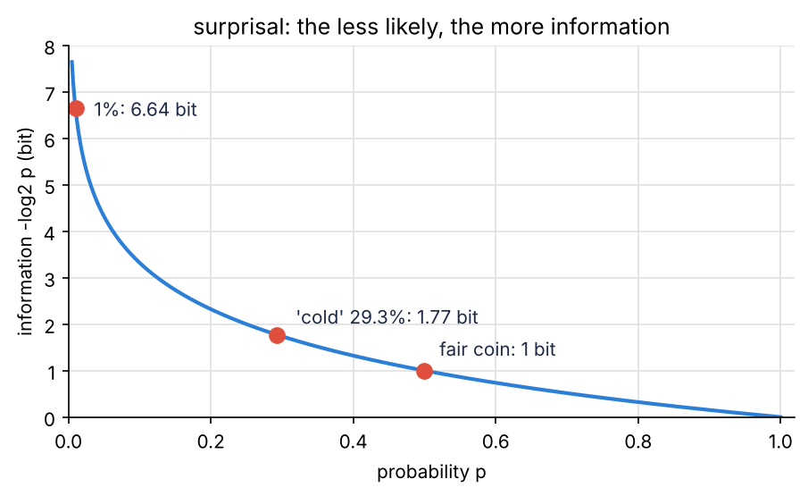
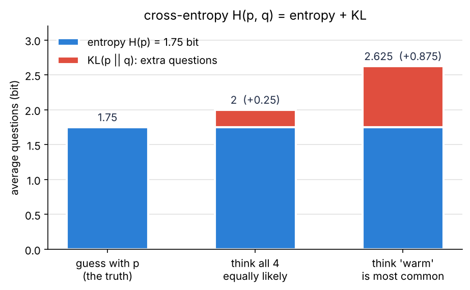
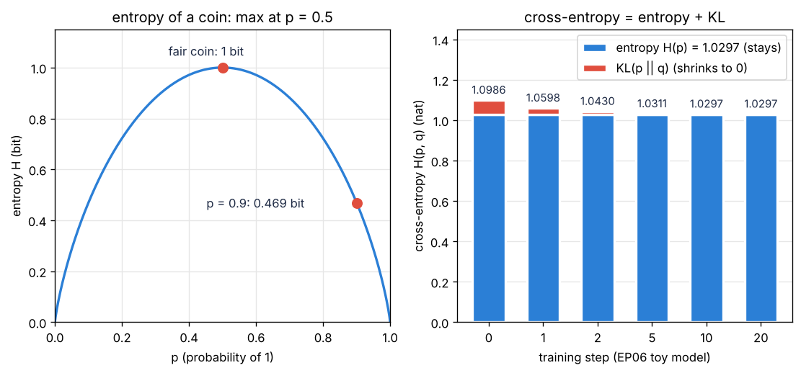
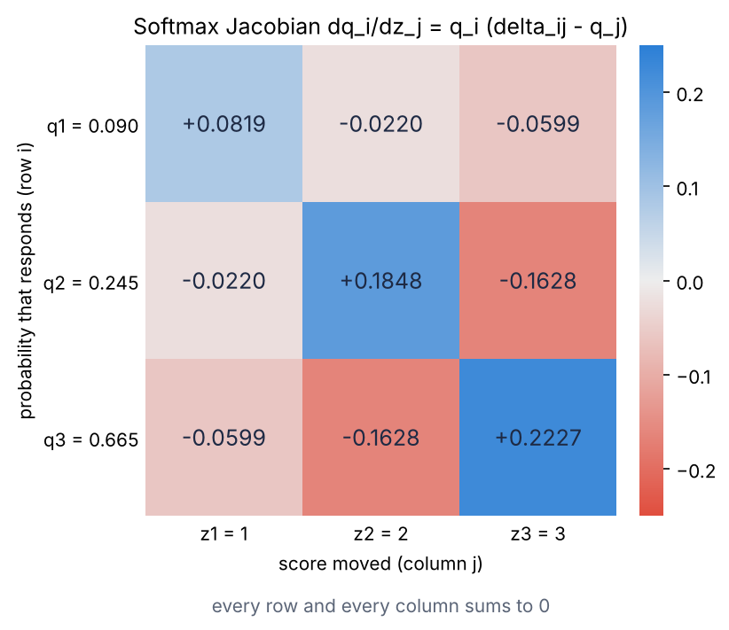
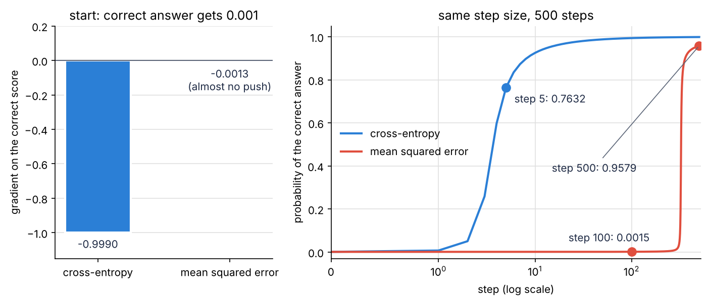

import { Aside, LinkButton } from '@astrojs/starlight/components';
import SurpriseEntropyDemo from '../../../components/SurpriseEntropyDemo.tsx';
import PerplexityDemo from '../../../components/PerplexityDemo.tsx';
import CrossEntropyStackDemo from '../../../components/CrossEntropyStackDemo.tsx';
import SoftmaxGradDemo from '../../../components/SoftmaxGradDemo.tsx';

<Aside type="note" title="影片">
本集影片製作中，完成後會放在這裡。
</Aside>

## 這集要解決什麼問題

EP06 的結論是**訓練語言模型＝最大概似估計**：讓模型給訓練資料裡每個「真正的下一個 token」的 log 機率加起來（叫 log 概似）越大越好；把這個總和取負號、再除以 token 數，就是 LLM 訓練時看到的損失。這留下三個問題：

1. **這個損失為什麼叫交叉熵 cross-entropy？** EP04 說損失怎麼算「是 EP07 的交叉熵」，EP02 說「LLM 的損失就是 $-\log p$」，是同一件事嗎？
2. **熵 entropy、KL 散度 KL divergence、困惑度 perplexity 各量什麼？**
3. **損失對分數的梯度長什麼樣子？** EP05 把 Softmax 的 Jacobian 留到這集；EP06 玩具模型的梯度剛好是「實際次數 − 預期次數」，為什麼？

答案都來自**資訊理論 information theory**：用「猜謎要問幾題」來量資訊。一個位置的損失是「看到正確答案時有多驚訝」，所有位置平均起來，正好是資料和模型的交叉熵。

<Aside type="tip" title="小提醒">

沒看過前幾集也沒關係，這集只需要幾個前提。EP00：模型替詞彙表裡每個 token 打一個分數 logits，Softmax 把分數換成機率（Qwen2.5-0.5B 有 151,936 個 token；「今天天氣很」後面「冷」是 29.3%）。EP01：分數 $z$ 的 Softmax 是 $q_i = \frac{e^{z_i}}{\sum_k e^{z_k}}$，每個分數取 $e$ 的次方、再除以總和；`llm-labs` 是我們的 Python 專案，用 `uv run pytest` 跑測試。EP02：$\ln$ 是以 $e$ 為底的 log，換底 $\log_2 x = \frac{\ln x}{\ln 2}$；$\text{logsumexp}(z) = \ln \sum_k e^{z_k}$ 是 Softmax 的分母取 $\ln$，log-softmax 是 $z - \text{logsumexp}(z)$，直接算 log 機率、不會下溢。EP04：$(e^x)' = e^x$、$(\ln x)' = \frac{1}{x}$；往負梯度走，損失下降最快。EP05：鏈鎖律；Jacobian 是每個輸出對每個輸入的偏導數排成的矩陣，梯度（一列）乘上它就往回傳一步。EP06：期望值；玩具模型有 3 個 token（冷、熱、好），資料是 10 個 token（冷 5、熱 2、好 3），訓練到機率停在比例 (0.5, 0.2, 0.3)。這集會用到 `ep01/softmax.py`、`ep02/mathlang.py`、`ep04/calculus.py`、`ep05/chain.py`，還沒寫的話，先把那幾集 notebook 最後的參考解答存成這些檔案（最上面加 `import numpy as np`，刪掉最後一行 `check_…()`）。

</Aside>

| 看過的東西 | 出處 | 還沒回答的 | 在哪裡回答 |
|---|---|---|---|
| $\log_2 151{,}936 \approx 17.2$，要 18 個位元才夠替每個 token 編號 | EP02 | 用 $\log_2$ 量資訊是什麼意思？ | 工具一 |
| 期望值是用機率加權的平均 | EP06 | 熵為什麼也是期望值？ | 工具二 |
| 損失是衡量模型錯多少的數；「LLM 的損失就是 $-\log p$」 | EP02、EP04 | 為什麼是這個？ | 工具三、本集重點 |
| 取負號、除以 token 數就是損失 | EP06 | 為什麼叫交叉熵？ | 本集重點 |
| Softmax 的 Jacobian；玩具模型的梯度＝實際次數 − 預期次數 | EP05、EP06 | 長什麼樣子？為什麼？ | Softmax 的導數 |

這集一共五個工具：**資訊量、熵、交叉熵、KL 散度、困惑度**，接起來就是本集重點：**LLM 的損失就是交叉熵**。學完這集，你應該能：

- 用「要問幾個是非題」說明資訊量 $-\log_2 p$，分清 bit 和 nat。
- 算出熵、交叉熵、KL 散度、困惑度，說明 $H(p, q) = H(p) + D_{\mathrm{KL}}(p \,\|\, q)$。
- 說明 LLM 的損失＝負 log 概似 ÷ token 數＝平均交叉熵，壓低它就是最大概似估計。
- 推出 Softmax 的 Jacobian 和梯度 $q - y$，從零寫出 `info.py`，和 PyTorch 對照。

## 準備：開一個邊讀邊跑的 notebook

在 Ubuntu 終端機進到 `llm-labs`，建立這集的資料夾：

```bash
cd ~/code/llm-labs
mkdir -p ep07 && touch ep07/__init__.py
```

接著在 VS Code 新增 `ep07/playground.ipynb`，kernel 選 `.venv`，第一個 cell 寫：

```python
import sys
sys.path.append("..")    # 讓 Python 也到上一層（llm-labs）找程式

import numpy as np
from ep01.softmax import softmax
from ep02.mathlang import log_softmax, logsumexp
from ep04.calculus import numerical_gradient
from ep05.chain import numerical_jacobian
```

也可以直接打開這集的 notebook 邊讀邊跑。

<LinkButton href="https://colab.research.google.com/github/chainchen1103/llm-from-scratch/blob/main/notebooks/ep07/ep07_information_theory.ipynb" icon="external" target="_blank" rel="noopener noreferrer">在 Colab 開啟 notebook</LinkButton>
<LinkButton href="https://github.com/chainchen1103/llm-from-scratch/blob/main/notebooks/ep07/ep07_information_theory.ipynb" variant="secondary" target="_blank" rel="noopener noreferrer">在 GitHub 查看</LinkButton>

<Aside type="tip" title="小提醒">

接下來的程式區塊裡，`print()` 那一行後面的註解就是印出來的結果，其他註解是說明。迴圈或印出好幾行的區塊，結果會依序寫在區塊最後的註解裡。

</Aside>

**寫法約定**：$p(x)$ 念「$x$ 的機率」，就是 EP06 的 $P(X = x)$；單獨寫 $p$、$q$ 時指整個分佈。熵、交叉熵、KL 散度的定義裡沒寫底數的 $\log$，用 $\log_2$ 或 $\ln$ 都可以，單位跟著底數走；損失和導數照 EP02、EP06，沒寫底數就是 $\ln$（`np.log`）。損失寫成 $\text{loss}$，和 EP06 的概似 $L(p)$ 分開。

## 工具一：資訊量

### 猜謎：要問幾個是非題

我心裡想一個 token，你只能問是非題。如果只有 8 個一樣可能的 token，最好的問法是每次砍一半：「是前 4 個嗎？」「是這 2 個嗎？」「是這個嗎？」，3 題一定猜中。$2^3 = 8$，所以題數就是 $\log_2 8 = 3$；$K$ 個一樣可能，就要 $\log_2 K$ 題。

EP00 的詞彙表有 151,936 個 token，$\log_2 151{,}936 \approx 17.21$。EP02 說要 18 個位元才夠替每個 token 編號，那是每個 token 編一個**一樣長**的號碼，位數只能是整數（17 位只有 131,072 種）。每個 token 一樣可能時，17.21 是平均位數的下限，可以是小數：把 100 個 token 排成的一串當成一個整體來編號，要 $100 \times 17.213 \approx 1{,}721.3$，進位成 1,722 位，平均每個 token 17.22 位。

### 資訊量 −log₂ p

$K$ 個一樣可能時，每一個的機率是 $p = \frac{1}{K}$，題數 $\log_2 K = \log_2 \frac{1}{p} = -\log_2 p$。推廣到任何機率：一件機率 $p(x)$ 的事 $x$ 發生，帶來

$$
I(x) = -\log_2 p(x)
$$

白話：機率取 $\log_2$ 再加負號，就是這件事發生時帶來多少資訊。

這叫**資訊量 information content**，也叫**驚訝程度 surprisal**。單位是**位元 bit**（EP02 的「一個 0 或 1」在這裡當單位）：公平硬幣丟出正面剛好 1 bit。

```python
for p in [0.5, 0.25, 0.125, 0.293, 0.01]:
    print(p, -np.log2(p))                        # 資訊量（bit）
print(-np.log2(1 / 2 * 1 / 6), -np.log2(1 / 2) + -np.log2(1 / 6))   # 硬幣正面「而且」骰子 6 點
# 0.5 1.0
# 0.25 2.0
# 0.125 3.0
# 0.293 1.7710274302398392
# 0.01 6.643856189774724
# 3.584962500721156 3.584962500721156
```

- 機率越小，資訊量越大：1% 的事是 6.64 bit，發生了不太可能的事才「驚訝」。機率 1 的事是 0 bit（說了等於沒說）；機率到 0 是無限大（工具四）。EP00 的「冷」是 29.3%，出現時帶來 1.77 bit，不太驚訝。
- 最後一行：硬幣和骰子彼此獨立（EP06），「正面而且 6 點」的機率是 $\frac{1}{2} \times \frac{1}{6}$，資訊量剛好是 $1 + 2.585$。**獨立的事，機率相乘、資訊量相加**（EP02 的對數律），這是資訊量要用 log 的原因。



### bit 和 nat

把 $\log_2$ 換成 $\ln$，單位叫 **nat**（natural 的縮寫）。用換底 $\log_2 x = \frac{\ln x}{\ln 2}$：

$$
1 \text{ nat} = \frac{1}{\ln 2} \approx 1.443 \text{ bit}, \qquad 1 \text{ bit} = \ln 2 \approx 0.693 \text{ nat}
$$

白話：兩者只差一個固定的倍數，就像公尺和公分。**PyTorch 和 LLM 的損失用 $\ln$，單位是 nat。**

```python
V = 151_936
print(-np.log(0.293), -np.log(0.293) / np.log(2))    # 「冷」的資訊量：nat，換成 bit
print(np.log2(V), np.log(V))                         # 151,936 個一樣可能：bit、nat
# 1.2275826699650698 1.7710274302398394
# 17.213104219641906 11.931214658529285
```

1.228 nat 就是 EP02、EP06 算過的 $\ln 0.293 = -1.228$ 去掉負號；換成 bit 和上一段只差最後一位（捨入誤差）。

## 工具二：熵

### 熵是資訊量的期望值

如果每個 token 的機率不一樣呢？示範：下一個 token 只有 4 種可能，冷 $\frac{1}{2}$、熱 $\frac{1}{4}$、晴 $\frac{1}{8}$、暖 $\frac{1}{8}$。聰明的問法是先問最可能的：「是冷嗎？」一半的時候 1 題就結束；不是，再問「是熱嗎？」；還不是，問「是晴嗎？」就知道答案了。

```python
p4 = np.array([0.5, 0.25, 0.125, 0.125])     # 冷、熱、晴、暖（示範）
questions = np.array([1, 2, 3, 3])            # 照上面的問法，每個 token 要問到第幾題
print(-np.log2(p4), p4 @ questions, p4 @ -np.log2(p4))   # [1. 2. 3. 3.] 1.75 1.75
```

每個 token 要問的題數，剛好就是它的資訊量 $-\log_2 p$；用機率加權平均（EP06 的期望值，`@` 是 EP03 的內積），平均 1.75 題，比 4 個一樣可能的 2 題少：常見的先問，平均就省。這個平均叫**熵 entropy**（念「商」）：

$$
H(p) = \sum_x p(x)\,\bigl(-\log p(x)\bigr)
$$

白話：**熵是資訊量的期望值，也就是平均的驚訝程度**。

$H(p)$ 念「$p$ 的熵」，用 $\log_2$ 是 bit，用 $\ln$ 是 nat。機率不是 $\frac{1}{2}$ 的次方時，題數（整數）不會剛好是 $-\log_2 p$；熵是平均題數的下限，很多次一起猜時可以很靠近它（資訊理論的創始人夏農 Shannon 1948 年證明，這裡不證）。

**$0 \times \log 0$ 當成 0**：機率 0 的事不會發生，不該算進平均（數學上 $p \ln p$ 在 $p$ 靠近 0 時也靠近 0）。但 `0 * np.log(0)` 是 `nan`，實作時要跳過 $p = 0$ 的項（弄壞它 5）。

### 均勻分佈的熵最大

```python
def H_bits(p):
    p = np.asarray(p, dtype=float)
    return np.sum(p * -np.log2(p))           # 熵（bit）；先假設 p 裡沒有 0（弄壞它 5）

for p in [[0.5, 0.5], [0.9, 0.1], np.full(6, 1 / 6), p4]:
    print(np.round(p, 3), H_bits(p))
# [0.5 0.5] 1.0
# [0.9 0.1] 0.4689955935892812
# [0.167 0.167 0.167 0.167 0.167 0.167] 2.584962500721156
# [0.5   0.25  0.125 0.125] 1.75
```

- 公平硬幣 1 bit；偏成 0.9 的硬幣只有 0.469 bit（大多是正面，不太需要問）；一定會發生的事是 0。
- **$K$ 種結果的熵最小是 0（一定是某一個），最大是 $\log K$**：每個一樣可能，叫**均勻分佈 uniform distribution**。熵量的是**不確定性**：分佈越平越大、越集中越小（證明用工具三的不等式，拿 $q$ 當均勻分佈）。
- 硬幣的熵畫成 $p$ 的函數（白努利分佈的熵），是一座中間最高的山：$p = 0.5$ 時 1 bit，兩端是 0（本集重點那張圖的左邊）。

下面的元件可以拖動 4 個 token 的機率，看每個 token 的驚訝程度和熵：

<SurpriseEntropyDemo client:visible />

## 工具三：交叉熵

### 照錯的分佈猜

回到工具二的猜謎，真正的機率是 $p$＝（冷 $\frac{1}{2}$、熱 $\frac{1}{4}$、晴 $\frac{1}{8}$、暖 $\frac{1}{8}$），可是你**以為**機率是 $q$，就會照 $q$ 安排問法：每個 token 問 $-\log_2 q(x)$ 題。真正平均要問幾題？

```python
q_uniform = np.full(4, 0.25)                   # 以為四個一樣可能
q_wrong = np.array([0.125, 0.125, 0.25, 0.5])  # 以為「暖」最常見
for q in [p4, q_uniform, q_wrong]:
    print(q, -np.log2(q), p4 @ -np.log2(q))    # 照 q 每個 token 問幾題；用真正的 p4 平均
# [0.5   0.25  0.125 0.125] [1. 2. 3. 3.] 1.75
# [0.25 0.25 0.25 0.25] [2. 2. 2. 2.] 2.0
# [0.125 0.125 0.25  0.5  ] [3. 3. 2. 1.] 2.625
```

照對的分佈猜，平均 1.75 題（就是熵）；以為一樣可能，2 題；以為「暖」最常見，2.625 題。這個數叫**交叉熵 cross-entropy**：

$$
H(p, q) = \sum_x p(x)\,\bigl(-\log q(x)\bigr)
$$

白話：驚訝程度用 $q$ 算，平均用 $p$ 加權。

$H(p, q)$ 念「$p$ 和 $q$ 的交叉熵」，**順序有意義**：$p$ 是真正會發生的（資料），$q$ 是你相信的（模型），兩個分佈交叉著用；$q = p$ 時就是熵。

### 交叉熵不會比熵小

上面三個 $q$，照對的猜最省。這是一般的事實，叫**吉布斯不等式 Gibbs inequality**：

$$
H(p, q) \ge H(p)\text{，只有 } q = p \text{ 時相等}
$$

白話：照錯的分佈猜，平均一定要多問。

理由只要高中數學：$\ln x \le x - 1$，只在 $x = 1$ 相等（$\ln 1 = 0$，斜率 $(\ln x)' = \frac{1}{x}$ 在 1 是 1，所以 $y = x - 1$ 是 $\ln x$ 在 $x = 1$ 的切線；斜率越往右越小，$\ln x$ 一路往下彎，整條都在切線下面）。用 $\ln$ 算兩者的差，只加 $p(x) > 0$ 的項：

$$
\begin{aligned}
H(p, q) - H(p) &= \sum_x p(x) \ln \frac{p(x)}{q(x)} = -\sum_x p(x) \ln \frac{q(x)}{p(x)} \\
&\ge -\sum_x p(x) \Bigl(\frac{q(x)}{p(x)} - 1\Bigr) = 1 - \sum_x q(x) \ge 0
\end{aligned}
$$

白話：把每個 $\ln \frac{q(x)}{p(x)}$ 換成不比它小的 $\frac{q(x)}{p(x)} - 1$，前面有負號，整個式子只會變小；變小之後是「1 減掉一些 $q(x)$」，還是 $\ge 0$，原來的差當然也 $\ge 0$。

最後一步：只加了 $p(x) > 0$ 的那些 $q(x)$，總和不會超過 1。要相等，每一項的 $\frac{q(x)}{p(x)}$ 都要是 1，也就是 $q = p$。所以**交叉熵越小，$q$ 越像 $p$**，這就是它能當損失的原因（測試會用 100 個隨機的分佈檢查這件事）。拿 $q$ 當 $K$ 種結果的均勻分佈：每個 $-\log q(x)$ 都是 $\log K$，$H(p, q) = \log K$，所以 $H(p) \le \log K$，這就是工具二「均勻分佈的熵最大」的理由。

### 正確答案只有一個：one-hot

訓練資料裡的每個位置，下一個 token 是確定的。把正確答案寫成分佈：正確的那一格是 1、其他都是 0，叫 **one-hot**。例如 EP00 的六格裡正確答案是「冷」：$y = (1, 0, 0, 0, 0, 0)$。交叉熵只剩一項：

$$
H(y, q) = \sum_x y(x)\,\bigl(-\log q(x)\bigr) = -\log q(\text{正確 token})
$$

白話：正確答案只有一個時，交叉熵就是模型給正確答案的機率取 $-\log$。

```python
q_ep00 = np.array([0.293, 0.229, 0.065, 0.045, 0.033, 0.335])   # 模型 q：EP00 的冷 熱 晴 暖 乾 其他（EP06）
y = np.array([1, 0, 0, 0, 0, 0])               # 正確答案是「冷」：one-hot
print(y @ -np.log(q_ep00), y @ -np.log2(q_ep00))   # nat、bit
# 1.2275826699650698 1.7710274302398392
```

交叉熵 1.228 nat，就是「冷」的資訊量。EP02 說「LLM 的損失就是 $-\log p$」，指的就是這個。

## 工具四：KL 散度

### 交叉熵 − 熵

工具三那個差有自己的名字，叫 **KL 散度 KL divergence**：

$$
D_{\mathrm{KL}}(p \,\|\, q) = H(p, q) - H(p) = \sum_x p(x) \log \frac{p(x)}{q(x)}
$$

白話：**資料是 $p$，卻照 $q$ 來猜，平均多付出的題數**（用 $\log_2$ 時單位是 bit）。

念「$p$ 對 $q$ 的 KL 散度」，中間的兩條直線只是隔開資料 $p$ 和模型 $q$（不是絕對值）；KL 是提出它的兩個人 Kullback 和 Leibler，散念「散步」的散。由吉布斯不等式，它 $\ge 0$，只有 $q = p$ 時是 0。

```python
def KL_bits(p, q):
    return np.sum(p * np.log2(p / q))           # 先假設沒有 0

print(KL_bits(p4, q_uniform), KL_bits(p4, q_wrong))   # 0.25 0.875
```

就是 $2 - 1.75$ 和 $2.625 - 1.75$：平均多問 0.25 題和 0.875 題。



### 不對稱：不是距離

```python
fair, biased = np.array([0.5, 0.5]), np.array([0.9, 0.1])
print(KL_bits(fair, biased), KL_bits(biased, fair))   # 順序反過來
# 0.7369655941662061 0.5310044064107189
```

$D_{\mathrm{KL}}(p \,\|\, q) \ne D_{\mathrm{KL}}(q \,\|\, p)$：「硬幣其實公平，你以為偏成 0.9」多付 0.737 bit；「硬幣其實偏，你以為公平」多付 0.531 bit。距離應該兩個方向一樣，所以叫「散度」不叫距離。**順序一定要對**：$p$ 是資料、$q$ 是模型（弄壞它 3）。

### 資料會出現、模型卻給 0：無限大

EP06 弄壞它 4：丟 3 次都是正面，最大概似估計說 $\hat{q}$＝（正面 1、反面 0）。拿它去猜一枚真正公平的硬幣 $p$：反面那一項是 $0.5 \log_2 \frac{0.5}{0}$，$D_{\mathrm{KL}}(p \,\|\, \hat{q}) = \infty$，一次反面就「無限驚訝」。

所以語言模型**不能給資料裡會出現的 token 剛好 0 的機率**。Softmax 的輸出永遠大於 0（$e^z > 0$），電腦上卻會下溢（弄壞它 1）；用計數做的模型會給 0，EP17 用平滑處理。

### 資料固定時：壓低交叉熵＝壓低 KL

把定義移項：

$$
H(p, q) = H(p) + D_{\mathrm{KL}}(p \,\|\, q)
$$

白話：交叉熵＝資料本身的熵＋模型猜錯多付的部分。

訓練時資料 $p$ 是固定的，$H(p)$ 是常數，模型能改的只有 KL。所以**把交叉熵壓低，就是把 KL 壓低，讓模型 $q$ 靠近資料 $p$**，最低降到 $H(p)$。熵那一份是資料本身的不確定性（「今天天氣很」後面本來就可能接很多字），模型壓不掉。

## 工具五：困惑度

### 把熵換回「幾個選項」

$K$ 個一樣可能時，熵是 $\log_2 K$ bit，反過來 $K = 2^{\text{熵}}$。對任何分佈都這樣算，叫**困惑度 perplexity**：

$$
\text{困惑度} = 2^{H \text{（bit）}} = e^{H \text{（nat）}}
$$

白話：**這個分佈的不確定性，相當於在幾個一樣可能的選項之間猶豫**。

```python
print(2 ** H_bits([0.9, 0.1]), 2 ** H_bits(p4))       # 偏的硬幣、工具二的四個 token
loss_demo = -np.mean(np.log([0.01, 0.2, 0.9, 0.3, 0.293]))   # EP06 的示範句：取負號、除以 5
print(np.exp(np.log(V)), loss_demo, np.exp(loss_demo))
# 1.384145488461686 3.363585661014858
# 151935.99999999997 1.7503048176742044 5.756357047977609
```

公平硬幣是 $2^1 = 2$、公平骰子是 6；偏成 0.9 的硬幣只像在 1.38 個選項之間猶豫，工具二的四個 token 像 3.36 個。最小是 1（確定）。兩種寫法一樣：$h$ nat 是 $\frac{h}{\ln 2}$ bit，而 $2 = e^{\ln 2}$，所以 $2^{h / \ln 2} = e^{h}$。

**模型的困惑度**用交叉熵算：平均交叉熵（就是損失，本集重點）是 $\text{loss}$ nat，困惑度就是 $e^{\text{loss}}$，越低越好。它量的**不是**模型多猶豫：一個 3 個 token 的模型每次都給 (0.001, 0.998, 0.001)，很有把握（熵只有 0.023 bit），正確答案卻每次都是只拿到 0.001 的那一個（弄壞它 2），損失 $-\ln 0.001 \approx 6.91$ nat，困惑度是 1000。

### 兩個要記住的數

上面程式的最後一行：

- **什麼都沒學的模型**：151,936 個 token 一樣可能，每個位置的交叉熵都是 $\ln 151{,}936 \approx 11.93$ nat，困惑度 151,936（`151935.99999999997` 是捨入誤差）。
- **EP06 的示範句**「今天／天／氣／很／冷」：每一步正確 token 的機率是 0.01、0.2、0.9、0.3、0.293，log 機率加起來 −8.752，取負號、除以 5 個 token，損失 1.750 nat，困惑度 $e^{1.750} \approx 5.76$（只有 0.293 是 EP00 實測，前四個是示範數字，所以 5.76 也只是示範）。5 個條件機率連乘約是 $\bigl(\frac{1}{5.76}\bigr)^5$，就像每一步都從 5.76 個一樣可能的 token 裡猜中一個：正確 token 平均（連乘再開 5 次方根，叫**幾何平均 geometric mean**）拿到約 $0.174 \approx \frac{1}{5.76}$。

困惑度只能在**同一份資料、同一個 tokenizer** 之間比：token 切法不同，「每個 token」的意思就不同（EP19）。

下面的元件可以調一串正確 token 的機率，看損失和困惑度：

<PerplexityDemo client:visible />

## 本集重點：為什麼 LLM 的損失是交叉熵

### 每個位置：−log q(正確 token)

訓練資料裡的每個位置，模型看了前文，替每個 token 打一個分數 $z$（EP00 的 logits），機率 $q = \text{Softmax}(z)$；正確答案是 one-hot。工具三說過，這個位置的交叉熵就是 $-\log q(\text{正確 token})$。用 EP02 的 log-softmax 算：

$$
-\ln q_{\text{正確}} = -\bigl(z_{\text{正確}} - \text{logsumexp}(z)\bigr) = \text{logsumexp}(z) - z_{\text{正確}}
$$

白話：全部分數的 logsumexp，減掉正確答案的分數。

logsumexp 用的是 $e$，所以 LLM 的損失單位是 nat。全部 $N$ 個位置平均：

$$
\text{loss} = \frac{1}{N} \sum_{t=1}^{N} \bigl(-\ln P_\theta(x_t \mid x_{<t})\bigr) = -\frac{\text{log 概似}}{N}
$$

白話：每個位置「正確的下一個 token 的機率」取 $-\ln$，加起來再除以位置數。

$P_\theta(x_t \mid x_{<t})$ 是 EP06 的寫法：參數 $\theta$ 的模型看了前面的 token $x_{<t}$，給第 $t$ 個 token $x_t$ 的機率，也就是那個位置的 $q_{\text{正確}}$。**這就是 EP06 說的「取負號、再除以 token 數」**：log 概似取負號叫**負 log 概似 NLL negative log-likelihood**，「越大越好」變成「越小越好」；除以 $N$，資料多少都能比。

用 EP06 的玩具模型（3 個 token、不看前文、資料是那 10 個 token），起點三個分數都是 0：

```python
data = np.array([0, 1, 0, 2, 0, 2, 2, 0, 1, 0])   # EP06：冷 熱 冷 好 冷 好 好 冷 熱 冷（0 冷、1 熱、2 好）
z = np.zeros(3)                                    # 起點：三個分數一樣
per_token = -log_softmax(z)[data]                  # 每個位置的交叉熵 −log q(正確 token)
print(np.round(per_token, 4))
print(per_token.sum(), per_token.mean(), logsumexp(z) - z[0])
# [1.0986 1.0986 1.0986 1.0986 1.0986 1.0986 1.0986 1.0986 1.0986 1.0986]
# 10.986122886681096 1.0986122886681096 1.0986122886681098
```

總和 10.986 就是 EP06 的 log 概似 −10.986 去掉負號，平均 1.0986 就是損失；最後一個數用 logsumexp 減掉正確分數算第一個位置，一樣。

### 平均起來：資料和模型的交叉熵

10 個位置裡，「冷」5 次、「熱」2 次、「好」3 次。把同一個 token 的位置放在一起加：

$$
\text{loss} = \frac{1}{N} \sum_{t=1}^{N} \bigl(-\log q(x_t)\bigr) = \sum_j \frac{c_j}{N} \bigl(-\log q_j\bigr) = H(\hat{p}, q)
$$

白話：10 個位置的平均，等於「每個 token 的比例 × 它的 $-\log q$」加起來。

$c_j$ 是第 $j$ 個 token 出現的次數，$\hat{p}_j = \frac{c_j}{N}$ 是資料裡的比例（EP06 的經驗分佈）。**平均損失正好是資料 $\hat{p}$ 和模型 $q$ 的交叉熵**，這就是它叫交叉熵的原因。

```python
p_hat = np.bincount(data, minlength=3) / data.size   # 資料的比例
q = softmax(z)
ce = p_hat @ -np.log(q)                              # 交叉熵 H(p̂, q)（nat）
H = p_hat @ -np.log(p_hat)                           # 熵 H(p̂)
print(p_hat, ce, H, ce - H)
print(np.exp(ce), np.exp(H))                         # 困惑度
# [0.5 0.2 0.3] 1.0986122886681098 1.0296530140645737 0.06895927460353612
# 3.0000000000000004 2.8000940728538315
```

EP06 把機率訓練到資料的比例 $q = \hat{p}$：

| | 起點 $q = (\frac{1}{3}, \frac{1}{3}, \frac{1}{3})$ | 訓練到 $q = \hat{p} = (0.5, 0.2, 0.3)$ |
|---|---|---|
| 損失＝交叉熵 $H(\hat{p}, q)$ | 1.0986（＝ EP06 的 −10.986 取負號 ÷ 10） | 1.0297（＝ EP06 的 −10.2965 取負號 ÷ 10） |
| 熵 $H(\hat{p})$ | 1.0297 | 1.0297 |
| KL 散度 $D_{\mathrm{KL}}(\hat{p} \,\Vert\, q)$ | 0.0690 | 0 |
| 困惑度 | 3 | 2.80 |

四件事是同一件事：**壓低損失＝壓低交叉熵＝最大概似估計（EP06）＝壓低 KL，讓模型靠近資料**。損失降不到 0，最低是資料的熵 1.0297：資料本身就有不確定性。把 EP06 訓練時每一步的 $q$ 都拿來算，畫成堆疊長條（右圖），熵那一層不動，KL 那一層縮到看不見：



這張圖是動手做的 `plot_entropy.py` 畫的。下面的元件可以拖動模型的 $q$：

<CrossEntropyStackDemo client:visible />

真正的語言模型每個位置的前文不一樣，$q$ 也不一樣：每一種前文各自是一個交叉熵，再用前文出現的比例加權平均。KL 的順序也不能反過來：$D_{\mathrm{KL}}(q \,\|\, \hat{p})$ 裡有 $\log \frac{q}{\hat{p}}$，前文後面沒出現過的 token 比例 $\hat{p}$ 是 0，Softmax 的 $q$ 卻大於 0，結果是無限大。

## Softmax 的導數：梯度為什麼是 q − y

### Softmax 的 Jacobian

要用梯度往下走，得知道損失對分數的導數，先推 Softmax 的。它的每個輸出都和**所有**分數有關（分母是全部加起來），Jacobian 是 $K \times K$ 的方陣，第 $i$ 列第 $j$ 欄是 $\frac{\partial q_i}{\partial z_j}$。取 log 就好推：

1. $\ln q_i = z_i - \text{logsumexp}(z)$（EP02 的 log-softmax）。
2. $\text{logsumexp}(z) = \ln \sum_k e^{z_k}$ 對 $z_j$ 微分：外層 $\ln u$ 的導數是 $\frac{1}{u}$，內層 $\sum_k e^{z_k}$ 只有 $e^{z_j}$ 這一項和 $z_j$ 有關，導數是 $e^{z_j}$；鏈鎖律（EP05）相乘得 $\frac{e^{z_j}}{\sum_k e^{z_k}} = q_j$。**logsumexp 的導數就是 Softmax。**
3. $z_i$ 對 $z_j$ 的導數是「$i = j$ 時 1，否則 0」，寫成 $\delta_{ij}$（念「delta i j」，叫 **Kronecker delta**，就是 `np.eye` 的第 $i$ 列第 $j$ 欄）。所以 $\frac{\partial \ln q_i}{\partial z_j} = \delta_{ij} - q_j$。
4. 左邊再用一次鏈鎖律：$\frac{\partial \ln q_i}{\partial z_j} = \frac{1}{q_i} \frac{\partial q_i}{\partial z_j}$。兩邊乘上 $q_i$：

$$
\frac{\partial q_i}{\partial z_j} = q_i\,(\delta_{ij} - q_j), \qquad J = \operatorname{diag}(q) - q\,q^\top
$$

白話：對角線是 $q_i(1 - q_i)$，其他格是 $-q_i q_j$。

$\operatorname{diag}(q)$ 是對角線放 $q$ 的對角矩陣（EP05），$q\,q^\top$ 是第 $i$ 列第 $j$ 欄為 $q_i q_j$ 的方陣（`np.outer(q, q)`，不是內積）。用 EP02 看過的分數 [1, 2, 3]：

```python
z3 = np.array([1.0, 2.0, 3.0])
q3 = softmax(z3)
J = np.diag(q3) - np.outer(q3, q3)                 # 第 i 列第 j 欄：q_i (δ_ij − q_j)
print(np.round(q3, 4))
print(np.round(J, 4))
print(np.abs(J - numerical_jacobian(softmax, z3)).max())   # 和 EP05 的數值 Jacobian 比
print(np.round(J.sum(axis=1), 12), np.round(J.sum(axis=0), 12))
# [0.09   0.2447 0.6652]
# [[ 0.0819 -0.022  -0.0599]
#  [-0.022   0.1848 -0.1628]
#  [-0.0599 -0.1628  0.2227]]
# 6.103749450314666e-12
# [0. 0. 0.] [0. 0. 0.]
```

- 和中央差分只差 $6 \times 10^{-12}$（中央差分本身的誤差）。
- 對角線是正的：自己的分數變大，自己的機率變大。其他格是負的：別人的機率被擠小。**每個輸出都和所有輸入有關**，就是這些不是 0 的格子。
- 每一列加起來是 0：第 $i$ 列的和是所有分數一起加一點點時 $q_i$ 的變化，而所有分數一起加同一個數，Softmax 不變（EP01）。每一欄加起來也是 0：機率的總和永遠是 1。



### 損失對分數的梯度：q − y

一個位置的損失 $\text{loss} = -\ln q_{\text{正確}}$ 對 $q$ 的梯度是一列，只有正確那一格不是 0：$-\frac{1}{q_{\text{正確}}}$。用 EP05 的「一列 × Jacobian」，乘出來就是 $-\frac{1}{q_{\text{正確}}}$ 乘上 $J$ 的「正確」那一列：

$$
\frac{\partial\,\text{loss}}{\partial z_j} = -\frac{1}{q_{\text{正確}}} \cdot q_{\text{正確}}\,(\delta_{\text{正確},j} - q_j) = q_j - y_j
$$

白話：**損失對分數的梯度是 $q - y$：預測的機率減掉正確答案的 one-hot**。$\delta_{\text{正確},j}$ 在 $j$ 是正確答案時是 1、否則是 0，正好就是 one-hot 的 $y_j$。

直接微分 $\text{logsumexp}(z) - z_{\text{正確}}$ 也一樣：前項的導數是 $q$，後項是 $y$。

```python
y3 = np.eye(3)[0]                                  # 正確答案是第 0 個：one-hot
print(-1 / q3[0] * J[0])                           # 一列 × Jacobian：−1/q_正確 乘上 J 的第 0 列
print(q3 - y3, numerical_gradient(lambda v: -log_softmax(v)[0], z3))   # 公式、中央差分
# [-0.90996943  0.24472847  0.66524096]
# [-0.90996943  0.24472847  0.66524096] [-0.90996943  0.24472847  0.66524096]
```

正確答案（機率 0.09）的梯度是 $0.09 - 1 = -0.91$：往負梯度走，它的分數被往上推；另外兩個被往下壓，壓多少看它們的機率。

### 兌現 EP06：實際次數 − 預期次數

玩具模型 10 個位置共用同一組分數 $z$，平均損失的梯度是 10 個 $\frac{1}{10}(q - y_t)$ 加起來：

$$
\frac{1}{10} \sum_{t=1}^{10} (q - y_t) = q - \hat{p}
$$

白話：10 個 one-hot 的平均，就是資料裡每個 token 的比例 $\hat{p}$。

EP06 是讓 log 概似**變大**；log 概似 $= -10 \times \text{loss}$，所以 EP06 的梯度是 $-10 \times (q - \hat{p}) = 10\hat{p} - 10q$，就是**實際次數 − 預期次數**，只差正負號和倍數：

```python
grad = softmax(np.zeros(3)) - p_hat                # 平均損失對共用分數的梯度：q − p̂
print(grad, -10 * grad)
z = np.zeros(3)
for step in range(51):
    q = softmax(z)
    ce = p_hat @ -np.log(q)                        # 損失＝交叉熵
    if step in [0, 1, 2, 5, 10, 20, 50]:
        print(step, np.round(q, 3), round(ce, 4), round(ce - H, 4), round(np.exp(ce), 3))
    z = z - 1.0 * (q - p_hat)                      # 往負梯度走一步
print(np.round(-np.log(softmax(z)), 4))            # 最後：冷、熱、好各自的 −log q
# [-0.16666667  0.13333333  0.03333333] [ 1.66666667 -1.33333333 -0.33333333]
# 0 [0.333 0.333 0.333] 1.0986 0.069 3.0
# 1 [0.391 0.289 0.32 ] 1.0598 0.0302 2.886
# 2 [0.43  0.261 0.309] 1.043 0.0133 2.838
# 5 [0.481 0.222 0.297] 1.0311 0.0015 2.804
# 10 [0.498 0.205 0.298] 1.0297 0.0001 2.8
# 20 [0.5 0.2 0.3] 1.0297 0.0 2.8
# 50 [0.5 0.2 0.3] 1.0297 0.0 2.8
# [0.6931 1.6094 1.204 ]
```

- 第一行乘 $-10$ 就是 EP06 的 $(1.67, -1.33, -0.33)$。
- 每一步減掉 1 倍的梯度，等於 EP06 加上 0.1 倍的 log 概似梯度（$0.1 \times 10 = 1$），所以機率和 EP06 每一步都一樣（一步該走多遠是 EP08 的事）。
- 中間七行依序是步數、機率、損失、KL、困惑度。損失降到熵 1.0297 就停了：梯度 $q - \hat{p}$ 在 $q = \hat{p}$ 時是 0，**這就是 EP06 的機率停在比例的原因**。
- 最後一行：「冷」的 $-\log q$ 從 1.0986 降到 0.693，「熱」反而**升到** 1.609（機率從 $\frac{1}{3}$ 降到 0.2），「好」也升到 1.204：10 個位置有 5 個變差，照比例分才讓平均最小。

### 為什麼不用別的損失

- **它就是最大概似估計**：「讓訓練資料的機率最大」換個寫法。
- **梯度 $q - y$ 在最需要改的時候推得最用力**：很有把握卻答錯（正確答案的機率接近 0），那一格的梯度接近 $-1$；很有把握地答對（$q \approx y$）就接近 0。log 的 $-\frac{1}{q_{\text{正確}}}$ 剛好抵掉 Jacobian 裡的 $q_{\text{正確}}$；換成**均方誤差 MSE mean squared error**（機率和 one-hot 的差距平方、再取平均，EP04 當示範用過），這種時候梯度會被 Jacobian 壓到幾乎是 0（弄壞它 2）。
- **算起來穩定**：$\text{logsumexp}(z) - z_{\text{正確}}$ 不會下溢（EP02、弄壞它 1）。

下面的元件可以調 3 個分數、點選正確答案，看每個分數被推往哪邊：

<SoftmaxGradDemo client:visible />

### 和 LLM 的連結

- PyTorch 的 `F.cross_entropy(logits, targets)`：`logits` 形狀 `(N, V)`，直接吃分數，內部做 log-softmax、取出正確 token、取平均，回傳 nat。LLM 的分數是 `(B, T, V)`（$B$ 句、每句 $T$ 個位置），攤平成 `(B·T, V)` 再丟進去，每個位置的正確答案是**下一個** token。
- 像 Qwen2.5-0.5B 這樣的模型，預訓練的損失就是平均每個 token 的交叉熵（nat）。剛初始化時如果每個 token 的分數都差不多，損失會在 $\ln 151{,}936 \approx 11.93$ 附近，可以拿來檢查訓練的第一步。
- 反向傳播的起點就是 $q - y$，再往回一路乘 Jacobian（EP05）。EP12 用 Softmax＋交叉熵辨認手寫數字，EP17 的 bigram 也算這個損失。

## 動手做：從零寫出 `info.py`

在 `llm-labs/ep07/info.py` 寫下面 6 個函式：

```python
import numpy as np

from ep01.softmax import softmax           # EP01 的穩定 Softmax
from ep02.mathlang import log_softmax      # EP02 寫過

def entropy(p, base=None):
    """熵 H(p) = Σ p (−log p)，p 是一維的機率分佈。base=None 用 ln（nat），base=2 用 log₂（bit）。
    0 × log 0 當成 0：不能得到 nan，也不能跳出 RuntimeWarning。回傳 float。"""

def cross_entropy(p, q, base=None):
    """交叉熵 H(p, q) = Σ p (−log q)（p 是資料、q 是模型，同長度）。p = 0 的項當成 0；
    有一項 p > 0 而 q = 0，回傳 np.inf，不能跳出 RuntimeWarning。"""

def kl_divergence(p, q, base=None):
    """KL 散度 D(p ‖ q) = Σ p log(p / q)。0 的處理和 cross_entropy 一樣。"""

def cross_entropy_loss(logits, targets):
    """logits：(N, K) 的分數；targets：長度 N 的整數（每個位置正確 token 的 ID）。回傳平均交叉熵
    （nat，float），和 PyTorch 的 F.cross_entropy 一樣。logits 不是二維、targets 長度不對、
    不是整數、或不在 0 到 K − 1，raise ValueError。"""

def softmax_ce_grad(logits, targets):
    """cross_entropy_loss 對 logits 的梯度 (softmax(logits) − one-hot(targets)) / N，形狀 (N, K)。檢查同上。"""

def perplexity(loss):
    """困惑度 exp(loss)，loss 是平均交叉熵（nat）。"""
```

要求與提示：

1. **只用 NumPy、基本的 Python 和前幾集自己寫的函式**。
2. **`entropy`、`cross_entropy`、`kl_divergence`**：先 `np.asarray(..., dtype=float)`（測試會傳 list），用 `m = p > 0` 只取 $p > 0$ 的項，`np.log` 就不會遇到 0；有 $p > 0$ 而 $q = 0$ 的項（`np.any(q[m] == 0)`）就直接 `return np.inf`。`base` 用換底：nat 除以 `np.log(base)`。`kl_divergence` 也可以寫成 `cross_entropy − entropy`。`np.asarray` 遇到小數陣列不會複製，不要在上面改值（例如 `p[p == 0] = 1`），會改到呼叫端的陣列（同 EP06）。
3. **`cross_entropy_loss`**：`a = log_softmax(logits, axis=-1)` 是 `(N, K)`，`a[np.arange(N), targets]` 一次取出每一列正確 token 那一格。不要寫成 `np.log(softmax(...))`（弄壞它 1）。一定要檢查 `targets`：索引 `-1` 是最後一個（EP01），寫錯只會默默取錯格。整數檢查用 `np.issubdtype(targets.dtype, np.integer)`；`targets` 先 `np.asarray`，別加 `dtype=int`（會把 `[0.0, 1.0]` 默默轉成整數）。
4. **`softmax_ce_grad`**：one-hot 用 `np.eye(K)[targets]`（恆等矩陣的每一列就是一個 one-hot），記得除以 $N$。

把下面的測試存成 `llm-labs/tests/test_ep07_info.py`：

```python
import math
import warnings

import numpy as np
import pytest

from ep01.softmax import softmax
from ep02.mathlang import log_softmax
from ep04.calculus import numerical_gradient
from ep07.info import cross_entropy, cross_entropy_loss, entropy, kl_divergence
from ep07.info import perplexity, softmax_ce_grad

DATA = np.array([0, 1, 0, 2, 0, 2, 2, 0, 1, 0])   # EP06 的 10 個 token：冷 5、熱 2、好 3
P_HAT = np.array([0.5, 0.2, 0.3])
UNIFORM3 = np.full(3, 1 / 3)

def random_dist(rng, k):
    p = rng.random(k)
    return p / p.sum()

def test_entropy_known_values():
    assert math.isclose(entropy([0.5, 0.5], base=2), 1.0)                 # 公平硬幣：1 bit
    assert math.isclose(entropy(np.full(6, 1 / 6)), math.log(6))          # 沒給 base：nat
    rng = np.random.default_rng(0)
    for _ in range(100):
        assert entropy(random_dist(rng, 5)) < math.log(5)                 # 均勻分佈最大
    with warnings.catch_warnings():
        warnings.simplefilter("error")                                    # 有警告就算失敗
        assert entropy([1.0, 0.0, 0.0]) == 0.0
        p0 = np.array([0.5, 0.0, 0.5])
        assert math.isclose(entropy(p0, base=2), 1.0)                     # 0 × log 0 當成 0
        cross_entropy(p0, p0), kl_divergence(p0, p0)
        assert np.array_equal(p0, [0.5, 0.0, 0.5])                        # 不能改到呼叫端的陣列

def test_cross_entropy_at_least_entropy():
    rng = np.random.default_rng(1)
    for _ in range(100):
        p, q = random_dist(rng, 4), random_dist(rng, 4)
        assert cross_entropy(p, q) > entropy(p)                           # 吉布斯不等式
    assert math.isclose(cross_entropy(p, p), entropy(p))                  # q = p 時相等
    assert math.isclose(cross_entropy([0, 1, 0], [0.2, 0.7, 0.1]), -math.log(0.7))   # one-hot
    p4, q_wrong = [0.5, 0.25, 0.125, 0.125], [0.125, 0.125, 0.25, 0.5]
    assert math.isclose(cross_entropy(p4, q_wrong, base=2), 2.625)       # 工具三：用 bit
    with warnings.catch_warnings():
        warnings.simplefilter("error")
        assert cross_entropy([0.5, 0.5], [1.0, 0.0]) == np.inf           # p 有機率、q 給 0
        assert cross_entropy([1.0, 0.0], [1.0, 0.0]) == 0.0              # p = 0 的項不算

def test_kl_divergence_properties():
    fair, biased = np.array([0.5, 0.5]), np.array([0.9, 0.1])
    assert math.isclose(kl_divergence(fair, biased), 0.5108256237659907)
    assert math.isclose(kl_divergence(biased, fair), 0.3680642071684971)
    rng = np.random.default_rng(2)
    for _ in range(100):
        p, q = random_dist(rng, 5), random_dist(rng, 5)
        assert kl_divergence(p, q) > 0
        assert math.isclose(kl_divergence(p, q), cross_entropy(p, q) - entropy(p))
    assert kl_divergence(p, p) == 0.0
    with warnings.catch_warnings():
        warnings.simplefilter("error")
        assert kl_divergence(fair, [1.0, 0.0]) == np.inf
        assert math.isclose(kl_divergence([1.0, 0.0], fair, base=2), 1.0)

def test_cross_entropy_loss_is_mean_negative_log_prob():
    rng = np.random.default_rng(3)
    logits = rng.normal(size=(6, 4)) * 3
    targets = np.array([0, 3, 1, 1, 2, 0])
    loss = cross_entropy_loss(logits, targets)
    assert math.isclose(loss, -np.mean(log_softmax(logits)[np.arange(6), targets]))
    one_hot = [cross_entropy(np.eye(4)[t], softmax(z)) for z, t in zip(logits, targets)]
    assert math.isclose(loss, np.mean(one_hot))
    big = np.array([[0.0, 1000.0], [2.0, 1.0]])                           # 分數差 1000
    with warnings.catch_warnings():
        warnings.simplefilter("error")
        assert math.isclose(cross_entropy_loss(big, [0, 0]), (1000 + math.log(1 + math.exp(-1))) / 2)
    for bad in [[0, -1], [0, 2], [0.0, 1.0], [0]]:
        for f in [cross_entropy_loss, softmax_ce_grad]:                   # 梯度也要檢查
            with pytest.raises(ValueError):
                f(big, bad)
    with pytest.raises(ValueError):
        cross_entropy_loss(big[0], [1])                                   # logits 不是二維

def test_softmax_ce_grad_matches_numerical_gradient():
    rng = np.random.default_rng(4)
    logits = rng.normal(size=(5, 3))
    targets = np.array([2, 0, 0, 1, 2])
    grad = softmax_ce_grad(logits, targets)
    num = numerical_gradient(lambda z: cross_entropy_loss(z, targets), logits)
    assert grad.shape == (5, 3)
    assert np.allclose(grad, num, rtol=0, atol=1e-8)
    assert np.allclose(grad.sum(axis=1), 0.0)

def test_toy_model_from_ep06():
    logits = np.zeros((10, 3))
    loss = cross_entropy_loss(logits, DATA)
    assert math.isclose(loss, math.log(3))                                # EP06 的 −10.986 取負號 ÷ 10
    assert math.isclose(loss, cross_entropy(P_HAT, UNIFORM3))
    assert math.isclose(entropy(P_HAT), 1.0296530140645737)               # EP06 的 −10.2965 取負號 ÷ 10
    assert math.isclose(loss - entropy(P_HAT), kl_divergence(P_HAT, UNIFORM3))
    shared = softmax_ce_grad(logits, DATA).sum(axis=0)                    # 10 個位置共用分數
    assert np.allclose(-10 * shared, [5 / 3, -4 / 3, -1 / 3])             # EP06：實際次數 − 預期次數
    best = np.tile(np.log(P_HAT), (10, 1))                                # q = p̂
    assert math.isclose(cross_entropy_loss(best, DATA), entropy(P_HAT))   # 降到熵，KL = 0
    assert np.allclose(softmax_ce_grad(best, DATA).sum(axis=0), 0.0)
    assert math.isclose(perplexity(loss), 3.0)
    assert math.isclose(perplexity(entropy(P_HAT)), 2 ** entropy(P_HAT, base=2))   # nat 用 e、bit 用 2

def test_matches_pytorch():
    torch = pytest.importorskip("torch")
    F = torch.nn.functional
    rng = np.random.default_rng(5)
    logits = rng.normal(size=(6, 5)) * 3
    targets = np.array([4, 0, 2, 2, 1, 3])
    z = torch.tensor(logits, requires_grad=True)                         # float64
    loss = F.cross_entropy(z, torch.tensor(targets))
    loss.backward()
    assert math.isclose(loss.item(), cross_entropy_loss(logits, targets), rel_tol=1e-12)
    assert np.allclose(z.grad.numpy(), softmax_ce_grad(logits, targets), rtol=1e-12, atol=1e-15)
    p, q = softmax(logits[0]), softmax(logits[1])
    kl = F.kl_div(torch.log(torch.tensor(q)), torch.tensor(p), reduction="sum")   # 先 log q、再 p
    assert math.isclose(kl.item(), kl_divergence(p, q), rel_tol=1e-12)
    big = torch.tensor([[0.0, 1000.0]], dtype=torch.float64)
    assert F.cross_entropy(big, torch.tensor([0])).item() == cross_entropy_loss(big.numpy(), [0])
```

`warnings.simplefilter("error")` 把警告變成錯誤，所以「不能跳出 `RuntimeWarning`」也測得到；用中央差分檢查推出來的梯度，就是 EP04 說的梯度檢查（EP11 會拿它檢查自動微分）。然後在 `~/code/llm-labs` 執行：

```bash
uv run pytest
```

EP01–EP06 共 43 個測試，加上這集 7 個：裝了 PyTorch 會看到 `50 passed`；沒裝的話是 `44 passed, 6 skipped`，跳過的是 EP02–EP07 各一個和 PyTorch 比對的測試（`uv run pytest -rs` 會列出原因）。只有這集的測試是 `7 passed`（沒裝 PyTorch 是 `6 passed, 1 skipped`）。參考解答在這集 notebook 的最後，先自己寫寫看。

### 畫出熵與交叉熵：`plot_entropy.py`

在 `llm-labs/ep07/plot_entropy.py` 寫一個畫圖腳本，執行 `uv run python ep07/plot_entropy.py` 會產生 `ep07/entropy.png`，也就是本集重點那張圖：

```python
from pathlib import Path

import numpy as np

OUT = Path(__file__).parent / "entropy.png"         # 從哪裡執行都存到 ep07/
DATA = np.array([0, 1, 0, 2, 0, 2, 2, 0, 1, 0])     # EP06 的 10 個 token：冷 5、熱 2、好 3
STEPS = [0, 1, 2, 5, 10, 20]                        # 右圖要畫的步數

def bernoulli_entropy_bits(p):
    """白努利分佈的熵 H(p) = −p log₂ p − (1 − p) log₂(1 − p)（bit），p 可以是陣列；
    0 × log 0 當成 0，不能跳出警告。"""

def draw_bernoulli(ax):
    """左圖：p 從 0 到 1（501 個點）畫 bernoulli_entropy_bits；標出 p = 0.5 和 p = 0.9 的點和數字。"""

def draw_ce_stack(ax):
    """右圖：玩具模型的 z 從 0 開始，每一步換成 z − 1.0 × (q − p̂)；在 STEPS 那幾步畫堆疊長條（nat）：
    下段是熵 H(p̂)、上段是 KL，頂端寫交叉熵。"""

if __name__ == "__main__":
    import matplotlib

    matplotlib.use("Agg")    # 只存檔、不開視窗
    import matplotlib.pyplot as plt

    # 一列兩張圖：左邊 draw_bernoulli、右邊 draw_ce_stack，存成 OUT
```

要求與提示：熵、Softmax 和訓練迴圈都在這個檔案裡自己寫（直接執行腳本時，Python 只在 `ep07/` 裡找模組，找不到 `ep01`、`ep07`，同 EP06）。堆疊長條先 `ax.bar(x, 熵)`，再 `ax.bar(x, KL, bottom=熵)` 疊上去，頂端用 `ax.text` 寫交叉熵；$y$ 軸從 0 開始，標籤寫上單位。寫死 `figsize` 和 `dpi`，執行兩次，`md5sum ep07/entropy.png` 應該一樣（同 EP04–EP06）。畫對的話，右圖頂端依序是 1.0986、1.0598、1.0430、1.0311、1.0297、1.0297。

### 和 PyTorch 對照

裝了 PyTorch 的話，在 `playground.ipynb` 執行（改過 `info.py` 要重新啟動 kernel，再從第一個 cell 依序執行到這裡，會用到前面的 `data`）：

```python
import torch
import torch.nn.functional as F
from ep07.info import cross_entropy_loss, softmax_ce_grad

logits = np.zeros((10, 3))                                   # 本集重點的起點：10 個位置、分數都是 0
zt = torch.tensor(logits, requires_grad=True)                # float64
loss = F.cross_entropy(zt, torch.tensor(data))               # 直接吃分數：內部做 log-softmax、取平均
loss.backward()                                              # 倒著算回來（EP05）
print(loss.item(), cross_entropy_loss(logits, data))
print(zt.grad[0], softmax_ce_grad(logits, data)[0])          # 第一個位置（正確是「冷」）：(q − y) / 10
# 1.0986122886681096 1.0986122886681096
# tensor([-0.0667,  0.0333,  0.0333], dtype=torch.float64) [-0.06666667  0.03333333  0.03333333]
```

`F.cross_entropy` 吃的是**分數**：把 `softmax` 的輸出丟進去，它會再做一次 log-softmax，算出錯的數，也不會報錯。

## 弄壞它

每一個都先**猜**結果，再執行，最後用自己的話解釋。會用到前面的 `fair`、`biased`、`loss_demo`（重新啟動過 kernel 的話，先執行定義它們的 cell）。弄壞它 1、3 從 `import torch` 開始要用 PyTorch，沒裝的話看結果就好。

### 弄壞它 1：用 `np.log(softmax(z))` 算損失

EP02 看過，先做 Softmax 再取 log，log 機率會變成 `-inf`；這次看一整批的損失和梯度。第一個位置，模型很有把握是第 1 個，正確答案卻是第 0 個：

```python
logits_b = np.array([[0.0, 1000.0],
                     [2.0, 1.0]])
targets_b = np.array([0, 0])
naive = -np.mean(np.log(softmax(logits_b))[np.arange(2), targets_b])
stable = -np.mean(log_softmax(logits_b)[np.arange(2), targets_b])
print(naive, stable)
import torch
for name, f in [("log(softmax)", lambda t: torch.log(torch.softmax(t, dim=-1))),
                ("log_softmax", lambda t: torch.log_softmax(t, dim=-1))]:
    zt = torch.tensor(logits_b, requires_grad=True)
    (-f(zt)[torch.arange(2), torch.tensor(targets_b)].mean()).backward()   # 讓 PyTorch 算梯度
    print(name, zt.grad)
```

<details>
<summary>實際結果與解釋</summary>

```
inf 500.1566308437591
log(softmax) tensor([[    nan,     nan],
        [-0.1345,  0.1345]], dtype=torch.float64)
log_softmax tensor([[-0.5000,  0.5000],
        [-0.1345,  0.1345]], dtype=torch.float64)
```

第一行還會跳出 `RuntimeWarning: divide by zero encountered in log`。$e^{-1000}$ 下溢成 0，正確答案的機率剛好是 0，log 是 `-inf`：**一個位置壞掉，整批的平均就是 `inf`**。梯度更糟：log 的導數 $\frac{1}{q} = \infty$ 乘上 Jacobian 裡的 $q = 0$，$\infty \times 0$ 是 `nan`，一進到參數，之後全部變 `nan`。log-softmax 的損失 $(1000 + 0.3133) / 2 = 500.16$ 很大但有限，梯度就是 $\frac{q - y}{N} = (-0.5, 0.5)$。PyTorch 預設的 `float32`，分數差大約 104 就會這樣（EP02）。

</details>

### 弄壞它 2：用均方誤差當分類的損失

正確答案是第 0 個，模型只給它 0.001。拿均方誤差 MSE（機率和 one-hot 的差距平方、再取平均）和交叉熵 CE 比一開始的梯度，以及同樣步伐走幾步後正確答案的機率：

```python
z0 = np.array([0.0, np.log(998), 0.0])     # Softmax 剛好是 (0.001, 0.998, 0.001)
y0 = np.eye(3)[0]

def mse(z):
    return np.mean((softmax(z) - y0) ** 2)

def ce(z):
    return -log_softmax(z)[0]

print(numerical_gradient(mse, z0), numerical_gradient(ce, z0))
for name, f in [("MSE", mse), ("CE", ce)]:
    z, probs = z0.copy(), []
    for step in range(501):
        if step in [0, 5, 20, 100, 500]:
            probs.append(softmax(z)[0])            # 正確答案的機率
        z = z - 1.0 * numerical_gradient(f, z)     # 同樣的步伐（怎麼選是 EP08）
    print(name, np.round(probs, 4))
```

<details>
<summary>實際結果與解釋</summary>

```
[-0.00132934  0.00199201 -0.00066267] [-0.999  0.998  0.001]
MSE [0.001  0.001  0.0011 0.0015 0.9579]
CE [0.001  0.7632 0.968  0.994  0.9988]
```

後兩行是第 0、5、20、100、500 步正確答案的機率。均方誤差的梯度只有 0.0013，交叉熵是 0.999，差約 750 倍：交叉熵 5 步就把正確答案推到 76%，均方誤差 100 步還卡在 0.15%。梯度＝（損失對 $q$ 的梯度）× Jacobian，而 Jacobian 每一格都很小（最大的是 $0.998 \times 0.002 \approx 0.002$），正確分數那一欄更是每一格都帶著 $q_{\text{正確}} = 0.001$。均方誤差對 $q$ 的梯度 $\frac{2}{3}(q - y)$ 不大，乘上去就幾乎是 0；交叉熵的 $-\frac{1}{q_{\text{正確}}} = -1000$ 剛好抵掉它，留下 $q - y$。**越有把握地答錯，均方誤差越推不動**。它不是永遠不動：正確答案的機率一點一點變大，Jacobian 跟著變大，到第 300 多步才突然衝上去。



</details>

### 弄壞它 3：KL 的順序放反

資料是公平硬幣、模型以為偏成 0.9。自己的函式兩個順序都算；PyTorch 的 `F.kl_div` 照文件傳、放反、忘了取 log：

```python
from ep07.info import kl_divergence
print(kl_divergence(fair, biased), kl_divergence(biased, fair))
import torch
import torch.nn.functional as F
pt, qt = torch.tensor(fair), torch.tensor(biased)
print(F.kl_div(torch.log(qt), pt, reduction="sum").item(),   # 照文件：先 log q（模型）、再 p（資料）
      F.kl_div(torch.log(pt), qt, reduction="sum").item(),   # 放反
      F.kl_div(qt, pt, reduction="sum").item())              # 忘了取 log
```

<details>
<summary>實際結果與解釋</summary>

```
0.5108256237659905 0.36806420716849714
0.5108256237659905 0.368064207168497 -1.1931471805599454
```

兩個順序差 0.14 nat。`F.kl_div(input, target)` 算的是 $\sum \text{target} \times (\log \text{target} - \text{input})$：`input` 要傳**模型的 log 機率**，`target` 是資料 $p$，結果才是 $D_{\mathrm{KL}}(p \,\|\, q)$。放反就變成 $D_{\mathrm{KL}}(q \,\|\, p)$；忘了取 log 算出 −1.19，KL 散度不可能是負的，程式卻不會報錯。

</details>

### 弄壞它 4：bit 和 nat 混用

工具五示範句的損失 1.750 是 nat，有人用 2 的次方算困惑度：

```python
print(np.exp(loss_demo), 2 ** loss_demo, 2 ** (loss_demo / np.log(2)))
```

<details>
<summary>實際結果與解釋</summary>

```
5.756357047977609 3.364296406286147 5.75635704797761
```

1.750 是用 $\ln$ 算的，困惑度要用 $e$ 的次方；拿 2 的次方只得到 3.36。要用 2，先把 nat 換成 bit（除以 $\ln 2$，得 2.525 bit），結果就一樣。看到損失或困惑度，先問單位：PyTorch 是 nat。

</details>

### 弄壞它 5：熵裡的 0 × log 0 沒處理

三格的分佈，其中一格是 0：

```python
from ep07.info import entropy

p0 = np.array([0.5, 0.5, 0.0])
print(np.sum(p0 * -np.log2(p0)))           # 工具二 H_bits 的寫法
print(np.log2(0.0), 0.0 * -np.log2(0.0))
print(entropy(p0, base=2))
```

<details>
<summary>實際結果與解釋</summary>

```
nan
-inf nan
1.0
```

前兩行各跳出兩個 `RuntimeWarning`：`divide by zero encountered in log2` 和 `invalid value encountered in multiply`（第二行是 `scalar multiply`）。`np.log2(0.0)` 是 `-inf`，`0.0 * inf` 是 `nan`（和 EP01 的 `inf / inf` 一樣），加任何數都是 `nan`。數學上這一項是 0，所以 `entropy` 要先跳過 $p = 0$ 的項，答案是 1 bit：多一個不可能的選項，猜謎不會變難。

</details>

## 小結

- **資訊量** $-\log_2 p$：一件事發生時有多驚訝，獨立的事相加；用 $\ln$ 單位是 nat。
- **熵** $H(p)$：資訊量的期望值，量不確定性；最小 0，最大 $\log K$（均勻分佈）。
- **交叉熵** $H(p, q)$：驚訝程度用模型 $q$、平均用資料 $p$，不會比熵小；one-hot 時就是 $-\log q(\text{正確 token})$。
- **KL 散度** $D_{\mathrm{KL}}(p \,\|\, q) = H(p, q) - H(p) \ge 0$：照錯的分佈猜多付的部分；不對稱，不是距離。
- **困惑度** $e^{\text{loss}}$：正確 token 平均拿到約 $\frac{1}{\text{困惑度}}$ 的機率，就像每一步都從這麼多個一樣可能的選項裡猜中一個；什麼都沒學的模型是 151,936。
- **本集重點**：LLM 的損失＝負 log 概似 ÷ token 數＝資料和模型的交叉熵；壓低它＝最大概似估計＝把 KL 壓低，損失最低是資料的熵（玩具模型的 KL 壓得到 0）。
- **Softmax 的導數**：Jacobian 是 $\operatorname{diag}(q) - q\,q^\top$，損失對分數的梯度是 $q - y$（EP06 的「實際 − 預期」換了正負號和倍數）。

## 自我檢測

1. 不用電腦：從 32 個一樣可能的 token 裡猜一個，要問幾個是非題？機率 $\frac{1}{32}$ 的事有幾 bit、幾 nat 的資訊（$\ln 2 \approx 0.693$）？「冷」29.3% 和「乾」3.3%，哪一個出現時比較驚訝？
2. 不用電腦：算公平骰子、「一定丟出 6」的骰子、$(\frac{1}{2}, \frac{1}{4}, \frac{1}{4})$ 三個分佈的熵（bit），說明熵在量什麼。為什麼 $0 \times \log 0$ 要當成 0？
3. 資料 $p = (\frac{1}{2}, \frac{1}{2})$、模型 $q = (\frac{1}{4}, \frac{3}{4})$：算 $H(p)$、$H(p, q)$、$D_{\mathrm{KL}}(p \,\|\, q)$、$D_{\mathrm{KL}}(q \,\|\, p)$（bit，可以用電腦），說明 KL 散度為什麼不叫距離。$q = (1, 0)$ 時 $D_{\mathrm{KL}}(p \,\|\, q)$ 是多少？
4. 平均損失 2.0 nat，困惑度是多少？2.0 bit 呢？什麼都沒學、詞彙表 151,936 的模型，損失和困惑度大約多少？
5. 用自己的話把「log 概似取負號、除以 token 數」→ 平均交叉熵 → 最大概似估計 → KL 變小串起來。玩具模型的損失為什麼停在 1.0297 而不是 0？為什麼「熱」的 $-\log q$ 反而變大？
6. 3 個分數的 Softmax Jacobian，對角線為什麼是正的、其他格為什麼是負的、每一列的和為什麼是 0？模型給正確答案 0.001 時，從 $q - y$ 說明它的分數會被推多用力；換成均方誤差呢？

<details>
<summary>參考答案</summary>

1. 5 題（$2^5 = 32$）；5 bit，$5 \ln 2 \approx 3.47$ nat。「乾」比較驚訝：約 4.92 bit，「冷」1.77 bit。
2. 2.585 bit、0、1.5 bit（$\frac{1}{2} \times 1 + \frac{1}{4} \times 2 + \frac{1}{4} \times 2$）。熵量的是不確定性：越平越大、越確定越小。機率 0 的事不會發生，不該算進平均（$p \log p$ 在 $p$ 靠近 0 時也靠近 0）。
3. $H(p) = 1$；$H(p, q) = \frac{1}{2} \times 2 + \frac{1}{2} \log_2 \frac{4}{3} \approx 1.208$；$D_{\mathrm{KL}}(p \,\|\, q) \approx 0.208$；$D_{\mathrm{KL}}(q \,\|\, p) \approx 0.189$：兩個方向不一樣，距離卻應該一樣。$q = (1, 0)$ 時是 $\infty$（反面會出現，模型卻給 0）。
4. $e^{2} \approx 7.39$；2.0 bit 用 2 的次方，是 4。什麼都沒學的模型，損失約 $\ln 151{,}936 \approx 11.93$ nat，困惑度 151,936。
5. 負 log 概似 ÷ token 數是每個位置 $-\ln q(\text{正確 token})$ 的平均，同一個 token 放在一起加，就是資料 $\hat{p}$ 和模型 $q$ 的交叉熵；log 概似越大損失越小，所以最大概似估計＝壓低交叉熵＝壓低 KL（熵固定）。1.0297 是資料的熵，KL 最多降到 0。「熱」的機率從 $\frac{1}{3}$ 降到 0.2，$-\log q$ 就升到 1.609：照比例分才讓平均最小。
6. 對角線 $q_i(1 - q_i) > 0$：自己的分數變大，自己的機率變大；其他格 $-q_i q_j < 0$：別人的機率被擠小。第 $i$ 列的和 $q_i(1 - q_1 - q_2 - q_3) = 0$：所有分數加同一個數，Softmax 不變。正確答案 0.001 時，那一格的梯度是 $-0.999$，被用力往上推；均方誤差只有約 $-0.0013$（弄壞它 2）。

</details>

## 下一集

這集知道了 LLM 的損失是平均交叉熵，也算出了它對分數的梯度 $q - y$，用固定的步伐走過幾步。下一集 **EP08 梯度下降與邏輯迴歸：第一個會學習的模型** 正式學沿著負梯度一步一步走：每一步走多遠由學習率決定，走得太大或太小會怎樣，也會親眼看到。
