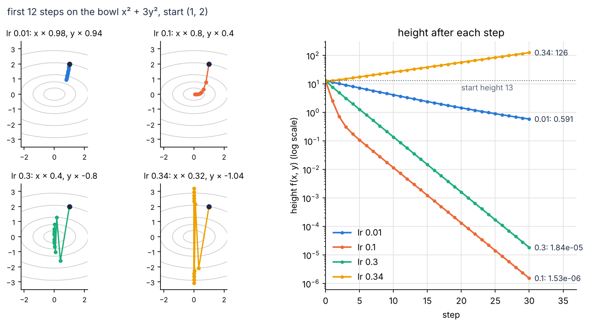
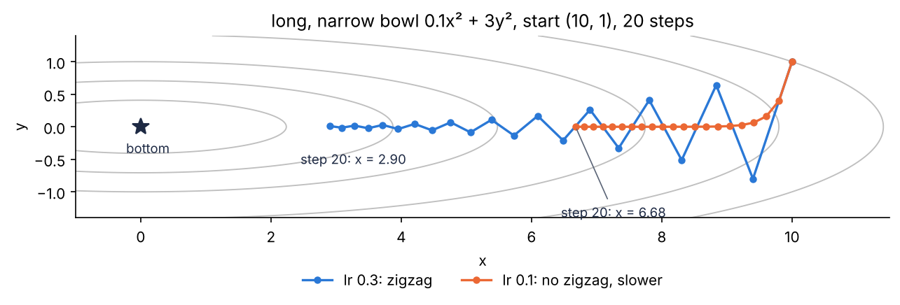
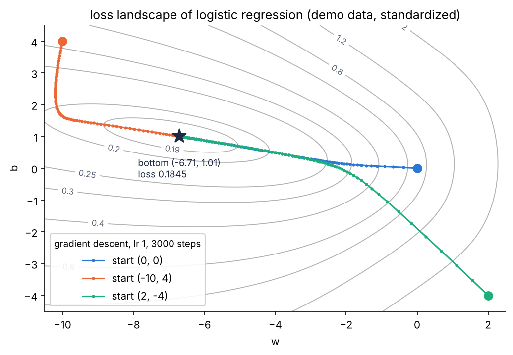
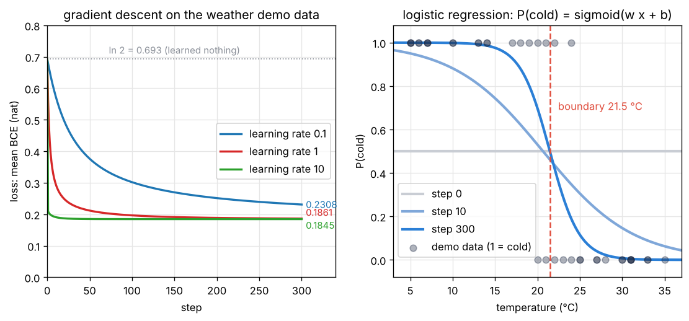
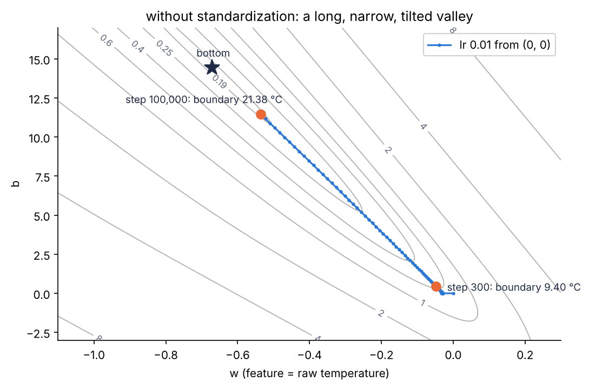
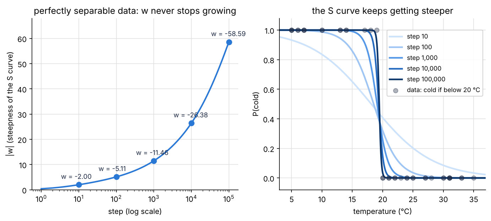

import { Aside, LinkButton } from '@astrojs/starlight/components';
import LearningRateLab from '../../../components/LearningRateLab.tsx';
import SigmoidSoftmaxDemo from '../../../components/SigmoidSoftmaxDemo.tsx';
import LossLandscapeDemo from '../../../components/LossLandscapeDemo.tsx';
import LogisticTrainer from '../../../components/LogisticTrainer.tsx';

<Aside type="note" title="影片">
本集影片製作中，完成後會放在這裡。
</Aside>

## 這集要解決什麼問題

EP07 的最後，我們讓玩具模型的分數一步一步換成 $z - 1.0 \times (q - \hat{p})$（$q$ 是模型的機率，$\hat{p}$ 是資料裡每個 token 的比例），大約 20 步，損失就降到地板。往負梯度走損失會下降，EP04 就知道了；可是有三件事還沒回答：

1. **一步該走多遠？** EP04 往負梯度走了「一小段，大約 0.12」，EP06 每步走 0.1 倍，EP07 走 1.0 倍。這些數怎麼來的？走太大會怎樣？
2. **損失長什麼樣子？** 「訓練模型就是在找損失的谷底」（EP04）：谷底只有一個嗎？
3. **模型怎麼從資料學？** 玩具模型只是把機率調成資料的比例；真正的模型要看線索（前文）猜答案，沒有人告訴它規則。

這集用四個工具回答：**梯度下降、學習率、邏輯迴歸、損失地形**，接起來就是本集重點：**第一個會學習的模型**。它只有兩個參數、只分「冷」「熱」兩類，可是「算預測 → 算損失 → 算梯度 → 走一步」這個迴圈，就是訓練 LLM 的骨架。

<Aside type="tip" title="小提醒">

沒看過前幾集也沒關係，這集只需要幾個前提。EP00：模型替每個 token 打分數，Softmax 換成機率。EP01：Softmax $q_i = \frac{e^{z_i}}{\sum_k e^{z_k}}$，每個分數都加同一個數，機率不變；`llm-labs` 是我們的 Python 專案，用 `uv run pytest` 跑測試。EP02：logsumexp $\ln \sum_k e^{z_k}$ 不會溢位，log 機率＝分數 − logsumexp。EP03：線性層 $Wx + b$（權重、偏差），`np.linalg.norm` 是向量的長度。EP04：碗 $x^2 + 3y^2$ 在 $(1, 2)$ 的梯度是 $(2x, 6y) = (2, 12)$，負梯度是下降最快的方向；`numerical_gradient` 用中央差分算梯度。EP05：鏈鎖律。EP07：損失＝平均交叉熵（nat），壓低它就是最大概似估計，對分數的梯度是 $q - y$。這集會用到 `ep01/softmax.py`、`ep02/mathlang.py`、`ep04/calculus.py`、`ep07/info.py`，還沒寫的話，先把那幾集 notebook 最後的參考解答存成這些檔案（最上面加 `import numpy as np`，`ep07/info.py` 還要照那一格開頭的註解多加兩行 import；刪掉最後一行 `check_…()`）。

</Aside>

| 看過的東西 | 出處 | 還沒回答的 | 在哪裡回答 |
|---|---|---|---|
| 在碗 $x^2 + 3y^2$ 上往負梯度走一小段（約 0.12），高度 13 → 11.56 | EP04 | 走多遠、走幾步、何時停？ | 工具一 |
| 玩具模型每一步走 0.1 倍（EP06）、1.0 倍（EP07），大約 20 步 | EP06、EP07 | 這些數怎麼選？走太大會怎樣？ | 工具二 |
| 損失＝平均交叉熵，梯度 $q - y$ | EP07 | 怎麼拿來從資料學？ | 工具三 |
| 「訓練模型就是在找損失的谷底」 | EP04 | 谷底只有一個嗎？ | 工具四 |
| 「猜錯了就調整參數」；⑤ 打分數、⑥ 換成機率 | EP00 | 調整是怎麼做的？ | 本集重點 |

學完這集，你應該能：

- 寫出梯度下降 $\theta \leftarrow \theta - \eta\,\nabla f(\theta)$，用 $1 - 6\eta$ 說明學習率太小、太大會怎樣。
- 說明 sigmoid 是兩類的 Softmax、二元交叉熵是兩類的交叉熵，推出梯度 $p - y$。
- 說明損失地形與「凸」；從零實作邏輯迴歸，和 PyTorch 對照。

## 準備：開一個邊讀邊跑的 notebook

在 Ubuntu 終端機進到 `llm-labs`，建立這集的資料夾：

```bash
cd ~/code/llm-labs
mkdir -p ep08 && touch ep08/__init__.py
```

接著在 VS Code 新增 `ep08/playground.ipynb`，kernel 選 `.venv`，第一個 cell 寫：

```python
import sys
sys.path.append("..")    # 讓 Python 也到上一層（llm-labs）找程式

import numpy as np
from ep01.softmax import softmax
from ep04.calculus import numerical_gradient
from ep07.info import cross_entropy_loss
```

也可以直接打開這集的 notebook 邊讀邊跑。

<LinkButton href="https://colab.research.google.com/github/chainchen1103/llm-from-scratch/blob/main/notebooks/ep08/ep08_gradient_descent.ipynb" icon="external" target="_blank" rel="noopener noreferrer">在 Colab 開啟 notebook</LinkButton>
<LinkButton href="https://github.com/chainchen1103/llm-from-scratch/blob/main/notebooks/ep08/ep08_gradient_descent.ipynb" variant="secondary" target="_blank" rel="noopener noreferrer">在 GitHub 查看</LinkButton>

<Aside type="tip" title="小提醒">

接下來的程式區塊裡，`print()` 那一行後面的註解就是印出來的結果，其他註解是說明。迴圈或印出好幾行的區塊，結果會依序寫在區塊最後的註解裡。

</Aside>

**寫法約定**：$\theta$（念 theta）是全部參數排成的一排數字，$\eta$（念 eta）是學習率，$\nabla f(\theta)$ 是 $f$ 在 $\theta$ 的梯度（EP04，$\nabla$ 念 nabla），$\leftarrow$ 念「換成」。**工具一、工具二的 $x$、$y$ 是碗的兩個座標，也就是要調的參數；從工具三開始，$x$ 是（標準化後的）氣溫、$y$ 是答案（1 = 冷、0 = 熱）**，意思不一樣。$p$ 是模型給「冷」的機率（工具一、二程式裡的 `p` 是碗上的位置）；一天的損失寫成 $\ell$（小寫的 L），平均起來寫成 $\text{loss}$（同 EP07）。$\ln$ 是自然對數（`np.log`），單位 nat。

## 工具一：梯度下降

### 把 EP04 那一步一直走下去

EP04 站在碗 $f(x, y) = x^2 + 3y^2$ 的 $(1, 2)$，算出梯度 $(2, 12)$，往負梯度走了**一步**。走到新的位置，坡的方向就變了，所以在那裡重新算梯度，再走一步；一直這樣走，叫**梯度下降 gradient descent**：

$$
\theta \leftarrow \theta - \eta\,\nabla f(\theta)
$$

白話：站在哪裡，就在那裡算梯度，往反方向走「$\eta$ 倍的梯度」，再算、再走。

$f$ 是要變小的函數，訓練時就是損失。$\eta$ 叫**學習率 learning rate**，是人選的、不是學出來的，所以也是超參數（EP00 的溫度也是）。

$\eta = 0.1$ 時，$x$ 換成 $x - 0.1 \times 2x = 0.8x$，$y$ 換成 $y - 0.1 \times 6y = 0.4y$：每一步 $x$ 乘 0.8、$y$ 乘 0.4。手算兩步：$(1, 2) \to (0.8, 0.8) \to (0.64, 0.32)$，高度 $13 \to 0.64 + 1.92 = 2.56 \to 0.4096 + 0.3072 = 0.7168$。

```python
def bowl(p):
    return p[0] ** 2 + 3 * p[1] ** 2          # EP04 的碗 f(x, y) = x² + 3y²

def bowl_grad(p):
    return np.array([2 * p[0], 6 * p[1]])     # 梯度 (2x, 6y)

p = np.array([1.0, 2.0])
for step in range(4):
    g = bowl_grad(p)
    print(step, p, bowl(p), g)
    p = p - 0.1 * g                           # 往負梯度走一步：學習率 0.1
# 0 [1. 2.] 13.0 [ 2. 12.]
# 1 [0.8 0.8] 2.559999999999999 [1.6 4.8]
# 2 [0.64 0.32] 0.7167999999999999 [1.28 1.92]
# 3 [0.512 0.128] 0.31129599999999996 [1.024 0.768]
```

和手算一樣（`2.559999999999999` 是捨入誤差，EP02）。梯度也一步一步變短：越走，坡越平。

### 什麼時候停、每步走多遠

兩種停法：**走固定的步數**（上面的迴圈走 4 步）；或**梯度夠小就停**：梯度的長度小於一個門檻，代表這裡幾乎是平的。碗裡幾乎平的地方就是谷底附近（例外：弄壞它 5 的地形越走越平，卻沒有谷底）。

```python
p, step, lengths = np.array([1.0, 2.0]), 0, []
while np.linalg.norm(bowl_grad(p)) >= 1e-6:   # 梯度夠小（坡夠平）就停
    lengths.append(0.1 * np.linalg.norm(bowl_grad(p)))   # 實驗紀錄：這一步走的距離
    p = p - 0.1 * bowl_grad(p)
    step += 1
print(step, p, bowl(p))
print(np.round(lengths[:5], 4), 0.01 * np.linalg.norm(bowl_grad([1.0, 2.0])))   # 最後一個：EP04 那一步
# 66 [4.01734511e-07 1.08890357e-26] 1.6139061738043196e-13
# [1.2166 0.506  0.2308 0.128  0.0875] 0.1216552506059644
```

- 66 步之後梯度短於 $10^{-6}$，高度 $1.6 \times 10^{-13}$：永遠不會剛好是 0，但越來越靠近谷底，這叫**收斂 converge**。$y$ 每步乘 0.4，早就到了（$10^{-26}$），後面幾十步都在等每步只乘 0.8 的 $x$。訓練 LLM 時通常是走固定的步數（看能花多少算力）。
- 第二行是前五步走的距離。學習率不是「走多遠」：**走多遠＝學習率 × 梯度的長度**。EP04 那一步 `p - 0.01 * grad` 就是學習率 0.01 的第一步，「大約 0.12」是 $0.01 \times$ 梯度的長度 12.17（最後一個數）。
- 學習率固定 0.1，前五步走的距離卻從 1.22 縮到 0.09，之後還會更小：**坡越陡走越多，越接近谷底走越少**，不用自己把步伐變小（EP15 的學習率排程 learning rate schedule 另有理由）。

## 工具二：學習率

### 四個學習率

同一個碗、同一個起點，換四個學習率，各走 30 步：

```python
def run(grad_fn, start, lr, steps):
    p, path = np.array(start), [np.array(start)]
    for _ in range(steps):
        p = p - lr * grad_fn(p)
        path.append(p)
    return np.array(path)                     # (steps + 1, 2)：每一步的位置

rates = [0.01, 0.1, 0.3, 0.34]
paths = [run(bowl_grad, [1.0, 2.0], lr, 30) for lr in rates]
for lr, path in zip(rates, paths):
    print(lr, round(1 - 2 * lr, 2), round(1 - 6 * lr, 2), np.round(path[:4, 1], 3), f"{bowl(path[30]):.3g}")
# 0.01 0.98 0.94 [2.    1.88  1.767 1.661] 0.591
# 0.1 0.8 0.4 [2.    0.8   0.32  0.128] 1.53e-06
# 0.3 0.4 -0.8 [ 2.    -1.6    1.28  -1.024] 1.84e-05
# 0.34 0.32 -1.04 [ 2.    -2.08   2.163 -2.25 ] 126
```

每一列依序是：學習率、$x$ 每步乘的數 $1 - 2\eta$、$y$ 每步乘的數 $1 - 6\eta$、前四步的 $y$、第 30 步的高度。

- **0.01：太小**。$y$ 每步只乘 0.94，30 步後高度還有 0.591。不會出錯，只是慢（EP04 故意用它：步伐小，線性近似才準）。
- **0.1：順利**。30 步降到 $1.5 \times 10^{-6}$。
- **0.3：偏大**。$y$ 乘 $-0.8$：每一步都跳到谷底的另一邊（2 → −1.6 → 1.28），越跳越近，還是會收斂。其實它和 0.1 一樣快：最慢的方向都是每步乘 0.8（下圖右邊兩條線後段一樣斜）。第 30 步的高度差 12 倍，是因為 0.1 最後剩下 $x^2$（從 1 出發），0.3 剩下 $3y^2$（從 $3 \times 2^2 = 12$ 出發）。
- **0.34：太大**。$y$ 乘 $-1.04$：每跳一次就離谷底更遠，30 步後高度 126，比起點的 13 還高。越走越遠叫**發散 diverge**（和高中數列的「發散」同一個字）。



### 為什麼上限是 1/3

$y$ 方向每一步：

$$
y \leftarrow y - \eta \times 6y = (1 - 6\eta)\,y
$$

白話：不管 $y$ 現在是多少，每一步都乘上同一個數 $1 - 6\eta$。

每步乘同一個數 $m$（高中的等比數列）：$|m| < 1$ 越乘越小，收斂，$m < 0$ 時每步換邊；$|m| > 1$ 越乘越大，發散。$|1 - 6\eta| < 1$ 就是 $0 < \eta < \frac{1}{3}$；$x$ 方向的 $|1 - 2\eta| < 1$ 只要 $\eta < 1$。兩個都要成立，所以 **$\eta < \frac{1}{3}$：最窄的方向決定上限**（剛好 $\frac{1}{3}$ 時，$y$ 永遠在 2 和 −2 之間跳）。

6 和 2 是什麼？$y$ 方向的斜率是 $6y$：$y$ 每多 1，斜率就多 6；$x$ 方向的斜率 $2x$ 每次只多 2。這個「斜率變化的快慢」叫**彎曲程度 curvature**：越大，碗在那個方向越窄。彎曲程度 $c$ 的方向每步乘 $1 - c\,\eta$，要 $|1 - c\,\eta| < 1$：

$$
\eta < \frac{2}{\text{最大的彎曲程度}}
$$

白話：學習率要小於「2 除以最彎的那個方向的彎曲程度」，這裡是 $\frac{2}{6} = \frac{1}{3}$。

真正的損失每個地方的彎曲程度都不一樣，算不出固定的上限，學習率通常是試出來的（弄壞它 1）。

### 又長又窄的碗：鋸齒狀前進

把碗的 $x$ 方向放平 10 倍：$0.1x^2 + 3y^2$，彎曲程度變成 0.2 和 6。上限還是 $\frac{1}{3}$（$y$ 決定）；用同樣的 0.3，$y$ 每步還是乘 $-0.8$，$x$ 卻只乘 $1 - 0.2 \times 0.3 = 0.94$。

```python
def flat_bowl(p):
    return 0.1 * p[0] ** 2 + 3 * p[1] ** 2    # x 方向放平 10 倍：又長又窄

def flat_grad(p):
    return np.array([0.2 * p[0], 6 * p[1]])

path = run(flat_grad, [10.0, 1.0], 0.3, 20)
print(flat_bowl(path[0]), np.round(path[[1, 2, 3, 20]], 3).tolist())
print(np.round(run(flat_grad, [10.0, 1.0], 0.1, 20)[20], 3))   # 學習率 0.1，第 20 步
# 13.0 [[9.4, -0.8], [8.836, 0.64], [8.306, -0.512], [2.901, 0.012]]
# [6.676 0.   ]
```

從 $(10, 1)$ 出發（高度一樣是 13）：$y$ 在谷底兩邊來回跳，20 步後只剩 0.012；$x$ 每步只挪一點點，20 步後還在 2.9。路徑是**鋸齒狀**的：橫越窄的方向來回跳，沿著長的方向慢慢爬。學習率 0.1 不會鋸齒（$y$ 乘 0.4，不換邊），$x$ 卻更慢，20 步後還在 6.68。想讓 $x$ 快一點，學習率又不能再大（$y$ 會發散）：**最窄的方向決定上限，最長的方向決定要走多久**。長和窄差得越多，走得越慢，工具三的「標準化」就是為了避免這件事。



下面的元件可以換學習率，看路徑和每一步乘的數：

<LearningRateLab client:visible />

<details>
<summary>EP06、EP07 的玩具模型也一樣</summary>

把 EP07 那一步 $z - 1.0 \times (q - \hat{p})$ 的 1.0 換成別的學習率，看要幾步 KL 才小於 $10^{-6}$：1.0（就是 EP06 的 0.1）要 19 步，也就是 EP07 的「大約 20 步」（EP06 走了 50 步，其實 19 步就夠了）；換成 0.1（EP06 的 0.01）要 206 步，3.0 只要 4 步，5.0 反而要 81 步，8.0 走了 1000 步還停不下來。太小慢、太大停不下來，最好的在中間：EP06、EP07 選的數沒有特別的道理。能用 KL 決定何時停，是因為知道地板（熵）；真正訓練時不知道，就用工具一的兩種停法。

</details>

## 工具三：邏輯迴歸

### 示範資料：「今天天氣很 ___」

EP00 的模型看了「今天天氣很」，給「冷」29.3%、「熱」22.9%。這集做一個極簡版：**只有「冷」「熱」兩個選項，只看一個線索：當天的氣溫**。下面是**示範資料**（不是真的天氣紀錄），照一個固定的規則產生：體感溫度＝氣溫加上 −6 到 6 度的隨機誤差，體感低於 20 度就寫「冷」。

```python
rng = np.random.default_rng(0)                # 示範資料：固定 seed 0
temp = rng.integers(5, 36, size=40)           # 40 天的氣溫（°C），5 到 35 度的整數（36 不含）
felt = temp + rng.uniform(-6, 6, size=40)     # 體感：每天多或少，最多 6 度
y = (felt < 20).astype(int)                   # 體感低於 20 度就寫「冷」：1 = 冷、0 = 熱
print(temp)
print(y)
print(y.sum(), temp[y == 1].max(), temp[y == 0].min())   # 冷的天數、最熱的「冷」、最冷的「熱」
print(temp.mean(), temp.std())                # 平均、標準差
x = (temp - 20) / 10                          # 標準化：20 度變 0，每 10 度算 1
# [31 24 20 13 14  6  7  5 10 30 25 33 20 23 35 27 24 21 22 33 13 30 25  5
#  17 31 22  6 28 27 31 10  7 31  5 21  7 14 19 18]
# [0 1 0 1 1 1 1 1 1 0 0 0 1 0 0 0 0 0 0 0 1 0 0 1 1 0 1 1 0 0 0 1 1 0 1 1 1
#  1 1 1]
# 21 24 20
# 19.75 9.307926729406502
```

- 40 天裡 21 天「冷」、19 天「熱」。19 度以下全是「冷」（17 天），25 度以上全是「熱」（14 天），**20 到 24 度兩種都有**（「冷」4 天、「熱」5 天）。同樣的氣溫，答案不一定一樣，就像同樣的前文，下一個 token 不一定一樣（EP07 的熵）。
- 從線索猜答案是哪一類，叫**分類 classification**；只有兩類叫**二元分類 binary classification**。氣溫這種拿來猜的數叫**特徵 feature**，答案 $y$ 叫**標籤 label**。LLM 猜下一個 token 也是分類，只是有 151,936 類。

### 標準化：把特徵縮放到差不多的範圍

最後一行把氣溫換成 $x = \frac{\text{氣溫} - 20}{10}$：20 度變 0、5 度變 −1.5、35 度變 1.5。把特徵平移、縮放到 0 附近、大小差不多 1，叫**標準化 standardization**。常見的做法是減掉平均、除以**標準差 standard deviation**（資料離平均大約多遠，`np.std`）；這份資料的平均 19.75、標準差 9.31，取整數 20 和 10 差不多，換算回氣溫也方便。

為什麼要做？等一下的模型有兩個參數 $w$、$b$。直接用 5 到 35 度，特徵又大又全是正的（$w$ 動一點，40 天的分數都往同一邊移，和 $b$ 動很像），損失就成了工具二那種又長又窄、還斜著放的碗（弄壞它 4）。減掉 20，特徵有正有負；再除以 10，大小差不多 1，碗就比較圓。

### 模型：sigmoid 就是兩個類別的 Softmax

先給「冷」打一個分數 $z = wx + b$：EP03 的線性層，只有 1 個輸入、1 個輸出，$w$ 是權重、$b$ 是偏差。分數要換成機率：讓「冷」的分數是 $z$、「熱」的分數固定是 0，做 Softmax：

$$
p = \frac{e^{z}}{e^{z} + e^{0}} = \frac{1}{1 + e^{-z}} = \sigma(z)
$$

白話：「冷」的機率，就是兩個分數 $[z, 0]$ 做 Softmax 之後的第一格（中間那一步是上下同除以 $e^z$）。

這個函數叫 **sigmoid**，記作 $\sigma$（念 sigma），也叫 logistic 函數。「熱」的分數可以固定是 0，因為 Softmax 只看分數的差（EP01：每個分數都加同一個數，機率不變），兩個類別只要一個數就夠了。

```python
def sigmoid_naive(z):
    return 1 / (1 + np.exp(-z))               # 照定義寫（等一下會看到它的問題）

zs = np.array([-5.0, -2.0, 0.0, 2.0, 5.0])
scores = np.stack([zs, np.zeros(5)], axis=1)  # 兩排並成兩欄 (5, 2)：每一列是「冷」的分數 z、「熱」的分數 0
print(np.round(sigmoid_naive(zs), 4))
print(scores[1], np.round(softmax(scores)[:, 0], 4))   # 兩個類別的 Softmax，取「冷」那一格
# [0.0067 0.1192 0.5    0.8808 0.9933]
# [-2.  0.] [0.0067 0.1192 0.5    0.8808 0.9933]
```

- $\sigma(0) = 0.5$；$z$ 越大越靠近 1、越小越靠近 0，畫出來是一條 **S 形曲線**。$\sigma(-z) = 1 - \sigma(z)$ 是「熱」的機率（$0.1192 + 0.8808 = 1$）。斜率是 $\sigma(z)\,(1 - \sigma(z))$（EP07 Softmax Jacobian 的對角線 $q_i(1 - q_i)$），在 $z = 0$ 最大，是 0.25，往兩邊越來越平。
- 模型 $p = \sigma(wx + b)$ 是「冷」的機率。$w < 0$ 時，越冷（$x$ 越小）分數越大，越可能是「冷」；$|w|$ 越大，S 形越陡，模型越有把握。
- $p = 0.5$ 的地方是 $z = 0$，也就是 $x = -\frac{b}{w}$，換回氣溫（$20 + 10x$）是 $20 - \frac{10b}{w}$ 度：$w < 0$ 時，比它冷就判「冷」，比它熱就判「熱」。這個分界叫**決策邊界 decision boundary**，這集叫它**分界氣溫**。
- 這個模型叫**邏輯迴歸 logistic regression**：名字來自 logistic 函數，「迴歸」是歷史留下來的名字，它其實是拿來分類的。

下面的元件可以拖動分數 $z$，看 sigmoid 和 Softmax 是同一件事：

<SigmoidSoftmaxDemo client:visible />

### 損失：二元交叉熵

每一天，模型的分佈是 $(p, 1 - p)$，正確答案的 one-hot 是 $(y, 1 - y)$。EP07 的交叉熵只剩兩項：

$$
\ell = -\bigl[\,y \ln p + (1 - y) \ln(1 - p)\,\bigr]
$$

白話：「冷」的日子是 $-\ln p$，「熱」的日子是 $-\ln(1 - p)$，都是「正確答案拿到的機率取 $-\ln$」（EP07 的驚訝程度）。

這叫**二元交叉熵 BCE binary cross-entropy**。40 天平均起來就是損失 $\text{loss}(w, b)$；壓低它就是最大概似估計（EP07）。

穩定的寫法：$p = \frac{e^z}{1 + e^z}$、$1 - p = \frac{1}{1 + e^z}$，所以 $\ln p = z - \ln(1 + e^z)$、$\ln(1 - p) = -\ln(1 + e^z)$，代進去：

$$
\ell = \ln(1 + e^{z}) - y\,z
$$

白話：直接從分數 $z$ 算損失，不用先算出機率。

$\ln(1 + e^z) = \ln(e^0 + e^z)$ 就是兩個數 $[0, z]$ 的 logsumexp（EP02），NumPy 寫成 `np.logaddexp(0, z)`，內部會先減掉最大值，不會溢位。

```python
w, b = -3.0, 0.5                              # 隨便挑的一組參數
z = w * x + b                                 # 40 天的分數
p = sigmoid_naive(z)                          # 40 天「冷」的機率
per_day = -(y * np.log(p) + (1 - y) * np.log(1 - p))   # 每一天的二元交叉熵
print(np.round(p[:5], 3), np.round(per_day[:5], 4), per_day.mean())
print(np.mean(np.logaddexp(0, z) - y * z))   # 穩定的寫法：ln(1 + e^z) − y z
print(cross_entropy_loss(np.stack([z, np.zeros(40)], axis=1), 1 - y))   # EP07：分數 [z, 0]，「冷」是第 0 類
print(cross_entropy_loss(np.zeros((40, 2)), 1 - y))                       # w = b = 0：什麼都沒學
# [0.057 0.332 0.622 0.931 0.909] [0.059  1.1032 0.9741 0.0716 0.0955] 0.23029095783326
# 0.23029095783326
# 0.23029095783326
# 0.6931471805599453
```

- 前五天（31、24、20、13、14 度）的答案是熱、冷、熱、冷、冷。24 度那天是「冷」，模型只給 0.332，損失 1.10；20 度那天是「熱」，模型給「冷」0.622，損失 0.97。照定義、穩定的寫法、EP07 的 `cross_entropy_loss`（第 0 類是「冷」，所以答案寫成 $1 - y$）三種寫法算出來都一樣。
- **什麼都沒學**（$w = b = 0$）：每一天 $p = 0.5$，損失 $\ln 2 = 0.693$，就像 EP07 的「151,936 個 token 一樣可能，損失 11.93」，只是這裡只有 2 類。

### 算得穩：不要先算機率再取 log

```python
z_big = np.array([-1000.0, 1000.0])
p_big = sigmoid_naive(z_big)                  # e^1000 溢位
print(p_big)
print(-np.log(1 - p_big[1]), np.logaddexp(0, 1000.0))   # 熱的一天，模型卻很有把握說冷（z = 1000）

def sigmoid(z):
    return np.exp(-np.logaddexp(0, -z))       # 1 / (1 + e^(−z)) = e^(−ln(1 + e^(−z)))：不會溢位

print(sigmoid(z_big), sigmoid(np.array([-2.0, 0.0, 2.0])))
# [0. 1.]
# inf 1000.0
# [0. 1.] [0.11920292 0.5        0.88079708]
```

- `sigmoid_naive(-1000)` 要算 $e^{1000}$，溢位（跳出 `RuntimeWarning: overflow encountered in exp`），$1 / (1 + \infty) = 0$ 碰巧是對的。
- 損失就糟了：一天「熱」、模型卻很有把握說「冷」（$z = 1000$），$p$ 存成剛好 1，$-\ln(1 - 1) = \infty$（跳出 `divide by zero encountered in log`）。正確答案是 $\ln(1 + e^{1000}) = 1000$，很大但有限；一天 `inf`，平均就是 `inf`。
- 穩定的 sigmoid 用 $\sigma(z) = e^{-\ln(1 + e^{-z})}$（因為 $\frac{1}{u} = e^{-\ln u}$），$e^{-1000}$ 只會下溢成 0，不跳警告，之後都用它。原則同 EP01、EP02：**直接從分數算，不要先算出機率再取 log**。

### 梯度：p − y

一天的損失 $\ell = \ln(1 + e^z) - yz$ 對 $z$ 微分。前項用鏈鎖律（EP05）：外層 $\ln u$ 的導數是 $\frac{1}{u}$，內層 $1 + e^z$ 的導數是 $e^z$（EP04）：

$$
\frac{d\ell}{dz} = \frac{e^z}{1 + e^z} - y = \sigma(z) - y = p - y
$$

白話：**就是 EP07 的 $q - y$，只看「冷」那一格**。

再接一層 $z = wx + b$：$\frac{\partial z}{\partial w} = x$、$\frac{\partial z}{\partial b} = 1$，所以一天的梯度是 $\bigl((p - y)\,x,\; p - y\bigr)$。$N$ 天平均：

$$
\frac{\partial\,\text{loss}}{\partial w} = \frac{1}{N} \sum_{i=1}^{N} (p_i - y_i)\,x_i, \qquad \frac{\partial\,\text{loss}}{\partial b} = \frac{1}{N} \sum_{i=1}^{N} (p_i - y_i)
$$

白話：每一天「猜的機率 − 答案」，乘上那天的特徵，再平均。

有 $d$ 個特徵時，把 $N$ 天的特徵排成 $(N, d)$ 的矩陣 $X$，$w$ 是 $d$ 個數，$z = Xw + b$，$w$ 的梯度是 $X^\top (p - y) / N$（EP03：$X^\top$ 是 $X$ 的轉置，等於讓 $X$ 的每一欄和 $p - y$ 做內積）。用 EP04 的數值梯度檢查：

```python
def loss(theta):                              # θ = (w, b)
    z = theta[0] * x + theta[1]
    return np.mean(np.logaddexp(0, z) - y * z)

def grad(theta):                              # 手推的梯度 (∂loss/∂w, ∂loss/∂b)
    p = sigmoid(theta[0] * x + theta[1])
    return np.array([np.mean((p - y) * x), np.mean(p - y)])

theta = np.array([-3.0, 0.5])
print(grad(theta), numerical_gradient(loss, theta))
print(grad(np.zeros(2)))
# [0.04041571 0.01539727] [0.04041571 0.01539727]
# [ 0.38  -0.025]
```

- 手推的和中央差分一樣（印出來的位數全部相同），這就是 EP04 說的梯度檢查（EP11 會拿它檢查自動微分）。
- 從 $w = b = 0$ 出發，每一天 $p = 0.5$。$b$ 的梯度 $0.5 - \frac{21}{40} = -0.025$：「冷」稍微多一點，負梯度把 $b$ 往上推。$w$ 的梯度 0.38 是正的：「冷」的日子 $x$ 大多是負的，$(0.5 - 1) \times$ 負數 $> 0$；「熱」的日子 $x$ 大多是正的，$(0.5 - 0) \times$ 正數也 $> 0$。負梯度把 $w$ 往負的推：**越冷越像「冷」**。

## 工具四：損失地形

### 損失是參數的函數

資料固定，損失就只是 $(w, b)$ 的函數，就像 EP06 的概似函數 $L(p)$ 是參數 $p$ 的函數。兩個參數，可以像 EP04 的碗一樣畫成等高線圖，叫**損失地形 loss landscape**。用 EP01 的廣播一次算一整片：

```python
W, B = np.meshgrid(np.linspace(-10, 2, 121), np.linspace(-4, 4, 81))   # 每隔 0.1 一個點
Z = W[..., None] * x + B[..., None]           # (81, 121, 40)：每一組 (w, b) 對 40 天的分數
L = np.mean(np.logaddexp(0, Z) - y * Z, axis=-1)   # (81, 121)：損失地形
i = np.unravel_index(L.argmin(), L.shape)
print(L.shape, L.min(), W[i], B[i], L.max())
# (81, 121) 0.18449452657117402 -6.699999999999999 1.0 2.9416363839032558
```

`W[..., None]` 在最後加一個軸（EP01），和 40 個 $x$ 廣播成 `(81, 121, 40)`；`np.unravel_index` 把 `argmin` 找到的位置換回列、欄。最低的格點是 $(w, b) \approx (-6.7, 1.0)$，損失 0.1845。畫出來是斜放的橢圓山谷（下一張圖）：往右（$w > 0$，越熱越像「冷」）很快變高；往左（S 形太陡，對 20 到 24 度那幾天太有把握）慢慢變高。

### 凸：只有一個谷

從三個很不一樣的地方出發，各走 3000 步（學習率 1）：

```python
for start in [(0.0, 0.0), (-10.0, 4.0), (2.0, -4.0)]:
    theta = np.array(start)
    for _ in range(3000):
        theta = theta - 1.0 * grad(theta)
    print(start, np.round(theta, 3), round(loss(theta), 8))
# (0.0, 0.0) [-6.708  1.012] 0.18449084
# (-10.0, 4.0) [-6.709  1.013] 0.18449084
# (2.0, -4.0) [-6.708  1.012] 0.18449084
```

三個起點都走到 $(-6.71, 1.01)$，損失 0.18449：**只有一個谷**，從哪裡出發都走到同一個底。這種地形叫**凸 convex**：像一個碗，碗壁只往上彎，中間不會鼓起一座山，也就沒有別的山谷可以把你困住。邏輯迴歸的損失不管資料長怎樣都是凸的（證明這裡不講）。不過凸只保證「沒有別的谷」：不保證「有底」（資料完全分得開時，谷底在無限遠，弄壞它 5），也不保證一定走得到（學習率太大，會在谷底附近來回跳，弄壞它 1）。



下面的元件可以點任何地方當起點：

<LossLandscapeDemo client:visible />

### LLM 的損失地形

邏輯迴歸只有 2 個參數、一個谷。LLM 的損失地形有約 5 億維（Qwen2.5-0.5B 約 5 億個參數），畫不出來，也不是凸的：有很多起伏，從哪裡出發會影響走到哪裡（EP13 的初始化 initialization）。梯度下降照樣有用，只是不保證走到最低點。

## 本集重點：第一個會學習的模型

### 四步接成一個迴圈

$w$、$b$ 從 0 開始（什麼都沒學），學習率固定 1，一輪一輪做這四步：**① 算預測 → ② 算損失 → ③ 算梯度 → ④ 往負梯度走一步**。

```python
w, b, lr = 0.0, 0.0, 1.0                      # 從 0 開始；學習率固定 1
history = []                                  # 實驗紀錄：每一步的 (w, b, 損失)
for step in range(301):
    z = w * x + b
    p = sigmoid(z)                            # ① 算預測：每一天「冷」的機率
    loss_now = np.mean(np.logaddexp(0, z) - y * z)   # ② 算損失：平均二元交叉熵
    dw, db = np.mean((p - y) * x), np.mean(p - y)    # ③ 算梯度
    history.append((w, b, loss_now))
    if step in [0, 1, 10, 30, 100, 300]:
        acc = np.mean((p >= 0.5) == y)        # 準確率：p ≥ 0.5 判成「冷」
        cut = 20 - 10 * b / w if w != 0 else np.nan   # 分界氣溫：p = 0.5 的地方
        print(step, round(loss_now, 4), round(w, 3), round(b, 3), acc, round(cut, 2))
    w, b = w - lr * dw, b - lr * db           # ④ 往負梯度走一步
history = np.array(history)                   # (301, 3)
# 0 0.6931 0.0 0.0 0.525 nan
# 1 0.5638 -0.38 0.025 0.9 20.66
# 10 0.2959 -1.888 0.123 0.9 20.65
# 30 0.2293 -3.004 0.294 0.9 20.98
# 100 0.1963 -4.43 0.583 0.9 21.32
# 300 0.1861 -5.749 0.838 0.9 21.46
```

每一列：步數、損失、$w$、$b$、**準確率 accuracy**（猜對的比例）、分界氣溫。這個迴圈叫**訓練迴圈 training loop**；每一步都用全部 40 天算梯度，叫**全批次 full-batch**。

- **損失每一步都下降**：0.693（什麼都沒學）→ 0.564 → 0.296 → 0.196 → 0.186，越來越靠近谷底的 0.1845。
- 第 0 步 $p$ 全是 0.5，全部判成「冷」，準確率 $\frac{21}{40} = 0.525$。**第 1 步準確率就到 0.9**，分界 20.66 度，之後 299 步準確率都沒變。
- 那後面 299 步在做什麼？$w$ 從 −0.38 變成 −5.75：**S 形越來越陡，模型越來越有把握**，分界從 20.66 度慢慢移到 21.46 度。準確率只看 $p$ 落在 0.5 的哪一邊，損失看正確答案拿到多少機率。訓練要用損失：準確率一格一格跳，參數動一點點它通常不變，幾乎每個地方的梯度都是 0，指不出方向。

### S 形曲線貼上資料

```python
temps = np.array([5, 15, 20, 25, 35])
for step in [0, 1, 10, 300]:
    w_, b_ = history[step, :2]
    print(step, np.round(sigmoid(w_ * (temps - 20) / 10 + b_), 3))   # 這幾個氣溫「冷」的機率
w_, b_ = history[300, :2]
p300 = sigmoid(w_ * x + b_)
wrong = (p300 >= 0.5) != y                    # 猜錯的日子
print(temp[wrong], y[wrong], np.round(p300[wrong], 3))
# 0 [0.5 0.5 0.5 0.5 0.5]
# 1 [0.645 0.554 0.506 0.459 0.367]
# 10 [0.95  0.744 0.531 0.306 0.062]
# 300 [1.    0.976 0.698 0.115 0.   ]
# [24 20 21 22] [1 0 0 1] [0.188 0.698 0.565 0.423]
```

- 5、15、20、25、35 度「冷」的機率：第 0 步是 0.5 的水平線，第 1 步微微傾斜，第 10 步是平緩的 S，第 300 步是陡的 S。
- 第 300 步猜錯的 4 天都在 20 到 24 度：24 度「冷」、20 度「熱」、21 度「熱」、22 度「冷」。同樣的氣溫有冷有熱，**沒有任何一條 S 形能全部猜對**，損失也降不到 0：這是資料本身的不確定性（EP07：損失的地板是熵）。
- 資料是照「20 度」的規則產生的，學到的分界卻是 21.5 度：只有 40 天，這 40 天剛好偏了一點（自我檢測 6）。



這張圖是動手做的 `plot_training.py` 畫的。左圖也說明了學習率為什麼挑 1：0.1 走 300 步只降到 0.2308，10 不到 100 步就到谷底，挑 1 是為了看清楚「幾百步慢慢變好」。300 步停在 $(-5.75, 0.84)$，還沒到底，但損失只比最低的 0.1845 多 0.0016。

下面的元件可以自己一步一步訓練：

<LogisticTrainer client:visible />

### 和 LLM 的連結

沒有人告訴模型「21.5 度」或「越冷越像冷」，只給了資料、損失和「往負梯度走」，$w$、$b$ 就從 0 走到能解釋資料的地方：這就是**從資料學習**，也是 EP00 的「猜錯了就調整參數」（猜得越錯，$p - y$ 離 0 越遠，改得越多）。

- **這個迴圈就是訓練 LLM 的骨架**：① 從前文算出 151,936 個分數、做 Softmax → ② 算平均交叉熵（EP07）→ ③ 算梯度 → ④ 往負梯度走一步，做非常多輪。
- **LLM 的最後一步就是多類別的邏輯迴歸**（EP00 的 ⑤ 打分數＋⑥ 換成機率）：特徵是最後一個向量的 896 個數，分數是 EP03 的 $(151936, 896)$ 矩陣乘上它。兩類換成 151,936 類、sigmoid 換回 Softmax、$p - y$ 換回 $q - y$，就是它，也叫 **Softmax 迴歸 softmax regression**（EP12 會用它分手寫數字的 10 類）。
- **LLM 和這集哪裡不一樣**：
  1. **約 5 億個參數、很多層**：特徵是前面的層算出來的，也要學；手推梯度不可能，要靠反向傳播（EP09–EP11）。
  2. **一次只看一小批資料**：每一步只用一小批資料算梯度，叫 **mini-batch**（EP12）。
  3. **更聰明的走法**：動量 momentum、Adam、學習率排程（EP15）；地形不是凸的，初始化（EP13）、過擬合 overfitting 與正則化 regularization（EP16）也會影響結果。

## 動手做：從零寫出 `gd.py`

在 `llm-labs/ep08/gd.py` 寫下面 7 個函式：

```python
import numpy as np

def make_weather_data(n=40, seed=0):
    """示範資料（工具三的規則）：n 天的氣溫（°C，5 到 35 的整數）和答案 y（1 = 冷、0 = 熱）。回傳 (temp, y)。"""

def gradient_descent(grad_fn, theta0, lr, steps):
    """每一步 θ ← θ − lr × grad_fn(θ)，走 steps 步。回傳 (theta, history)：最後的參數，和每一步的紀錄
    （theta0 是 d 個數時形狀 (steps + 1, d)；history[k] 是走了 k 步之後，history[0] 是起點）。不能改到呼叫端的 theta0。"""

def sigmoid(z):
    """σ(z) = 1 / (1 + e^(−z))，z 可以是一個數或陣列。數值穩定：z = ±1000 不能有警告、inf 或 nan。"""

def bce_loss(w, b, X, y):
    """平均二元交叉熵（nat，float）。X：(N, d)；w：(d,)；b：一個數；y：長度 N 的 0／1。用穩定的寫法。"""

def bce_grad(w, b, X, y):
    """bce_loss 對 w、b 的梯度 (dw, db) = (Xᵀ(p − y) / N, mean(p − y))。dw 形狀 (d,)，db 是 float。"""

def fit_logistic(X, y, lr, steps):
    """w、b 從 0 開始，用 gradient_descent 走 steps 步。回傳 (w, b, losses)：w 形狀 (d,)、b 是 float，
    losses 長度 steps + 1（losses[k] 是走了 k 步之後的損失）。"""

def accuracy(w, b, X, y):
    """p ≥ 0.5 判成 1、否則判成 0，回傳猜對的比例（float）。"""
```

要求與提示：

1. **只用 NumPy、基本的 Python 和前幾集自己寫的函式**。
2. **`make_weather_data`**：照抄工具三示範資料那一格的前四行，把 `default_rng(0)` 的 0 換成 `seed`、40 換成 `n`。**亂數的呼叫順序不能換**（先 `integers`、再 `uniform`），測試會檢查前五天、「冷」剛好 21 天，以及換了 seed 資料會不一樣。
3. **`gradient_descent`**：先 `theta = np.array(theta0, dtype=float)` 複製一份，每一步 `theta = theta - lr * grad_fn(theta)` 產生新陣列，把 `theta.copy()` 加進 `history`（list），最後 `np.array(history)`。工具二的 `run` 就是它。
4. **`sigmoid`**：用工具三「算得穩」那一段的寫法；或照正負號分開算：`e = np.exp(-np.abs(z))`，$z \ge 0$ 用 `1 / (1 + e)`、$z < 0$ 用 `e / (1 + e)`（上下同乘 $e^z$），再用 `np.where` 挑。不要在 `np.where` 裡直接寫 `np.exp(-z)` 和 `np.exp(z)`：兩邊都會先算完，一樣溢位。
5. **`bce_loss`**：`float(np.mean(np.logaddexp(0, z) - y * z))`，`z = X @ w + b`；`X`、`y`、`w` 先 `np.asarray(..., dtype=float)`（測試會傳 list）。
6. **`bce_grad`**：`r = sigmoid(X @ w + b) - y`，`dw = X.T @ r / N`、`db = float(np.mean(r))`。記得除以 $N$（弄壞它 3）。
7. **`fit_logistic`**：把 $w$、$b$ 排成一排 `theta`（長度 $d + 1$，最後一個是 $b$），`grad_fn(theta)` 回傳 `np.append(dw, db)`（把 `db` 接在 `dw` 後面），交給 `gradient_descent`；再對 `history` 的每一列算 `bce_loss`。
8. **`accuracy`**：`sigmoid(...) >= 0.5` 和 `y == 1` 比，取平均。

把下面的測試存成 `llm-labs/tests/test_ep08_gd.py`：

```python
import math
import warnings

import numpy as np
import pytest

from ep01.softmax import softmax
from ep04.calculus import numerical_gradient
from ep07.info import cross_entropy_loss
from ep08.gd import accuracy, bce_grad, bce_loss, fit_logistic, gradient_descent
from ep08.gd import make_weather_data, sigmoid

def bowl_grad(p):
    return np.array([2 * p[0], 6 * p[1]])                     # EP04 的碗 x² + 3y² 的梯度

def weather():
    temp, y = make_weather_data()                             # 示範資料：40 天，seed 0
    return ((temp - 20) / 10).reshape(-1, 1), y               # 標準化，形狀 (40, 1)

def test_gradient_descent_on_bowl():
    start = np.array([1.0, 2.0])
    theta, hist = gradient_descent(bowl_grad, start, lr=0.1, steps=100)
    assert hist.shape == (101, 2) and np.array_equal(theta, hist[-1])
    assert np.allclose(hist[:3], [[1, 2], [0.8, 0.8], [0.64, 0.32]])   # x ← 0.8x、y ← 0.4y
    assert np.linalg.norm(theta) < 1e-8 and np.array_equal(start, [1.0, 2.0])   # 收斂；不能改到呼叫端
    _, hist = gradient_descent(bowl_grad, start, lr=0.3, steps=50)
    assert np.all(hist[1:, 1] * hist[:-1, 1] < 0) and abs(hist[-1, 1]) < 1e-4   # 每步換邊，但會收斂
    _, hist = gradient_descent(bowl_grad, start, lr=0.34, steps=50)
    assert np.all(np.abs(hist[1:, 1]) > np.abs(hist[:-1, 1]))   # 1 − 6η = −1.04：越跳越遠

def test_sigmoid_is_stable_and_two_class_softmax():
    with warnings.catch_warnings():
        warnings.simplefilter("error")                        # 有警告就算失敗
        out = sigmoid(np.array([-1000.0, 0.0, 1000.0]))
    assert np.all(np.isfinite(out)) and np.allclose(out, [0.0, 0.5, 1.0])
    z = np.random.default_rng(0).normal(size=20) * 5
    assert np.allclose(sigmoid(z) + sigmoid(-z), 1.0)         # 冷 + 熱 = 1
    assert np.allclose(sigmoid(z), softmax(np.stack([z, 0 * z], axis=1))[:, 0])   # 分數 [z, 0] 的 Softmax
    assert math.isclose(sigmoid(2.0), 1 / (1 + math.exp(-2)))   # 一個數也要能算

def test_bce_loss_hand_computed():
    X, y = weather()
    assert math.isclose(bce_loss(np.zeros(1), 0.0, X, y), math.log(2))   # 什麼都沒學：ln 2
    assert math.isclose(bce_loss([2.0], -1.0, [[1.0]], [1]), math.log(1 + math.exp(-1)))   # z = 1、冷
    assert type(bce_loss([2.0], -1.0, [[1.0]], [1])) is float   # 要回傳 float，不是 np.float64
    z = -3.0 * X[:, 0] + 0.5                                  # 和 EP07 的交叉熵一樣：分數 [z, 0]
    assert math.isclose(bce_loss([-3.0], 0.5, X, y), cross_entropy_loss(np.stack([z, 0 * z], axis=1), 1 - y))
    with warnings.catch_warnings():
        warnings.simplefilter("error")
        assert bce_loss([1.0], 0.0, [[1000.0]], [0]) == 1000.0     # 很有把握地答錯：大但有限
        assert bce_loss([1.0], 0.0, [[1000.0]], [1]) == 0.0

def test_bce_grad_matches_numerical_gradient():
    rng = np.random.default_rng(1)
    X, y = rng.normal(size=(8, 3)), rng.integers(0, 2, size=8)
    w, b = rng.normal(size=3), 0.3
    dw, db = bce_grad(w, b, X, y)
    assert dw.shape == (3,) and isinstance(db, float)
    assert np.allclose(dw, numerical_gradient(lambda v: bce_loss(v, b, X, y), w), rtol=0, atol=1e-8)
    assert math.isclose(db, numerical_gradient(lambda c: bce_loss(w, c[0], X, y), np.array([b]))[0], abs_tol=1e-8)

def test_fit_logistic_learns_weather():
    X, y = weather()
    X0, y0 = X.copy(), y.copy()
    w, b, losses = fit_logistic(X, y, lr=1.0, steps=300)
    assert w.shape == (1,) and isinstance(b, float) and losses.shape == (301,)
    assert math.isclose(losses[0], math.log(2)) and np.all(np.diff(losses) <= 0)   # 從 0 開始，每步都下降
    assert math.isclose(losses[-1], bce_loss(w, b, X, y)) and 0.18 < losses[-1] < 0.19
    assert accuracy(w, b, X, y) == 0.9
    assert accuracy(np.zeros(1), 0.0, X, y) == y.mean()       # p = 0.5：全部判成「冷」
    assert 21 < 20 - 10 * b / w[0] < 22                       # 分界氣溫：p = 0.5 的地方
    assert np.array_equal(X, X0) and np.array_equal(y, y0)    # 不能改到呼叫端
    assert 0.23 < fit_logistic(X, y, lr=0.1, steps=300)[2][-1] < 0.232   # lr 要真的用上：0.1 走 300 步只到 0.2308

def test_reproducible_with_fixed_seed():
    (t1, y1), (t2, y2) = make_weather_data(), make_weather_data()
    assert np.array_equal(t1, t2) and np.array_equal(y1, y2)
    assert t1.shape == (40,) and t1.min() >= 5 and t1.max() <= 35 and y1.sum() == 21   # 21 天「冷」
    assert not np.array_equal(make_weather_data(seed=1)[0], t1)   # seed 要真的用上
    assert t1[:5].tolist() == [31, 24, 20, 13, 14] and y1[:5].tolist() == [0, 1, 0, 1, 1]   # 工具三印出來的前五天
    t400, y400 = make_weather_data(n=400)
    assert t400.shape == y400.shape == (400,)                 # n 要真的用上

def test_matches_pytorch():
    torch = pytest.importorskip("torch")
    F = torch.nn.functional
    X, y = weather()
    Xt, yt = torch.tensor(X), torch.tensor(y, dtype=torch.float64)
    w = torch.zeros(1, dtype=torch.float64, requires_grad=True)
    b = torch.zeros(1, dtype=torch.float64, requires_grad=True)
    opt = torch.optim.SGD([w, b], lr=1.0)                     # 每一步用全部 40 筆：全批次梯度下降
    for _ in range(300):
        opt.zero_grad()
        loss = F.binary_cross_entropy_with_logits(Xt @ w + b, yt)
        loss.backward()
        opt.step()
    w_np, b_np, losses = fit_logistic(X, y, lr=1.0, steps=300)
    assert math.isclose(loss.item(), losses[-2], rel_tol=1e-12)   # 最後一次 backward 是第 299 步
    assert np.allclose(w.detach().numpy(), w_np, rtol=1e-10) and math.isclose(b.item(), b_np, rel_tol=1e-10)
```

`bce_grad` 和數值梯度比，就是梯度檢查；`test_matches_pytorch` 用 PyTorch 跑同樣的 300 步，`w`、`b` 要一樣到 $10^{-10}$。然後在 `~/code/llm-labs` 執行：

```bash
uv run pytest
```

EP01–EP07 共 50 個測試，加上這集 7 個：裝了 PyTorch 會看到 `57 passed`；沒裝的話是 `50 passed, 7 skipped`，跳過的是 EP02–EP08 各一個和 PyTorch 比對的測試（`uv run pytest -rs` 會列出原因）。只有這集的測試是 `7 passed`（沒裝 PyTorch 是 `6 passed, 1 skipped`）。參考解答在這集 notebook 的最後，先自己寫寫看。

### 畫出訓練過程：`plot_training.py`

在 `llm-labs/ep08/plot_training.py` 寫一個畫圖腳本，執行 `uv run python ep08/plot_training.py` 會產生 `ep08/training.png`，也就是本集重點那張圖：

```python
from pathlib import Path

import numpy as np

OUT = Path(__file__).parent / "training.png"        # 從哪裡執行都存到 ep08/
STEPS = 300
RATES = [0.1, 1.0, 10.0]                            # 左圖的三個學習率
SHOW = [0, 10, 300]                                 # 右圖要畫的步數（學習率 1）

def weather_data(n=40, seed=0):
    """示範資料，和 gd.py 的 make_weather_data 一樣。回傳 (temp, y)。"""

def train(x, y, lr, steps):
    """w、b 從 0 開始做全批次梯度下降（x 是標準化後的氣溫）；回傳每一步的 (w, b, 損失)，形狀 (steps + 1, 3)。"""

def draw_loss(ax, x, y):
    """左圖：RATES 的每個學習率各走 STEPS 步的損失曲線（nat），右端寫出最後的損失；一條 ln 2 的虛線（什麼都沒學）。"""

def draw_fit(ax, temp, x, y):
    """右圖：40 天的點（縱軸 1 = 冷、0 = 熱，半透明），學習率 1 在 SHOW 那幾步的 S 形曲線（由淺到深），
    第 STEPS 步的分界氣溫畫垂直虛線、標出數字。"""

if __name__ == "__main__":
    import matplotlib

    matplotlib.use("Agg")    # 只存檔、不開視窗
    import matplotlib.pyplot as plt

    # 一列兩張圖：左邊 draw_loss、右邊 draw_fit，存成 OUT
```

要求與提示：示範資料、sigmoid 和訓練迴圈都在這個檔案裡自己寫（直接執行腳本時，Python 只在 `ep08/` 裡找模組，同 EP06、EP07）。左圖的 $y$ 軸標籤寫上單位；1 和 10 最後的損失很接近，右端的數字上下挪開一點。寫死 `figsize` 和 `dpi`，執行兩次，`md5sum ep08/training.png` 應該一樣。畫對的話，會和本集重點那張圖一樣：三條線從 0.693 出發，停在 0.2308、0.1861、0.1845；第 300 步的 S 形在 21.5 度穿過 0.5。

### 和 PyTorch 對照

裝了 PyTorch 的話，在 `playground.ipynb` 執行（改過 `gd.py` 要重新啟動 kernel，再從第一個 cell 依序執行到這裡，會用到前面的 `x`、`y`）：

```python
import torch
import torch.nn.functional as F
from ep08.gd import fit_logistic

X = x.reshape(-1, 1)                                         # (40, 1)：40 天、1 個特徵
Xt, yt = torch.tensor(X), torch.tensor(y, dtype=torch.float64)
w_t = torch.zeros(1, dtype=torch.float64, requires_grad=True)
b_t = torch.zeros(1, dtype=torch.float64, requires_grad=True)
opt = torch.optim.SGD([w_t, b_t], lr=1.0)                    # 每一步 θ ← θ − 1.0 × 梯度
for step in range(300):
    opt.zero_grad()                                          # 把上一步的梯度清掉
    loss_t = F.binary_cross_entropy_with_logits(Xt @ w_t + b_t, yt)   # 直接吃分數 z
    loss_t.backward()                                        # 倒著算回來（EP05）：梯度存進 .grad
    opt.step()                                               # 往負梯度走一步
w_np, b_np, losses = fit_logistic(X, y, lr=1.0, steps=300)
print(w_t.item(), b_t.item(), loss_t.item())
print(w_np[0], b_np, losses[299])
# -5.749229453136947 0.8380955630927862 0.18614843958439906
# -5.749229453136946 0.838095563092786 0.18614843958439906
```

- 300 步之後只差最後一兩位（捨入誤差）。`loss_t` 是走第 300 步之前算的損失，所以對 `losses[299]`。
- PyTorch 的訓練迴圈也是四步：算預測和損失 → `backward()` 算梯度 → `step()` 走一步。它會把梯度**加**到 `.grad` 上（EP09 會看到為什麼），所以每一步先 `zero_grad()`。
- SGD 是**隨機梯度下降 stochastic gradient descent**：每一步只用隨機抽的一小批資料（EP12）；這裡每一步都用全部 40 天，就是全批次梯度下降。`torch.optim` 裡這些負責「走一步」的叫優化器 optimizer（EP15）。
- `F.binary_cross_entropy_with_logits` 直接吃分數 $z$；`F.binary_cross_entropy` 吃機率 $p$，$p$ 存成剛好 1 時它把 $\ln$ 截在 −100，算出 100（正確是 1000），梯度是 0，學不到。

## 弄壞它

每一個都先**猜**結果，再執行，最後用自己的話解釋。會用到前面的 `x`、`y`、`temp`、`sigmoid`（重新啟動過 kernel 的話，從第一個 cell 依序執行到「算得穩」那一格）。

### 弄壞它 1：學習率太小、太大

工具二在碗上看過 0.34 發散。換成邏輯迴歸，四個學習率各走 300 步，看第 1、2、3、10、100、298、299、300 步的損失：

```python
from ep08.gd import accuracy, bce_grad, bce_loss, fit_logistic, gradient_descent, make_weather_data

X = x.reshape(-1, 1)                           # (40, 1)：40 天、1 個特徵（同 PyTorch 那一段）
for lr in [0.01, 1, 10, 100]:
    w_, b_, losses = fit_logistic(X, y, lr, 300)
    print(lr, np.round(losses[[1, 2, 3, 10, 100, 298, 299, 300]], 4))
```

<details>
<summary>實際結果與解釋</summary>

```
0.01 [0.6917 0.6903 0.6888 0.6789 0.5753 0.4449 0.4445 0.444 ]
1 [0.5638 0.4829 0.4298 0.2959 0.1963 0.1862 0.1861 0.1861]
10 [0.2095 0.2035 0.2004 0.1908 0.1845 0.1845 0.1845 0.1845]
100 [0.5563 0.481  0.4601 0.3679 0.5688 0.5685 0.5849 0.5685]
```

0.01 太小：300 步只降到 0.444。10 比 1 快，100 步就到谷底 0.1845。照工具二，上限是 2 ÷ 最大的彎曲程度；起點每天 $p = 0.5$，sigmoid 最陡（斜率 0.25），彎曲程度最多約 0.25（怎麼算見弄壞它 4），上限約 8。10 為什麼還能走？越接近谷底，每天的 $p$ 越靠近 0 或 1，sigmoid 越平，彎曲程度跟著變小：谷底附近只剩約 0.06，上限約 33（實測 33 收斂、34 不會）。

100 太大：第 25 步降到 0.22 左右，又被彈開，最後在 0.5685 和 0.5849 之間來回跳，比第 1 步還糟。它不像碗的 0.34 越飛越遠，因為邏輯迴歸的梯度有上限（$|p - y| \le 1$），每步最多走那麼遠。**學習率沒有萬用的數字，要看損失曲線試**：一開始就往上、或上下跳，先調小。

</details>

### 弄壞它 2：正負號寫反

往梯度的方向走（上坡）：

```python
def grad_wb(theta, X_=X, y_=y):              # θ = (w, b) 排成一排；預設用 40 天的資料
    dw, db = bce_grad(theta[:1], theta[1], X_, y_)
    return np.append(dw, db)

theta, hist = gradient_descent(lambda t: -grad_wb(t), np.zeros(2), 1.0, 300)   # 減掉「負的梯度」
print([round(bce_loss(t[:1], t[1], X, y), 4) for t in hist[[1, 10, 100, 300]]])
print(np.round(theta, 3), accuracy(theta[:1], theta[1], X, y))
```

<details>
<summary>實際結果與解釋</summary>

```
[0.8538, 5.0814, 59.4228, 180.8127]
[231.78   12.072] 0.1
```

往上坡走，損失一路變大，沒有上限（$w$ 每步大約多 0.77）。準確率 0.1：模型學成「比 19.5 度熱就是冷」，19 度以下、25 度以上全部猜反，只有 20 到 24 度那 4 天「冷」碰巧猜對（0.1 = 1 − 0.9 只是巧合）。正負號寫反不會報錯，所以**訓練一開始，先確認損失在下降**。

</details>

### 弄壞它 3：梯度用加總、不用平均

40 天加起來，等於平均乘 40。再用同樣的規則產生 400 天，平均和加總各走 300 步（會用到弄壞它 2 的 `grad_wb`）：

```python
theta, hist = gradient_descent(lambda t: len(y) * grad_wb(t), np.zeros(2), 1.0, 300)   # 加總＝平均 × N
print([round(bce_loss(t[:1], t[1], X, y), 4) for t in hist[[1, 2, 3, 100, 299, 300]]])
temp400, y400 = make_weather_data(n=400)       # 同樣的規則，400 天
X400 = ((temp400 - 20) / 10).reshape(-1, 1)
for scale in [1, 400]:                         # 平均、加總
    theta, hist = gradient_descent(lambda t: scale * grad_wb(t, X400, y400), np.zeros(2), 1.0, 300)
    print(scale, [round(bce_loss(t[:1], t[1], X400, y400), 4) for t in hist[[1, 2, 3, 100, 299, 300]]])
```

<details>
<summary>實際結果與解釋</summary>

```
[0.2647, 0.2346, 0.23, 0.2175, 0.2284, 0.224]
1 [0.5565, 0.4711, 0.4148, 0.1635, 0.1536, 0.1536]
400 [2.0785, 1.7709, 1.6819, 0.5411, 1.3664, 1.2968]
```

加總＝平均 × $N$，等於把學習率乘上 $N$。40 天是學習率 40，超過谷底附近的上限（約 33，弄壞它 1）：第 60 步到過谷底 0.1845，又被彈開，最後在 0.224 和 0.228 之間來回跳。400 天是 400，損失在 0.53 到 10.7 之間亂跳，大多比什麼都沒學的 0.693 還糟；平均的版本用同一個學習率 1，400 天也穩穩降到 0.1536。**資料一多就壞掉，是用加總才會有的問題**；LLM 的損失也是平均（EP07：除以 token 數）。

</details>

### 弄壞它 4：不標準化

直接用 5 到 35 度當特徵。先看一開始兩個方向的彎曲程度（為什麼這樣算，見解釋），再用學習率 1 和 0.01 試：

```python
X_raw = temp.reshape(-1, 1).astype(float)      # 直接用氣溫
print(0.25 * np.mean(temp ** 2), 0.25 * np.mean(x ** 2))
for lr, steps in [(1.0, 300), (0.01, 300), (0.01, 100_000)]:
    w_, b_, losses = fit_logistic(X_raw, y, lr, steps)
    print(lr, steps, np.round(losses[[1, 2, 3]], 4), round(losses[-1], 4), round(-b_ / w_[0], 2), accuracy(w_, b_, X_raw, y))
```

<details>
<summary>實際結果與解釋</summary>

```
119.175 0.21675000000000005
1.0 300 [21.6844 43.4094 65.0531] 57.8517 3.97 0.475
0.01 300 [0.647  0.646  0.6457] 0.5767 9.4 0.675
0.01 100000 [0.647  0.646  0.6457] 0.188 21.38 0.9
```

第二列的 57.8517 是參數大步亂跳的結果，捨入誤差會被放大，小數點後幾位每台電腦、每種 sigmoid 寫法都可能不一樣，看整數就好。後三列依序是學習率、步數、前三步的損失、最後的損失、分界氣溫（特徵就是氣溫，分界是 $-\frac{b}{w}$）、準確率。

一開始每天 $p = 0.5$，sigmoid 的斜率是 0.25（這一段的 $x$ 指特徵，不標準化時就是氣溫）：$w$ 動 $\Delta w$，$p$ 大約動 $0.25\,x\,\Delta w$（EP04 的線性近似），$w$ 的梯度 $\text{mean}\bigl((p - y)\,x\bigr)$ 就變了約 $0.25 \times \text{mean}(x^2) \times \Delta w$，所以 **$w$ 方向的彎曲程度是 $0.25 \times \text{mean}(x^2)$**，$b$ 方向是 0.25。不標準化時 $w$ 方向是 119，約是 $b$ 的 480 倍；加上兩個參數互相牽動，最窄和最長的方向，彎曲程度實際差約 2600 倍（只除以 10、不減 20，還差約 36 倍），學習率要小於 $2 \div 119 \approx 0.017$。

學習率 1 一步就飛出去（21.7、43.4、65.1）。0.01 不會飛，但 $b$ 方向每步只動一點點：300 步後分界 9.4 度、準確率 0.675，要 10 萬步才到 21.38 度。標準化後，一開始兩個方向是 0.217 和 0.25，差不多圓。**平移到 0 附近（減 20）、縮放到差不多的範圍（除以 10），兩個都要做**，同一個學習率才能讓每個方向都走得動（神經網路裡是 EP14 的正規化層 normalization layer）。



</details>

### 弄壞它 5：資料完全分得開

把規則改成「低於 20 度一定寫冷」（20 度算熱），沒有重疊。走很多步，看損失、$w$、$b$，和 19 度、20 度「冷」的機率：

```python
y_sep = (temp < 20).astype(int)                # 沒有隨機誤差：冷熱完全分得開
for steps in [10, 100, 1000, 10_000, 100_000]:
    w_, b_, losses = fit_logistic(X, y_sep, 1.0, steps)
    print(steps, round(losses[-1], 4), round(w_[0], 2), round(b_, 2), np.round(sigmoid(w_[0] * np.array([-0.1, 0.0]) + b_), 4))
```

<details>
<summary>實際結果與解釋</summary>

```
10 0.2376 -2.0 -0.38 [0.4563 0.4073]
100 0.1008 -5.11 -0.76 [0.4391 0.3197]
1000 0.0474 -11.46 -1.06 [0.5221 0.2578]
10000 0.0181 -26.38 -1.75 [0.7091 0.1484]
100000 0.0037 -58.59 -3.29 [0.9287 0.0358]
```

損失一直往 0 靠近，卻停不下來：步數每多 10 倍，$w$ 大約變 2 倍多。1000 步時 19 度「冷」的機率剛超過 0.5，40 天全部判對；可是 S 形再陡一點，每一天的機率都更靠近 0 或 1，損失就再小一點，梯度永遠不會是 0：**谷底在無限遠**（還是凸的，只是沒有底）。19 度被推到 0.93、20 度被推到 0.036，還會繼續推：對「隔一度就完全不一樣」越來越有把握，這叫**過度自信 overconfidence**，真實資料只要有一天例外就會非常驚訝（EP07）。防止的方法之一（例如懲罰太大的 $w$）是正則化（EP16）。



</details>

## 小結

- **梯度下降** $\theta \leftarrow \theta - \eta\,\nabla f(\theta)$：一直在現在的位置算梯度、往反方向走；走多遠＝學習率 × 梯度的長度，越接近谷底走越少；走固定步數，或梯度夠小就停。
- **學習率**：太小慢，偏大會來回跳，太大會發散。上限是 2 ÷ 最大的彎曲程度（碗 $x^2 + 3y^2$ 是 $\frac{1}{3}$）：最窄的方向決定上限，最長的方向決定要走多久。實際上要看損失曲線試。
- **邏輯迴歸** $p = \sigma(wx + b)$：sigmoid 是兩個類別的 Softmax，二元交叉熵是兩個類別的交叉熵（穩定的寫法 $\ln(1 + e^z) - yz$），對分數的梯度 $p - y$ 就是 EP07 的 $q - y$。特徵要標準化。
- **損失地形**：資料固定時，損失是參數的函數。邏輯迴歸的損失是凸的，學習率夠小時，從哪裡出發都走到同一個底（資料完全分得開時谷底在無限遠）；LLM 的有約 5 億維、不是凸的。
- **本集重點**：算預測 → 算損失 → 算梯度 → 走一步，就是訓練迴圈；示範資料上從 0 學到損失 0.186、準確率 0.9、分界 21.5 度。這個迴圈是訓練 LLM 的骨架，LLM 的最後一步就是 151,936 類的邏輯迴歸。

## 自我檢測

1. 不用電腦：碗 $x^2 + 3y^2$ 從 $(1, 2)$ 出發，學習率 0.25，走一步到哪裡？$x$、$y$ 每步各乘多少？為什麼走久了，0.25 在這個碗上最快（比較兩個倍數）？
2. 為什麼 $x^2 + 3y^2$ 的學習率上限是 $\frac{1}{3}$？$x^2 + 30y^2$ 呢？為什麼又長又窄的碗會鋸齒狀前進、走得很慢？和不標準化氣溫有什麼關係？
3. 用自己的話說明：sigmoid 和 Softmax 的關係；二元交叉熵和 EP07 交叉熵的關係；$w = b = 0$ 時損失為什麼是 $\ln 2$；為什麼用 $\ln(1 + e^z) - yz$ 算損失，而不是先算 $p$ 再取 log。
4. 推導 $\frac{d\ell}{dz} = p - y$、$\frac{\partial\,\text{loss}}{\partial w}$、$\frac{\partial\,\text{loss}}{\partial b}$。為什麼要除以 $N$？不除的話，學習率要怎麼改？
5. 訓練迴圈的四步，對應到訓練 LLM 時各是什麼？為什麼說 LLM 的最後一步是「多類別的邏輯迴歸」？它和這集的模型哪裡不一樣（三件事）？
6. 準確率第 1 步就是 0.9，為什麼還要再走 299 步？資料照「20 度」產生，為什麼學到 21.5 度？用 `make_weather_data(400)`、`make_weather_data(4000)` 重跑 `fit_logistic`（特徵一樣用 (氣溫 − 20) / 10，學習率 1、3000 步），分界氣溫變成多少？資料完全分得開時，為什麼停不下來？

<details>
<summary>參考答案</summary>

1. $(1, 2) - 0.25 \times (2, 12) = (0.5, -1)$，高度 3.25。$x$ 乘 0.5、$y$ 乘 $-0.5$：兩個方向每步都縮成一半。學習率小一點，$x$ 的倍數 $1 - 2\eta$ 就大於 0.5；大一點，$y$ 的倍數 $|1 - 6\eta|$ 就大於 0.5。走久了，快慢看最慢的方向，所以 0.25 最快（0.1、0.3 最慢的方向都是每步乘 0.8）。前幾十步不一定：高度大多來自 $y$，稍小的 0.245 讓 $y$ 縮得更快（每步乘 0.47），前 64 步都比 0.25 低。
2. $y$ 方向每步乘 $1 - 6\eta$，要 $|1 - 6\eta| < 1$，也就是 $\eta < \frac{1}{3}$（$x$ 方向只要 $\eta < 1$）。$x^2 + 30y^2$ 的彎曲程度是 60，上限 $\frac{2}{60} = \frac{1}{30}$。又長又窄的碗：學習率被窄的方向限制住，大到窄的方向每步換邊就鋸齒；長的方向每步乘的數很接近 1，要走很久。不標準化時 $w$ 方向的彎曲程度約是 $b$ 的 480 倍、又斜著放，就是這種碗（弄壞它 4）。
3. sigmoid 是分數 $[z, 0]$ 的 Softmax 取第一格；二元交叉熵是 one-hot $(y, 1 - y)$ 和模型 $(p, 1 - p)$ 的交叉熵。$w = b = 0$ 時每天 $p = 0.5$，損失 $-\ln 0.5 = \ln 2$。先算 $p$ 的話，很有把握時 $p$ 會存成剛好 0 或 1，取 log 變成 `inf`；直接從分數算不會溢位。
4. 前項用鏈鎖律得 $\frac{e^z}{1 + e^z} = p$，後項是 $y$；再乘上 $\frac{\partial z}{\partial w} = x$、$\frac{\partial z}{\partial b} = 1$，平均起來。不除以 $N$，等於學習率乘上 $N$，資料一多就超過上限（弄壞它 3）；用加總的話，學習率要除以 $N$。
5. ① 從前文算出 151,936 個分數、做 Softmax；② 算平均交叉熵；③ 用反向傳播算梯度；④ 往負梯度走一步。最後一個向量的 896 個數是特徵，乘上矩陣得到分數、做 Softmax，梯度是 $q - y$：就是 151,936 類的邏輯迴歸。三件事：參數多、層數多，特徵也要學；每一步只用一小批資料；更聰明的走法，地形也不是凸的。
6. 準確率只看 $p$ 落在 0.5 的哪一邊；後面 299 步讓 S 形變陡，正確答案拿到更多機率，損失從 0.564 降到 0.186。40 天剛好偏了一點：400 天是 19.39 度、4000 天是 20.14 度，資料越多越靠近 20 度（EP06 的大數法則）。完全分得開時，S 形越陡損失越小，梯度永遠不是 0，谷底在無限遠。

</details>

## 下一集

這集的梯度 $\text{mean}\bigl((p - y)\,x\bigr)$、$\text{mean}(p - y)$ 是我們用鏈鎖律手推的；模型只要多幾層、多幾種運算，就推不動了。下一集 **EP09 自動微分（上）：計算圖與反向傳播** 讓電腦自己算梯度：把計算記成一張圖，再倒著走回來。第 1 部「數學與工具基礎」到這集結束，第 2 部「從零打造神經網路」從下一集開始。
